# DIY-LLM 零基础学习笔记

大语言模型（large language model, LLM）把文字转成数字，用神经网络（neural network）计算下一个文字片段的概率，再逐步生成完整回答。训练（training）的作用是调整网络里的数字，使这种预测越来越符合训练数据中的规律。

这份笔记围绕 Datawhale 的 [diy-llm 仓库](https://github.com/datawhalechina/diy-llm)，解释分词、模型结构、训练、数据、评估和计算优化。文中的小词表、概率与向量均为教学示例，不代表某个真实模型的输出。

## 1 大语言模型怎样生成一句话

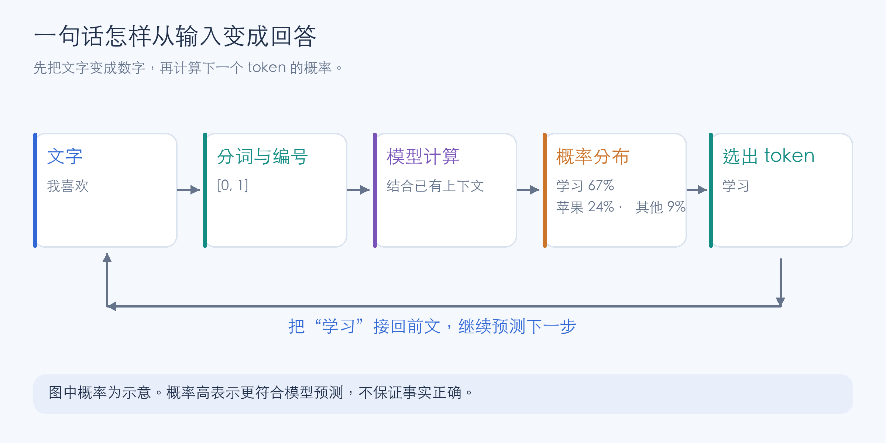

*图 1 从文字到概率，再把新 token 接回输入。*

语言模型（language model）的基本任务是根据前文预测接下来出现的内容。例如，输入“今天的天气很”，模型可能给“好”“冷”等候选片段不同的概率。选出一个片段后，把它加到前文，再预测下一步。

```text
今天的天气很
今天的天气很好
今天的天气很好，
今天的天气很好，我们
……
```

这种“生成一个、接回输入、继续生成”的方式叫自回归生成（autoregressive generation）。生成的基本单位是 token，中文叫词元。一个 token 可能是一个字、一个词、一个词的一部分，也可能是字节片段；它不固定等于一个汉字或一个英文单词。

模型对下一个 token 的预测会利用前文。随着模型和训练（training）规模扩大，这个任务可以促使模型学到语法、知识关联、代码模式等复杂规律。不过，概率高不代表事实正确：错误信息也可能具有非常自然的语言形式。

**训练与使用的区别：**训练会根据数据调整模型参数（model parameters）；普通生成通常固定参数（parameters），用输入和已有输出继续计算。聊天记录进入上下文（context），不等于模型已经通过训练永久记住这些内容。

对应原文：[第 10 章推理](https://github.com/datawhalechina/diy-llm/tree/main/docs/zh/chapter10)、[第 13 章训练流程](https://github.com/datawhalechina/diy-llm/tree/main/docs/zh/chapter13)。

## 2 分词器如何把文字变成数字

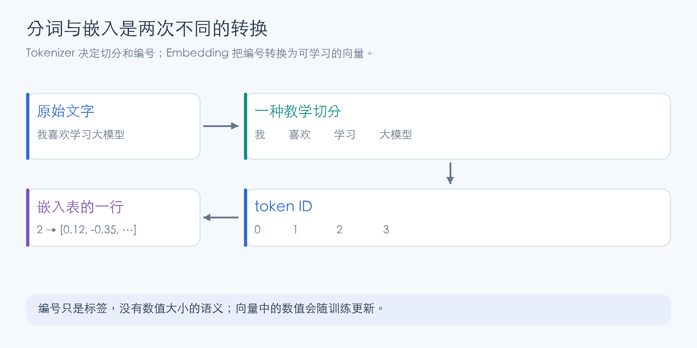

*图 2 分词器（tokenizer）输出编号，嵌入层（embedding layer）再将编号转换为向量（vector）。*

计算机需要用数值表示文字。Tokenizer，也就是分词器，负责切分文字并分配编号。

假设有一张教学词表（vocabulary）：

| token | 编号 |
| --- | --- |
| 我 | 0 |
| 喜欢 | 1 |
| 学习 | 2 |
| 大模型 | 3 |

那么“我喜欢学习大模型”就可以编码为 `[0, 1, 2, 3]`。从文字得到编号叫 encode，从编号恢复文字叫 decode。编号只是标识，不存在“编号 2 的含义是编号 1 的两倍”这种关系。

词表大小叫 vocabulary size。词表较小，很多表达需要拆成更多 token，序列可能变长；词表较大，表示同一文本可能更紧凑，但嵌入表（embedding table）和输出层（output layer）也可能更大。具体效果取决于语料和分词（tokenization）算法。

### BPE 的核心思想

BPE（Byte Pair Encoding，字节对编码）可以理解为反复合并常见的相邻单位。例如，从字符开始处理 `low`、`lower` 等文本时，如果 `l` 与 `o` 经常相邻，就先合并成 `lo`，后续可能继续合并成 `low`。实际合并顺序由统计频率和实现规则决定。

训练（training）分词器，主要是在学习词表与切分规则；训练语言模型（language model），是在调整神经网络（neural network）参数（parameters）。这是两个不同的过程。语言模型通常使用已经确定的分词器，模型权重（weights）和分词器必须匹配。

对应原文：[第 2 章分词器](https://github.com/datawhalechina/diy-llm/tree/main/docs/zh/chapter2)。

## 3 向量和张量是什么

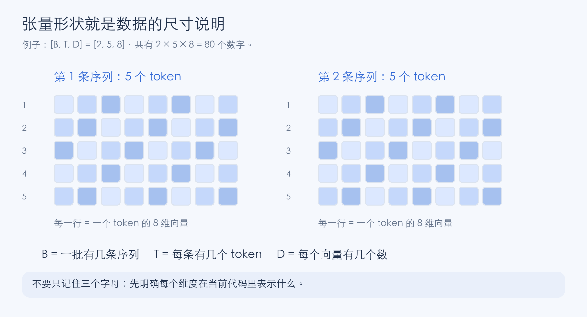

*图 3 两条序列，每条五个位置，每个位置八个数。*

向量（vector）可以先看成一排数字，例如 `[0.2, -0.5, 0.8]`。矩阵（matrix）是多排数字组成的表。张量（tensor）是更一般的多维数字数组。

模型不能直接把 token 编号当作有意义的大小关系使用。Embedding，嵌入层，会根据编号查表，得到一个向量：

```text
token ID 2 → [0.12, -0.35, 0.81, 0.04]
```

这张表里的数值会随着训练（training）调整。它们共同构成 token 的表示，每一维通常没有人工规定的、固定不变的含义。

### 怎样读懂 shape

Shape 表示张量各个维度的大小。例如：

```text
[batch_size, sequence_length, hidden_size]
[2,          5,               8]
```

意思是一次处理 2 条序列，每条有 5 个 token，每个位置用 8 个数字表示。总共有 `2 × 5 × 8 = 80` 个数。

token ID 的输入常是 `[B, T]`，查过嵌入表（embedding table）后变成 `[B, T, D]`。这里 B 是批次大小（batch size），T 是序列长度（sequence length），D 是向量维度。

矩阵乘法（matrix multiplication）是神经网络（neural network）中的基本计算。例如，一个长度为 3 的向量乘一个 `3 × 2` 的矩阵，可以得到长度为 2 的向量。矩阵中的权重（weights）决定怎样把输入数字组合成输出数字。

对应原文：[第 3 章 PyTorch 与资源核算](https://github.com/datawhalechina/diy-llm/tree/main/docs/zh/chapter3)。

## 4 神经网络中的参数和学习

一个最简单的数值模型可以写成：

```text
预测结果 = w × 输入 + b
```

w 和 b 是参数（parameters），也就是可以通过训练（training）调整的数字。如果输入是 2，目标是 5，当前 w=1、b=0，那么模型只能预测 2。训练的目的就是根据错误调整 w、b，使预测更接近目标。

真实语言模型（language model）包含大量矩阵（matrix）和非线性（nonlinear）计算，参数可能达到数十亿。基本逻辑仍然是：用当前参数计算预测，对照目标衡量错误，再调整参数。

“7B 参数”的 B 表示 billion，即十亿；7B 约为 70 亿个参数。这不等于有 70 亿条可单独查询的知识。

PyTorch 是帮助编写这类模型的工具。它提供张量（tensor）计算、神经网络（neural network）组件和自动求导（automatic differentiation, autograd）。自动求导负责计算参数对损失（loss）的影响，开发者不必手工推导整个网络的每一个导数（derivative）。

对应原文：[第 3 章](https://github.com/datawhalechina/diy-llm/tree/main/docs/zh/chapter3)。

## 5 Transformer 怎样利用上下文

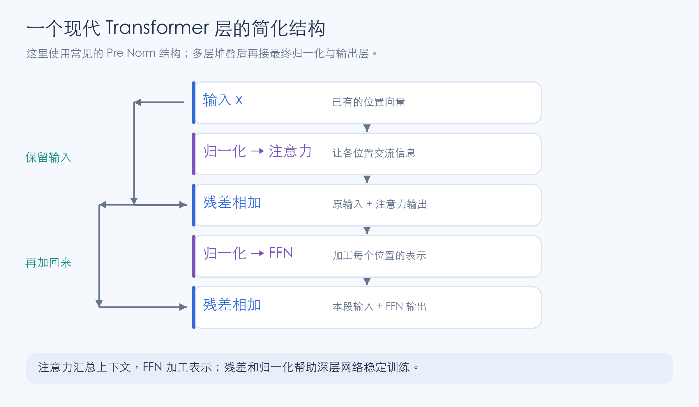

*图 4 一个常见 Pre Norm 模型层的结构，箭头表示数据流。*

Transformer 是一种神经网络（neural network）架构。仓库作业 1 使用小型语言模型（language model），让输入序列经过若干层计算，再预测下一个 token。不能把原始论文中的完整编码器（encoder）与解码器（decoder）结构直接等同于所有现代语言模型。

一条简化的数据流是：

```text
token 编号
   ↓ 嵌入层
每个位置的向量
   ↓ 多层 Transformer
结合上下文后的向量
   ↓ 输出层
词表中每个候选 token 的分数
   ↓ softmax
下一个 token 的概率
```

### 注意力机制

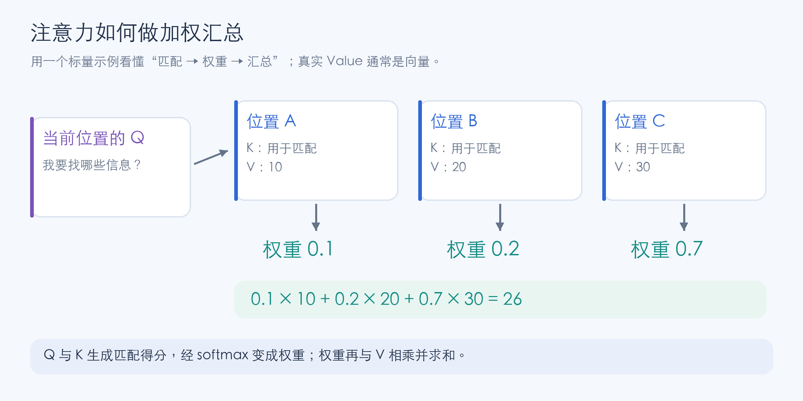

*图 5 先算相关程度，再按权重（weights）汇总 Value。*

读“小明把书递给小红，因为她想看”时，理解“她”需要联系前文。自注意力（self-attention）让每个位置根据与其他位置的关联程度，汇总相关信息。

每个位置的表示经过不同的线性变换（linear transformation），形成三种向量（vector）：

| 名称 | 直观含义 |
| --- | --- |
| Q，Query | 当前位置用来寻找信息的查询 |
| K，Key | 每个位置提供的匹配线索 |
| V，Value | 匹配后要汇总的实际信息 |

Q 和 K 的匹配得分经过缩放、遮罩（mask）和 softmax，变成权重；再用这些权重对 V 加权求和。

例如，三个位置对应的 V 是 10、20、30，注意力（attention）权重是 0.1、0.2、0.7，汇总结果就是：

```text
0.1 × 10 + 0.2 × 20 + 0.7 × 30 = 26
```

真实的 V 通常是向量，但加权汇总的思想一样。权重是模型算出来的，不是人提前为每句话标好的。

常见公式是 `Attention(Q,K,V) = softmax(QKᵀ / √d + mask)V`。QKᵀ 计算匹配分数，除以 √d 控制数值尺度，mask 遮住不允许看的位置，softmax 将分数转为权重，最后乘 V 完成汇总。

### 多头注意力

多头注意力（multi-head attention）并行（parallel）计算多组注意力，再合并结果。不同头能学习不同的关联模式，但不能预先规定“第一个头负责语法，第二个头负责情绪”。

### 因果遮罩

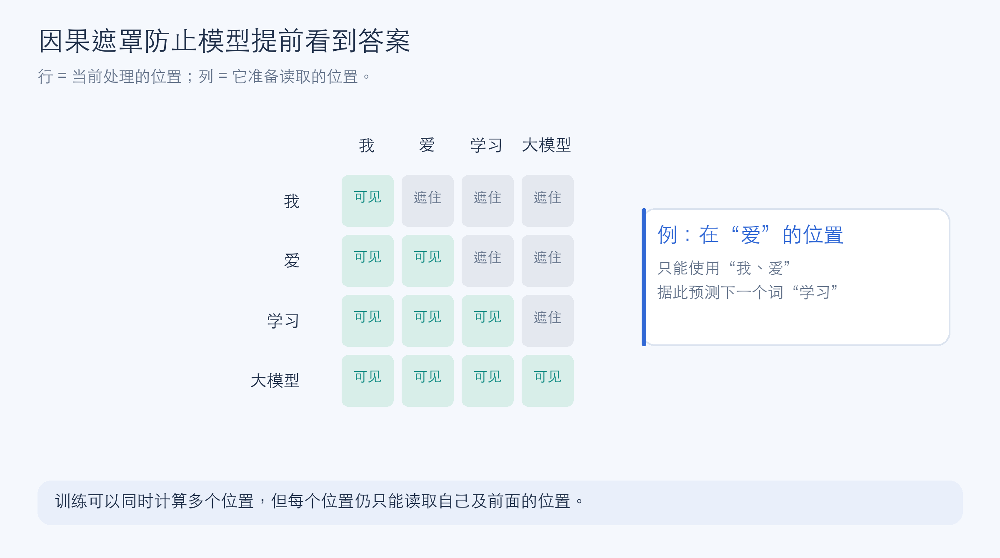

*图 6 下三角区域可见，右上角的未来位置被遮住。*

自回归（autoregressive）模型预测下一个 token 时，不能提前看到未来答案。假设原文是“我 爱 学习”，预测“爱”时只能使用“我”，不能看见后面的“爱 学习”。因果遮罩（causal mask）用来阻止这种信息泄漏（information leakage）。

训练（training）时答案已经存在，因此可以在一次计算中处理多个位置，但每个位置仍然受遮罩限制。生成时下一个 token 尚未确定，所以通常需要逐步生成。

### 一个模型层里的其他部件

| 部件 | 作用 |
| --- | --- |
| 位置信息（positional information） | 使模型能够利用 token 的位置和相对顺序 |
| FFN 前馈网络（feed-forward network） | 对每个位置的向量进一步做非线性（nonlinear）加工 |
| 残差连接（residual connection） | 通过 `x + F(x)` 保留直接传递的路径，帮助深层网络训练 |
| 归一化（normalization） | 调整数值尺度，帮助稳定训练 |

RoPE（Rotary Position Embedding，旋转位置编码）通过旋转查询和键（queries and keys）的表示引入位置信息。RMSNorm（Root Mean Square Normalization，均方根归一化）是归一化方法之一，不进行与 LayerNorm（Layer Normalization，层归一化）完全相同的减均值操作。SwiGLU 是常见的门控前馈网络（gated feed-forward network）形式。它们分别解决不同环节的问题，并非三种互相替代的完整模型。

对应原文：[第 4 章模型架构](https://github.com/datawhalechina/diy-llm/tree/main/docs/zh/chapter4)。

## 6 语言模型怎样训练

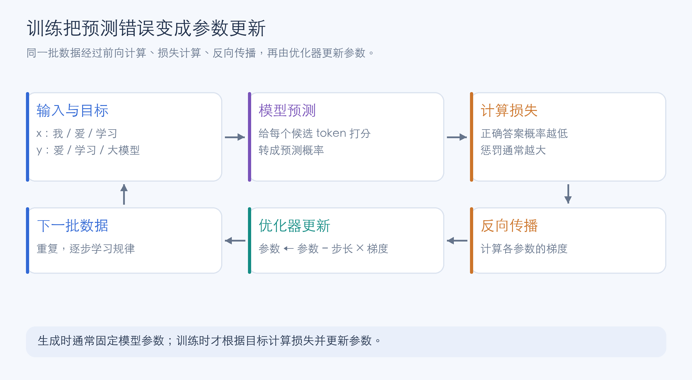

*图 7 损失（loss）通过反向传播（backpropagation）影响参数（parameters），循环执行形成训练（training）。*

### 训练目标从哪里来

对于文本“我 爱 学习 大模型”，可以把相邻位置对齐：

```text
输入 x：我    爱    学习
目标 y：爱    学习  大模型
```

在因果遮罩（causal mask）下，第一个位置根据“我”预测“爱”，第二个位置根据“我 爱”预测“学习”，第三个位置根据“我 爱 学习”预测“大模型”。

目标直接来自文本，因此不需要为每个位置额外请人写答案。这叫自监督学习（self-supervised learning）。

### 损失怎样衡量错误

交叉熵（cross-entropy）是语言模型（language model）常见的损失。对一个正确目标，它会惩罚模型赋给正确 token 的概率过低。单个目标的形式可以写成 `loss = -ln(p)`，其中 p 是正确 token 的概率。

| 正确 token 的概率 | 对应损失约为 |
| --- | --- |
| 0.9 | 0.105 |
| 0.5 | 0.693 |
| 0.1 | 2.303 |

模型越不相信正确答案，惩罚越大。实际训练通常会对许多有效位置的损失求平均，并忽略不参与训练的位置。

### 梯度与反向传播

梯度（gradient）描述参数变化对损失的影响。反向传播利用链式法则（chain rule），把最终损失对各个参数的导数（derivative）算出来。

最简单的梯度下降（gradient descent）可以写成：

```text
新参数 = 旧参数 - 学习率 × 梯度
```

学习率（learning rate）控制更新幅度。太大可能跳过较好的区域甚至使训练不稳定；太小可能进展缓慢。AdamW 是常见优化器（optimizer），会根据梯度历史调整更新，并加入权重衰减（weight decay）。

### 训练循环

```python
# PyTorch 风格示意，需要事先定义模型、优化器和数据
for x, y in data_loader:
    optimizer.zero_grad()       # 清除上次累积的梯度
    logits = model(x)           # 前向计算，得到候选 token 的分数
    loss = compute_loss(logits, y)
    loss.backward()            # 计算梯度
    optimizer.step()           # 更新参数
```

一次完整更新通常称为一个 step；遍历训练数据一遍称为一个 epoch。Batch size 是一次送入计算的样本（sample）数。使用梯度累积（gradient accumulation）时，多次小批次（mini-batch）的前向和反向计算才进行一次更新，因此小批次数与更新次数不一定相同。

Checkpoint 是保存的训练状态（training state）。只保存模型权重（weights）可以用于加载生成；要更完整地恢复训练，通常还需要优化器状态（optimizer state）、训练步数等信息。

对应原文：[第 3 章](https://github.com/datawhalechina/diy-llm/tree/main/docs/zh/chapter3)、[作业 1 训练代码](https://github.com/datawhalechina/diy-llm/blob/main/coursework/assignment1-basics/train.py)。

## 7 预训练和微调分别改变什么

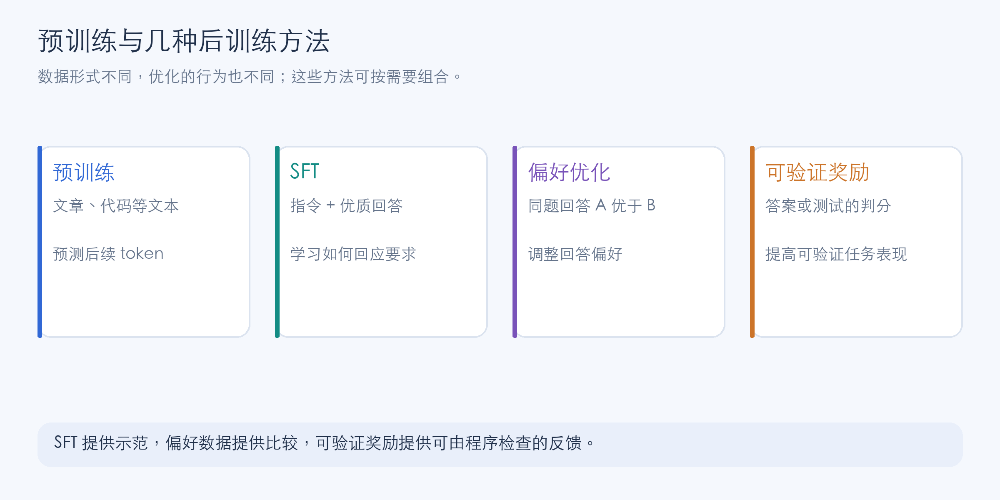

*图 8 四种数据和反馈形式，对应不同的训练（training）目标。*

### 预训练

预训练（pre-training）使用大量文本进行预测任务，使模型学习广泛的语言和内容规律。数据可以包含文章、代码、数学等。仅有预训练目标，并不能保证模型形成稳定的问答格式或满足用户要求。

### SFT 监督微调

SFT（supervised fine-tuning，监督微调）使用指令（instruction）与优质回答等示例，例如：

```text
用户：把“苹果”翻译成英语。
助手：apple。
```

模型通过这些示例学习如何回应指令。常见对话 SFT 会重点计算助手回答部分的损失（loss），具体掩码（mask）由训练实现决定。SFT 不只是固定格式，也可能学习任务知识和行为。

### 偏好优化与 RLHF

对于同一个问题，人们可以比较回答 A、B 哪个更好。传统 RLHF（reinforcement learning from human feedback，基于人类反馈的强化学习）流程利用偏好数据（preference data）训练奖励模型（reward model），再通过 PPO（Proximal Policy Optimization，近端策略优化）等强化学习算法调整语言模型（language model）。奖励模型给出的是对偏好的近似评分，并不是真理判断器。

DPO（Direct Preference Optimization，直接偏好优化）则可以直接使用偏好对（preference pair）优化语言模型，无须按传统 PPO 流程另行训练一个显式奖励模型并进行在线强化学习（online reinforcement learning）。

### RLVR 和 GRPO

RLVR（reinforcement learning with verifiable rewards，可验证奖励的强化学习）使用可由程序验证的奖励（reward），例如数学答案是否匹配、代码是否通过测试。它减少了部分任务对人工偏好评分的依赖，但验证器（verifier）可能有漏洞，答案正确也不代表每一步解释都正确。

GRPO（Group Relative Policy Optimization，组相对策略优化）的一个关键想法是：对同一道题生成一组回答，根据组内奖励计算相对表现，用于更新模型。常见形式不依赖 PPO 中单独训练的价值网络（value network）。若一组回答获得相同奖励，通常难以从组内差异获得有效信号。

这些方法可以组合成不同训练流程，并非每个模型都必须依次使用所有阶段。

对应原文：[第 13 章](https://github.com/datawhalechina/diy-llm/tree/main/docs/zh/chapter13)、[第 14 章](https://github.com/datawhalechina/diy-llm/tree/main/docs/zh/chapter14)。

## 8 数据质量为什么影响模型能力

模型从数据中学习。重复、乱码、错误、广告和不合适的内容会影响训练（training）效果，数据覆盖不足也会限制模型在相应领域的表现。

常见处理流程是：获取文本，提取正文，做语言和质量过滤（quality filtering），去除重复，处理个人信息，再组合不同来源的数据。过滤规则必须与目标相关；过于激进的规则也可能误删有价值的内容。

精确去重（exact deduplication）处理完全相同的内容。近似去重（near-duplicate deduplication）处理改了少量文字、格式或标点的相似内容。MinHash 等方法能用较小的摘要估计集合相似性，帮助大规模筛选近似重复文本，但它不是对语义（semantics）等价的完美判断。

数据配比（data mixture）也很重要。代码、中文、英文、数学等内容所占比例，会影响模型接触不同模式的机会。

评测（evaluation）题或答案混进训练数据叫数据污染（data contamination）。模型可能因为见过答案而获得高分，导致评测结果高估它对新问题的能力。

对应原文：[第 11 章数据工程](https://github.com/datawhalechina/diy-llm/tree/main/docs/zh/chapter11)。

## 9 怎样判断模型有没有学好

训练集（training set）用于更新参数（parameters）；验证集（validation set）用于观察泛化（generalization）并选择配置；测试集（test set）用于最终评价，应避免反复根据它调参（hyperparameter tuning）。

训练损失（training loss）持续下降，验证损失（validation loss）却上升，是过拟合（overfitting）的常见信号。模型越来越适应训练（training）数据，但对未见数据的表现变差。它类似记住了练习卷，却没有掌握处理新题的规律。

困惑度（perplexity） PPL 常写成 `exp(平均交叉熵)`，这里交叉熵（cross-entropy）使用自然对数。相同评估（evaluation）条件下，PPL 更低通常表示对实际文本的预测更好。不同分词器（tokenizer）、文本或统计方式得到的数字，不宜直接比较。

基准测试（benchmark）分别检查不同能力：知识问答、数学、代码、指令遵循（instruction following）等。单个分数不能概括所有用途。正式比较要尽量固定模型版本、提示（prompt）、样本（sample）范围、生成与评分设置。少量样本跑通评测（evaluation），只能证明流程基本可运行。

模型输出的流畅程度、事实准确率、任务完成率、延迟（latency）和成本，是不同指标。例如回答很快但错误很多，不能因为速度好就认为整体质量好。

对应原文：[第 12 章评估](https://github.com/datawhalechina/diy-llm/tree/main/docs/zh/chapter12)、[作业 6](https://github.com/datawhalechina/diy-llm/tree/main/coursework/assignment6-evaluation)。

## 10 生成参数和缓存怎样影响回答

输出层（output layer）先产生 logits，即每个候选 token 的未归一化（unnormalized）分数。Softmax 将它们转换为总和为 1 的概率，再由生成策略选出 token。

| 生成方式 | 含义 |
| --- | --- |
| 贪心选择（greedy decoding） | 每次选择概率最高的 token |
| 温度（temperature） | 调整概率分布的集中程度，常见形式是将 logits 除以温度再做 softmax |
| Top K | 仅在概率最高的 K 个候选中采样（sampling） |
| Top P | 保留累计概率达到阈值的一组高概率候选，再采样 |

温度较低通常让分布更集中，较高通常让选择更分散。提高温度不保证更有创意，降低温度也不保证事实正确。生成一般在输出结束标记（end-of-sequence token, EOS）或达到长度限制时停止。

### Prefill 和 Decode

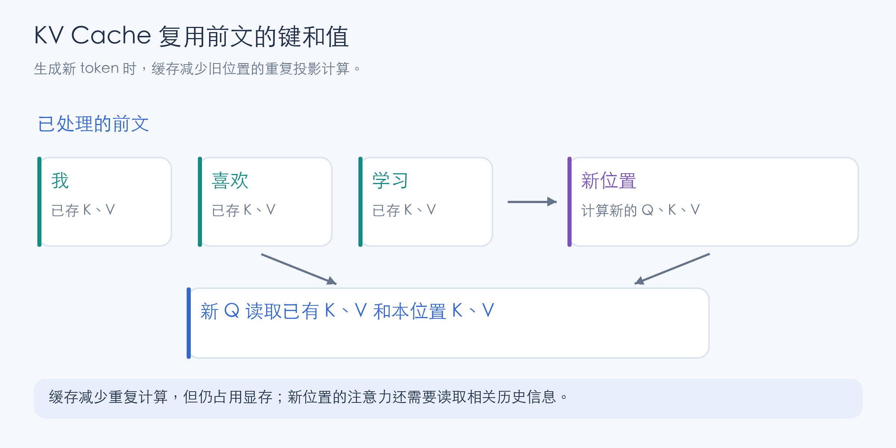

*图 9 旧位置的 K、V 可以复用，新位置仍需计算并读取上下文（context）。*

Prefill 处理输入提示（prompt），为已有上下文计算表示并建立缓存（cache）。Decode 根据上下文生成后续 token。长提示可能使第一个 token 出现得较慢；生成很长的回答，则需要经历更多生成步骤。

KV Cache（key-value cache，键值缓存）缓存先前位置在各层的键和值（keys and values），避免每一步重新计算这些投影（projection）。新 token 仍需读取相关缓存并计算注意力（attention），因此缓存不会让长上下文的成本消失。序列变长、并发（concurrency）增加时，缓存会占用更多显存（GPU memory）和带宽（bandwidth）。

首 token 延迟（time to first token, TTFT）衡量等多久开始看到回答，token 间延迟（inter-token latency）衡量后续输出速度，吞吐量（throughput）衡量系统单位时间完成多少工作。三者不能互相替代。

对应原文：[第 10 章推理](https://github.com/datawhalechina/diy-llm/tree/main/docs/zh/chapter10)。

## 11 GPU 和显存为什么重要

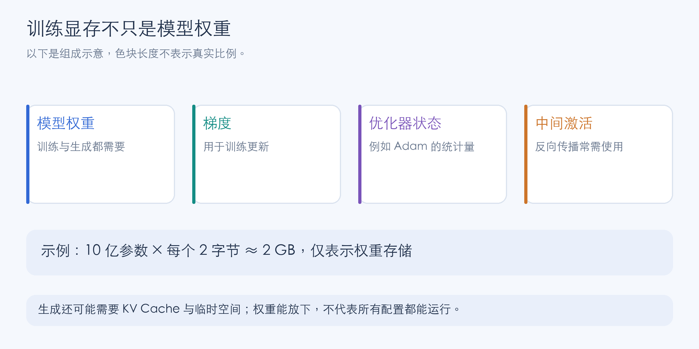

*图 10 训练（training）需要保存权重（weights）以外的状态（state），生成则常增加 KV Cache（key-value cache，键值缓存）。*

语言模型（language model）大量使用矩阵（matrix）运算。GPU 能并行（parallel）执行很多数值计算，适合这种工作。CPU 更擅长通用控制和多样任务，二者通常协作完成训练或服务。

模型运行同时受计算速度、存储容量和数据传输速度影响。“算得慢”和“数据搬不过来”是两种不同瓶颈（bottleneck）。

### 权重占多少空间

假设有 10 亿个参数（parameters），每个使用 2 字节存储，仅权重就约需 20 亿字节，即 2 GB，约 1.86 GiB。实际运行还需要其他空间。

训练时常要保存梯度（gradient）、优化器状态（optimizer state）和中间激活（intermediate activations）；生成时还可能需要 KV Cache。因此，权重能放下，不代表相应训练或长上下文（long context）生成一定能运行。

FP32（32-bit floating point，32 位浮点）通常每个数占 4 字节，FP16（16-bit floating point，16 位浮点）和 BF16（bfloat16, brain floating point，脑浮点 16 位）通常每个数占 2 字节。它们的数值范围和精度（precision）不同。混合精度（mixed precision）会在不同操作中使用合适的精度，以平衡速度、内存和稳定性。

量化（quantization）将部分数值用更少位表示，并结合缩放等规则恢复近似值。它可以降低存储和带宽（bandwidth）开销，但效果和加速程度依赖量化方法、硬件与内核（kernel），也可能影响质量。

### 三种常见优化

FlashAttention 通过分块（tiling）和优化数据搬运，避免保存完整的大型注意力（attention）中间矩阵，在数值舍入差异内计算同一种标准注意力。它不是单纯把注意力改成一个粗略近似。

算子融合（operator fusion）将若干计算组合起来，减少启动和中间结果读写开销。重计算（recomputation, activation checkpointing）则少保存一些中间激活，在反向传播（backpropagation）需要时重新计算，用额外计算换取显存（GPU memory）。

CUDA 和 Triton 用于编写更底层的 GPU 计算内核。性能分析（profiling）工具帮助定位具体耗时；GPU 存在异步执行（asynchronous execution），计时通常需要预热（warm-up）并正确同步。

对应原文：[第 3 章](https://github.com/datawhalechina/diy-llm/tree/main/docs/zh/chapter3)、[第 6 章](https://github.com/datawhalechina/diy-llm/tree/main/docs/zh/chapter6)、[第 7 章](https://github.com/datawhalechina/diy-llm/tree/main/docs/zh/chapter7)。

## 12 多张 GPU 怎样一起训练

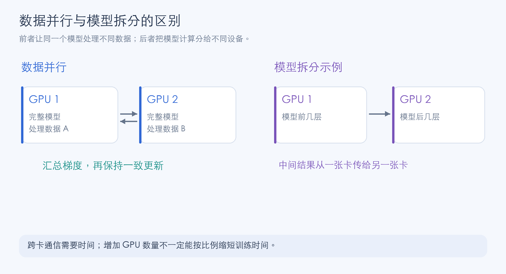

*图 11 数据并行（data parallelism）复制模型；图右以流水线方式拆分模型层。*

数据并行让每张 GPU 放一份模型，处理不同数据，再汇总梯度（gradient），保持更新一致。例如两张卡分别计算梯度 2 和 4，取平均后两张卡都用 3 作为对应梯度进行更新，这是简化示例。

模型太大时，也可以拆开模型：张量并行（tensor parallelism）把某些矩阵（matrix）计算分给不同设备；流水线并行（pipeline parallelism）把不同层分给不同设备，再组织微批次（micro-batch）流动。两者都会引入通信（communication）与调度成本。

ZeRO（Zero Redundancy Optimizer，零冗余优化器）的关键是减少不同设备之间重复保存的训练状态（training state）：Stage 1 分片（sharding）优化器状态（optimizer state），Stage 2 进一步分片梯度，Stage 3 再分片参数（parameters）。FSDP（Fully Sharded Data Parallel，全分片数据并行）也通过参数等状态（state）的分片减少每张卡的存储压力，计算时按需通信。

All Reduce 可以让各设备取得合并后的结果；All Gather 汇集各设备的分片；Reduce Scatter 先归约再把结果分片。真实集体通信（collective communication）不一定通过某一台中央机器完成。

GPU 数量增加时，通信和等待也会增加，所以两张卡不必然带来两倍速度。

对应原文：[第 8 章分布式训练](https://github.com/datawhalechina/diy-llm/tree/main/docs/zh/chapter8)。

## 13 MoE 为什么能有很多参数但只使用一部分

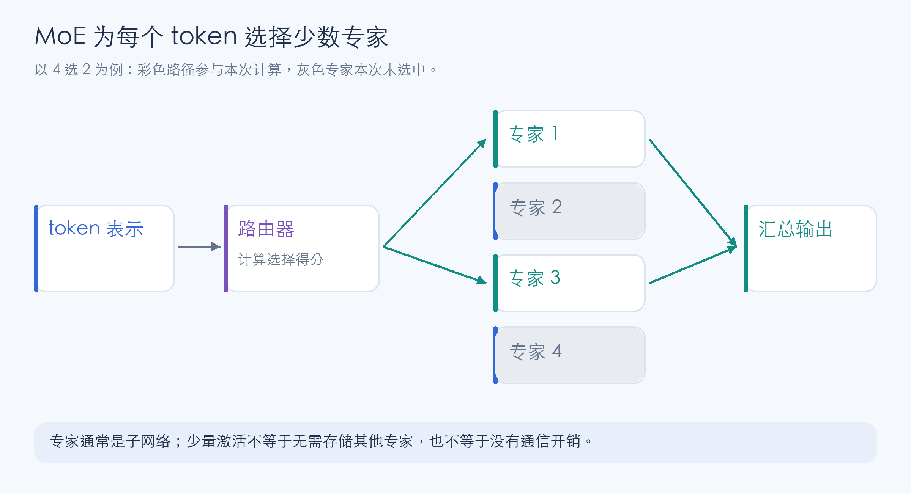

*图 12 路由器（router）为当前 token 选择两个专家（expert），其他专家本次不参与。*

MoE 是 Mixture of Experts，即混合专家模型。常见做法是在某些前馈模块中设置多个专家网络，再由路由器为每个 token 选择少数专家参与计算。

例如有 8 个专家，每个 token 选择其中 2 个。不同 token 可以走不同路径。这样，总参数量（total parameter count）可以很大，而单个 token 激活的专家参数（parameters）只是其中一部分；注意力（attention）等其他模块仍然可能照常计算。

专家是可学习的子网络，不是预先写好的“数学老师”“文学老师”。训练（training）过程中可能出现不同模式，但不能仅凭名称推定它们的固定分工。

路由（routing）如果总把 token 送到少数专家，会使部分设备繁忙、部分闲置。因此需要负载均衡（load balancing）。专家跨设备分布时，还需要通信（communication）。MoE 降低部分计算开销，并不代表所有权重（weights）都不需要存储。

对应原文：[第 5 章](https://github.com/datawhalechina/diy-llm/tree/main/docs/zh/chapter5)。

## 14 缩放定律说明什么

模型参数量（model parameter count）、训练（training） token 数和计算预算（compute budget）相互制约。固定预算下，模型太大而数据不足，可能训练不充分；模型太小，也可能限制效果。缩放定律（scaling laws）通过小规模实验拟合这些量与损失（loss）的经验关系，用来指导资源分配。

一个常见形式是 `L(N,D) = E + A/N^α + B/D^β`：N 是参数（parameters）规模，D 是训练 token 数，其他量是拟合常数。它表示在拟合适用的范围内，增加模型或数据可减少相应损失项，但收益逐渐减小。

常见训练计算量粗估是 `C ≈ 6ND`，适用于一定假设下的稠密（dense） Transformer 训练估算，不包含所有架构和工程开销。它不是计时器；实际时间还依赖有效硬件利用率（hardware utilization）和通信（communication）。

“每个参数对应约 20 个训练 token”来自特定计算最优（compute-optimal）研究背景，不能当作所有模型都适用的训练门槛。数据质量（data quality）、架构以及后续推理成本（inference cost）都会改变最佳选择。

对应原文：[第 9 章缩放定律](https://github.com/datawhalechina/diy-llm/tree/main/docs/zh/chapter9)。

## 15 多模态模型怎样接入图像

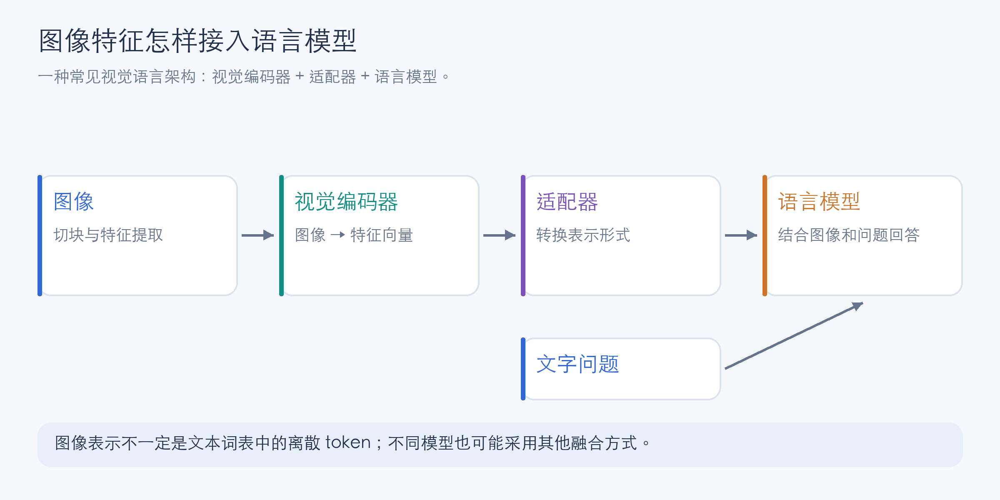

*图 13 一种常见视觉语言模型（vision-language model, VLM）中的图像与文字输入路径。*

多模态模型（multimodal model）可以处理文字之外的图像、音频等信息。一种常见视觉语言架构是：

```text
图像 → 视觉编码器 → 适配器 → 与文字表示一起送入语言模型
```

视觉编码器（vision encoder）把图像变成特征（features），适配器（adapter）把这些特征转换到语言模型（language model）能够使用的表示空间（representation space）。模型再结合问题文字生成回答。不同系统可能采用其他融合方式。

CLIP（Contrastive Language-Image Pre-training，对比式图文预训练）通过图像和文本配对学习表示：让匹配的图文表示更接近，不匹配的更远。它适合做图文匹配等任务，但仅有这种训练（training）并不等于拥有会写长回答的聊天助手（chat assistant）。

图像也可以被拆成 patch，也就是小块，再转换成向量（vector）。这里扩展了“序列表示”的思想，但图像特征并不一定是与文本词表（vocabulary）相同的离散 token。

对应原文：[第 15 章多模态模型](https://github.com/datawhalechina/diy-llm/tree/main/docs/zh/chapter15)。

## 16 一段完整例子把各环节串起来

假设用户输入“我喜欢”，教学词表（vocabulary）是 `[我, 喜欢, 学习, 苹果]`，对应编号 `[0,1,2,3]`。

第一步，分词器（tokenizer）把输入编码为 `[0,1]`。第二步，嵌入层（embedding layer）为两个编号分别取出向量（vector），例如形成 `[1,2,4]` 的张量（tensor）：1 条序列、2 个 token、每个向量 4 维。

第三步，Transformer 处理这些表示。在“喜欢”的位置，模型能够利用“我”和“喜欢”的信息。第四步，输出层（output layer）为四个候选 token 打分，例如：

```text
我     喜欢   学习   苹果
-1.0   -0.5   2.0    1.0
```

Softmax 转成的概率约为 `[0.033, 0.055, 0.667, 0.245]`。若贪心选择（greedy decoding），就输出“学习”。新的文本变成“我喜欢学习”，随后继续生成。

如果这是训练（training）样本（sample），原文的下一个 token 正好是“学习”，就用其概率 0.667 计算这一位置的损失（loss），约为 `-ln(0.667) ≈ 0.405`。反向传播（backpropagation）计算梯度（gradient），优化器（optimizer）调整参数（parameters）。实际训练会汇总许多位置和样本，而不是只看这一处。

**生成时选择输出，训练时根据正确目标更新参数。**这是同一模型两种用途之间最重要的区别。

## 17 仓库代码中的具体对应关系

| 文件或目录 | 内容 |
| --- | --- |
| `docs/zh/` | 中文理论讲解 |
| `coursework/assignment1-basics/CS336_Assignment1_BPE.ipynb` | 分词器（tokenizer）实验 |
| `coursework/assignment1-basics/get_train_data.py` | 将训练文本转换为 token 二进制数据 |
| `coursework/assignment1-basics/model.py` | 模型定义与生成示例 |
| `coursework/assignment1-basics/train.py` | 数据加载、损失（loss）计算、参数（parameters）更新和保存 |
| `coursework/assignment6-evaluation/` | 评测框架（framework）示例 |

作业 1 的训练脚本在没有数据文件时会创建随机 token 数据。这能检查代码路径是否跑通，但随机数据没有自然语言（natural language）规律，不能据此期待生成有意义的故事。

生成示例默认读取 `ckpt/epoch_5.pt`。如果实际只保存了其他轮次，需要使用相应路径。训练与加载的词表（vocabulary）大小、模型维度、层数和注意力（attention）头数也应匹配。只改变训练命令中的配置而不调整加载端，会造成不一致。

相关代码：[数据处理](https://github.com/datawhalechina/diy-llm/blob/main/coursework/assignment1-basics/get_train_data.py)、[模型与生成](https://github.com/datawhalechina/diy-llm/blob/main/coursework/assignment1-basics/model.py)、[训练](https://github.com/datawhalechina/diy-llm/blob/main/coursework/assignment1-basics/train.py)。

## 18 常见概念对照

| 容易混淆的词 | 区别 |
| --- | --- |
| token 与 token ID | 前者是切分单位，后者是对应编号 |
| token ID 与 embedding | 前者是标识，后者是可学习的数值向量 |
| 参数（parameters）与超参数（hyperparameters） | 参数由训练（training）更新；学习率（learning rate）、层数等超参数由配置决定 |
| 上下文（context）与模型参数（model parameters） | 上下文是本次计算参考的信息；参数是模型保存的可学习数值 |
| 训练与推理（inference） | 训练根据目标更新参数；普通推理固定参数计算输出 |
| inference 与 reasoning | 前者泛指使用模型计算输出；后者通常指完成推理任务或相关过程 |
| 显存（GPU memory）与算力（compute） | 前者决定能存多少，后者表示计算能力；带宽（bandwidth）还决定数据传输速度 |
| loss 与任务正确率 | 前者对应特定优化目标；后者需要按具体任务评分 |
| 总参数（total parameters）与激活参数（active parameters） | 在 MoE（Mixture of Experts，混合专家）中，单个 token 使用的参数通常少于总参数 |
| 程序跑通与模型学会 | 前者只说明执行成功；后者需要真实数据、评估（evaluation）和生成表现支持 |

笔记依据仓库在 2026 年 10 月 29 日可读取的内容整理。概念解释与数值例子为便于零基础理解而重述；文件默认行为以所链接的当前代码为准。
