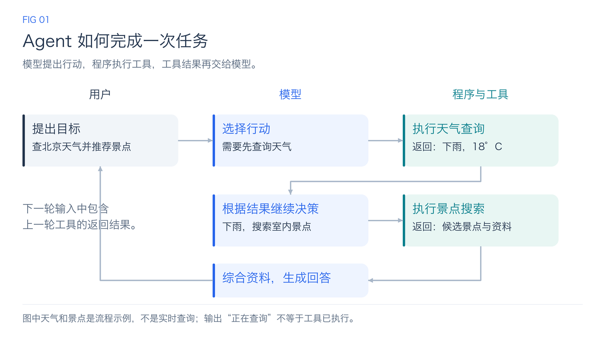
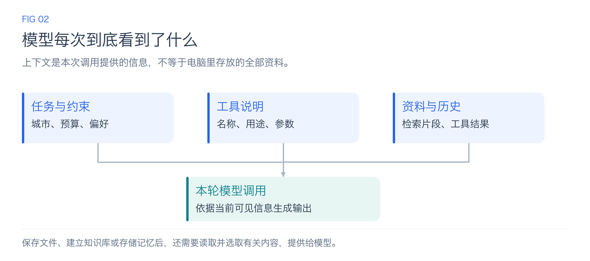
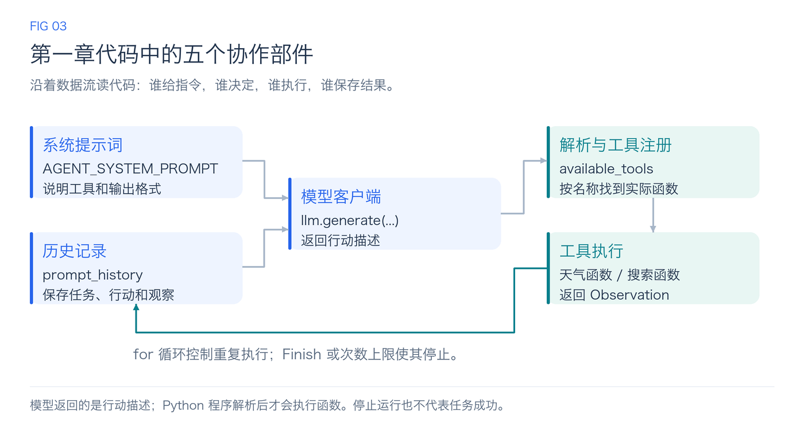
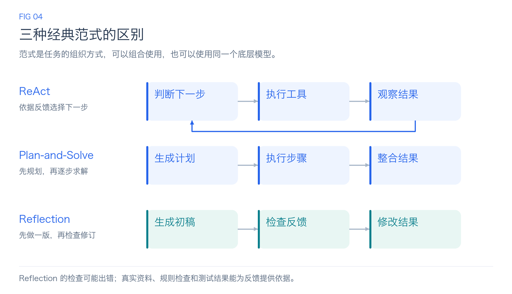
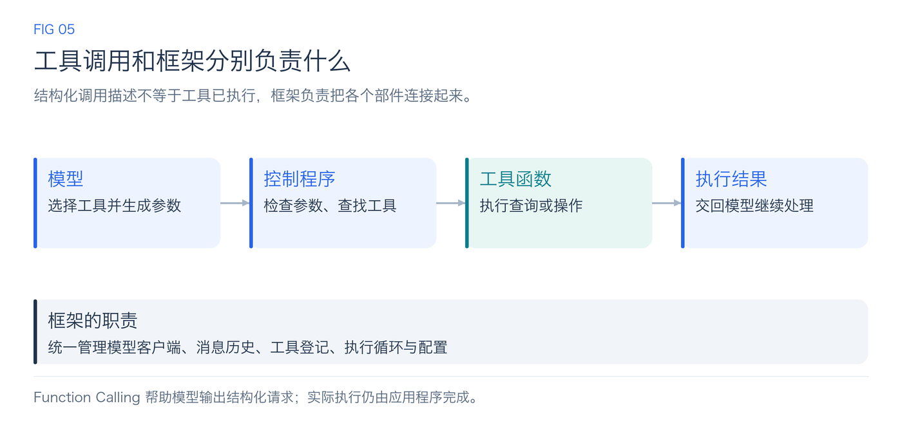
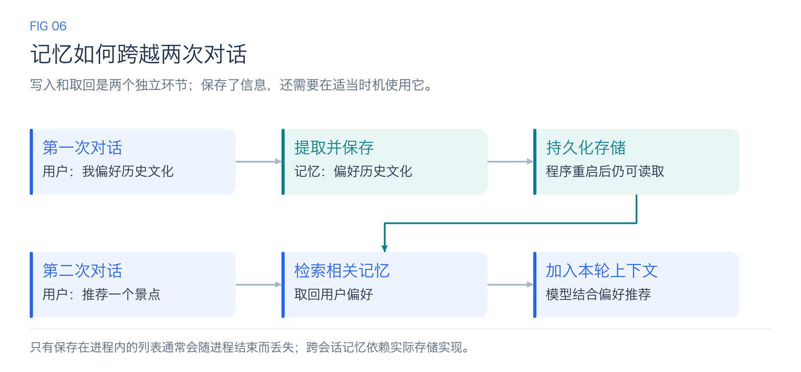
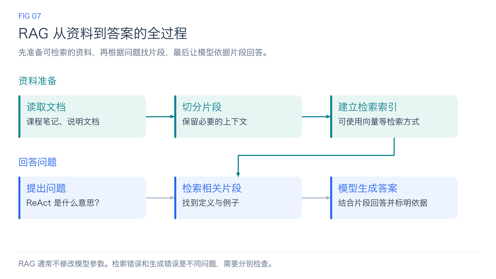
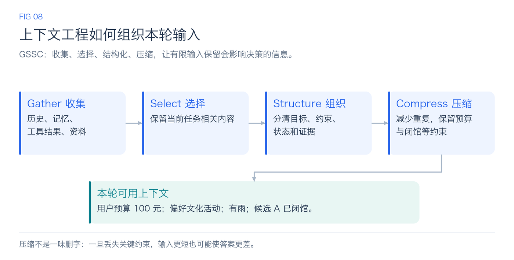
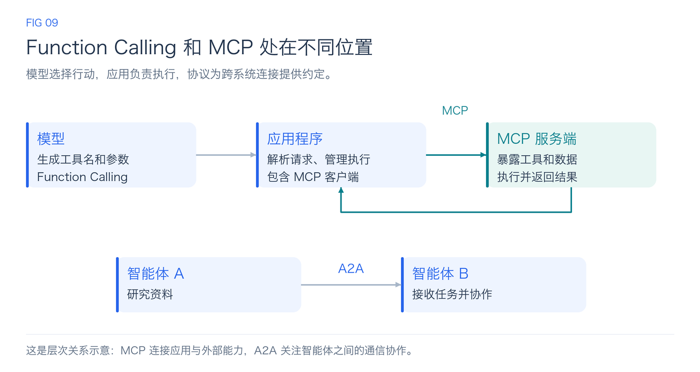
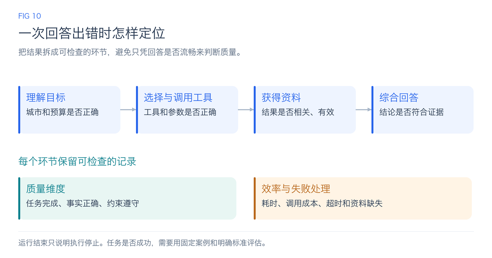

# Hello-Agents 零基础图文笔记

Agent（智能体）是能够围绕目标，根据已有信息选择行动（action）、执行行动并利用反馈（feedback）继续工作的系统。Hello-Agents 主要讨论由大语言模型（large language model, LLM）驱动的智能体：模型负责理解和决策（decision-making），程序负责连接工具（tool）、保存状态（state）和控制执行。

本文依据 [whicter/hello-agents](https://github.com/whicter/hello-agents) 的教程目录、核心章节和第一章代码整理。解释中的旅行情境和简化代码用于帮助理解，不代表实时查询结果。

## 1 智能体的基本概念

### 1.1 用旅行助手理解 Agent



*图 1　旅行助手中的决策（decision-making）、执行与反馈（feedback）。*

假设用户说：“查询北京今天的天气，再推荐适合的景点。”

这里有三个不同的角色：用户提出目标，模型选择下一步行动（action），程序执行具体操作。模型生成一句“正在查询天气”，并不意味着天气查询已经发生；必须看到工具（tool）实际执行并返回结果。

**Agent 的关键是反馈循环（feedback loop）：行动得到新信息，新信息影响下一步行动。**

### 1.2 模型和智能体的区别

大语言模型（Large Language Model，LLM）根据输入生成输出。智能体（agent）系统把模型放进一个更完整的运行机制中，使它能够使用工具、跟踪任务并持续执行。

| 组成部分 | 作用 | 旅行助手中的例子 |
| --- | --- | --- |
| 模型 | 理解目标，选择行动，整理结果 | 判断下雨时需要查找室内景点 |
| 工具 | 获取外部信息或执行操作 | 天气查询、景点搜索 |
| 状态（state） | 保存任务当前进展 | 已查询天气，还未搜索景点 |
| 控制程序 | 组织调用、执行工具、判断结束 | 执行循环，限制最多调用次数 |

“模型 + 工具 + 状态 + 控制循环”是理解这类智能体的实用方式，不是对所有智能体的严格数学定义。传统恒温器、导航系统等也可以从智能体的角度分析，它们不一定使用语言模型（language model）。

### 1.3 Workflow 和 Agent

Workflow 是预先安排好的工作流程；Agent 可以在程序允许的范围内，根据当前信息决定下一步。

| 维度 | Workflow | Agent |
| --- | --- | --- |
| 谁主要决定执行路径 | 开发者提前编排（orchestration） | 模型在运行时选择 |
| 例子 | 固定执行查天气、搜索、总结三个步骤 | 查询失败后决定换一种搜索方法 |
| 优势 | 流程明确，容易检查 | 能根据新信息调整 |
| 代价 | 意外情况通常需要补充分支 | 路径更不确定，可能重复或偏离目标 |

实际系统可以结合两者。例如，外层用固定流程控制任务阶段，某个阶段内部允许 Agent 自主选择工具。一个产品是否支持 Agent，要看具体执行机制，不能只根据产品名称判断。

来源：[第一章 初识智能体](https://github.com/whicter/hello-agents/blob/main/docs/chapter1/第一章%20初识智能体.md)。

## 2 大语言模型基础

### 2.1 模型为什么能生成回答

语言模型（language model）从大量训练（training）数据中学习语言和其他模式。在生成文字时，它根据当前上下文（context），逐步预测并生成后续 Token。

Token 是模型处理文本的单位，可能对应一个字、词的一部分或其他文本片段。不能简单认为一个 Token 永远等于一个汉字或一个英文单词。

这种生成能力使模型能够完成总结、问答、编程和一定程度的推理（reasoning），但流畅的表达不等于事实正确。

### 2.2 Transformer 和注意力

Transformer 是现代大语言模型（large language model, LLM）常用的基础架构。理解它时，可以先抓住“注意力（attention）”这个概念：模型处理某个位置的信息时，会计算其他位置与它的关联。

例如：“小明把雨伞给小红，因为她没有带伞。”要理解“她”指谁，需要结合句子中的其他信息。注意力机制（attention mechanism）提供了建立这些关联的一种计算方法。

这个类比帮助理解信息关联，不代表模型像人一样阅读，也不保证它每次都能判断正确。

### 2.3 Prompt 和 Context



*图 2　只有提供给本轮调用的信息，才是模型此刻可见的上下文。*

Prompt 是提供给模型的提示或指令（instruction）。一个明确的提示通常包含任务、约束（constraint）和输出要求。

```text
任务：根据查询到的天气和景点资料，推荐一个景点。
约束：用户偏好历史文化；预算不超过 100 元。
依据：以下是工具返回的天气和景点信息。
输出：景点名称、推荐理由、需要进一步确认的信息。
```

Context（上下文）是模型本次调用能看到的全部相关输入，范围通常比任务提示更广，还包括对话历史、工具（tool）说明、检索（retrieval）资料和工具返回结果。

**数据保存在电脑里，不代表模型已经看到它。程序需要读取、筛选并把相关内容提供给模型。**

### 2.4 API 调用的含义

API 是应用程序编程接口，可以理解为程序请求外部服务的一种约定。调用模型 API，就是程序把问题发送到模型服务，再接收返回结果。

| 配置 | 含义 |
| --- | --- |
| API Key | 访问服务的凭证 |
| Base URL | 服务的接口地址 |
| Model ID | 请求使用的模型标识 |
| messages | 发送给模型的消息列表 |

消息通常带有角色：`system` 提供系统指令，`user` 提供用户内容，`assistant` 表示模型回复。一些接口还用专门的工具消息传递执行结果；具体格式取决于接口。

### 2.5 幻觉

幻觉（hallucination）是模型生成了看起来合理、实际却错误或缺少依据的内容。例如，模型在没有查询的情况下，编造今天的天气或某景点的开放时间。

工具和检索可以提供依据，但不能自动消除所有错误。系统仍可能查错城市、检索到过期资料，或者在总结时曲解结果。

来源：[第三章 大语言模型基础](https://github.com/whicter/hello-agents/blob/main/docs/chapter3/第三章%20大语言模型基础.md)。

## 3 阅读示例代码需要理解的 Python

### 3.1 变量和字符串

变量给数据起一个名字。字符串是文本。

```python
city = "北京"
user_question = "今天适合去哪里玩？"
```

`city` 保存城市名称，后续代码通过这个名字取得内容。

### 3.2 列表和字典

列表保存一组按顺序排列的内容，适合记录任务历史。

```python
history = ["用户要求推荐景点"]
history.append("天气查询结果：下雨")
```

字典保存键和对应的值，适合按名字找到信息或工具（tool）。

```python
weather = {"city": "北京", "condition": "下雨"}
print(weather["condition"])
```

这里会打印“下雨”。

### 3.3 函数

函数把一段操作封装起来，便于重复调用。

```python
def get_weather(city):
    return f"{city}：下雨，18°C"

result = get_weather("北京")
print(result)
```

`def` 定义函数，`city` 是参数（parameters），`return` 返回结果，`f"...{city}..."` 把变量插入文字。这里返回的是模拟数据，并未联网。

### 3.4 工具注册

```python
tools = {"get_weather": get_weather}
result = tools["get_weather"]("北京")
```

字典里的 `get_weather` 没带括号，表示保存函数本身。最后一行带括号，表示执行函数。

这就是工具注册（tool registration）的基本思想：把一个工具名称对应到一个可执行函数。模型输出工具名称后，程序才能据此找到实际操作。

### 3.5 条件判断和循环

`if` 根据条件选择分支；`for` 重复执行代码；`break` 提前结束循环。

```python
for step in range(5):
    if task_finished:
        break
```

这是语法片段，`task_finished` 需要由其他代码定义。它表达的意思是：最多重复五次，如果任务已完成就提前停止。

`try / except` 用于处理异常（exception），例如网络请求失败。处理异常意味着程序可以记录错误或采取下一步措施，不代表请求已经成功。

## 4 第一章旅行助手的代码拆解



*图 3　提示词（prompt）、历史、模型客户端（client）、解析器（parser）和工具（tool）如何连接。*

### 4.1 系统提示词

`AGENT_SYSTEM_PROMPT` 告诉模型它是旅行助手，可以使用两个工具，并要求它用特定文本格式输出下一步行动（action）。

```text
Thought: 需要先获得北京天气。
Action: get_weather(city="北京")
```

这里的 Thought 是模型生成的解释性文本，不能当成模型内部计算过程的完整记录。Action 是供程序解析的行动描述。

### 4.2 两个工具

`get_weather` 使用 `requests` 请求天气服务，并从返回的 JSON 中提取天气描述和温度。

JSON 是常见的数据交换格式（data interchange format），常见结构是“字段名称对应字段值”，在 Python 中通常可以转换成字典和列表处理。

`get_attraction` 使用 Tavily 搜索服务，根据城市和天气构造查询，返回搜索结果的综合回答或摘要。

因此，这个案例的景点推荐不只是模型凭已有知识回答，还包含搜索服务返回的信息。

### 4.3 工具字典

```python
available_tools = {
    "get_weather": get_weather,
    "get_attraction": get_attraction,
}
```

左侧字符串是工具名称，右侧是函数。模型可以提出调用工具的请求，但程序只会在这个已登记的集合中寻找对应函数。

### 4.4 模型客户端

`OpenAICompatibleClient` 把模型调用封装成一个类。可以把类理解为把相关数据和操作组织在一起的模板。

这个客户端保存模型标识和接口配置，并提供 `generate` 方法发送消息、接收模型输出。它负责和模型服务通信（communication），不负责查询天气。

### 4.5 历史记录

`prompt_history` 最开始保存用户问题。每轮执行后，程序把模型输出和工具结果追加进去，再拼接成下一轮输入。

这解释了模型为什么能在第二轮知道第一轮查到了什么：程序把历史再次发送给它。

**当前进程中的列表只是临时记录。程序结束后，若没有另行保存，它不会自然变成跨会话记忆（cross-session memory）。**

### 4.6 主循环

第一章代码的运行过程可以概括为：

```text
拼接已有历史
    ↓
调用模型
    ↓
解析 Action
    ↓
如果是 Finish，就取出最终答案并结束
如果是工具调用，就解析名称和参数
    ↓
执行工具
    ↓
把结果作为 Observation 加入历史
    ↓
进入下一轮
```

`Observation` 表示观察结果，来自执行工具后的返回值。它也可能是失败信息，例如“没有配置搜索凭证（credentials）”。

示例设置最多五轮，是给执行过程加上限。达到上限只是停止继续执行，并不证明用户任务已经完成。

### 4.7 这个教学实现的边界

代码通过正则表达式（regular expression, regex）提取工具名和参数（parameters）。正则表达式是一种匹配文本模式的工具。若模型没有按预期格式输出，部分解析步骤可能报错。

其他需要从代码中读出的事实：

- 脚本中有 `YOUR_API_KEY`、`YOUR_BASE_URL` 等配置占位值，需要替换或改为读取配置。
- 当前脚本没有自动加载 `.env` 文件；只创建这个文件不足以让配置生效。
- 天气请求没有显式设置请求超时（timeout）时间；最大循环次数也不会限制单次网络请求耗时。
- 历史会逐轮增长，较长任务需要进一步管理上下文（context）。

来源：[FirstAgentTest.py](https://github.com/whicter/hello-agents/blob/main/code/chapter1/FirstAgentTest.py)。

## 5 三种经典智能体范式



*图 4　ReAct（Reasoning + Acting，推理与行动）、Plan-and-Solve 和 Reflection 的流程对比。*

范式（paradigm）是组织任务处理过程的方法。ReAct、Plan-and-Solve 和 Reflection 可以组合使用，并不一定对应三个独立模型。

### 5.1 ReAct

ReAct 结合 Reasoning 和 Acting，核心是根据已有信息决定行动（action），再根据行动结果继续决策（decision-making）。

```text
判断需要什么 → 执行工具 → 获得结果 → 再次判断
```

旅行例子：先查天气，发现有雨，再搜索室内景点；搜索结果显示场馆闭馆，再找其他候选。

它适合需要外部信息和逐步反馈（feedback）的任务。主要问题是可能重复搜索、调用错误工具（tool）或长时间无法结束。清晰的工具说明、参数（parameters）检查、调用上限和执行日志（execution log）有助于控制这些问题。

### 5.2 Plan-and-Solve

Plan-and-Solve 把任务分为规划和执行两个阶段。

```text
先生成计划 → 按步骤执行 → 汇总结果
```

例如计算水果销量：周一卖 15 个，周二是周一两倍，周三比周二少 5 个。

```text
计划 1：求周二销量，15 × 2 = 30。
计划 2：求周三销量，30 − 5 = 25。
计划 3：求三天总销量，15 + 30 + 25 = 70。
```

它让任务结构更明确，但初始计划可能出错。第四章展示的是先规划再逐步执行的基本形式；动态环境中的系统还可以另加重新规划（replanning）机制。

### 5.3 Reflection

Reflection 先生成结果，再生成反馈，最后按反馈修改。

```text
初稿 → 检查与反馈 → 修订稿
```

例如旅行行程初稿推荐了三个景点，检查时发现总门票超出用户预算，修订阶段替换其中一个景点。

反思（reflection）反馈可以来自模型、规则、工具结果或人工意见。模型自评可能重复原来的错误；有实际依据的反馈通常更容易判断，例如门票价格、开放时间、代码测试结果。

反思也需要设置结束条件，否则可能一直修改，增加耗时和费用。

| 范式 | 核心问题 | 典型代价 |
| --- | --- | --- |
| ReAct | 依据现在掌握的信息，下一步做什么 | 可能绕圈或反复调用 |
| Plan-and-Solve | 整个任务可以拆成哪些步骤 | 初始计划错误会影响后续 |
| Reflection | 当前结果有什么问题，怎么修改 | 额外调用不一定带来提升 |

来源：[第四章 智能体经典范式构建](https://github.com/whicter/hello-agents/blob/main/docs/chapter4/第四章%20智能体经典范式构建.md)。

## 6 工具调用和框架



*图 5　调用描述、程序执行和框架（framework）职责的关系。*

### 6.1 工具调用的组成

一个工具（tool）通常需要说明名称、用途、参数（parameters）和返回值。

```text
名称：get_weather
用途：查询指定城市当前天气
参数：city，字符串
返回：天气结果或错误信息
```

工具描述（tool description）帮助模型选择工具；参数定义帮助程序检查输入；工具实现负责实际工作。

Function Calling 是模型接口提供结构化工具调用输出的能力。模型可以返回类似“调用 get_weather，参数 city 为北京”的结构化信息，由程序执行。**结构化输出（structured output）仍然需要执行程序，也仍然可能包含错误参数。**

### 6.2 框架解决什么问题

多个 Agent 往往都要处理模型配置、消息历史、工具登记、循环和错误。框架把这些重复功能组织成可复用组件。

第七章构建的 HelloAgents 包含模型调用、消息、配置、Agent 和工具等组成部分。理解这些组件的职责，比只记某个类的名称更有价值。

| 组件 | 负责什么 |
| --- | --- |
| LLM（large language model，大语言模型）客户端（client） | 把统一的调用请求发送到模型服务 |
| Message | 表示消息内容及其角色 |
| Config | 管理配置 |
| Agent | 组织任务处理逻辑 |
| Tool 和工具注册（tool registration）机制 | 定义、管理和执行工具 |

使用框架能减少重复代码，但不会自动修正模糊目标、错误资料或工具本身的缺陷。

教程仓库 Hello-Agents 和配套 Python 框架 HelloAgents 相关，但不是同一份内容。各章按功能逐步扩展框架，并可能指定不同版本。例如第七章示例安装 `0.1.1`，第九章示例安装 `0.2.8`，不能假定所有章节代码都适用于任意版本。

来源：[第七章 构建你的 Agent 框架](https://github.com/whicter/hello-agents/blob/main/docs/chapter7/第七章%20构建你的Agent框架.md)。

## 7 记忆系统



*图 6　跨会话记忆（cross-session memory）需要保存、检索（retrieval）和重新提供给模型。*

### 7.1 模型为什么会忘记

如果用户上一轮说“我喜欢历史文化”，下一轮的模型输入没有包含这条信息，模型就未必知道这个偏好。

对话产品看起来能记住历史，通常依赖系统保存记录，并在后续调用时重新提供有关内容。是否能够跨会话记忆，取决于系统的存储和检索实现。

### 7.2 记忆的工作过程

```text
发现值得保存的信息
    ↓
写入存储
    ↓
新任务到来时检索相关记忆
    ↓
把有关记忆放进模型上下文
```

保存和取回是两个不同操作。信息虽然保存了，但检索没有找到，或者没有提供给模型，也无法帮助当前回答。

### 7.3 记忆类型

第八章的实现区分工作记忆（working memory）、情景记忆（episodic memory）、语义记忆（semantic memory）和感知记忆（sensory memory）。可以用下面的例子理解其用途：

| 类型 | 含义 | 例子 |
| --- | --- | --- |
| 工作记忆 | 当前任务中的临时信息 | 正在比较两个景点 |
| 情景记忆 | 具体发生过的事件 | 用户上次拒绝了爬山方案 |
| 语义记忆 | 提炼后的知识或稳定事实 | 用户偏好室内文化活动 |
| 感知记忆 | 来自图像、声音等输入的信息 | 用户提供的景点照片及其描述 |

这是一种工程组织方式，不表示系统完整复制了人类记忆（memory）。记忆还需要更新和清理：例如用户明确更改偏好后，旧偏好不能一直压过新信息。

来源：[第八章 记忆与检索](https://github.com/whicter/hello-agents/blob/main/docs/chapter8/第八章%20记忆与检索.md)。

## 8 RAG 检索增强生成



*图 7　RAG（retrieval-augmented generation，检索增强生成）的资料准备与回答过程。*

### 8.1 RAG 解决什么问题

假设你想问“这份课程笔记怎么解释 ReAct（Reasoning + Acting，推理与行动）”，模型需要看到笔记内容。资料较多时，一次全部塞入输入会增加成本，也可能超过上下文（context）限制。

RAG（Retrieval-Augmented Generation）先从资料中找出有关片段，再把片段交给模型组织答案。

### 8.2 两个阶段

资料准备阶段：

```text
读取文档 → 切分片段 → 建立检索索引
```

回答阶段：

```text
用户提问 → 检索相关片段 → 组织上下文 → 模型回答
```

文档切片（chunking）的目的是让检索（retrieval）更精细。片段太大，容易混入无关内容；片段太小，可能缺少解释某个概念所需的上下文。

### 8.3 Embedding 和向量检索

Embedding 将文本转换成一组数字，也称向量。系统可以比较向量的接近程度，寻找语义（semantics）相近的内容。

例如“Agent 怎么记住我说的话”和“智能体记忆（memory）机制”措辞不同，但可能在语义上接近。

向量数据库（vector database）负责存储向量及相关信息，并支持查询。它帮助找出可能有关的材料；相似度（similarity）高并不等于材料事实正确，也不等于答案就在其中。

### 8.4 RAG 和训练的区别

| 方法 | 如何影响回答 | 是否必然修改模型参数（model parameters） |
| --- | --- | --- |
| RAG | 在调用时提供检索资料 | 否 |
| 提示词（prompt）调整 | 改变任务和约束（constraint）说明 | 否 |
| 模型训练（training）或微调（fine-tuning） | 通过数据和优化过程调整模型 | 是 |

把文件加入知识库（knowledge base），通常意味着建立检索能力，不能直接理解成模型已经被重新训练。

### 8.5 RAG 的常见失败点

- 文档没有正确读取，索引（index）缺失内容。
- 切片割断了定义与解释。
- 检索到了关键词相似、实际答非所问的材料。
- 材料已经过期。
- 模型拿到了正确片段，却在总结时添入没有依据的结论。

因此，排查错误时需要分别看“检索出了什么”和“模型如何使用这些内容”。

来源：[第八章 记忆与检索](https://github.com/whicter/hello-agents/blob/main/docs/chapter8/第八章%20记忆与检索.md)。

## 9 上下文工程



*图 8　用 GSSC（Gather-Select-Structure-Compress，收集-筛选-结构化-压缩）组织有限的模型输入。*

### 9.1 上下文工程的目标

上下文工程（context engineering）处理的问题是：每次调用模型之前，应该提供哪些信息，如何组织，哪些内容应当压缩（compression）或舍弃。

它同时考虑用户目标、系统指令（instruction）、工具描述（tool description）、历史记录、记忆（memory）和检索（retrieval）资料。提示词（prompt）设计是其中的一部分。

| 概念 | 主要关注点 |
| --- | --- |
| 记忆 | 什么信息值得长期保存和取回 |
| RAG（retrieval-augmented generation，检索增强生成） | 如何从资料中检索相关内容 |
| 上下文工程 | 本次调用最终给模型看什么、怎么排列 |

### 9.2 GSSC 流程

第九章的 ContextBuilder 使用 Gather、Select、Structure、Compress 四个环节。

| 环节 | 含义 | 例子 |
| --- | --- | --- |
| Gather | 收集候选信息 | 读取用户偏好、历史和天气结果 |
| Select | 选出与当前问题相关的内容 | 保留预算，排除无关聊天 |
| Structure | 按明确结构组织 | 分开任务、状态（state）、证据和输出要求 |
| Compress | 压缩重复或过长信息 | 把多轮失败搜索归纳成一条状态 |

例如，本轮输入可以概括为：用户预算 100 元，偏好历史文化，天气有雨，两个候选景点中一个已闭馆，需要给出可行的替代方案。

压缩时需要保留会影响决策（decision-making）的约束（constraint）。若把“预算 100 元”或“已闭馆”压掉，文字虽然更短，任务却更容易出错。

来源：[第九章 上下文工程](https://github.com/whicter/hello-agents/blob/main/docs/chapter9/第九章%20上下文工程.md)。

## 10 智能体通信协议和多智能体



*图 9　工具调用（tool calling）、MCP（Model Context Protocol，模型上下文协议）和 A2A（Agent-to-Agent protocol，智能体间协议）的不同位置。*

### 10.1 协议的含义

协议（protocol）是不同程序交流时遵守的约定，包括如何描述能力、如何发送请求以及如何返回结果。

没有共同约定时，接入每个外部服务往往需要单独编写适配逻辑。协议可以减少重复接入工作，但不能替代服务实现本身。

### 10.2 MCP 和 A2A

MCP（Model Context Protocol）为应用连接外部工具（tool）和数据提供标准化接口（standardized interface）。应用通过客户端（client）连接 MCP 服务端（server），发现并使用服务端暴露的能力。

A2A（Agent-to-Agent）关注不同智能体之间的通信（communication）与任务协作。教程还介绍了 ANP（Agent Network Protocol，智能体网络协议），涉及智能体网络中的发现和交互。

| 概念 | 理解重点 |
| --- | --- |
| 普通工具函数 | 程序里一个具体的可执行功能 |
| Function Calling | 模型生成结构化工具调用请求 |
| MCP | 应用与外部工具和数据服务的连接约定 |
| A2A | 智能体之间交流和协作的约定 |

它们位于不同层次，可以共同使用。例如应用通过 MCP 得到搜索工具，再把工具定义提供给模型，模型输出调用请求后，由应用完成执行。

### 10.3 多智能体的作用和代价

多智能体（multi-agent）可以把任务分给不同角色，例如资料搜集、报告写作和结果审查。多个角色可以使用同一个底层模型，只是指令（instruction）、工具和状态（state）不同。

拆分有助于明确职责，但也引入信息传递、结果整合和调用成本。一个角色传错事实，可能影响后续所有角色，因此智能体数量本身不是质量指标。

来源：[第十章 智能体通信协议](https://github.com/whicter/hello-agents/blob/main/docs/chapter10/第十章%20智能体通信协议.md)。

## 11 模型训练和 Agentic RL 的基本区别

构建 Agent 应用可以直接使用已有模型，通过提示词（prompt）、工具（tool）和控制程序实现功能。模型训练（training）则进一步调整模型参数（model parameters）。

教程第十一章涉及 SFT（supervised fine-tuning，监督微调）和 GRPO（Group Relative Policy Optimization，组相对策略优化）等训练内容。这里只解释其基本用途。

| 名称 | 通俗解释 |
| --- | --- |
| SFT 监督微调（supervised fine-tuning） | 用输入和期望输出等示范数据训练模型 |
| RL 强化学习（reinforcement learning） | 根据行为结果得到的奖励（reward），优化决策策略（decision policy） |
| GRPO | 一种利用同一问题下多份候选结果之间的相对奖励进行优化的方法 |
| Agentic RL | 将强化学习用于智能体任务和交互行为的优化 |

普通运行时的 Reflection 把反馈（feedback）加入下一次输入，通常没有改变模型参数。不能因为一个助手会“反思（reflection）”，就判断它已经进行了强化学习。

章节范围来源：[仓库第十一章目录说明](https://github.com/whicter/hello-agents/blob/main/README.md)。

## 12 智能体评估



*图 10　沿着执行链路定位错误，再评估（evaluation）结果与效率。*

### 12.1 能运行和做对了是两回事

程序输出一段景点推荐，只能说明它生成了内容。要判断任务完成，还需要检查城市、天气依据、用户约束（constraint）和工具调用（tool calling）是否正确。

| 评估维度 | 具体检查什么 |
| --- | --- |
| 任务成功 | 是否完成用户提出的目标 |
| 事实正确 | 关键结论是否与可靠依据一致 |
| 工具（tool）选择 | 是否调用了合适工具 |
| 参数（parameters）正确 | 城市、日期等是否传对 |
| 约束遵守 | 是否满足预算、格式和偏好 |
| 效率 | 耗时、调用次数和费用 |
| 失败处理 | 工具不可用时，是否明确说明和合理结束 |

### 12.2 固定案例的意义

要比较两种提示词（prompt）或两个模型，需要使用相同的任务和评判标准（evaluation criteria）。否则两次输出的差异，可能来自问题不同。

例如定义四种测试情境：天气工具正常返回、工具超时（timeout）、景点资料缺失、用户预算不足。每个情境提前写清楚什么行为算成功。

### 12.3 第十二章中的评估方法

- **BFCL（Berkeley Function Calling Leaderboard，伯克利函数调用排行榜）**：关注工具调用能力，例如函数选择和参数是否正确。
- **GAIA（General AI Assistants benchmark，通用 AI 助手基准）**：评估通用助手完成需要推理（reasoning）及使用工具等任务的能力。
- **LLM Judge**：让模型按照标准给结果评分。
- **Win Rate**：比较两份结果，统计某一方案获得偏好的比例。

LLM Judge 是一种评估手段，不是绝对裁判。评判规则、模型偏好和输入顺序都可能影响结果。重要结论可以结合程序检查和人工核验。

来源：[第十二章 智能体性能评估](https://github.com/whicter/hello-agents/blob/main/docs/chapter12/第十二章%20智能体性能评估.md)。

## 13 三个综合案例中的知识关系

仓库第十三至十五章分别是智能旅行助手、自动化深度研究智能体（agent）和赛博小镇。可以从它们要解决的问题理解前面各项能力为何需要组合。

| 案例 | 要解决的问题 | 可以联系的知识 |
| --- | --- | --- |
| 智能旅行助手 | 把用户约束（constraint）和外部信息变成可执行行程 | 工具（tool）、状态（state）、协作、结果检查 |
| 自动化深度研究 | 围绕问题收集资料并形成报告 | 规划（planning）、搜索、证据组织、反思（reflection） |
| 赛博小镇 | 让多个角色在环境中持续互动 | 记忆（memory）、角色状态、多智能体（multi-agent）交互 |

这些是理解案例的概念联系，不表示每个功能都必须使用某一种固定架构。

来源：[仓库综合案例目录](https://github.com/whicter/hello-agents/blob/main/README.md)。

## 14 容易混淆的概念

| 常见理解 | 更准确的表述 |
| --- | --- |
| 模型说查询了，就代表查询发生了 | 需要看工具（tool）执行记录和返回结果 |
| 有 API 就是 Agent | API 是调用方式，Agent 还涉及目标、决策（decision-making）和反馈（feedback） |
| 工具可以保证回答正确 | 工具能提供依据，但选错工具、参数（parameters）或错误解读仍会失败 |
| 保存聊天就是长期记忆（long-term memory） | 跨会话（session）使用还需要持久化（persistence）存储、检索（retrieval）和上下文（context）注入 |
| RAG（retrieval-augmented generation，检索增强生成）就是训练（training）模型 | RAG 通常在调用时提供资料，不更新模型参数（model parameters） |
| Reflection 就是强化学习（reinforcement learning） | 运行时反馈通常只改变输入，不改变模型参数 |
| MCP（Model Context Protocol，模型上下文协议）是模型 | MCP 是连接工具和数据的协议（protocol） |
| 多个 Agent 就需要多个不同模型 | 多个角色可以使用同一个底层模型 |
| 循环结束就是任务成功 | 可能因次数上限、错误或其他条件而停止 |
| 代码跑通就代表效果好 | 还需要检查正确性、约束（constraint）、成本和失败情境 |

## 15 核心概念速查

**LLM（large language model，大语言模型）** 根据上下文（context）生成输出；**Prompt** 表达任务和约束（constraint）；**Tool** 提供外部能力；**Agent** 组织决策（decision-making）、行动（action）和反馈（feedback）；**State** 记录当前进展；**Memory** 保存并取回历史信息；**RAG（retrieval-augmented generation，检索增强生成）** 检索（retrieval）资料辅助回答；**上下文工程（context engineering）** 选择和组织本轮输入；**框架（framework）** 封装重复的执行机制；**协议（protocol）** 约定不同系统如何连接和交流；**评估（evaluation）** 判断系统是否真正完成任务。

理解一个 Agent 系统时，可以沿着四个问题追踪：模型这次看到了什么，决定做什么，程序实际执行了什么，返回结果怎样影响下一轮。
