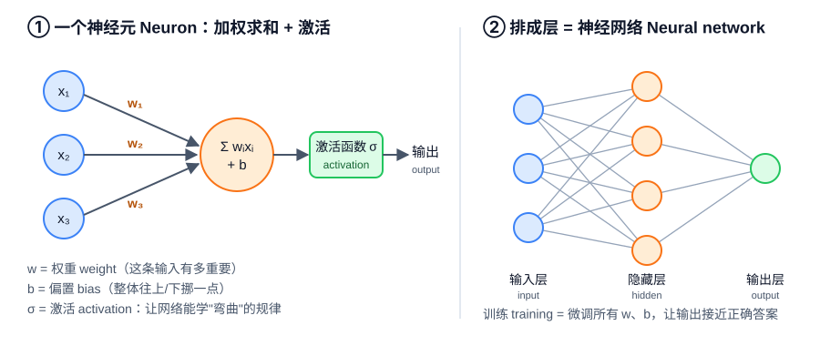
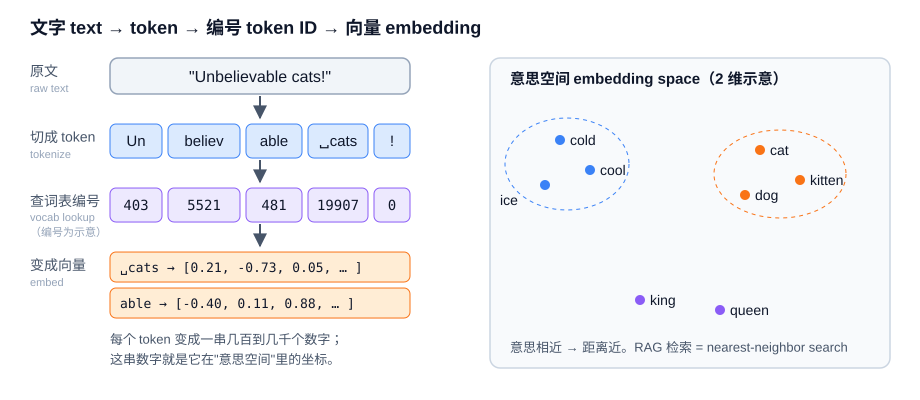
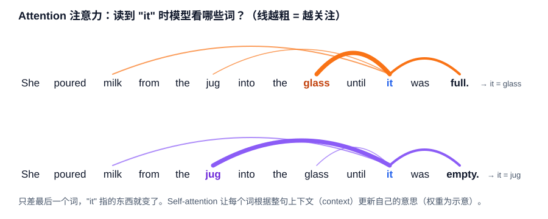
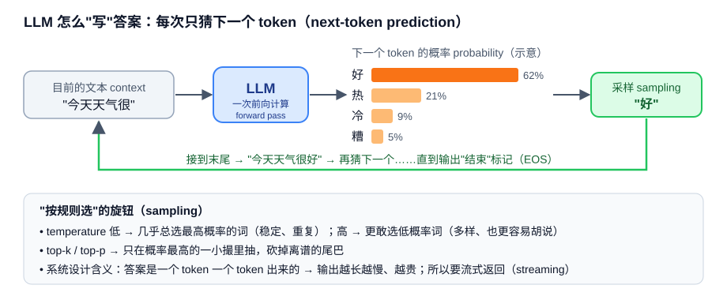

# 01 · LLM 到底是什么（零基础版）

> 来源：Educative《Grokking the Generative AI System Design》Ch.2「Preliminary ML Concepts」「Key Concepts」，2026-10-26 读，用自己的话重写。图是我自己画的，没有复制课程图片。
> 读完这一篇你应该能用大白话讲清楚：神经网络（neural network）、token、embedding、attention、LLM（large language model，大语言模型）怎么一个字一个字地生成答案。

---

## 1. 一句话

**LLM（large language model，大语言模型）= 一个巨大的"猜下一个词"的函数。** 输入一段文字，它输出"下一个词是什么"的概率表；挑一个词接上，再猜下一个，如此循环，就写出了一整段回答。

---

## 2. 神经网络（neural network）：一堆"加权打分器"

- **神经元（neuron）**：把几个输入各乘一个权重（weight, w），加起来，再加一个偏置（bias，b），最后过一个"激活函数（activation function）"。权重表示"这个输入有多重要"。
- **激活函数**（ReLU、sigmoid、softmax 等）：让网络能学"弯曲"的规律。没有它，叠多少层都只是一条直线。
- **层**：很多神经元排成一层，层层相连就是**神经网络（neural network）**。中间那些层叫隐藏层（hidden layer）。
- **参数（parameters）**：所有的 w 和 b 合起来就是"参数"。说"3B 模型"，意思是有 30 亿个参数。
- **训练（training）**：拿大量"输入 → 正确答案"去试，答错了就按误差往回微调所有参数（反向传播（backpropagation）），一直调到答得准为止。

> 类比：参数像一个超大调音台上的旋钮。训练就是自动拧几十亿个旋钮，直到放出来的声音（输出）对了。

### 课程提到的几种网络（知道名字就够）

| 名字 | 擅长 | 一句话 |
|---|---|---|
| CNN（convolutional neural network，卷积网络） | 图片 | 用小窗口扫图，先认边缘、纹理，再认整体 |
| RNN（recurrent neural network，循环神经网络） / LSTM（long short-term memory，长短期记忆网络） | 序列（老方法） | 一个词一个词地读，带着"记忆（memory）"往后走；**不能并行（parallel）、长句记不住** |
| **Transformer** | 文本、几乎一切 | 2017 年的论文《Attention Is All You Need》提出；**一次看整句、可以并行训练**。今天的 LLM（large language model，大语言模型）基本都是它 |

---

## 3. 文字怎么变成数字：token 和 embedding

**Token**：模型不按"字"或"词"读，而是按 **token** 读。token 是常见的字词片段，比如 `unbelievable` 可能被切成 `un` + `believ` + `able`。

| 切法 | 优点 | 缺点 |
|---|---|---|
| 按整词 | 直观 | 词表（vocabulary）巨大；没见过的词就不认识 |
| **按子词（BPE（Byte Pair Encoding，字节对编码） / SentencePiece）** | 生词也能拼出来，词表适中 | 一个字可能拆成好几个 token |
| 按字符 | 词表最小 | 序列太长，计算贵 |

今天的 LLM（large language model，大语言模型）基本都按**子词**切。

**为什么系统设计要关心 token？**

- **计费和限额都按 token 算**，不按字数。
- **上下文窗口（context window）**（模型一次能看多少内容）也按 token 算。
- 中文通常比英文更"费 token"。估成本时别用字数直接换算，要用 tokenizer 实测。

**Embedding**：每个 token（或一整段话）被转换成一串数字（向量（vector）），可以理解为它在"意思空间"里的坐标。**意思相近，坐标就相近**，比如 cold 和 cool 挨得很近。

- 这就是 **RAG（retrieval-augmented generation，检索增强生成）检索**的基础：问题和文档都转成向量，找"坐标最近"的文档（见 [03](03-genai-system-architecture.md)）。
- 课程列了 Word2Vec、GloVe、FastText、BERT 等老方法。面试不会考这些名字，只要知道"今天用 Transformer 类的 embedding 模型"就行。

---

## 4. Attention：读懂"它"指谁

**问题**：对 "She poured milk from the jug into the glass until **it** was full" 这句话，"it" 指的是杯子还是壶？要看句尾的 full 或 empty 才知道。

**Attention 的做法**：处理每个词时，让它"回头看"句子里所有的词，给每个词打一个相关度分，再按分数把别人的信息融进自己。处理 "it" 时，"glass" 和 "full" 的分数就高。

- **Self-attention**：一句话里的词互相看。
- **Multi-head**：同时开好几组 attention，有的看指代关系，有的看语法结构，最后合并。
- **Positional encoding（位置编码）**：attention 本身不管词序，所以要给每个词加一个"位置"信号，否则 "太阳落在山后面" 和 "山落在太阳后面" 在模型眼里就一样了。

> 不需要背公式 `softmax(QKᵀ/√d)·V`。能说清"每个词根据整句上下文（context）重新理解自己"就够了。

**对系统设计的一个关键推论**：attention 要让每个 token 看前面**所有** token，所以上下文越长，计算量和显存（GPU memory）占用越大（见 [02 的 KV cache](02-inference-and-estimation.md)）。"长上下文"不是免费的。

---

## 5. LLM 怎么写答案：自回归生成（autoregressive generation）

1. 把目前的全部文本喂给模型 → 得到"下一个 token"的概率表。
2. 按规则挑一个 token（这一步叫 **sampling**）。
3. 把它接到文本末尾，回到第 1 步。
4. 直到模型输出"结束"标记，或者达到长度上限。

| 旋钮 | 作用 | 什么时候调 |
|---|---|---|
| **temperature** | 低：几乎总选概率最高的 token，稳定；高：更随机，更有创意，也更容易胡说 | 抽取、分类、写代码用低值；写文案、头脑风暴可以调高 |
| **top-k / top-p** | 只在概率最高的一小撮 token 里抽 | 砍掉离谱的长尾 |
| **max tokens** | 输出长度上限 | 控制成本和延迟（latency） |

**系统设计含义**（面试常问）：

- 输出是**一个 token 一个 token 串行生成**的，所以输出越长越慢，**输出 token 通常也比输入 token 贵**。
- 要**流式返回（streaming）**，用户才不用干等。
- 就算 temperature = 0，结果也**不保证 100% 可复现（reproducible）**。所以要靠 eval 和结构化校验，不能靠"它每次都一样"。

---

## 6. 训练 vs 推理（两个词别混）

| | 训练（training） | 推理（inference） |
|---|---|---|
| 做什么 | 调参数（parameters），让模型学会 | 参数不动，拿来回答问题 |
| 多久一次 | 几周到几个月一次 | 每个用户请求一次 |
| 谁关心 | 研究 / ML（machine learning，机器学习）团队 | **系统设计面试关心的几乎都是这个** |
| 钱花在哪 | 一次性的超大算力（compute） | 持续的 GPU 账单，随用户量线性增长 |

还有两个常听到的词：

- **Fine-tuning（微调）**：在已训练好的模型上，用你自己的数据再训练一小轮。什么时候用、什么时候用 RAG（retrieval-augmented generation，检索增强生成），见 [06 §2.11](../06-ai-system-design.md)。
- **Pre-training（预训练）**：从零开始训练基础模型。面试里基本不会让你设计这个。

---

## 中英术语表（Key terms）

| 中文 | English | 面试里这样用 |
|---|---|---|
| 大语言模型 | large language model (LLM) | "At its core an LLM is a next-token predictor." |
| 参数 / 权重 / 偏置 | parameters / weights / biases | "A 3B model has three billion parameters." |
| 激活函数 | activation function | "Activations add non-linearity." |
| 神经网络 / 隐藏层 | neural network / hidden layer |  |
| 训练 / 推理 | training / inference | "In system design we mostly care about inference cost." |
| 反向传播 | backpropagation |  |
| 预训练 / 微调 | pre-training / fine-tuning | "I'd try RAG before fine-tuning for knowledge that changes." |
| token / 分词器 | token / tokenizer | "Pricing and context limits are in tokens, not characters." |
| 子词切分 | subword tokenization (BPE, SentencePiece) |  |
| 词表 | vocabulary |  |
| 向量 / 嵌入 | embedding (vector) | "We embed both the query and the documents." |
| 语义空间 | embedding space / semantic space | "Similar meanings land close together." |
| 注意力 / 自注意力 / 多头注意力 | attention / self-attention / multi-head attention | "Attention lets each token pull in context from the whole sequence." |
| 位置编码 | positional encoding |  |
| 上下文窗口 | context window | "I treat the context window as a budget." |
| 自回归生成 / 预测下一个词 | autoregressive generation / next-token prediction | "Output is generated one token at a time." |
| 采样 / 温度 | sampling / temperature (top-k, top-p) | "Low temperature for extraction, higher for creative tasks." |
| 最大输出长度 | max tokens / output limit |  |
| 流式返回 | streaming | "We stream tokens to cut perceived latency." |
| 可复现 / 确定性 | reproducible / deterministic | "Temperature zero still isn't fully deterministic." |
| 幻觉 | hallucination | "The model can be confidently wrong." |

## 7. 面试里能说的话

> An LLM is a next-token predictor: it reads the whole context, outputs a probability distribution over the next token, samples one, and repeats. Two things follow for system design. Output is generated serially, so latency and cost scale with output length and we stream it. And attention looks back over the entire context, so longer context costs more compute and memory. That's why I budget context instead of stuffing everything in.

## 8. 自测（答不上来就回去看对应小节）

1. 为什么按"字数"估算 LLM（large language model，大语言模型）成本会不准？（§3）
2. "it" 的例子说明了 attention 在做什么？（§4）
3. 为什么 LLM 的回答要用流式返回（streaming）？（§5）
4. temperature 设成 0，结果就一定能复现吗？（§5）

---

**来源**：Educative《Grokking the Generative AI System Design》Ch.2（2026-10-26 读）；Vaswani et al., 2017, [*Attention Is All You Need*](https://arxiv.org/abs/1706.03762)。
