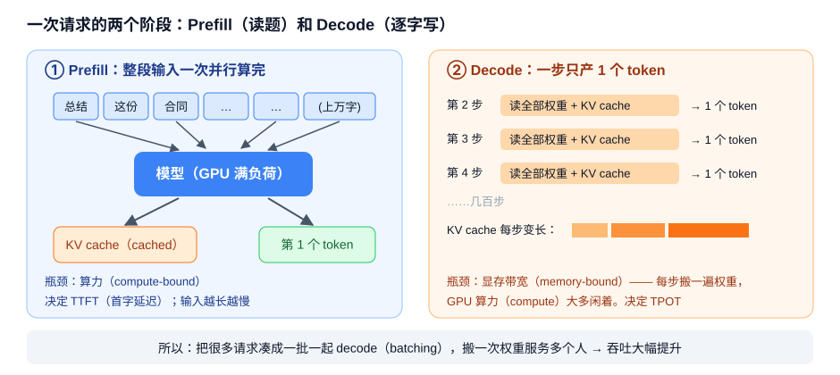
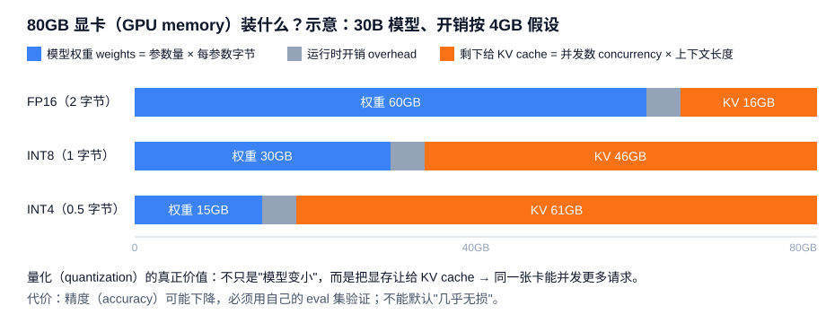
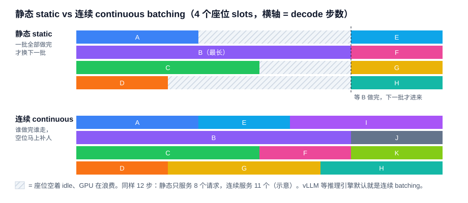
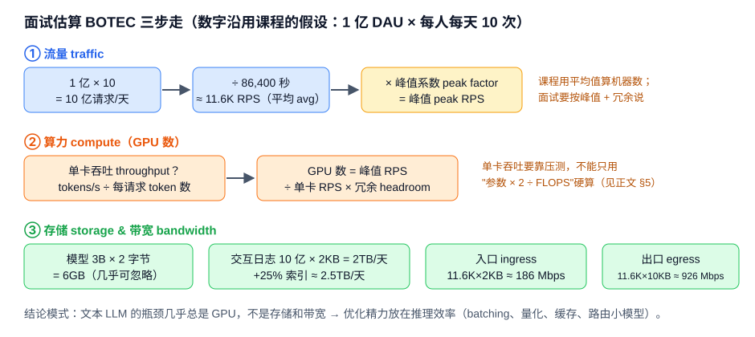

# 02 · 推理为什么贵、怎么省、怎么估算

> 来源：Educative《Grokking the Generative AI System Design》Ch.2「Inference Optimization」+ Ch.3「Back-of-the-envelope Calculations」（训练、部署两课），2026-10-26 读。
> 课程的推理（inference）优化讲得比较浅（量化（quantization）、剪枝（pruning）、蒸馏（knowledge distillation）、缓存（cache）、batching），**没讲 prefill/decode、连续 batching（continuous batching）、KV cache（key-value cache，键值缓存）显存（GPU memory）这些面试真正会追问的点**。我按面试需要补齐了，每处都标明是课程内容还是我补的，并附来源。
> 06 里对应的是 §2.8 Serving、§2.9 成本估算、06c Q8。这一篇是它们的"零基础前置课"。

---

## 1. 一句话

**LLM（large language model，大语言模型）推理（inference）的瓶颈（bottleneck）通常不是"算得慢"，而是"搬得慢"**：每生成一个 token，都要把整个模型的权重（weights）从显存（GPU memory / HBM（high-bandwidth memory，高带宽显存））读一遍。所以几乎所有优化都围绕三件事：**少搬**（量化（quantization））、**搬一次多用**（batching）、**不重复算**（缓存（cache））。

---

## 2. 一次请求的两个阶段（我补的，课程没讲）



| 阶段 | 做什么 | 瓶颈（bottleneck） | 影响哪个指标 |
|---|---|---|---|
| **Prefill** | 把整段输入一次并行（parallel）算完，生成 KV cache（key-value cache，键值缓存）和第一个输出 token | 算力（compute-bound） | **TTFT**（Time To First Token，首字延迟），输入越长越大 |
| **Decode** | 每步只生成 1 个 token，每步都要读一遍全部权重（weights）和 KV cache | 显存带宽（memory-bound） | **TPOT**（Time Per Output Token，每个 token 的间隔）以及总时长 |

**KV cache 是什么**：attention 在处理新 token 时要回看前面所有 token 的中间结果（K 和 V）。把这些结果存下来就不用每步重算，这份存储就是 KV cache。代价是**它占显存（GPU memory），而且随上下文（context）长度和并发（concurrency）数线性增长**。

> 类比：Prefill 像考试时先把整道题读完（一眼扫完，很快）；Decode 像一个字一个字地写答案，而且每写一个字都要把整本参考书翻一遍。

---

## 3. 显存账本：一张卡装得下什么



**公式 1：模型权重（weights）大小 = 参数量（parameter count） × 每个参数（parameters）的字节数**（课程公式）

| 精度（precision） | 每参数字节 | 3B 模型 | 30B 模型 |
|---|---|---|---|
| FP32 | 4 | 12 GB | 120 GB |
| FP16 / BF16 | 2 | 6 GB | 60 GB |
| INT8 | 1 | 3 GB | 30 GB |
| INT4 | 0.5 | 1.5 GB | 15 GB |

**公式 2：KV cache（key-value cache，键值缓存）每个 token 占多少（我补的）**

```
每 token KV 字节 = 2 (K 和 V) × 层数 × KV 头数 × 每头维度 × 每数字节数
```

算一个**假设的**模型（32 层、8 个 KV 头、每头 128 维、FP16）：
`2 × 32 × 8 × 128 × 2 B = 131,072 B ≈ 128 KB/token`
→ 一个 4K token 的请求约占 **512 MB** → 如果卡上留给 KV 的空间是 40 GB，**大约能同时跑 80 个这样的请求**。

**由此得出的面试结论**：

- 同一张卡**能并发（concurrency）多少请求，往往是 KV cache 说了算**，不是算力（compute）。
- **长上下文（long context）很贵**：上下文翻倍，单个请求的 KV 就翻倍，并发数减半。
- **量化（quantization）的真正价值**是把显存（GPU memory）让给 KV cache，从而并发更多请求（图中 INT8 比 FP16 多出约 3 倍 KV 空间）。

---

## 4. 省钱的手段

### 4.1 课程讲的五种

| 手段 | 一句话 | 代价 / 注意 |
|---|---|---|
| **量化** quantization | 用更少的位数存参数（FP16 → INT8 / INT4） | 精度（precision）可能下降。**课程说"小模型通常几乎无损"，不要照搬，要用自己的 eval 集验证** |
| **剪枝** pruning | 删掉不重要的连接或神经元（neuron） | 往往要重新训练（training）；面试里很少用到 |
| **蒸馏** distillation | 让大模型（老师）教小模型（学生），小模型模仿大模型的输出 | 需要训练流程；产品里常见的做法是"小模型做路由（routing）和分类" |
| **缓存** caching | 见 §4.2 | 失效、权限、内存 |
| **Batching** | 多个请求凑成一批一起算 | 单个请求可能多等一会儿 |

### 4.2 四种缓存（课程表格，按我的理解修正）

| 缓存 | 命中条件 | 省了什么 | 坑 |
|---|---|---|---|
| **精确缓存（exact-match cache）**（Redis 等） | 完全相同的请求 | 整次调用 | 自然语言（natural language）很少完全重复，命中率低 |
| **语义缓存（semantic cache）** | 意思相似（向量（vector）距离小于阈值） | 整次调用 | **可能答非所问**；还有权限和新鲜度风险：A 用户的答案不能给 B。合规（compliance）场景慎用 |
| **Prompt / 前缀缓存** | **开头一段完全相同**（系统提示（system prompt）、工具（tool）定义、长文档） | 这段前缀的 prefill 计算 | 要把不变的内容放前面、变化的放后面。课程把它说成"存相同 prompt 的回答"，这不准确：主流模型 API 的 prompt caching 只复用前缀的计算，**回答仍然重新生成** |
| **KV cache（key-value cache，键值缓存）** | 同一请求的 decode 过程 | 每步不重算前文 | 吃显存（GPU memory，§3） |

> 语义缓存上线怎么做（L1 精确 + L2 语义（semantics）分层、阈值、按租户（tenant）隔离、错误命中率）：见 [06 §2.8](../06-ai-system-design.md)。

### 4.3 Batching：静态 vs 连续（我补的）



- **静态 batching（static batching）**：凑齐一批，**等最长的那个做完**才换下一批。短请求做完了座位也空着。
- **连续 batching**（continuous / in-flight batching）：**每个 decode 步骤都可以有人进、有人出**，空位马上补上。Orca（OSDI 2022）提出，vLLM 等推理（inference）引擎都在用。
- **PagedAttention**（vLLM）：把 KV cache 像操作系统的内存页一样分块（paging）管理，减少碎片，同一张卡能放进更多并发（concurrency）请求。

### 4.4 课程没讲但面试常问的（我补的）

| 手段 | 一句话 |
|---|---|
| **模型路由（model routing）** | 简单请求交给小模型，难的才给大模型（06 §2.8） |
| **投机解码** speculative decoding | 小模型先快速猜几个 token，大模型一次性验证，猜对的直接收下，减少大模型的 decode 步数 |
| **Prefill / decode 分离** | 两个阶段瓶颈（bottleneck）不同，可以放到不同的机器池里各自优化（了解即可） |

---

## 5. 面试估算（BOTEC）



### 5.1 课程给的公式（会用就行）

| 要算什么 | 公式 |
|---|---|
| 平均 QPS（queries per second，每秒请求数） | DAU（daily active users，日活跃用户数） × 每人每天请求数 ÷ 86,400 |
| 模型大小 | 参数量（parameter count） × 每参数（parameters）字节 |
| 每天存储 | 用户数 × 每天交互次数 × 每次大小，再加约 25% 的索引（index）开销（课程假设） |
| 入口 / 出口带宽（bandwidth） | QPS × 请求大小 / QPS × 响应大小 |
| 训练（training）总算力 | **约 6 × 参数量 × 训练 token 数**（前向约 2N，反向约 4N）÷ (每卡 FLOPS（floating-point operations per second，每秒浮点运算次数） × 卡数) = 训练时间 |

课程的完整例子：1 亿 DAU、每人每天 10 次 → **平均约 11.6K QPS**；3B 模型 FP16 → **6 GB**；交互日志 **2.5 TB/天**；入口约 **186 Mbps**、出口约 **926 Mbps**；**112 张 A100**。

### 5.2 ⚠️ 课程算 GPU 数量的方法有问题（面试别照搬）

课程用 `推理时间 = 参数 × 2 × 输出 token 数 ÷ GPU 峰值（peak） FLOPS` 来算：
3B 模型、500 个 token、A100 FP16 峰值（peak） 312 TFLOPS（tera floating-point operations per second，每秒万亿次浮点运算） → **9.6 ms**，所以单卡 104 QPS，需要 112 张卡。

这个算法有三个问题：

1. **它算的是"算力下限"，而 decode 是带宽瓶颈（bottleneck）。** 单个请求每生成 1 个 token，都要从显存（GPU memory）读完整的 6 GB 权重（weights）。A100 80GB（SXM）的带宽是 2,039 GB/s，所以每个 token 至少 **约 2.9 ms**，500 个 token 至少 **约 1.5 秒**，不是 9.6 ms。两者差了 **约 150 倍**。
2. **它默认 GPU 算力 100% 被用满。** 实际做不到。
3. **它用平均 QPS 算机器数**，没算峰值和冗余（headroom）。

**那 104 QPS 是不是完全错的？** 不一定。靠大 batch，一次搬权重可以服务很多请求，吞吐（throughput）确实能涨上去。但这要看 batch 能开多大（受 KV cache（key-value cache，键值缓存）显存限制）和延迟（latency）目标，**只能压测（load testing / benchmarking）得出，不能用公式推出来**。

> 面试正确说法：*"I'd estimate capacity from measured tokens-per-second per GPU at our target latency, not from peak FLOPS. Decode is memory-bandwidth bound: at batch size one, every token reads all the weights, so throughput comes from batching, and batch size is capped by KV-cache memory. Then I size for peak traffic plus headroom, not the daily average."*

### 5.3 一个能直接套用的估算模板

```
1. 流量：DAU × 每人请求数 ÷ 86,400 = 平均 QPS；× 峰值系数（说出你的假设）= 峰值 QPS
2. token：每请求 平均输入 X token + 输出 Y token → 每秒 token 量
3. GPU：单卡吞吐（压测值，说"假设为 T tokens/s"）→ GPU 数 = 峰值 token/s ÷ T × (1 + 冗余)
4. 显存检查：权重 + 并发数 × 每请求 KV（§3 的公式）≤ 单卡显存？装不下就量化、拆卡或换卡
5. 存储和带宽：顺手算一下，通常不是瓶颈
6. 成本：token 量 × 单价（单价面试前查官方定价，不要背）
```

---

## 中英术语表（Key terms）

| 中文 | English | 面试里这样用 |
|---|---|---|
| 推理服务 | inference / model serving |  |
| 预填充 / 解码 | prefill / decode | "Prefill is compute-bound; decode is memory-bandwidth-bound." |
| 首字延迟 | time to first token (TTFT) | "Long prompts hurt TTFT." |
| 每 token 间隔 | time per output token (TPOT) / inter-token latency |  |
| 算力瓶颈 / 带宽瓶颈 | compute-bound / memory-bandwidth-bound |  |
| 显存 | GPU memory (HBM / VRAM) | "KV cache, not compute, usually caps concurrency." |
| KV 缓存 | KV cache | "KV cache grows with context length and concurrent requests." |
| 精度 | precision (FP32 / FP16 / BF16 / INT8 / INT4) |  |
| 量化 | quantization | "Quantization frees memory for KV cache, so we can serve more users per GPU." |
| 剪枝 | pruning |  |
| 蒸馏（老师 / 学生） | knowledge distillation (teacher / student) |  |
| 精确缓存 / 语义缓存 | exact-match cache / semantic cache | "Semantic caching is risky for personalized or regulated answers." |
| 前缀缓存 | prompt caching / prefix caching | "Put stable content first so the prefix is cacheable." |
| 静态 / 连续批处理 | static / continuous (in-flight) batching | "Continuous batching keeps the GPU slots full." |
| 分页注意力 | PagedAttention (vLLM) |  |
| 投机解码 | speculative decoding | "A small draft model proposes tokens; the big model verifies them." |
| 模型路由 | model routing | "Route easy requests to a smaller model." |
| 吞吐 | throughput (tokens/s, requests/s) |  |
| 并发 | concurrency |  |
| 利用率 | utilization | "Peak FLOPS assumes 100% utilization, which never happens." |
| 峰值 / 峰值系数 | peak traffic / peak-to-average ratio | "I size for peak, not the daily average." |
| 冗余余量 | headroom / N+1 redundancy |  |
| 粗略估算 | back-of-the-envelope estimate (BOTEC) | "Let me do a quick back-of-the-envelope." |
| 压测 | load testing / benchmarking | "Per-GPU throughput comes from benchmarks, not formulas." |
| 入口 / 出口带宽 | ingress / egress bandwidth |  |

## 6. 面试里能说的话

> Inference has two phases. Prefill processes the whole prompt in parallel and is compute-bound, which drives time-to-first-token. Decode emits one token at a time and is memory-bandwidth-bound, which drives per-token latency. Since every decode step reads all the weights, the main levers are continuous batching to share that read across requests, quantization to shrink weights and free memory for KV cache, prefix caching for stable prompt prefixes, and routing easy requests to smaller models. Concurrency is usually limited by KV-cache memory, so long contexts directly cut how many users a GPU can serve.

## 7. 自测

1. TTFT（time to first token，首 token 延迟）和 TPOT（time per output token，每个输出 token 的耗时）分别由哪个阶段决定？为什么瓶颈（bottleneck）不一样？（§2）
2. 为什么说"量化（quantization）的价值在于把显存（GPU memory）让给 KV cache（key-value cache，键值缓存）"？（§3）
3. 语义缓存（semantic cache）在合规（compliance）场景里有什么风险？（§4.2）
4. 课程算出"3B 模型生成 500 个 token 只要 9.6 ms"，错在哪？（§5.2）

---

**来源**（2026-10-26 查）：

- Educative《Grokking the Generative AI System Design》Ch.2–3。
- [NVIDIA A100 规格页](https://www.nvidia.com/en-us/data-center/a100/)：FP16 Tensor Core 312 TFLOPS（不含稀疏加速）；80GB 显存带宽 1,935 GB/s（PCIe）/ 2,039 GB/s（SXM）。
- [Llama 2 论文](https://arxiv.org/abs/2307.09288)：课程引用的"70B 训练约 170 万 A100 GPU 小时"出自这里。
- 连续 batching：[Orca, OSDI 2022](https://www.usenix.org/conference/osdi22/presentation/yu)；PagedAttention：[vLLM 论文](https://arxiv.org/abs/2309.06180)；投机解码：[Leviathan et al., 2023](https://arxiv.org/abs/2211.17192)。
- §3 的 KV cache 计算用的是**假设的**模型配置，只演示方法，不对应任何具体模型。
