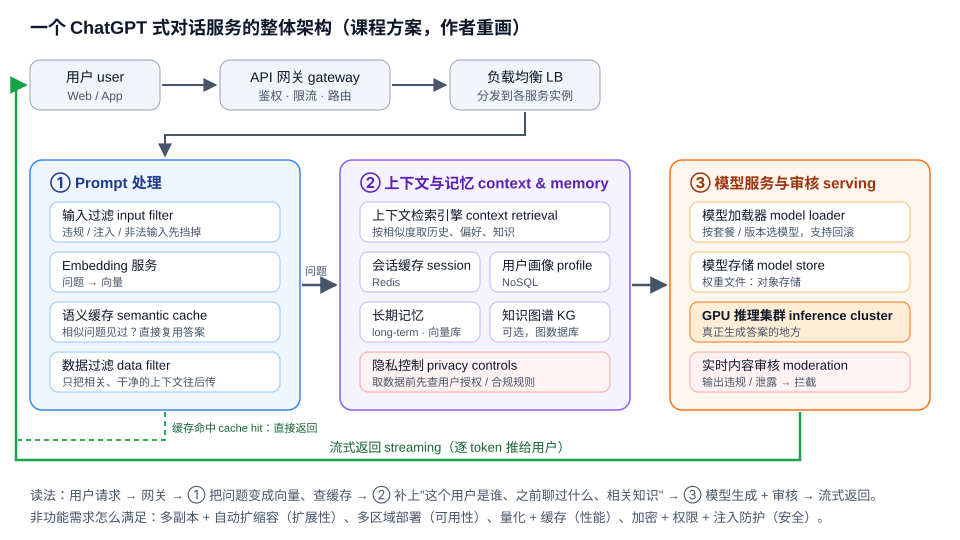
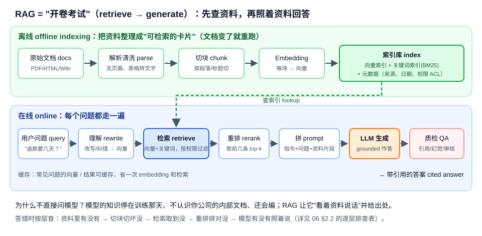
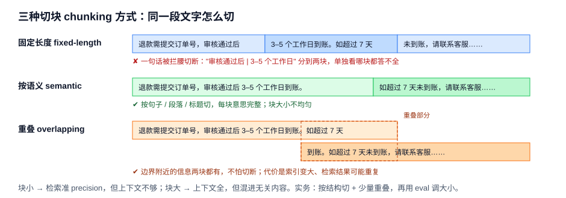

# 03 · GenAI 系统长什么样：答题框架、对话系统、RAG 系统

> 来源：Educative《Grokking the Generative AI System Design》Ch.4「Interview Preparation」「SCALED 框架」、Ch.5「文本生成系统部署」、Ch.11「Introduction to RAG」「RAG System Design」，2026-10-26 读。架构图是我按课程方案重画的。
> 跳过的部分：文生图（DALL·E）、语音合成（ElevenLabs）、文生视频（Sora）、语音识别、看图说话这几章，以及所有"训练（training）基础设施"章节。这些偏 ML（machine learning，机器学习）工程师，Staff SWE 面试性价比低。

---

## 1. 课程的答题框架 SCALED，和 06 的框架怎么对应

课程提出 6 步 **SCALED**：

| 字母 | 步骤 | 一句话 |
|---|---|---|
| **S** | System requirements | 功能需求（functional requirements）（做什么）+ 非功能需求（non-functional requirements）（多快、多稳、多大规模） |
| **C** | Choose a model | 开源还是闭源、大还是小、通用还是专用 |
| **A** | Acquire & prepare data | 收集、清洗、存数据 |
| **L** | Leverage the model | 训练（training） + 评估（BLEU、FID 等） |
| **E** | Estimate resources | 存储、GPU、带宽（见 [02 §5](02-inference-and-estimation.md)） |
| **D** | Design the system | 先画模块，再拼成整体，最后逐条说明非功能需求怎么满足 |

**我的判断**：SCALED 是为"从零训练一个模型"的 ML（machine learning，机器学习）面试设计的，A 和 L 两步对 SWE 面试基本用不上（你不会被要求训练 GPT）。**SWE 的 AI 系统设计轮继续用 [06 §1.3 的 9 步框架](../06-ai-system-design.md)**。SCALED 里值得借用的只有两点：

1. **E 步要单独算一次**：先估 GPU 和存储，再画架构。面试官会看你"有没有量级感"。
2. **D 步结尾要逐条对照非功能需求**：可用性（availability）用什么保证、扩展性（scalability）用什么保证……不要画完图就停。

| 06 §1.3 的步骤 | 对应 SCALED |
|---|---|
| ① Problem framing | S |
| ④ Model choice | C |
| ③ Data & context | A（只是数据接入，不包括训练） |
| ⑧ Cost & latency | E |
| ⑤ ⑦ ⑨ 编排（orchestration）、护栏（guardrails）、运维 | D |
| ⑥ Eval | L 的评估部分（但要换成 LLM（large language model，大语言模型）应用的 eval，见 06 §2.6） |

---

### 1.1 面试官怎么打分、会怎么追问（课程「Interview Preparation」）

**这一轮考的不是模型原理**（架构、训练算法、损失函数（loss function）），而是能不能把 LLM、embedding、检索（retrieval）、编排接成一个**可扩展、可靠、算得清成本**的系统，并在约束（constraint）变化时讲清取舍（trade-off）。

| 面试官看什么 | 不看什么 |
|---|---|
| 思路清晰度、取舍意识（trade-off awareness）、约束变了能不能调整、表达 | 答案"对不对"；两个人画出差不多的图，**讲清"为什么这样设计"的人分数高很多** |

**课程举的三个"面试官往前一靠"的追问**（练到能脱口而出）：

| 追问 | 答题方向 |
|---|---|
| "怎么降低幻觉（hallucination），又不把延迟（latency）搞爆？" | RAG（retrieval-augmented generation，检索增强生成）锚定资料 + 引用校验；校验放在异步或只对高风险请求做；小模型先判断要不要检索（06 §2.2、§2.6） |
| "如果模型成本一夜之间涨 3 倍？" | 路由（routing）到小模型、prompt / 语义缓存（semantic cache）、缩短上下文（context）、batch 离线任务、多供应商切换（06 §2.8、§2.9） |
| "为什么需要动态上下文组装（dynamic contextualizer）？没有它会坏在哪？" | 没有它要么把所有东西塞进上下文（贵、慢、中间信息丢失），要么缺关键信息而答错；上下文要按请求挑选并有预算 |

**常见失分**：一上来就过度设计（没问清需求）；钻进模型内部原理；不谈延迟、成本、质量、可靠性（reliability）之间的取舍；**把 LLM 当成神奇黑盒，而不是一个有延迟、限流（rate limiting）、会出错的服务**。课程的建议：先把整体画完，再按面试官的兴趣深挖。

> I treat the LLM as a service with latency, cost, rate limits and failure modes, not a magic box. I'll sketch the whole system first, then go deep wherever you'd like, and I'll call out the latency-cost-quality trade-off at each decision.

## 2. 对话系统（ChatGPT 式）怎么设计

### 2.1 三个子系统

| 子系统 | 干什么 | 关键组件 |
|---|---|---|
| **① Prompt 处理** | 把用户的问题变成向量，先查缓存（cache），挡掉违规输入 | 输入过滤、embedding 服务、语义缓存（课程建议 LRU（least recently used，最近最少使用）淘汰）、数据过滤 |
| **② 上下文（context）与记忆（memory）** | 补充"这个用户是谁、之前聊过什么、相关知识有哪些"，得到增强后的 prompt | 上下文检索引擎（context retrieval engine）；会话缓存（Redis）；用户画像（NoSQL，如 MongoDB / Cassandra）；长期记忆（long-term memory，原文库 + 向量库（vector database））；知识图谱（knowledge graph）（可选）；**隐私控制** |
| **③ 模型服务与审核** | 加载合适的模型、在 GPU 上生成答案、审核输出 | 模型加载器（按套餐和版本选模型、可回滚（rollback））、模型存储（对象存储（object storage））、GPU 推理（inference）集群、实时内容审核（content moderation） |

再加上外围组件：**API 网关（API gateway）**（鉴权（authentication / authorization）、限流（rate limiting）、路由（routing））和**负载均衡（load balancing）**。

### 2.2 一次请求怎么走

1. 网关（gateway）验证身份和配额 → 负载均衡。
2. 问题转成向量，查语义缓存：**命中就直接返回**。
3. 没命中 → 上下文检索引擎按相似度（similarity）取历史对话、用户偏好、相关知识。**取之前先过隐私控制**。
4. 模型加载器按用户套餐选模型 → GPU 生成答案。
5. 实时审核 → **流式**返回给用户。
6. 用户反馈（feedback，点赞、点踩）写回长期记忆，用于个性化（personalization）和后续改进。

### 2.3 非功能需求怎么满足（课程的做法）

| 需求 | 做法 |
|---|---|
| 性能 | 量化（quantization）、缓存、边缘部署 |
| 扩展性 | 多副本 + 负载均衡 + 自动扩缩容（autoscaling） |
| 可用性（availability） | 多区域部署（multi-region deployment），全局负载均衡做故障切换（failover） |
| 可靠性（reliability） | 重试、checkpoint、副本、持续监控模型表现 |
| 安全 | 传输加密和存储加密、RBAC（role-based access control，基于角色的访问控制） / OAuth、审计日志（audit log），**以及 prompt 注入（prompt injection）防护**（输入清洗、对抗测试） |

### 2.4 我觉得课程方案的弱点（面试可以主动补）

- **语义缓存放在最前面，对个性化和合规（compliance）场景有风险**：问题相似 ≠ 答案通用，A 用户的个性化答案不能给 B。要按用户或租户（tenant）隔离，或只缓存通用 FAQ。
- **没有讲 eval 和回归门禁**：换模型或改 prompt 时靠什么判断"没变差"？见 06 §2.6。
- **没有讲成本控制**：路由小模型、每个租户的 token 配额。见 06 §2.8 和 06c Q4。

---

## 3. RAG 系统怎么设计

**RAG（Retrieval-Augmented Generation，检索增强生成）= 开卷考试。** 先从资料库里查出相关片段，再让模型**照着资料**回答，并给出处。

**为什么需要它**：模型的知识停在训练（training）截止那天；它不认识你公司的内部文档；它不知道答案时会编。

### 3.1 两条流水线

| | 离线：建索引（index） | 在线：回答问题 |
|---|---|---|
| 步骤 | 解析清洗 → 切块（chunk）→ embedding → 存进向量库（vector database）和关键词索引，附带元数据（metadata：来源、日期、权限） | 理解问题（纠错、改写）→ 转成向量 → 检索（retrieval，向量 + 关键词，**按元数据和权限过滤**）→ 重排（reranking） → 拼 prompt → LLM（large language model，大语言模型）生成 → 质检 |
| 关注点 | 新鲜度（新文档多久能被搜到）、切块质量 | 延迟（latency）、准确率、权限 |

### 3.2 课程的三个子系统和存储选型

| 子系统 | 组件 | 存储 |
|---|---|---|
| 问题理解与 embedding | 预处理（preprocessing，分词（tokenization）、纠错、同义词扩展）、问题编码器（SBERT / MiniLM 这类小模型，可量化（quantization））、embedding 缓存（cache） | 查询日志放关系库（relational database）或文档库（document store） |
| 知识管理 | 文档接入（PDF / DOCX / HTML / JSON）、文档 embedding、索引与检索（Faiss / Pinecone，**向量 + 关键词混合**）、元数据过滤 | 文档库 + 向量库 + 元数据库 |
| 生成与质检 | 上下文（context）拼装（无状态（stateless），可用 Redis 临时存）、按领域定制 prompt、LLM 生成（温度（temperature）、最大长度、流式）、质检（格式、幻觉（hallucination）、审核、收集反馈（feedback）） | 模板放 KV 或文档库；日志放时序库（time-series database）；审核规则和反馈放 PostgreSQL / MongoDB |

课程的估算：QPS（queries per second，每秒请求数）、GPU、带宽（bandwidth）沿用对话系统的数字（见 [02 §5](02-inference-and-estimation.md)），不同的是**每次查询约 100 KB 的交互数据**（问题、检索到的片段、答案、日志）→ **100 TB/天，约 3 PB/月**。这说明 RAG 的日志存储要设保留期（retention policy）和分层存储（tiered storage），不能全部永久存热数据。

### 3.3 RAG 的四个组件和关键技术点（课程「Introduction to RAG」）

**四个组件**：建索引（indexing）→ 检索（retrieval）→ 增强（augmentation，把资料和问题拼成 prompt）→ 生成（generation）。

**切块（chunking）怎么切**：

| 方式 | 优点 | 缺点 |
|---|---|---|
| 固定长度（fixed-length） | 实现简单 | 会把一句话拦腰切断 |
| 按语义（semantic：句子、段落、标题） | 每块意思完整，检索效果通常更好 | 块大小不均 |
| 重叠（overlapping） | 边界附近的信息不会丢 | 索引变大，结果可能重复 |

**相似度怎么算**：余弦相似度（cosine similarity，看方向，文本检索最常用）、欧氏距离（Euclidean distance，维度高时区分度变差）、点积（dot product，计算快）。**问题和文档必须用同一个 embedding 模型**，否则两边的"坐标系"不一样，检索结果没有意义；换模型就要整体重建索引。

**混合检索（hybrid search）**：关键词检索（sparse，BM25 / TF-IDF（term frequency-inverse document frequency，词频-逆文档频率），擅长精确匹配编号、专有名词）+ 向量检索（dense，擅长同义改写）。

**怎么评估（evaluation）**：

| 评估对象 | 指标 |
|---|---|
| 检索 | 精确率（precision：取回的里面有多少是相关的）、召回率（recall：相关的里面取回了多少）、**MRR（mean reciprocal rank，平均倒数排名）**（第一个相关结果排第几）、**MAP（mean average precision，平均精度均值）**（多个问题的平均精度（average precision）） |
| 生成 | **忠实度（faithfulness）**：答案是否被资料支持；**答案相关性（answer relevance）**：是否真的回答了问题 |

**RAG 也会被攻击（RAG poisoning）**：往知识库（knowledge base）里塞文档来操纵结果。关键词堆砌（keyword stuffing）；构造 embedding 和高质量文档很像、内容却是错的（embedding collision）；部分正确、细节误导（contextual poisoning）。防御：控制谁能往索引里写、来源分级、检索时做异常（anomaly）检测，并且**把检索到的内容当数据，不当指令（instruction）**（06 §2.7）。

### 3.4 RAG 的进阶内容在 06 里

这一篇只讲"零基础能看懂的骨架"。下面这些面试深挖题都已经在 [06](../06-ai-system-design.md) 里：

- 混合检索、HNSW（Hierarchical Navigable Small World，分层可导航小世界图） vs IVF-PQ（inverted file index with product quantization，倒排索引加乘积量化）、权限过滤的坑 → 06 §2.2
- query rewrite / HyDE（Hypothetical Document Embeddings，假设文档嵌入）、contextual retrieval、agentic RAG、GraphRAG、长上下文 vs RAG → 06 §2.2
- 答错时逐层排查 → 06 §2.2 失败模式表
- 带权限的企业 RAG 完整设计题 → 06c Q1

---

## 中英术语表（Key terms）

| 中文 | English | 面试里这样用 |
|---|---|---|
| 功能 / 非功能需求 | functional / non-functional requirements | "Let me pin down functional and non-functional requirements first." |
| API 网关 | API gateway |  |
| 鉴权 | authentication / authorization (authn / authz) |  |
| 限流 | rate limiting |  |
| 负载均衡 | load balancer / load balancing |  |
| 自动扩缩容 | autoscaling |  |
| 多区域部署 / 故障切换 | multi-region deployment / failover |  |
| 内容审核 | content moderation |  |
| 会话缓存 | session cache |  |
| 用户画像 | user profile |  |
| 长期记忆 | long-term memory |  |
| 知识图谱 | knowledge graph |  |
| 隐私控制 | privacy controls / data governance |  |
| 模型加载器 | model loader / model registry | "The model loader lets us roll back a model version." |
| 检索增强生成 | retrieval-augmented generation (RAG) | "RAG makes the model answer from retrieved sources, with citations." |
| 离线索引流水线 | offline ingestion / indexing pipeline |  |
| 切块 | chunking |  |
| 向量库 | vector database / vector index |  |
| 关键词检索 / 混合检索 | keyword search (BM25) / hybrid search | "Hybrid search catches exact IDs that embeddings miss." |
| 元数据过滤 | metadata filtering | "Permission filters must be part of the search, not applied afterwards." |
| 访问控制列表 | access control list (ACL) |  |
| 重排 | reranking |  |
| 引用 / 有据回答 | citations / grounded answer |  |
| 新鲜度 | freshness / staleness |  |
| 保留期 / 分层存储 | retention policy / tiered storage |  |
| 取舍意识 | trade-off awareness | "Two candidates can draw the same diagram; the one who explains why scores higher." |
| 动态上下文组装 | dynamic contextualization | |
| 固定 / 语义 / 重叠切块 | fixed-length / semantic / overlapping chunking | |
| 余弦相似度 / 点积 | cosine similarity / dot product | |
| 稀疏 / 稠密检索 | sparse (BM25) / dense (vector) retrieval | |
| 平均倒数排名 / 平均精度均值 | MRR / MAP | |
| 忠实度 / 答案相关性 | faithfulness / answer relevance | |
| 知识库投毒 | RAG poisoning (keyword stuffing, embedding collision) | "Retrieved content is data, never instructions." |

## 4. 面试里能说的话

> I split a GenAI product into three subsystems that scale independently: request processing (auth, input filtering, embedding, caching), context assembly (session state, user memory, retrieval with permission checks), and generation (model routing, GPU serving, output moderation, streaming). For RAG specifically there are two pipelines: offline ingestion that parses, chunks, embeds, and indexes with metadata and ACLs, and online retrieval that filters by permission, reranks, and makes the model answer only from the retrieved passages with citations.

## 5. 自测

1. 为什么 SCALED 里的 A 和 L 两步对 SWE 面试意义不大？哪两点值得借用？（§1）
2. 语义缓存（semantic cache）放在对话系统最前面，有什么风险？（§2.4）
3. RAG（retrieval-augmented generation，检索增强生成）的离线和在线两条流水线各自最关心什么？（§3.1）

---

**来源**：Educative《Grokking the Generative AI System Design》Ch.4、Ch.5、Ch.11（2026-10-26 读）。课程里的规模数字（1 亿 DAU、每次交互 2 KB / 100 KB 等）**都是课程的假设，不是任何真实系统的数据**。
