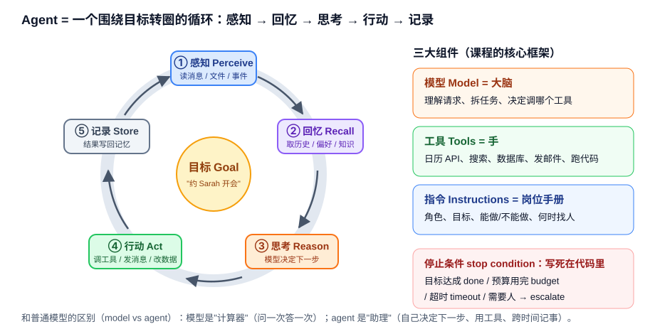
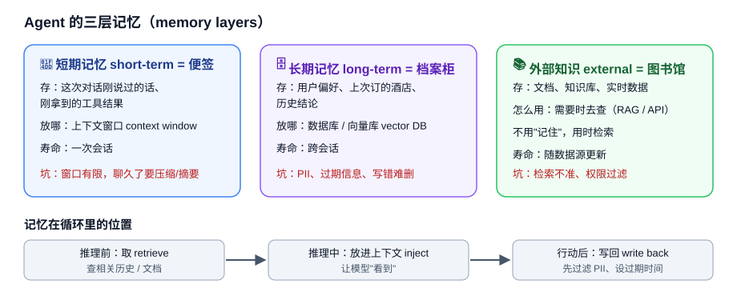
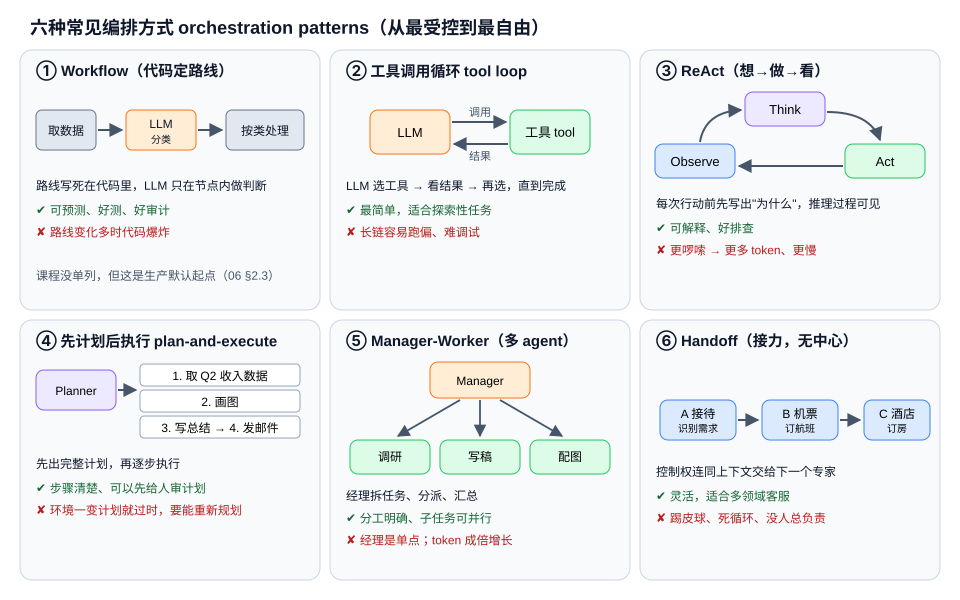

# 04 · Agent 入门：它是什么、由什么组成、怎么编排

> 来源：Educative《Agentic System Design》Ch.1「Agent Design Fundamentals」前 4 课 + 附录 Cheatsheet、Glossary、Landscape Guide，2026-10-26 读。
> 读完你应该能讲清：模型和 agent 的区别；agent 的循环、三大组件、三层记忆（memory）；常见的编排（orchestration）方式和怎么选；什么时候**不该**用 agent。
> 安全与护栏（guardrails）单独放在 [05](05-agent-safety.md)。06 §2.3、§2.4 是进阶版，这一篇是它们的前置课。

---

## 1. 一句话

**Agent = LLM（large language model，大语言模型） + 工具（tool） + 记忆（memory） + 一个循环。** 普通模型"问一次、答一次"；agent 会围绕一个目标自己决定下一步做什么：查资料、调 API、看结果、再决定，直到完成。

> 课程的类比：模型像**计算器**，你给算式它给结果；agent 像**私人助理**，你说"帮我约 Sarah 下周开会"，它自己去查两个人的日历、发邀请、确认结果。

| | 模型（Model） | Agent |
|---|---|---|
| 范围 | 一个窄任务 | 一整套行为 |
| 角色 | 输入 → 输出 | 为了目标选择行动（action） |
| 上下文（context） | 只有这一次输入 | 维护并更新自己的状态（state） |
| 主动性（proactivity） | 等你问 | 被触发或定时触发后自己干 |
| 工具 | 没有 | 有，往往还用多个工具和多个模型 |
| 例子 | 情感分类器 | 能回答、升级、记录工单的客服助理 |

---

## 2. Agent 的循环和三大组件

**循环**（课程版，源自经典 AI 教材的"感知（perceive） → 推理（reasoning） → 行动（action）"）：

1. **感知**：读用户消息、文件、截图（screenshot）、传感器、API 返回。语音要先转文字（STT（speech-to-text，语音转文字）），图片要先做 OCR（optical character recognition，光学字符识别）或交给多模态模型（multimodal model）。
2. **回忆（recall）**：取相关的历史、偏好、知识。
3. **思考规划（reason & plan）**：模型理解意图（intent）、拆任务、选工具（tool）。
4. **行动**：调 API、发消息、改数据。
5. **记录**：把结果和新信息写回记忆（memory）。

然后进入下一轮。**停止条件（stop condition）必须写在代码里**：目标达成、步数或预算用完、超时（timeout）、需要人确认。不能指望模型自己"觉得做完了"，这正是网页 agent 最常见的失败之一，见 [06-case-studies](06-case-studies.md)。

**三大组件**：

| 组件 | 类比 | 设计要点 |
|---|---|---|
| **模型** Model | 大脑 | **不是越大越好**。按任务复杂度、延迟（latency）、成本、上下文（context）长度选；常见做法是小模型做常规步骤，大模型只在需要时调用 |
| **工具** Tools | 手 | API、搜索、代码执行、数据库、设备控制。**一个工具只做好一件事，返回结构化结果**（工具设计原则见 06 §2.3） |
| **指令** Instructions | 岗位手册 | 系统提示（system prompt）里写角色、目标、边界、什么时候升级给人（escalate to a human）。"要乐于助人"太空泛；"只回答账单问题，退款请求转人工"才是好指令 |

**为什么要拆成三块（模块化（modularity））**：可以单独换模型、加工具、改指令，而不用重写整个系统；出了问题也能定位到具体哪一块。

---

## 3. 三层记忆

| 记忆（memory） | 存什么 | 放在哪 | 寿命 |
|---|---|---|---|
| **短期** | 本次对话刚说过的话、刚拿到的工具（tool）结果 | 模型的上下文窗口（context window） | 一次会话（session） |
| **长期** | 用户偏好、"上次订的那家酒店"、历史结论 | 数据库、向量库（vector database） | 跨会话 |
| **外部知识** | 文档、知识库（knowledge base）、实时数据 | 需要时再查（RAG（retrieval-augmented generation，检索增强生成）或 API） | 跟着数据源更新 |

**课程里的一个排障例子**：一个客服 agent 上线后，①重复问用户已经回答过的问题，②不提用户最近提交的工单，③有现成 FAQ 却给出泛泛的回答，④用户反复生气却不升级。**这四个问题都出在记忆和上下文（context）层**，不是模型不够聪明。

记忆管理（memory management）要注意的地方（06 §2.4 有更细的表）：

- **不要什么都存**：PII（personally identifiable information，个人身份信息）不进长期记忆（long-term memory）；存之前先过滤；给记忆设过期时间。
- **多 agent 时要规定谁能读写哪部分记忆**，否则会互相覆盖。
- **关键记忆要能版本化（versioning）和审计（audit）**：写错了要能追溯、能删除。

---

## 4. 编排（orchestration）方式：agent 怎么组织自己的步骤

| 方式 | 适合 | 课程的提醒 |
|---|---|---|
| ① **Workflow**（课程没单列，我补的） | 路线基本固定，只在节点里需要语言理解 | **生产环境的默认起点**（Anthropic《Building effective agents》，06 §2.3） |
| ② **工具调用（tool calling）循环** | 探索性、动态的任务（搜索、排查问题） | 长链容易跑偏，难调试 |
| ③ **ReAct**（Reason + Act） | 需要看到推理（reasoning）过程的场景（受监管行业、教学） | 更啰嗦 → 更多 token、更慢 |
| ④ **先计划后执行**（plan-and-execute） | 能提前拆清楚的任务（订行程、写多部分的报告） | 环境变了计划就过时，要能重新规划（replanning） |
| ⑤ **Manager-Worker**（多 agent） | 一个中心规划者（planner） + 多个专家（specialist），子任务可以并行（parallel） | 经理是单点（single point of failure）；token 成倍增长 |
| ⑥ **Handoff**（多 agent，无中心） | 多个领域的专家接力（客服转机票再转酒店） | 踢皮球、死循环，没有人对整体负责 |

> 进阶（面试版）：orchestrator 居中的控制面（control plane）、工具调用的三种形态与错误恢复、"生成 → 验证 → 反思（reflection） → 选择"骨架，见 [06 §2.3](../06-ai-system-design.md)。

### 单 agent 还是多 agent？（课程的四个判断维度）

| 维度 | 倾向单 agent | 倾向多 agent |
|---|---|---|
| 任务范围 | 窄、聚焦 | 横跨多个领域，子目标可以独立解决 |
| 技能 | 一种能力够用 | 需要法律、代码、沟通等差别很大的专长 |
| 执行方式 | 线性、一步接一步 | 可以并行 |
| 可观测性（observability） | 逻辑集中，好监控、好调试 | 更灵活，但要协调和共享状态（state） |

> 我的补充：**先把单 agent 或 workflow 做扎实，再拆多 agent**。多 agent 要付的代价（token 翻倍、协调失败、调试难）在 06 §2.3 和 §2.4 有表格。

### 课程提到的框架（2026-10 现状对照）

| 框架（framework） | 课程的说法 | 现状 |
|---|---|---|
| LangChain / LangGraph | 用 "AgentExecutor" 做工具（tool）循环 | **过时了**。LangChain 1.0（2025-10）以后用 `create_agent`；复杂流程用 LangGraph。见 [06 §2.12](../06-ai-system-design.md)，已查证版本 |
| AutoGen（微软） | 多个 agent 用对话来协作，人也可以作为一个 agent 加入 | **已停止演进**：GitHub README 写明 AutoGen 正在转为归档状态，不建议用于生产，新用户请用继任者 **Microsoft Agent Framework**（PyPI `agent-framework` 1.23.0，2026-10-22）。AutoGen 最后一版是 `autogen-agentchat` 0.7.5（2025-09-30）。**面试别推荐 AutoGen**，要提就说 "AutoGen, now succeeded by Microsoft Agent Framework" |
| CrewAI | 围绕 Manager-Worker 设计 | **仍在活跃更新**：PyPI `crewai` 1.15.30（2026-10-24）。核心概念：给每个 agent 定一个角色（role），组成一个 crew，让它们按顺序或在 manager 调度下协作完成任务 |

> 以上版本信息于 2026-10-26 在 PyPI 和 microsoft/autogen 的 GitHub README 查证。

---

**框架怎么选**（课程「Landscape Guide」的五个问题）：单 agent 还是多 agent；需要多少现成集成（LangChain 最多）；团队是不是新手（CrewAI 的"角色"比喻最好上手）；部署在哪朵云（Google 用 ADK、Azure 用 Semantic Kernel / Microsoft Agent Framework）；对执行循环要多少控制（要得越多，越接近直接用模型 SDK 自己写，见 06 §2.12）。

### 经典 AI 里的 agent 分类（课程附录「Glossary」）

按"怎么做决定"分，从简单到复杂。知道名字、能举例就够了：

| 类型 | 怎么做决定 | 例子 |
|---|---|---|
| 简单反射（simple reflex） | 只看眼前，套"如果…就…"规则 | 关键词垃圾邮件过滤 |
| 基于模型的反射（model-based reflex） | 维护一个内部状态，记住看不见的部分 | 自动驾驶记得被挡住的车 |
| 基于目标（goal-based） | 为了目标规划（planning）路线 | 导航软件 |
| 基于效用（utility-based） | 不只达成目标，还在多个方案里挑"最好"的 | 在时间、价格、舒适度之间权衡的出行规划 |
| 学习型（learning） | 根据反馈（feedback）改进自己 | Eureka（自动改进奖励（reward）函数，见 06 §2.3） |

今天的 LLM（large language model，大语言模型） agent 往往是几种的组合：用目标驱动规划，用记忆（memory）维护状态，用反馈做反思。

## 5. 什么时候该用 agent，什么时候不该

课程给了三个"适合用 agent"的信号：

1. **需要结合上下文（context）做判断**：比如退款审批要看客户历史、语气和退货理由。
2. **规则多到维护不了**：几十个分支和例外，还在不断变化（比如供应商安全审查）。
3. **输入是非结构化（unstructured）的自然语言（natural language）**：邮件、文档、客户自己描述的理赔经过。

**反过来，下面这些情况用规则或普通代码就够了**（课程的练习题）：

| 场景 | 选什么 | 为什么 |
|---|---|---|
| 每个工作日晚 7 点关办公室的灯 | 规则或定时任务（scheduled job） | 完全确定，没有任何判断 |
| 超过 $10,000 的交易标记为人工审核 | 规则 | 阈值明确；**合规（compliance）场景要求结果可解释、可复现（reproducible）** |
| 读客户邮件、分类、复杂的升级给人（escalate to a human）、从历史中学习 | Agent | 非结构化输入 + 需要判断 |

> 这和你自己的项目讲法一致：**确定性（deterministic）的部分交给代码，只有真正需要语言理解的部分才用模型**（06 §1.3 第②步、§4）。

---

## 中英术语表（Key terms）

| 中文 | English | 面试里这样用 |
|---|---|---|
| 智能体 | agent | "An agent is a model in a loop with tools and memory." |
| 自主性 | autonomy | "I add autonomy only where the path really varies." |
| 感知 / 推理 / 行动 | perceive / reason / act |  |
| 工具调用 | tool calling / function calling |  |
| 指令 / 系统提示 | instructions / system prompt |  |
| 停止条件 | stop condition / termination condition | "The code enforces the stop condition, not the model." |
| 步数预算 | step budget / max iterations |  |
| 短期 / 长期记忆 | short-term (working) / long-term memory |  |
| 外部知识 | external knowledge (retrieval) |  |
| 编排 | orchestration |  |
| 工作流 | workflow | "I start with a workflow and add agency where needed." |
| 工具调用循环 | tool-calling loop |  |
| 先计划后执行 | plan-and-execute |  |
| 管理者-工作者 | manager-worker / orchestrator-workers / supervisor |  |
| 交接 | handoff |  |
| 反思 / 自我批评 | reflection / self-critique |  |
| 路由 | routing |  |
| 单点故障 | single point of failure |  |
| 可观测性 | observability |  |
| 模块化 | modularity | "Model, tools, and instructions are swappable parts." |
| 确定性 | deterministic | "Deterministic rules for a $10k threshold; an agent for unstructured email." |
| 非结构化数据 | unstructured data |  |
| 简单反射 / 基于模型 / 基于目标 / 基于效用 / 学习型 agent | simple reflex / model-based / goal-based / utility-based / learning agent | |
| 框架 | framework (LangGraph, CrewAI, Microsoft Agent Framework, ADK, OpenAI Agents SDK) | "The framework matters less than the trade-off between control and convenience." |

## 6. 面试里能说的话

> An agent is a model in a loop with tools and memory: it perceives, recalls relevant context, decides the next action, executes it through a tool, and records the result, until a stop condition the code enforces. I think of it as three swappable parts: the model as the reasoning engine, tools as the only way it can affect the world, and instructions as its operating boundaries. I default to a workflow and add autonomy only where the path genuinely varies with the input, and I move to multiple agents only when subtasks are truly parallel or need isolated context, because coordination costs tokens and debuggability.

## 7. 自测

1. 用"计算器 vs 助理"解释模型和 agent 的区别。（§1）
2. 为什么循环的停止条件（stop condition）不能交给模型自己判断？（§2）
3. 客服 agent 重复提问、忘记用户最近的工单，问题出在哪一层？（§3）
4. "超过 $10,000 的交易要人工审核"为什么不该用 agent 来做？（§5）

---

**来源**：Educative《Agentic System Design》Ch.1 第 1–4 课 + 附录 Cheatsheet（2026-10-26 读）；Anthropic, [*Building effective agents*](https://www.anthropic.com/engineering/building-effective-agents)。
