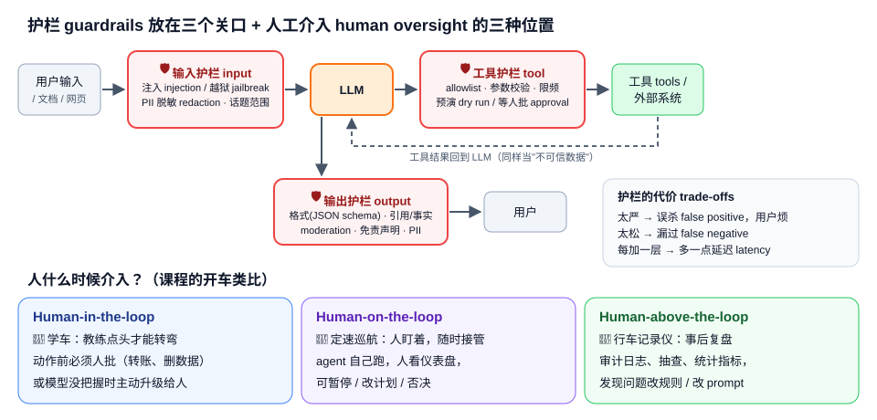

# 05 · 让 agent 可信：护栏、人工介入、六大难题

> 来源：Educative《Agentic System Design》Ch.1 第 5 课「Guardrails and Human Oversight」、第 6 课「Key Challenges and Design Strategies」，2026-10-26 读。
> 06 §2.7 是面试版的护栏（guardrails）表（侧重"服务端（server）强制"），这一篇是零基础的前置课。

---

## 1. 一句话

**聊天机器人答错只是"说错话"；agent 做错是"做错事"**（转错账、删错数据）。所以对 agent 来说，可信是一项**设计需求**，不是锦上添花。手段有两类：**护栏（guardrails）**（自动拦截）和**人工介入（human oversight）**（关键时刻交给人判断）。

---

## 2. 护栏放在三个关口

| 关口 | 拦什么 | 怎么做 |
|---|---|---|
| **输入护栏（guardrails）**（进模型之前） | 越狱（jailbreak）、prompt 注入（prompt injection）、违规话题、PII（personally identifiable information，个人身份信息） | 审核 API 或分类器、PII 识别与脱敏（redaction / masking）、话题白名单（allowlist） |
| **工具（tool）护栏**（执行动作（executing an action）之前） | 不该做的动作（action）、参数错误、调用太频繁 | **白名单**、**参数校验（argument validation）**、前置条件检查、**限频（rate limiting）**（如每个用户每小时最多发一封邮件）、**先预演（dry run）再执行** |
| **输出护栏**（给用户之前） | 格式错误、编造的事实、不当内容、漏掉免责声明 | 正则、JSON schema 校验、用另一个模型做语义（semantics）检查、黑白名单 |

### 课程列的五类护栏

| 类型 | 防什么 | 例子 |
|---|---|---|
| 上下文（context）对齐检查 | 跑题、**编造资料里没有的内容** | 用 RAG（retrieval-augmented generation，检索增强生成）锚定资料；提示词（prompt）约束（constraint）；事后检查答案和资料是否一致 |
| 安全与审核过滤 | 有害、冒犯、偏见内容 | 用户让金融助理"黑掉支付系统"，在输入端就拦下 |
| PII 与数据保护 | 泄露个人信息 | 医疗助手只能检索（retrieval）当前用户的病历，并对标识符打码 |
| 工具使用防护 | 误用工具 | IT 助手的"重置密码"工具：必须先验证身份 |
| 规则化输出校验 | 最后一道关 | 法律类回答必须带"这不是法律意见"的声明 |

### 进阶手段（课程列的，了解名字即可）

评审 agent（evaluator / critic）、多模型投票、自我反思（reflection）、多 agent 之间的通信（communication）护栏、安全指标监控、**自动回滚（automated rollback）**、**可解释与审计日志（audit trail）**。

### 护栏的代价

| 问题 | 表现 |
|---|---|
| 误杀（false positive） | 正常请求被拦，用户很烦 |
| 漏过（false negative） | 精心构造的攻击还是能绕过 |
| 延迟（latency）和复杂度 | 每加一层就多一点延迟 |
| 用户摩擦 | 动不动就要用户确认，体验很差 |

**课程的最佳实践**：多层防御（defense in depth）；先防影响最大的风险（PII、安全、不可逆动作）；持续监控误杀率和漏过率；对用户透明。

> 我的补充（06 §2.7 的核心观点）：**护栏要由服务端（server）强制执行，不能只靠 prompt 里的一句"请不要……"**。模型只负责提议，允许做什么由服务端决定。

---

## 3. 记忆也要管

Agent 能记住东西，就有记错和泄露的风险：

- 不保存 PII（personally identifiable information，邮箱、银行卡、敏感请求）。
- 存之前先过滤掉不当或无关的内容。
- 给不该长期保留的数据设过期时间。
- 限制哪些话题可以被回忆。

---

## 4. 人在哪个位置介入（课程的开车类比）

| 模式 | 类比 | 什么时候用 | 机制 |
|---|---|---|---|
| **Human-in-the-loop**（HITL） | 学车，教练点头才能转弯 | 高风险、不可逆的动作（action，转账、部署、删数据）；模型没把握 | **审批关卡（approval gate）**（"现在取消订阅吗？"）、**升级触发（escalation）**（置信度（confidence score）低、输入模糊、政策不明确时转给人） |
| **Human-on-the-loop**（HOTL） | 定速巡航，人盯着，随时可以接管 | agent 自己跑，人需要能实时干预 | 监控面板：暂停、否决、改计划 |
| **Human-above-the-loop**（HATL） | 行车记录仪，事后复盘 | 问责、审计（audit）、长期改进 | 审计日志（audit log）、抽查、指标统计 |

其他模式：用户主动举报、多名评审员共同评估（evaluation）、**自动监控 + 超过阈值才升级给人（escalate to a human）**（HOTL 和 HITL 的混合）。

**人工介入（human oversight）的代价**：延迟（latency）、人力成本、难以扩展，以及**审核疲劳（reviewer fatigue）**（升级太多，人会麻木，真正的问题反而漏掉）。所以要**按风险分级**，只把真正需要判断的事情交给人。

---

## 5. Agent 系统的六大难题和对策（课程第 6 课）

| 难题 | 为什么麻烦 | 对策 |
|---|---|---|
| **延迟（latency）高** | 大模型慢，多轮循环会把延迟累加 | 简单步骤用小模型；量化（quantization）、蒸馏（knowledge distillation）；缓存（cache）；**独立的工具调用（tool calling）并行（parallel）执行**；不需要立刻返回的任务改成异步 |
| **输出不可靠 / 幻觉（hallucination）** | 一本正经地胡说，还可能据此行动（action） | RAG（retrieval-augmented generation，检索增强生成）锚定资料；输出校验；关键决策（decision-making）让多个模型投票；**置信度（confidence）低就升级给人（escalate to a human）或反问用户**；指令（instruction）里写"不知道就说不知道" |
| **记忆（memory）不一致** | 忘记上下文（context）、用过期信息、多个 agent 互相覆盖 | 分层记忆；规定谁能读写哪部分；选择性保留；**关键记忆版本化（versioning）和审计（audit）** |
| **扩展性（scalability）** | 一个用户跑得好，一千个用户就崩 | 模块化（modularity）；多 agent 分担负载；自动扩缩容（autoscaling）；工具调用批量化、去重（deduplication） |
| **集成复杂** | 外部 API 各有各的格式、鉴权（authentication / authorization）和故障方式 | 工具（tool）定义标准化（JSON schema）；**API 抽象层**；完善的重试和降级（graceful degradation）；多 agent 之间约定明确的消息格式 |
| **安全与隐私** | prompt 注入（prompt injection）、越狱（jailbreak）、数据泄露 | 多层护栏（guardrails） + 身份认证和授权 + 安全部署 + （高敏感场景）差分隐私 |

> 和 06 对照：重试和幂等（idempotency）见 06 §2.3 工具设计第 7 条；长时间运行时的退化问题见 06 §2.4。

---

## 中英术语表（Key terms）

| 中文 | English | 面试里这样用 |
|---|---|---|
| 护栏 | guardrails | "Guardrails are enforced server-side, not by the prompt." |
| 输入 / 输出护栏 | input / output guardrails |  |
| 工具使用防护 | tool-use safeguards |  |
| 提示注入 | prompt injection | "Treat retrieved content and tool output as untrusted data." |
| 越狱 | jailbreak |  |
| 个人敏感信息 | personally identifiable information (PII) |  |
| 脱敏 / 打码 | redaction / masking |  |
| 白名单 / 黑名单 | allowlist / blocklist |  |
| 参数校验 | argument validation |  |
| 限频 | rate limiting |  |
| 预演 | dry run |  |
| 有据性检查 | grounding check / factual consistency check |  |
| 幻觉 | hallucination |  |
| 误杀 / 漏过 | false positive (over-blocking) / false negative (under-blocking) | "There's a trade-off between over-blocking and letting things through." |
| 人工介入 | human oversight |  |
| 人在环中 / 环上 / 环之上 | human-in-the-loop (HITL) / on-the-loop (HOTL) / above-the-loop (HATL) |  |
| 审批关卡 | approval gate | "Irreversible actions go through an approval gate." |
| 升级给人 | escalation / escalate to a human |  |
| 置信度 | confidence score |  |
| 审计日志 | audit trail / audit log |  |
| 自动回滚 | automated rollback |  |
| 终止开关 | kill switch |  |
| 审核疲劳 | reviewer fatigue / alert fatigue | "Over-escalation causes fatigue and hides the cases that matter." |
| 多层防御 / 纵深防御 | defense in depth |  |
| 最小权限 | least privilege |  |

## 6. 面试里能说的话

> Trust has to be designed in because agents act, not just talk. I put guardrails at three checkpoints: on inputs before the model sees them, on tool calls before anything executes (allowlists, argument validation, rate limits, dry-runs), and on outputs before they reach the user. They're enforced by the server, not by the prompt. Then I tier human oversight by risk: approval gates for irreversible actions, live monitoring with a kill switch for autonomous runs, and audit trails for everything else. I tune it so reviewers aren't flooded, because over-escalation causes fatigue and hides the cases that matter.

## 7. 自测

1. 输入、工具（tool）、输出三个关口各举一个具体的护栏（guardrails）。（§2）
2. HITL（human-in-the-loop，人在回路）、HOTL（human-on-the-loop，人在环上监督）、HATL（human-above-the-loop，人在环外事后监督）分别对应开车的什么场景？各自适合什么风险等级？（§4）
3. 为什么"升级给人（escalate to a human）"不是越多越好？（§4）
4. 降低 agent 延迟（latency）的四种手段是什么？（§5）

---

**来源**：Educative《Agentic System Design》Ch.1 第 5–6 课（2026-10-26 读）。课程提到 OpenAI Agents SDK 自带输入护栏，这里没有展开；要用的话请查它的官方文档。
