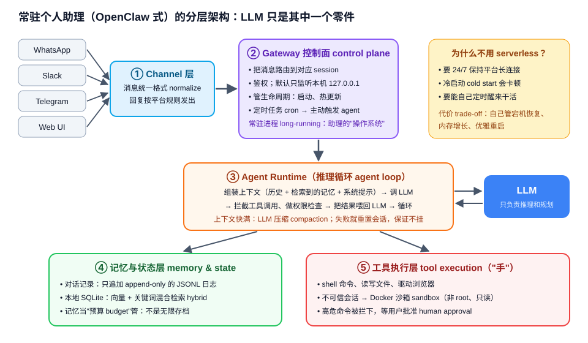
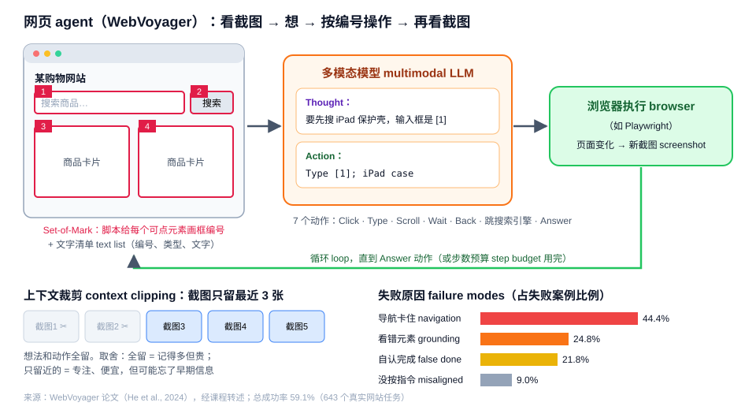

# 06 · 两个完整案例：常驻个人助理（OpenClaw）和网页 agent（WebVoyager）

> 来源：Educative《Agentic System Design》Ch.11「Designing a Personal AI Assistant like OpenClaw」，Ch.7「Designing a Web Agent」中的「The Multimodal Web Agent Challenge」「WebVoyager's Architecture」「Evaluating WebVoyager」三课，2026-10-26 读。
> 跳过的部分：MACRS、Eureka、MuLan、ChainBuddy、AI Hospital 这几个论文复述案例，以及 Google ADK 和 AutoGen 的动手实现。

---

## A. 常驻个人助理（OpenClaw 式）

**为什么值得看**："设计一个能帮我处理邮件、日程、文件的个人助理 agent" 很可能成为面试题。06 题库里还没有这道题，而这一课给了一个完整、讲取舍（trade-off）的答案。

### A1. 和普通聊天机器人差在哪：五个硬约束

| 约束（constraint） | 意思 |
|---|---|
| **一直在线** | 7×24 保持和 WhatsApp、Slack 等平台的连接 |
| **跨平台延续** | 在手机上聊到一半，换到 Slack 还能接着聊 |
| **能动手** | 跑 shell 命令、读写文件、操作浏览器 |
| **长期记忆（long-term memory）** | 记得几周前说过的事，又不能把上下文窗口（context window）撑爆 |
| **主动** | 不等用户开口，定时检查、发现情况主动提醒 |

**核心观点：LLM（large language model，大语言模型）不是系统本身，只是系统里负责推理（reasoning）的一个零件。** 持久化（persistence）、安全、工具（tool）执行、可靠性（reliability）都由基础设施负责。要问的问题不再是"prompt 怎么写更好"，而是"长会话（session）怎么组织、不可信输入怎么隔离、权限怎么强制执行"。**把助理当成基础设施来设计，它更像一个操作系统，而不是一个 prompt 模板。**

### A2. 分层架构

| 层 | 职责 |
|---|---|
| ① Channel 层 | 各平台适配器（adapter）：把消息**统一成内部格式**，在本层消化各平台的怪癖，回复时按平台规则发出（Web 端流式，WhatsApp 整段发） |
| ② Gateway 控制面（control plane） | 常驻的 WebSocket 服务，助理的"操作系统"：把消息路由（routing）到对应 session、鉴权（authentication / authorization）、管理生命周期（启动、热更新（hot reload）、定时任务（scheduled job）） |
| ③ Agent Runtime | 组装上下文（context，历史 + 检索（retrieval）到的记忆（memory） + 系统提示（system prompt））→ 调 LLM → **拦截工具调用（tool calling）、做策略检查** → 把结果喂回模型 → 循环 |
| ④ 记忆与状态（state）层 | 对话记录写成**只追加（append-only）的 JSONL（JSON Lines，每行一个 JSON 的日志格式）日志**；本地 SQLite 做**向量（vector） + 关键词混合检索（hybrid retrieval）** |
| ⑤ 工具执行层 | shell、文件系统、浏览器；不可信会话放进 **Docker 沙箱（sandbox）**；高危命令要用户批准 |

### A3. 关键设计决策

**① 常驻进程（long-running process），不用 serverless**

- serverless 的问题：每条消息都冷启动（cold start），延迟（latency）高；平台长连接保持不住；没法自己定时醒来。
- 常驻进程的好处：路由表在内存里，session 状态一直是"热"的，支持流式和后台任务。
- **代价**：要自己负责可用性（availability）、宕机恢复、内存增长，重启时还要保证日志不写坏。

**② 主动性（proactivity）不需要单独的监控系统**

同一个 agent，换一种触发方式就行：用户消息触发，或者**定时任务触发**。定时检查时如果没事，agent 就静默结束这一轮（课程叫 sentinel token）；有重要情况才主动发消息。

**③ 纵深防御（defense in depth）**（假设任何一层都可能失守）

| 层 | 做法 |
|---|---|
| 网络 | 默认只监听本机 `127.0.0.1` |
| 网关（gateway）鉴权 | 远程访问要严格认证，比较凭证（credentials）时用**定长时间比较（constant-time comparison）**，防止计时攻击（timing attack） |
| 按 session 分权限 | "主"会话可以访问主机；私聊、群聊会话只能在沙箱里跑 |
| 硬沙箱 | 不可信会话的工具放进 Docker：非 root、只读文件系统（read-only filesystem）、去掉多余权限 |
| 人工确认 | 高危 shell 命令被拦下，等用户在控制台批准 |

**④ 上下文当预算管**

- Runtime 一直在权衡系统提示、近期历史、工具结果各占多少 token。
- 快满时，**用 LLM 把早期对话压缩成摘要（compaction）**。
- **压缩也失败时，宁可重置会话也不让服务挂掉**：可用性优先于记忆完整性。对一个常驻助理来说，"活着"是最重要的功能。

**⑤ 防 prompt 注入（prompt injection）：先把信息贴好标签**

用结构化格式把"系统指令（instruction） / 用户消息 / 工具输出"分开，并给每条输入加上来源元数据（metadata）。课程的观点：**大多数注入漏洞不是模型的错，而是系统没有把信息的来源标对**。

### A4. 哪些决策是承重墙（load-bearing decision），哪些可以换

| 承重墙（一改系统性质就变了） | 可替换（swappable）（实现细节） |
|---|---|
| 常驻 Gateway（而不是 serverless） | SQLite 可以换成 Pinecone 等外部向量库（vector database） |
| Session 作用域：一切通过结构化的 key 路由，从而实现隔离 | Docker 可以换成 gVisor 等其他隔离技术 |
| Agent 循环和基础设施逻辑分开 | 往前端流式推 token 的具体方式 |

> 面试里主动区分"承重墙"和"可替换"，是很好的 Staff 信号：说明你知道哪些决定难以回头。

### A5. 面试里能说的话

> For an always-on personal assistant, I'd treat the LLM as one component inside a persistent runtime, closer to an OS than a prompt. Channel adapters normalize messages from each platform. A long-running gateway routes events to scoped sessions, handles auth, and fires scheduled triggers, so proactive behavior is just the same agent with a different trigger. The agent runtime assembles context within a token budget, intercepts every tool call for policy checks, and runs untrusted sessions in a sandbox, with human approval for risky commands. The load-bearing choice is a persistent process over serverless: it gives continuity and background autonomy, at the cost of owning uptime and crash recovery. When context overflows, I'd rather compact or reset the session than go down.

> 讲这道题时，可以接上 06 §2.4 的“状态外化、上下文契约（context contract）、schema 校验”做法。

---

## B. 网页 agent（WebVoyager）

**为什么值得看**："设计一个能替用户在网站上完成任务的 agent"，是 computer-use 和 browser agent 类题目的原型。这一课的设计取舍（trade-off）和失败分析很有代表性。

### B1. 核心难点：grounding（落到具体元素上）

模型看懂了页面，还要能**准确说出"点哪个元素"**。如果用自然语言（natural language）描述（"中间那个蓝色的搜索按钮"），很容易点错。

**为什么不直接读 HTML？**（课程「The Multimodal Web Agent Challenge」）HTML 能精确列出每个按钮和输入框，但现代网页的 HTML 动辄几十万 token，满是样式和脚本代码，还看不出布局和图片内容。所以多模态（multimodal） agent 改成主要看**截图（screenshot）**，像人一样浏览。

**截图带来的新问题：生成动作（action） vs 落到元素**。SeeAct 论文发现，多模态模型（multimodal model）很擅长想清楚**"做什么"**（action generation，"我该点搜索按钮"），但不擅长准确指出**"点哪一个"**（action grounding）。课程的类比是厨房：主厨说"炒 7 号桌的菜"没错，但帮厨得从一堆锅和菜碗里找对是哪一份。WebVoyager 的 Set-of-Mark 编号就是用来解决后一步的。

### B2. 架构

| 设计 | 做法 | 为什么 |
|---|---|---|
| **多模态 ReAct（Reasoning + Acting，推理与行动）循环** | 每一步先输出 Thought（为什么这么做），再输出 Action（具体动作） | 网页不可预测（弹窗、改版、多条路径），提前定好的计划会失效，所以要走一步看一步；写出 Thought 也方便排查 |
| **截图为主** | 主要输入是网页截图，而不是 HTML | 能看出布局和空间关系；原始 HTML 又长又乱 |
| **Set-of-Mark 标注** | 脚本先给每个可交互元素（interactive element）画框、编号，再把截图交给模型 | 模型只要说"Click [2]"，**动作指向的元素没有歧义**。可推广的模式叫 *grounded action referencing*：给环境里的对象贴上结构化标签 |
| **双模态观察** | 截图之外再附一份文字清单：编号、元素类型、文字内容 | 看得到布局，也读得到准确的文字 |
| **7 个动作** | Click、Type、Scroll、Wait、Back、跳转搜索引擎（search engine）、Answer | 模仿人浏览网页的动作；"跳转搜索引擎"用于卡住时自救；Answer 是唯一的结束动作 |
| **上下文裁剪（context clipping）** | 想法和动作全部保留，**截图只留最近 3 张** | 专注 vs 记忆（memory）的取舍：全留又贵，又容易被旧页面干扰 |

### B3. 怎么评估（这一部分对任何 agent 都适用）

- **用真实网站评估（evaluation）**，不用模拟器：643 个任务，覆盖 Amazon、Google Flights、GitHub 等 15 个网站，才能测出弹窗、改版这类真实问题。
- **造数据集（dataset）的方法（self-instruct）**：人写少量种子任务 → 让 LLM（large language model，大语言模型）仿写出大量任务 → **人逐条验证能不能做**。
- **不看"标准路径（golden trajectory）"，只看结果**：网页上往往有多条正确路径，只认一条会误判。人工评审员看完整的操作轨迹（trajectory），判断成功还是失败。
- **用 LLM 当评委（judge）来扩大规模**：给多模态模型看最后 k 张截图，让它判断成败。论文报告它和人工判断的**一致率是 85.3%**。k 是一个要调的参数（parameters）。

### B4. 结果和失败分析（论文数字）

总成功率 **59.1%**。失败的案例中：

| 失败原因 | 占失败的比例 | 对应的设计改进 |
|---|---|---|
| 导航卡住、出错后不会恢复 | 44.4% | 更好的规划（planning）和恢复机制、步数上限、发现循环就跳出 |
| 看错页面元素（visual grounding） | 24.8% | 更好的标注和定位；结合 DOM（Document Object Model，文档对象模型）信息 |
| **以为做完了，其实没做完（幻觉（hallucination））** | 21.8% | **结束前做校验**（检查页面状态（state）是否真的达标）、评审循环 |
| 没按指令（instruction）做 | 9.0% | 指令设计 |

> 关键教训：近一半失败是"不会恢复"，五分之一是"自以为完成"。所以**完成判断不能只信模型自己说的**，要用代码或另一个评审去验证。这和 [04 §2](04-agent-basics.md) 的"停止条件（stop condition）写在代码里"是同一件事。

### B5. 面试里能说的话

> For a browser agent, the core problem is grounding: turning "click the search button" into an unambiguous target. I'd use a ReAct loop over a screenshot annotated with numbered marks on interactive elements, plus a text list of those elements, so the model acts by ID. History keeps every thought and action but only the last few screenshots, which trades recall for focus and cost. For evaluation I'd use live tasks judged on outcome rather than a golden path, with an LLM judge calibrated against human labels. And because a big share of failures are getting stuck or falsely declaring success, I'd add loop detection, a step budget, and a verifier that checks the page state before accepting "done".

---

## 中英术语表（Key terms）

| 中文 | English | 面试里这样用 |
|---|---|---|
| 常驻进程 | long-running / persistent process |  |
| 无服务器 | serverless |  |
| 冷启动 | cold start |  |
| 控制面 | control plane |  |
| 适配器 / 归一化 | adapter / normalization |  |
| 会话作用域 | session scoping | "Permissions are scoped per session, not global." |
| 定时触发 | scheduled trigger (cron) | "Proactivity is the same agent with a different trigger." |
| 主动性 | proactive autonomy |  |
| 只追加日志 | append-only log |  |
| 沙箱 | sandbox |  |
| 定长时间比较 | constant-time comparison |  |
| 上下文压缩 | context compaction |  |
| 可用性优先于完整性 | availability over fidelity | "I'd rather reset the session than go down." |
| 承重墙决策 / 可替换决策 | load-bearing / swappable decisions | "This is a load-bearing decision; that one is swappable." |
| 定位到元素 | grounding | "The core problem for a browser agent is grounding." |
| 标记提示 | Set-of-Mark prompting |  |
| 观察空间 / 动作空间 | observation space / action space |  |
| 上下文裁剪 | context clipping |  |
| 标准路径 | golden trajectory | "Judge the outcome, not a golden path." |
| 自举生成数据 | self-instruct (data generation) |  |
| LLM 当评委 | LLM-as-a-judge | "Calibrate the LLM judge against human labels." |
| 一致率 | agreement rate |  |
| 循环检测 | loop detection |  |
| 完成校验 | completion verifier / post-condition check | "A verifier checks the page state before accepting done." |
| 生成动作 / 落到元素 | action generation / action grounding | "Models are good at deciding what to do, weaker at pinpointing which element." |

---

## 自测

1. 为什么常驻助理选常驻进程（long-running process）而不选 serverless？代价是什么？（A3 ①）
2. 定时检查、主动提醒，需要单独建一个监控系统吗？（A3 ②）
3. "上下文（context）满了而且压缩（compression）失败"，OpenClaw 怎么处理？为什么？（A3 ④）
4. Set-of-Mark 解决了什么问题？（B2）
5. WebVoyager 最大的两类失败是什么？分别怎么改进？（B4）

---

**来源**（2026-10-26 查）：Educative《Agentic System Design》Ch.7、Ch.11；He et al., 2024, [*WebVoyager*](https://arxiv.org/abs/2401.13919)（59.1% 成功率和 85.3% 评委一致率已对照论文摘要核实；失败分类的百分比来自课程对论文的转述）。OpenClaw 的组件细节（SQLite、JSONL、Docker、127.0.0.1 等）**来自课程描述，我没有对照 OpenClaw 源码核实**【待核实】。
