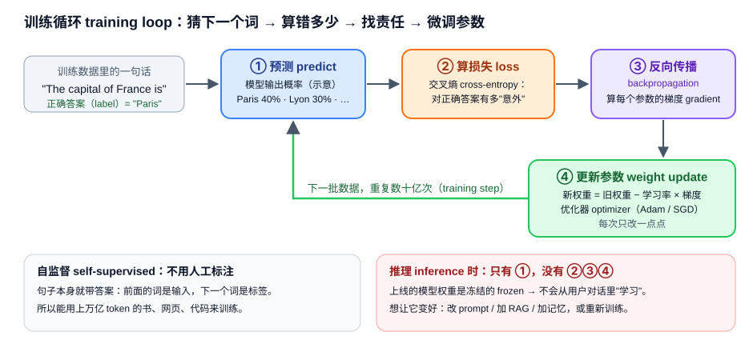
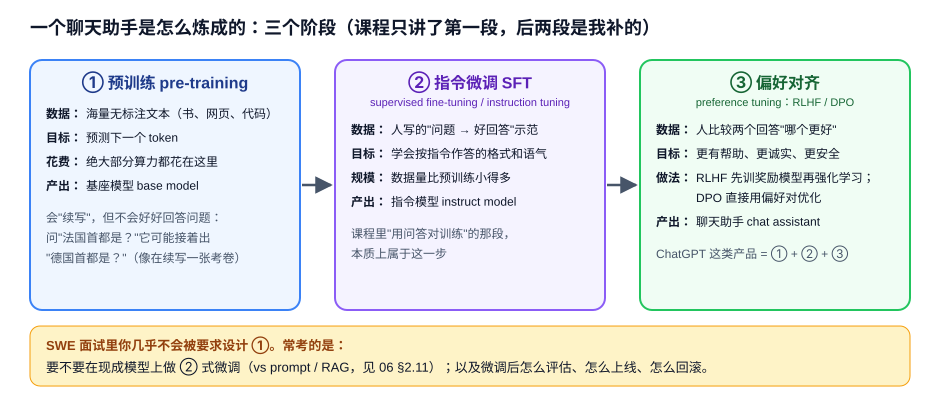
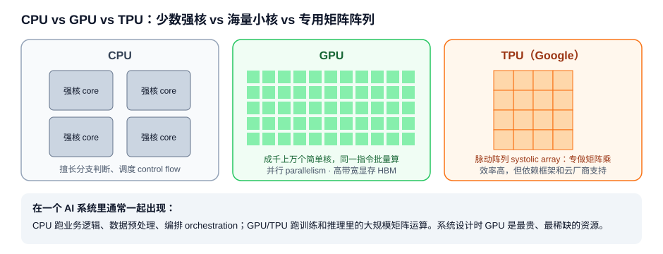

# 07 · 模型是怎么训练出来的（以及跑在什么硬件上）

> 来源：Educative《Grokking the Generative AI System Design》Ch.13「How LLMs Learn (The Training Loop)」「CPU vs. GPU vs. TPU」、Ch.5「Training Infrastructure of a Text-to-Text Generation System」，2026-10-26 读，用自己的话重写。图是我自己画的。
> 课程只讲了"预训练（pre-training）"一段，**完全没讲指令微调（SFT（supervised fine-tuning，监督微调））和偏好对齐（RLHF（reinforcement learning from human feedback，基于人类反馈的强化学习） / DPO（Direct Preference Optimization，直接偏好优化））**。这两段是我按公开论文补的，并附了来源。
> 读完你应该能讲清：模型怎么"学"；为什么上线后的模型不会从用户对话里学习；ChatGPT 这类助手经历了哪三个训练（training）阶段；CPU、GPU、TPU（Tensor Processing Unit，张量处理单元）各干什么。

---

## 1. 一句话

**训练（training） = 让模型反复"猜下一个词 → 看错了多少 → 把参数（parameters）往对的方向挪一点点"，重复几十亿次。** 推理（inference）时参数是冻结（frozen）的，模型只做"猜"这一步。

---

## 2. 训练循环（training loop）

| 步骤 | 做什么 | 大白话 |
|---|---|---|
| ① 预测（predict） | 输入一段文字，模型输出"下一个 token"的概率表 | 先猜 |
| ② 损失（loss） | 用**交叉熵（cross-entropy）**衡量模型对正确答案有多"意外" | 对答案；**错得越自信，罚得越重** |
| ③ 反向传播（backpropagation） | 从损失往回算，每个参数（parameters）对这次出错"负多大责任"，得到**梯度（gradient）** | 找责任人（课程的类比：像从 bug 往回追调用栈） |
| ④ 更新参数（weight update） | 新权重 = 旧权重 − **学习率（learning rate）** × 梯度，由**优化器（optimizer）**（Adam、SGD（stochastic gradient descent，随机梯度下降））执行 | 每次只改一点点 |

再加几个常见术语：

- **自监督（self-supervised）**：句子本身就带答案，前面的词是输入、下一个词是标签，**不需要人工标注（human annotation）**。所以能用上万亿 token 的书、网页、代码来训练（training）。
- **批大小（batch size）**：一次喂多少条样本（sample）。**轮数（epoch）**：完整过一遍数据算一轮。
- **验证集损失（validation loss）**：用模型没见过的数据检查。验证损失不再下降甚至上升，说明开始**过拟合（overfitting）**，应该停下来。
- **规模定律（scaling）**：数据越多、参数越多，效果越好，但**收益递减**：后面每提升一点，要多花不成比例的算力（compute）。

> 类比：训练像一个学生做了几十亿道"完形填空"，每做错一道就把脑子里相关的旋钮拧一下。他并不"理解"句子，只是越来越会猜。

---

## 3. 训练 vs 推理：上线的模型不会自己变聪明

| | 训练（training） | 推理（inference） |
|---|---|---|
| 目的 | 从数据里学规律 | 用学到的规律回答新问题 |
| 权重（weights） | 不断更新 | **冻结（frozen）** |
| 损失（loss） / 反向传播（backpropagation） | 有 | 没有 |
| 成本 | 极高（几周到几个月，大量 GPU） | 每次请求相对便宜，但随用户量持续累积 |
| 会不会学习 | 会 | **不会** |

**面试里非常重要的推论**：用户和产品聊天，**模型本身不会"记住"或"学会"任何东西**。产品里的"记忆（memory）"和"个性化（personalization）"来自外部系统（会话（session）存储、长期记忆（long-term memory）、RAG（retrieval-augmented generation，检索增强生成），见 [04 §3](04-agent-basics.md)）。想让模型本身变好，只能重新训练或微调（fine-tuning）。

> A deployed model's weights are frozen; it doesn't learn from user conversations. Personalization comes from memory and retrieval around the model, and improving the model itself means another training or fine-tuning run with its own eval and rollout.

---

## 4. 一个聊天助手经历的三个训练阶段（课程没讲，我补的）

| 阶段 | 数据 | 学到什么 | 产出 |
|---|---|---|---|
| ① **预训练（pre-training）** | 海量无标注（unlabeled）文本 | 语言、知识、推理（reasoning）的统计规律 | **基座模型（base model）**：会续写，但不会好好"回答" |
| ② **指令微调（supervised fine-tuning, SFT / instruction tuning）** | 人写的"指令 → 好回答"示范 | 按指令作答的格式和语气 | **指令模型（instruct model）** |
| ③ **偏好对齐（preference tuning）** | 人比较两个回答"哪个更好" | 更有帮助、更诚实、更安全 | **聊天助手（chat assistant）** |

- **RLHF**（reinforcement learning from human feedback）：先用人的偏好训一个**奖励模型（reward model）**，再用强化学习（reinforcement learning）让模型去拿高分。InstructGPT 论文是代表。
- **DPO**（direct preference optimization）：跳过奖励模型，直接用"好回答 / 差回答"的配对数据优化。更简单。
- 这些阶段的具体配方各家都不完全公开，**面试里讲清这三段的作用就够了，不要编细节**。

**和系统设计的关系**：SWE 面试几乎不会让你设计 ①。常考的是"要不要在现成模型上做 ② 式微调（fine-tuning）"，相对于 prompt 和 RAG（retrieval-augmented generation，检索增强生成）怎么取舍（trade-off），见 [06 §2.11](../06-ai-system-design.md)。如果要微调，就要讲清数据怎么来、怎么评估（evaluation）、怎么灰度上线（canary rollout）和回滚（rollback）。

---

## 5. 课程里"训练一个对话模型"那课的问题（面试别照搬）

课程设计的流程是：拿 Llama 3.2 3B 的架构**从零训练（training）**，用 50 GB、2 亿行问答对，训练 1,000 轮，用 32 张 A100 估算约 8 天。几处要注意：

| 课程说法 | 问题 |
|---|---|
| 用 2 亿行"问题 → 回答"从零训练一个对话模型 | 这其实是阶段 ② 的数据。**从零训练**需要的是阶段 ① 的海量无标注（unlabeled）文本。现实做法是在已有基座模型（base model）上做 SFT（supervised fine-tuning，监督微调） |
| 训练 1,000 轮（epoch） | 大模型预训练（pre-training）通常只把语料过一遍左右。对小数据集（dataset）反复训 1,000 轮会严重过拟合（overfitting） |
| 把训练数据转成向量（vector）存进**向量库（vector database）**，供训练读取 | 训练读的是 token 化后的原始文本，向量库是给 RAG（retrieval-augmented generation，检索增强生成）检索（retrieval）用的，两件事混了 |
| A100 按 156 TFLOPS（tera floating-point operations per second，每秒万亿次浮点运算）算 | 同一门课在估算章节用的是 312 TFLOPS（FP16 峰值（peak））。156 对应的是 TF32 精度（precision）。**同一门课前后不一致**，引用时说清精度 |
| 只用 BLEU、ROUGE、perplexity 评估（evaluation）对话模型 | 对话质量要靠人工或 LLM（large language model，大语言模型）评委（judge） + 任务指标，见 06 §2.6 |

课程里值得保留的：训练前要做**数据清洗（data cleaning）和去偏（debiasing）**（话题分布、人群刻板印象、情绪分布；欠代表的数据用合成数据（synthetic data）补，过度代表的下采样（downsampling），有害内容删掉）；数据预处理（data preprocessing）可以按机器数并行（parallel）切分；训练时间公式 `≈ 6 × 参数量 × 训练 token 数 ÷ (每卡 FLOPS × 卡数 × 利用率)`（[02 §5.1](02-inference-and-estimation.md)）。

---

## 6. 硬件：CPU、GPU、TPU

| 硬件 | 结构 | 擅长 | 不擅长 | 在 AI 系统里干什么 |
|---|---|---|---|---|
| **CPU** | 少量强核 | 分支判断、调度、通用代码 | 大规模矩阵（matrix）运算 | 业务逻辑、数据预处理（data preprocessing）、编排（orchestration）、小模型 |
| **GPU** | 成千上万个简单核 + 高带宽显存（HBM，high-bandwidth memory） | 并行（parallelism）矩阵 / 向量（vector）运算 | 分支多的逻辑；功耗高 | **训练（training）和大规模推理（inference）的主力** |
| **TPU（Tensor Processing Unit，张量处理单元）**（Google） | 专用矩阵乘单元（**脉动阵列（systolic array）**） | 超大规模矩阵乘，能效高 | 灵活性低；依赖框架（framework）和云支持 | Google 生态里的大规模训练 / 推理 |

> 系统设计里的结论：**GPU 是最贵、最稀缺的资源**。所以估算从 GPU 开始（[02 §5](02-inference-and-estimation.md)），优化也围绕 GPU 利用率（utilization）展开：batching、量化（quantization）、路由（routing）小模型。

---

## 中英术语表（Key terms）

| 中文 | English | 面试里这样用 |
|---|---|---|
| 训练 / 推理 | training / inference | "Training updates weights; inference only reads them." |
| 训练循环 | training loop | |
| 损失 / 交叉熵 | loss / cross-entropy | "Cross-entropy punishes confident wrong answers the most." |
| 反向传播 / 梯度 | backpropagation / gradient | |
| 学习率 / 优化器 | learning rate / optimizer (Adam, SGD) | |
| 批大小 / 轮数 | batch size / epoch | |
| 验证集 / 过拟合 | validation set / overfitting | "Stop when validation loss stops improving." |
| 自监督 | self-supervised learning | "The text itself provides the labels." |
| 规模定律 / 收益递减 | scaling / diminishing returns | |
| 冻结权重 | frozen weights | "A deployed model doesn't learn from users." |
| 预训练 | pre-training | |
| 基座模型 | base model | |
| 指令微调 | supervised fine-tuning (SFT) / instruction tuning | "SFT teaches the format of following instructions." |
| 偏好对齐 | preference tuning / alignment | |
| 人类反馈强化学习 | RLHF (reinforcement learning from human feedback) | |
| 奖励模型 | reward model | |
| 直接偏好优化 | DPO (direct preference optimization) | |
| 去偏 / 合成数据 / 下采样 | debiasing / synthetic data / downsampling | |
| 高带宽显存 | high-bandwidth memory (HBM) | |
| 脉动阵列 | systolic array | |

## 面试里能说的话

> A model learns by predicting the next token, measuring the error with cross-entropy, backpropagating to get gradients, and nudging the weights, billions of times. A chat assistant then goes through supervised fine-tuning on instruction-response examples and preference tuning such as RLHF or DPO. In system design I rarely train from scratch; the real decision is prompt versus RAG versus fine-tuning, and since deployed weights are frozen, anything that should change per user lives in memory and retrieval around the model.

## 自测

1. 训练循环（training loop）的四步是什么？哪一步才真正"学习"？（§2）
2. 用户纠正了模型一个错误，下次换个用户问，模型会答对吗？为什么？（§3）
3. 基座模型（base model）和聊天助手（chat assistant）差在哪两个阶段？（§4）
4. 课程"用问答对从零训练（training）、训 1,000 轮"错在哪？（§5）
5. 系统设计里为什么估算从 GPU 开始？（§6）

---

**来源**（2026-10-26 查）：Educative《Grokking the Generative AI System Design》Ch.5、Ch.13；Ouyang et al., 2022, [*Training language models to follow instructions with human feedback*（InstructGPT）](https://arxiv.org/abs/2203.02155)；Rafailov et al., 2023, [*Direct Preference Optimization*](https://arxiv.org/abs/2305.18290)；[NVIDIA A100 规格页](https://www.nvidia.com/en-us/data-center/a100/)（FP16 Tensor Core 312 TFLOPS，TF32 156 TFLOPS，均不含稀疏加速）。
