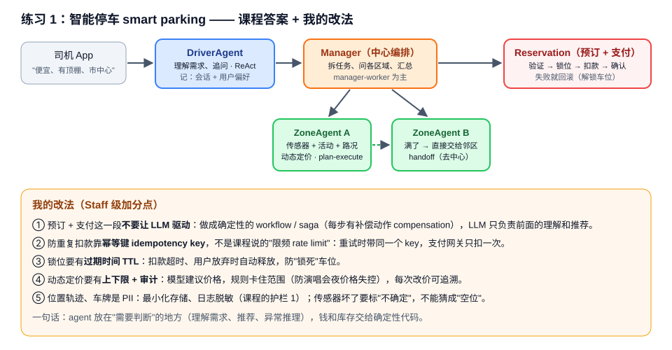
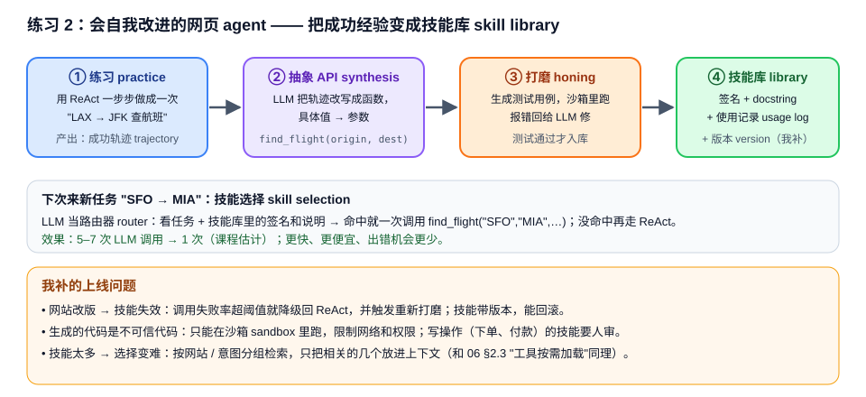
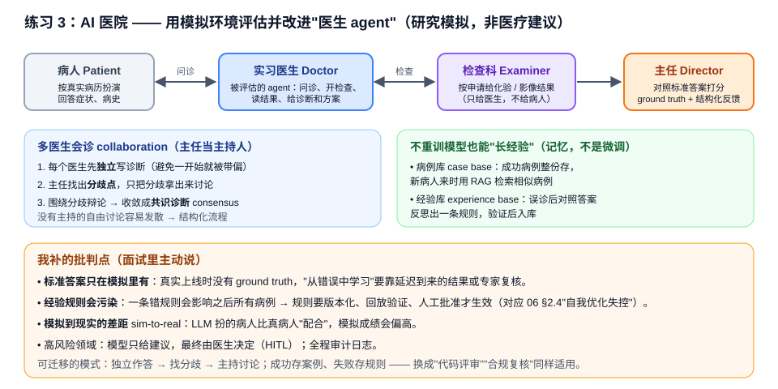

# 08 · 三道 agent 设计练习（按面试格式整理）

> 来源：Educative《Agentic System Design》的三个思考题「Design a Smart Parking Agent System」「Designing a Self-Improving Web Agent」「Design a Multi-Agent Medical Diagnosis System」，2026-10-26 读，包括课程的参考答案。图是我自己画的。
> 每道题的结构：题目 → 课程参考答案的要点 → **我补的 Staff 级改法**（课程答案有几处在生产里会出事）→ 英文话术 → 自测。
> 用法：先遮住答案，按 [06 §1.3](../06-ai-system-design.md) 的 9 步框架（framework）自己讲 20–30 分钟，再对照。

---

## 练习 1：把一个智能停车系统改造成多 agent 系统

**题目**：已有一套微服务（microservices，传感器、预订、用户、通知），能用但只会"被动响应"。希望它能主动改道、按需求动态定价（dynamic pricing）、做个性化（personalization）推荐、在传感器故障时自己推理（reasoning）。怎么设计？

### 课程参考答案要点

| 决策（decision-making） | 课程的选择 | 理由 |
|---|---|---|
| 整体编排（orchestration） | **以 manager-worker 为主的混合模式**：Manager 统一协调；区域之间满了就直接交接（handoff） | 主流程可控；局部交互不必绕回中心，更有韧性 |
| DriverAgent（由用户服务演化） | ReAct（Reasoning + Acting，推理与行动）；理解自然语言（natural language）需求、追问；记住会话（session）和用户偏好 | 面向人的交互需要一步步可见 |
| ZoneAgent（由传感器服务演化） | plan-and-execute：查占用 → 查活动 → 查路况 → 动态定价 → 返回前 3 名 | 步骤固定、可审计（audit）；传感器坏了用相邻传感器推断 |
| ReservationAgent（由预订服务演化） | plan-and-execute：验证用户 → 锁定车位 → 扣款 → 确认 → 通知；失败就回滚（rollback） | 事务要按顺序、可回滚 |
| 护栏（guardrails） | ① PII（personally identifiable information，个人身份信息）脱敏（redaction，车牌、位置轨迹（trajectory））；② 支付工具（tool）做参数校验（argument validation） + 限频（rate limiting） | 隐私风险、资金风险 |

### 我的改法（面试里主动说）

| 课程答案 | 问题 | 改成 |
|---|---|---|
| 预订和支付也交给一个"agent" | 钱和库存不需要语言判断，交给 LLM（large language model，大语言模型）只会增加不确定性（nondeterminism） | **确定性（deterministic）的 workflow / saga**（每步配一个补偿动作（compensation）），LLM 只负责前面的理解和推荐 |
| 用限频防止重复扣款 | 限频挡不住"超时（timeout）后重试 → 扣两次" | **幂等键（idempotency key）**：同一笔预订的所有重试带同一个 key，支付网关（payment gateway）只扣一次（对应 06 §2.3 工具设计第 7 条） |
| 锁定车位 | 扣款卡住或用户放弃，车位就一直被锁 | 锁要带 **TTL（time to live，存活时间）自动过期** |
| 动态定价交给 agent 推理 | 演唱会夜价格可能被推到离谱 | 模型给建议，**规则卡上下限**，每次改价写审计日志（audit log） |
| 传感器坏了用相邻数据推断 | 推断出"空位"会把人导到不存在的车位 | 推断结果标成**"不确定"**，对用户降级（graceful degradation）显示 |

> I'd keep the LLM where judgment is needed — understanding the request, ranking options, reasoning about anomalies — and keep money and inventory in deterministic code: a saga with compensations, idempotency keys on payment, TTL'd spot locks, and pricing suggestions clamped by rules and audited. Rate limiting doesn't prevent double charges; idempotency does.

---

## 练习 2：会自我改进的网页 agent（技能库）

**题目**：网页 agent 每次查航班都从头点一遍菜单，又慢又贵还容易错。怎么让它把做成功过的流程变成可复用的能力？

### 课程参考答案要点

1. **问题**：重复做同类任务时，每一步都要截图（screenshot）、标注、调一次 LLM（large language model，大语言模型）。课程估计一次查航班要 5–7 次 LLM 调用，延迟（latency）、token 和出错概率都随步数增加。
2. **三阶段流水线**：
   - **练习（skill practice）**：用 ReAct（Reasoning + Acting，推理与行动）做成一次，得到成功轨迹（trajectory）。
   - **抽象（API synthesis）**：LLM 把轨迹改写成带参数（parameters）的函数，比如 `find_flight(origin, dest, date)`，具体值变成参数。
   - **打磨（skill honing）**：LLM 生成多组测试用例，在沙箱（sandbox）里跑，报错回给 LLM 修，测试通过才入库。
3. **技能库（skill library）**：每个技能存签名、说明文档（docstring）、使用记录。
4. **技能选择（skill selection）**：新任务来了，LLM 当路由器（router），看任务描述和技能清单；命中就一次调用，没命中再走 ReAct。

### 我的改法

- **技能会过期**：网站一改版，技能就坏了。要监控每个技能的调用失败率，超过阈值就降级（graceful degradation）回 ReAct 并重新打磨；技能要**版本化（versioning）**，能回滚（rollback）。
- **生成的代码是不可信代码**：只在沙箱（sandbox）里运行，限制网络和权限；会下单、付款的技能，上线前要人审。
- **技能多了要按需加载**：按网站和意图（intent）分组检索（retrieval），只把相关的几个放进上下文（context，同 06 §2.3"工具（tool）按需加载"）。
- 06 §2.3 里的"技能库（SkillWeaver 思路）"讲的是同一件事，面试版本以那里为准。

> Repeated tasks shouldn't be re-reasoned every time. After a successful run, I'd distill the trajectory into a parameterized function, test it in a sandbox, and register it with a description and version. The router picks a skill when one matches and falls back to step-by-step reasoning when not, and failing skills get demoted automatically. That cuts LLM calls, latency, and error surface.

---

## 练习 3：AI 医院（多 agent 模拟环境）

> ⚠️ 这是基于研究模拟的思考题，用来练习多 agent 设计，**不是医疗建议**。

**题目**：选择题考试测不出 AI 能不能像医生一样问诊。设计一个模拟医院，评估（evaluation）并持续改进"医生 agent"。

### 课程参考答案要点

| 部分 | 设计 |
|---|---|
| 核心角色 | **实习医生**（被评估的 agent：问诊、开检查、给诊断和方案）、**病人**（按真实病历扮演）、**检查科**（按申请给化验 / 影像结果，只给医生）、**主任**（对照标准答案（ground truth）打分、给结构化反馈（feedback）） |
| 多医生会诊 | ① 每个医生**独立**写诊断；② 主任找出**分歧点**；③ 只围绕分歧讨论；④ 收敛成**共识**（consensus）。有主持人，讨论才不会发散 |
| 不重训也能进步 | **病例库**（case base）：成功病例整份存，新病人来时用 RAG（retrieval-augmented generation，检索增强生成）检索（retrieval）相似病例；**经验库**（experience base）：误诊后对照答案反思（reflection）出一条规则，验证后入库 |
| 为什么做模拟 | 短时间看大量病例、不需要人工标注（human annotation）、结果能迁移到真实基准考试、能从行动（action）后果中学习 |

### 我的改法

- **标准答案只在模拟里有**：真实上线后没有现成的 ground truth，"从错误中学习"要靠延迟到来的结果或专家（expert）复核。
- **经验规则会污染后续判断**：一条错规则会影响之后所有病例。规则要版本化（versioning）、先回放（replay）验证、人工批准才生效（对应 06 §2.4"自我优化失控"那一行）。
- **模拟和现实有差距（sim-to-real gap）**：LLM（large language model，大语言模型）扮演的病人比真病人配合，模拟成绩会偏高。
- **高风险领域**：模型只给建议，最终由人决定（HITL（human-in-the-loop，人在回路）），全程审计（audit）。
- **可迁移的模式**："独立作答 → 找分歧 → 主持讨论"和"成功存案例、失败存规则"，换到代码评审、合规（compliance）复核同样适用。你自己的合规 triage 项目就可以这样讲。

> I'd structure collaboration as independent drafts, a moderator that extracts disagreements, and a focused debate toward consensus, so agents don't anchor on each other. For improvement without retraining, successes go into a retrievable case base and failures become candidate rules, but rules only take effect after replay validation and human approval, because one bad rule silently degrades every later case.

---

## 三道题的共同点

| 共同模式 | 练习 1 | 练习 2 | 练习 3 |
|---|---|---|---|
| 判断交给 LLM（large language model，大语言模型），确定性（deterministic）交给代码 | 推荐给 LLM，支付给 saga | 选技能给 LLM，执行给测试过的代码 | 诊断给 LLM，打分对照标准答案（ground truth） |
| 有外部验证 | 支付网关（payment gateway）、库存锁 | 沙箱（sandbox）测试 | 主任对照标准答案 |
| 改进要有闸门 | 定价规则上下限 | 技能版本、失败降级（graceful degradation） | 规则回放（replay）验证、人工批准 |

## 中英术语表（Key terms）

| 中文 | English | 面试里这样用 |
|---|---|---|
| 主动 vs 被动 | proactive vs reactive | "Today it's reactive; agents make it proactive." |
| 混合编排 | hybrid orchestration (manager-worker + handoff) | |
| 补偿事务 | saga / compensating transaction | "Payment runs as a saga, not an agent loop." |
| 幂等键 | idempotency key | "Rate limiting doesn't stop double charges; idempotency does." |
| 锁过期 | lock TTL / lease | |
| 动态定价 | dynamic pricing (clamped by rules) | |
| 降级显示 | graceful degradation | |
| 成功轨迹 | successful trajectory | |
| 技能抽象 / 打磨 | skill synthesis / skill honing | |
| 技能库 / 技能选择 | skill library / skill selection | |
| 版本化 | versioning | |
| 共识 | consensus | |
| 主持人 | moderator | "A moderator extracts disagreements instead of free-form debate." |
| 病例库 / 经验库 | case base / experience base | |
| 标准答案 | ground truth | "Ground truth exists in simulation, not in production." |
| 模拟到现实的差距 | sim-to-real gap | |

## 自测

1. 练习 1 里为什么"限频（rate limiting）"防不住重复扣款？正确做法是什么？（练习 1）
2. 技能库（skill library）上线后最常见的两种失效是什么？分别怎么处理？（练习 2）
3. 多医生会诊为什么要"先独立写、再讨论分歧"？（练习 3）
4. 经验库里的规则为什么不能自动生效？（练习 3）

---

**来源**：Educative《Agentic System Design》三个 Thought Exercise（2026-10-26 读，含课程参考答案）。"我的改法"是我对照 06 已有原则补的，不是课程内容。
