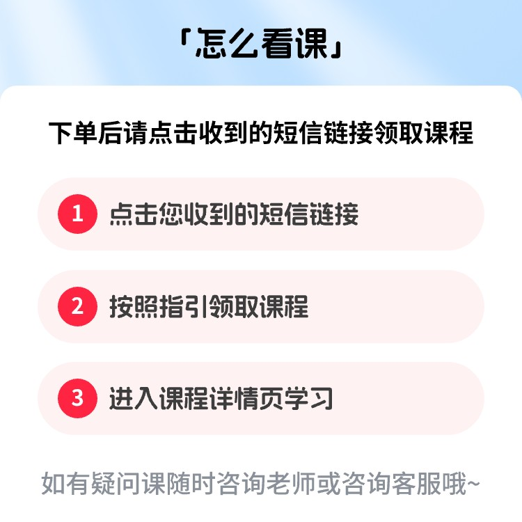
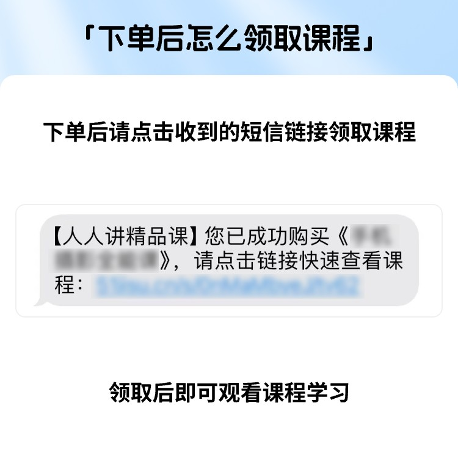
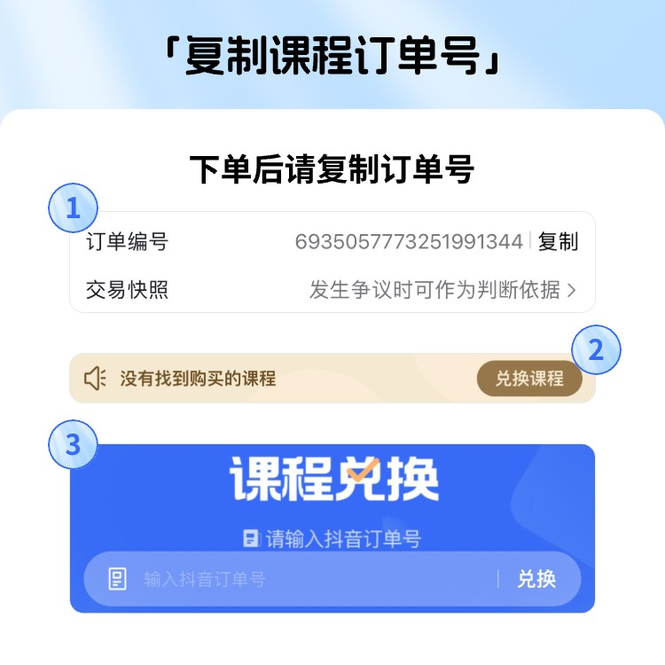
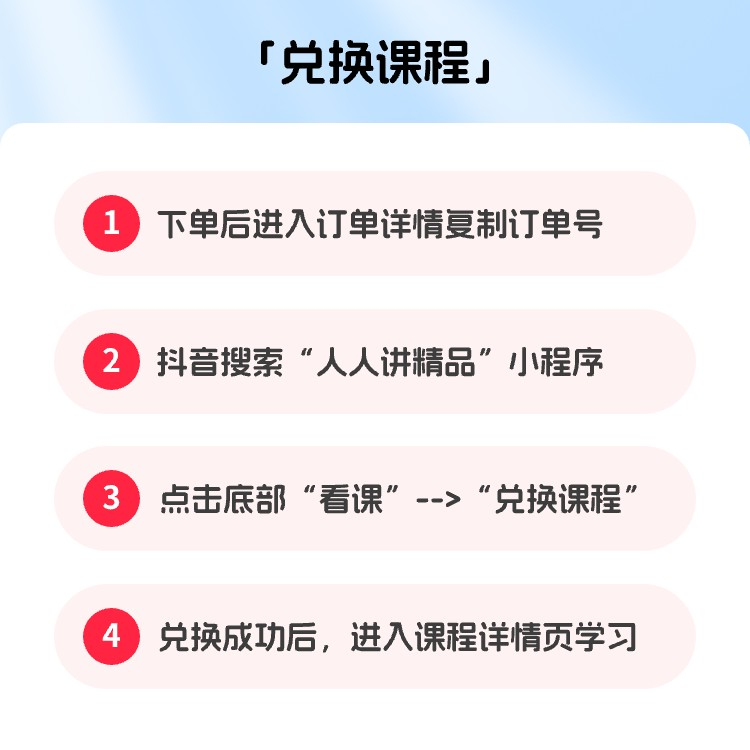
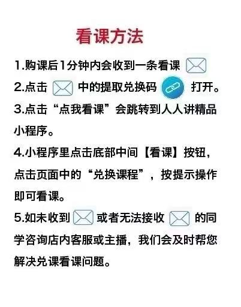

小鹅通用户直接查看:[https://study.xiaoe-tech.com/](https://study.xiaoe-tech.com/)

或者微信小程序搜索“小鹅通”，又或者下载“小鹅通app”。

---

<u>【小鹅通用户不需要以下内容】</u>

## **抖音平台**

抖音小黄车购课后看课流程

【方法1】

购课1分钟内会收到一条看课短信，点击短信中的链接跳转到“人人讲精品课”小程序，找到购买的课程即可观看

【方法2】

抖音搜索“人人讲精品课”小程序-->点击页面下方【看课】--> 用【订单编号】兑换课程

看课图片：

看课视频：

2823_1744771735.mp4

## **视频号平台**

视频号购课看课方法

【方法1】

微信中“我的”页面，找到购买的订单，点击“前往小程序去上课”，即可观看学习

【方法2】

购课1分钟内会收到一条看课短信，点击短信中的链接跳转到“人人讲精品课”小程序，找到购买的课程，即可观看

【方法3】

微信中搜索“人人讲精品课”小程序-->点击页面下方【看课】，找到购买的课程，即可观看

**注意：如果在小程序页面中找不到购买的课程，可点击“切换”账号查找课程**

## **小红书平台**

小红书购课后看课流程

【方法1】

购课1分钟内会收到一条看课短信，点击短信中的链接跳转到微信“人人讲精品课”小程序，找到购买的课程即可观看

【方法2】

微信搜索“人人讲精品课”小程序-->点击页面下方【看课】--> 用【订单编号】兑换课程

快手平台

搜索“人人讲精品课”小程序，进入-->点击页面下方【看课】-->找到相应专栏，进入学习

## **电脑看课**

电脑看课操作方法：

1. 网页登录https://ke.renrenjiang.cn/#/login （推荐谷歌浏览器）
2. 选择左下角【手机号登录】
3. 输入购课时的手机号和验证码，即可观看

## **App看课**

应用商店搜索【人人讲】，下载软件后，选择手机号登录（购课手机号），登陆后点击底部【已购】，直接看课即可

## 投屏

苹果手机小程序投屏

1，打开课程---点击右上角【投屏】标识

2，点击可连接的设备【AirPlay】

3，选择对应需要投屏的电视即可

人人讲App投屏（苹果&安卓手机）

1，app中打开课程---点击左上角【TV】标识

2，选择对应需要投屏的电视即可
