## 先说一句：用什么工具都可以

这门课**不限定 Agent 工具**。

- 如果你平时已经在用 **Codex、Claude Code** 这类工具，就按你自己的习惯来，不用换。这份文档里的提示词（就是你发给它的那句话）你照样可以复制过去用。
- 如果你是新手，没用过这类工具，也不想折腾安装和配置，那就用 **WorkBuddy** 或者 **Trae** 这种装好就能用的工具。
- 这套教程用 **WorkBuddy** 来演示。

💡 **什么是 Agent 工具？** 你可以把它理解成一个"会动手的 AI 助手"。普通聊天机器人只会回答你的问题；Agent 工具除了回答，还能**真的在你的电脑上干活**：查东西、执行命令、新建和修改文件。

## 第 1 步：认识 WorkBuddy 的界面

打开 WorkBuddy 后，你会看到下面这个样子。它看起来像一个聊天窗口，但能做的事比聊天多得多。

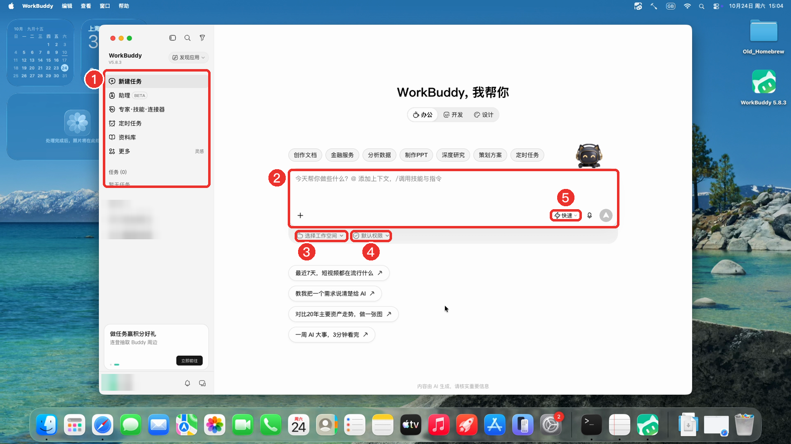

对照图上的红色数字，一个一个认：

1. **左边：任务列表。** 你每让它做一件事，这里就会多一个任务。以后想接着做，点回那个任务就行。最上面的"新建任务"用来开始一件新的事。
2. **中间的大框：输入框。** 这是你跟它说话的地方。你把要它做的事写在（或粘贴到）这里。
3. **"选择工作空间"：** 告诉它在哪个文件夹里干活。第 3 章打开课程代码时会用到，现在先不用动。
4. **"默认权限"：** 很重要，下一步单独讲。
5. **"快速"：** 选择模型的地方（模型就是它背后用的那颗"AI 大脑"）。第 2 章再细讲，现在先不用动。

## 第 2 步：看一眼"默认权限"，保持默认

1. 用鼠标点一下输入框下面的 **"默认权限"**（图中 1 号位置）。
2. 会弹出一个小窗口，上面写着：当前为默认权限，所有操作都会在安全沙箱约束内进行，超出范围会请求你的允许。下面还有一个 **"允许完全访问"** 的开关。
3. **什么都不用改**，确认"允许完全访问"的开关是**关着的**（灰色），然后在空白处点一下关掉这个小窗口。

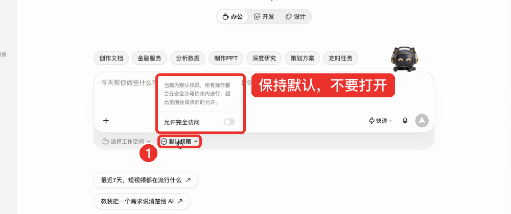

**为什么要保持默认？** 默认情况下，它只在一个安全范围里干活；超出这个范围的操作，它会先停下来问你。新手保持默认就好，**不要打开"允许完全访问"**。

## 第 3 步：第一次试用——让它查查你的电脑装了什么

我们来试一下它到底能不能"动手"。

1. 用鼠标点一下中间的输入框，让光标在里面闪。
2. 复制下面这句话（在下面的灰色框里选中整句，按 `Cmd + C`；Windows 按 `Ctrl + C`）。
3. 回到输入框，按 `Cmd + V` 粘贴（Windows 按 `Ctrl + V`）。
4. 点输入框右下角那个**黑色圆形的发送按钮**（图中 2 号位置），或者直接按回车。

**复制这句话，粘贴到输入框，按回车发送：**

```latex
帮我看看这台电脑上有没有装 Python、Node.js 和 Git，分别是什么版本？只查看，不要安装任何东西。
```

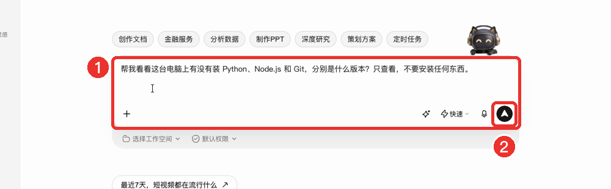

💡 **Python、Node.js、Git 是什么？** 都是跑课程代码需要的软件。现在你不用懂，只是拿它们来试试 WorkBuddy。

## 第 4 步：看它真的在你的电脑上执行命令

发出去以后，注意看对话区：它不是凭记忆回答，而是写着"已处理……""正在后台执行命令"——它真的在你的电脑上执行命令去查。

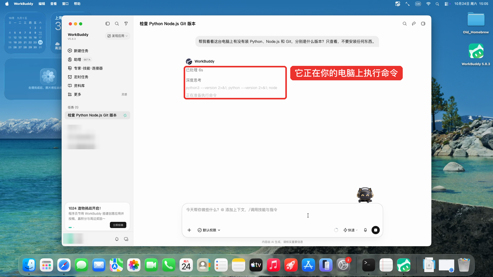

**这时你要做的：** 什么都不用做，等它跑完。一般十几秒。

💡 **命令是什么？** 就是让电脑做事的一行文字指令。以前要你自己打开"终端"（电脑上输入命令的黑色窗口）一个字一个字敲，现在 WorkBuddy 替你敲。这门课里你都不用自己开终端。

**正确的样子：** 十几秒后，它把结果整理成了一张表，列出 Python、Node.js、Git 各自的版本，还会主动说明：只做了查看，没有安装任何东西。

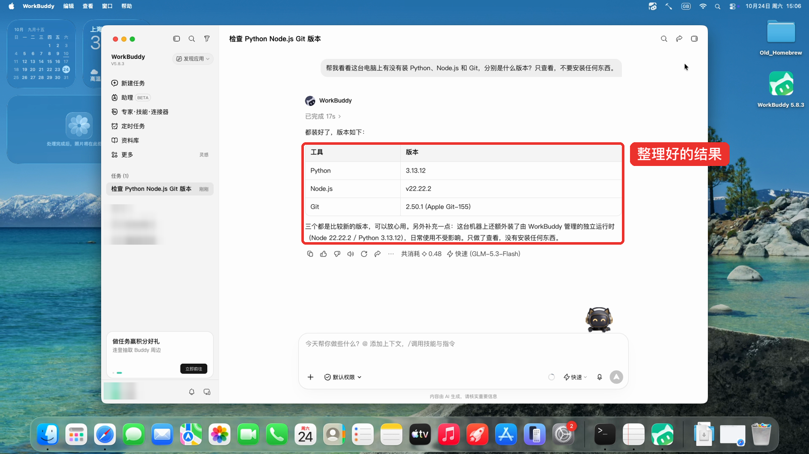

**如果不一样：**

- 一直转圈超过 2 分钟没动静：点一下左边任务列表里的这个任务，看看它是不是卡在某个弹窗上等你点。
- 它说某个软件"没装"：这很正常，每台电脑不一样。这一步只是为了试用，没装也没关系，第 4 章会让它帮你装好。

## 第 5 步：查看它背后到底做了什么

想知道它背后执行了哪些命令？它做的每一步，你都能查得到。

1. 点它回答上方的 **"已完成 xx s"** 这一行（图中 1 号），会展开它的工作过程。
2. 再点展开出来的 **"运行命令"**（图中 2 号）。
3. 这里（图中 3 号红框）就能看到它执行的那一行命令，以及电脑返回的结果。

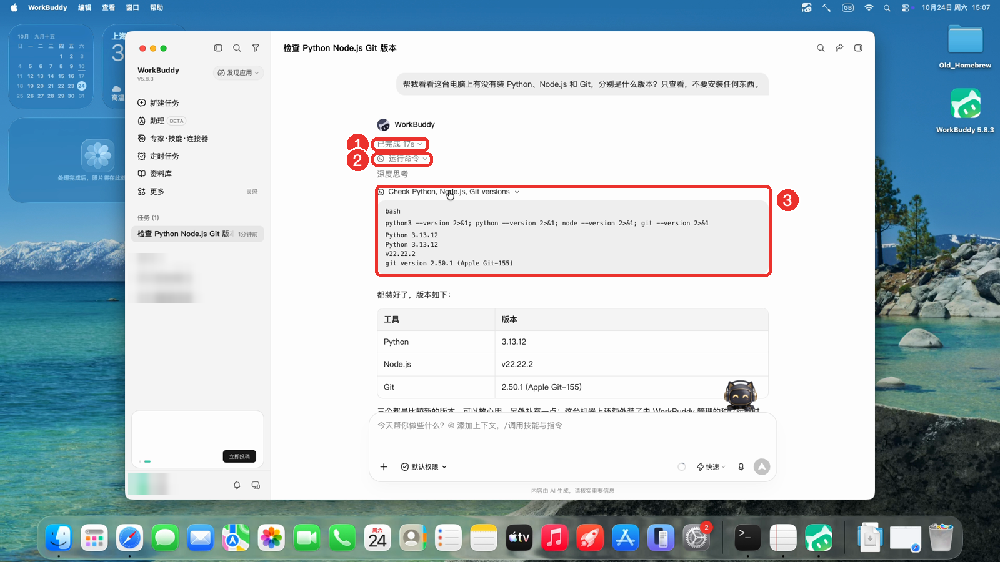

💡 以后它做任何事，你觉得不放心，都可以这样点开看一看。看不懂命令也没关系，你可以直接问它："你刚才执行的这条命令是什么意思？"

## 第 6 步：让它在桌面上新建一个文件夹

再试一个，看看它是不是真的能动你电脑上的文件。

1. 点一下输入框。
2. 复制下面这句话，粘贴进去，点发送（或按回车）。

**复制这句话，粘贴到输入框，按回车发送：**

```latex
在我的桌面上新建一个文件夹，名字叫「WorkBuddy练习」。
```

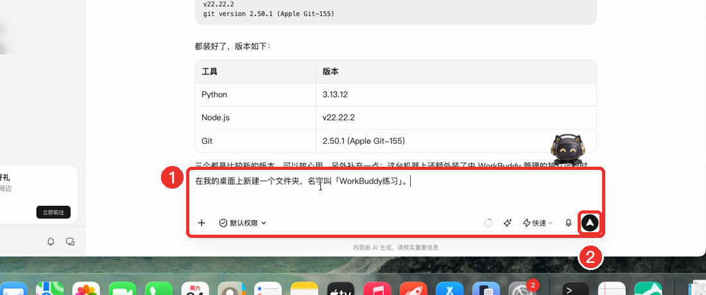

**正确的样子：** 发出去十几秒后，它回复"已创建好：……/Desktop/WorkBuddy练习"（图中 1 号）。同时你的桌面上马上多了一个叫"WorkBuddy练习"的文件夹（图中 2 号）。

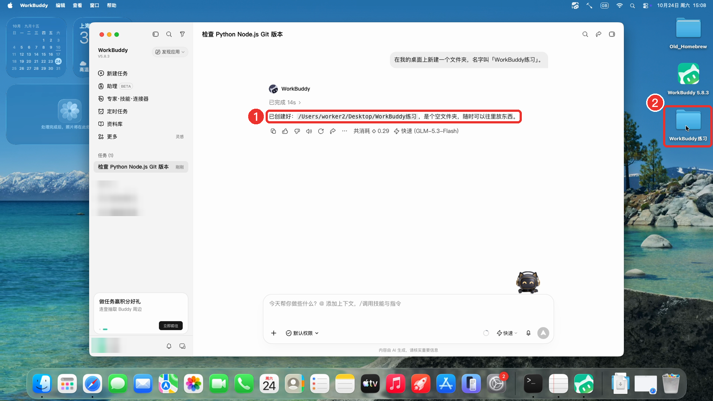

也就是说：**它是真的能动你电脑上的文件。** 能建，就能删，所以下面要学会看确认弹窗。

**Windows 用户看这里：** Windows 的桌面一般在 `C:\Users\你的用户名\Desktop`，它回复的路径会长这样，以你屏幕上实际显示为准。

## 第 7 步：让它删掉这个文件夹，学会看确认弹窗

删除是比较危险的操作，我们看看它会怎么做。

**复制这句话，粘贴到输入框，按回车发送：**

```latex
把桌面上的「WorkBuddy练习」文件夹删掉。
```

接下来会**先后弹出两种确认**，一个一个来。

### 弹窗一：Mac 系统的窗口

先弹出来的，是 Mac 系统的小窗口：**"WorkBuddy"想要控制"访达"**。意思是：WorkBuddy 想通过访达（Mac 上管理文件的程序）去处理这个文件。

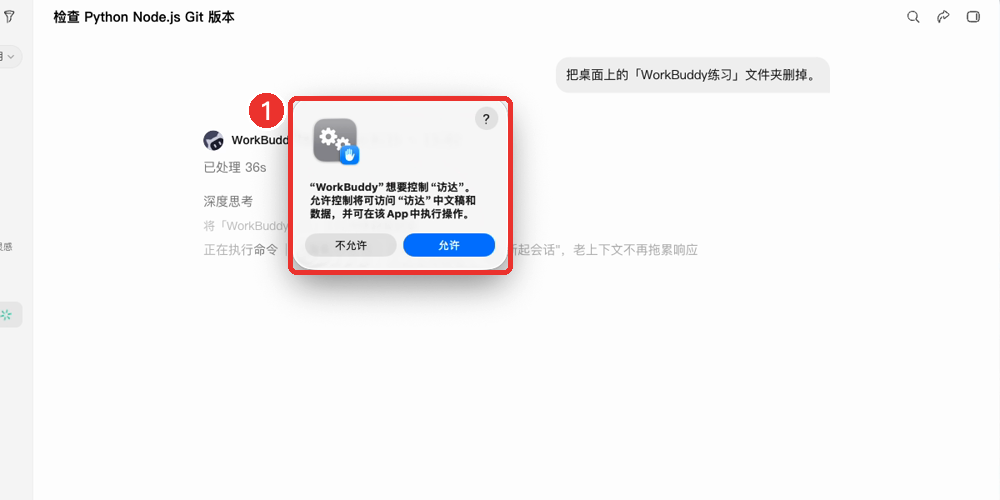

**判断方法很简单：这件事，是不是你刚刚让它做的？**

- 是你刚让它做的（这里就是：你刚让它删文件夹）→ 点 **"允许"**（蓝色按钮）。
- 不是你让它做的，或者你看不懂它要干嘛 → 点 **"不允许"**。

💡 有时它会说"Finder 自动化被系统权限拦住了"，然后换一种办法继续，这是正常的。点"不允许"也不会弄坏什么，最多是这一步做不成，它会换个办法。

**Windows 用户看这里：** Windows 上不会有"想要控制访达"这个窗口。你可能会看到 Windows 自己的提示，比如"你要允许此应用对你的设备进行更改吗？"。判断方法一样：是你刚让它做的，点"是"；看不懂，点"否"。

### 弹窗二：WorkBuddy 自己的确认卡片

接着，输入框的位置会出现 WorkBuddy 自己的确认卡片，标题是 **"删除文件命中询问规则，需要确认。"**

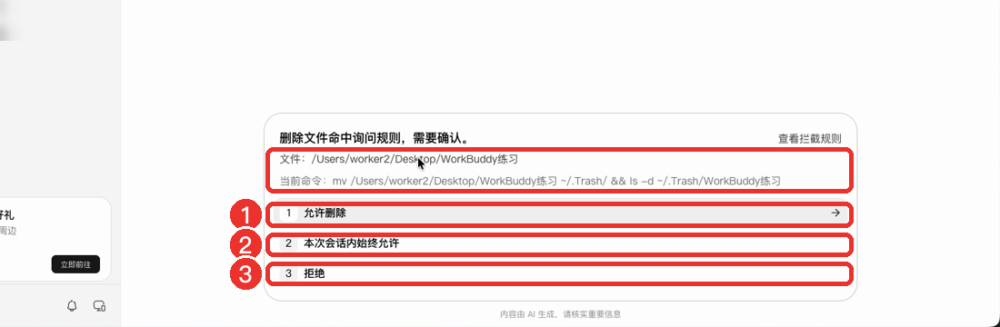

先看最上面的红框：卡片上写清楚了

- **文件：** 要删的是哪个文件（这里是桌面上的 WorkBuddy练习）；
- **当前命令：** 要执行的是哪一条命令。

**先读这两行，确认它要删的就是你想删的那个东西。** 然后看下面三个选项：

| 选项 | 意思 | 新手怎么选 |
| --- | --- | --- |
| 1 允许删除 | 只允许这一次 | ✅ **建议每次都选这个**，一次一次地确认 |
| 2 本次会话内始终允许 | 这次对话里同类操作都不再问你 | 新手不要选 |
| 3 拒绝 | 不让它做 | 拿不准就选这个 |

这里我们要删的就是刚建的练习文件夹，所以点 **"1 允许删除"**。

## 第 8 步：看结果——它放进了废纸篓

**正确的样子：** 它回复"已删除：桌面上的「WorkBuddy练习」文件夹已移入废纸篓……不是永久删除"。桌面上的文件夹也不见了。

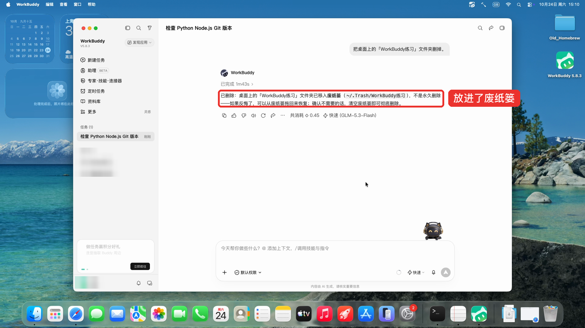

注意：它是把文件夹**放进了废纸篓**，而不是直接永久删除。后悔了，打开废纸篓还能找回来。

**Windows 用户看这里：** Windows 上对应的是"回收站"。

## 遇到确认弹窗，记住这张表

| 弹窗要你确认的事 | 怎么选 |
| --- | --- |
| 是你刚刚让它做的，而且你看得懂（比如：装课程需要的软件、启动课程服务、删你刚让它建的练习文件） | 允许（只允许这一次） |
| 不是你让它做的 | 拒绝 |
| 看不懂它要干什么 | 拒绝，然后在输入框里问它："你刚才想做什么？为什么要这样做？" |
| 要删除、覆盖文件，或者改系统设置，你又拿不准 | 拒绝 |

**拿不准就点拒绝。** 点了拒绝不会弄坏任何东西，最多就是它这一步没做成，你问清楚了再让它重来。

## 常见问题

**问：它真的能删我电脑上的文件，会不会把我的东西弄没了？**  
答：它删文件前会弹出确认卡片，写清楚要删哪个文件，你不点允许它就不会删。而且它一般是放进废纸篓（Windows 叫回收站），还能找回来。另外，WorkBuddy 的"安全中心"里有"自动备份"，第 2 章会教你确认它是开着的。

**问：确认卡片上的命令我完全看不懂，怎么办？**  
答：看不懂就点"拒绝"，然后在输入框里问它："你刚才要执行的命令是什么意思？会改动哪些文件？"它解释清楚、你觉得没问题了，再让它继续。

**问：为什么不选"本次会话内始终允许"，那样不是更省事吗？**  
答：省事，但你就看不到它后面每一步要做什么了。新手阶段多点几次"允许"，正好借机看看它在干什么。

**问：我用的是 Codex / Claude Code / Trae，界面和截图不一样怎么办？**  
答：按钮名字和位置会不一样，但道理是相通的：它们都会执行命令、改文件，也都会在危险操作前问你。文档里的提示词可以直接复制过去用。

**问：它说"没有装 Python"之类的，我需要现在去装吗？**  
答：不用。第 4 章会让它帮你检查环境并装好缺的东西。
