用 Trae 或者其他 Agent 工具的同学，安装和登录的步骤都差不多，这里以 WorkBuddy 作为示范。已经在用 Codex、Claude Code 的同学，可以跳过这一章。

## 第 1 步：打开 WorkBuddy 官网

1. 打开浏览器（Mac 自带的 Safari、Chrome、Edge 都行）。
2. 用鼠标点一下最上面的**地址栏**（图中 1 号），输入 `workbuddy.cn`，按回车。
3. 进入 WorkBuddy 官网，页面上写着大大的"WorkBuddy 我帮你"。

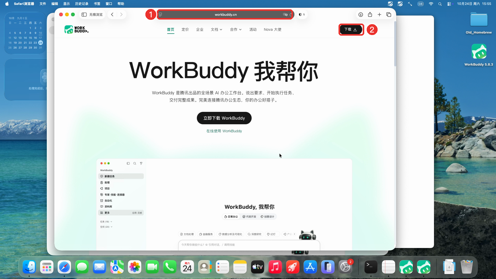

⚠️ 只从官网下载，不要在搜索结果里点来路不明的"高速下载"链接。

## 第 2 步：选对自己的电脑类型，下载安装包

1. 把鼠标**移到**（不用点）页面右上角黑色的 **"下载"** 按钮上（上一张图 2 号），会弹出一个菜单。
2. 看菜单的"桌面端"部分：

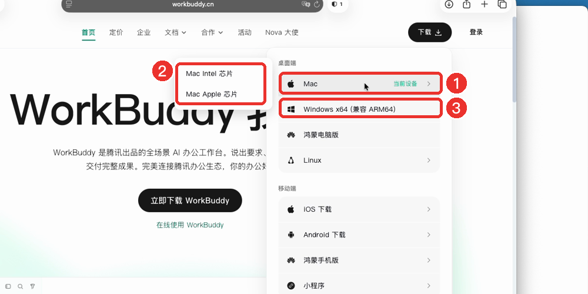

**用 Mac 的同学：**

1. 把鼠标移到 **"Mac"** 这一行（图中 1 号），左边会出现两个选项（图中 2 号）：**Mac Intel 芯片** 和 **Mac Apple 芯片**。
2. 不知道自己是哪一种？这样查：
    1. 点屏幕**左上角的苹果图标** 。
    2. 选 **"关于本机"**。
    3. 看弹出窗口里 **"芯片"** 这一行：写着 **Apple M 几**（比如 Apple M1、Apple M2），就选 **Mac Apple 芯片**；写着 **Intel**（有的电脑这一行叫"处理器"），就选 **Mac Intel 芯片**。
3. 点对应的那一项，安装包就开始下载了。

**用 Windows 的同学：**

- 直接点 **"Windows x64（兼容 ARM64）"** 这一项（图中 3 号）。

## 第 3 步：找到下载好的安装包

下载要等一会儿（安装包大约 370 MB，网速快的话一两分钟）。

1. 点浏览器右上角的**下载按钮**（一个向下的箭头，图中 1 号）。
2. 弹出的下载列表里，能看到刚下载的安装包（图中 2 号）。Mac 上它的名字以 `WorkBuddy-darwin-` 开头、以 `.dmg` 结尾。
3. **双击**这个安装包。

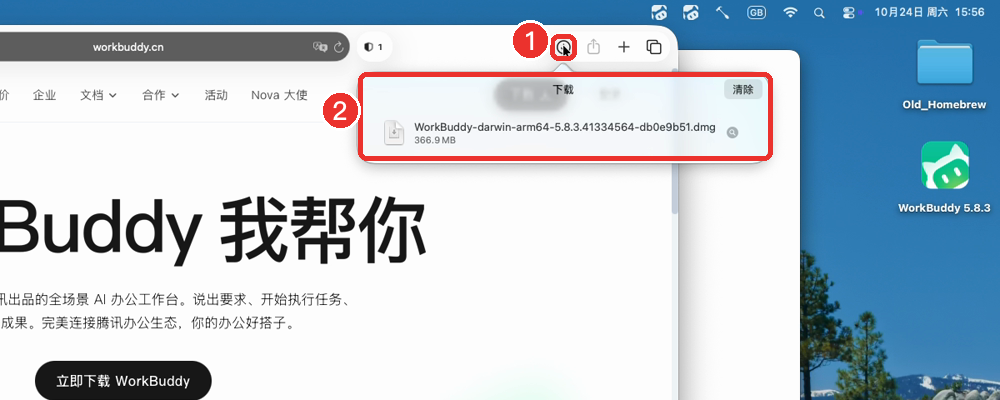

**如果找不到：** 打开"访达"（Dock 栏最左边那个蓝白笑脸），点左边的"下载"文件夹，安装包就在那里。

## 第 4 步：安装（Mac）

双击安装包后，会弹出这样一个窗口：左边是 WorkBuddy 图标，右边是 Applications（应用程序）文件夹，中间有个箭头。

1. 用鼠标**按住**左边的 **WorkBuddy 图标**（图中 1 号），不要松手。
2. 拖到右边的 **Applications 文件夹**（图中 2 号）上，再松手。
3. 等几秒，复制完就安装好了。这个窗口可以关掉。

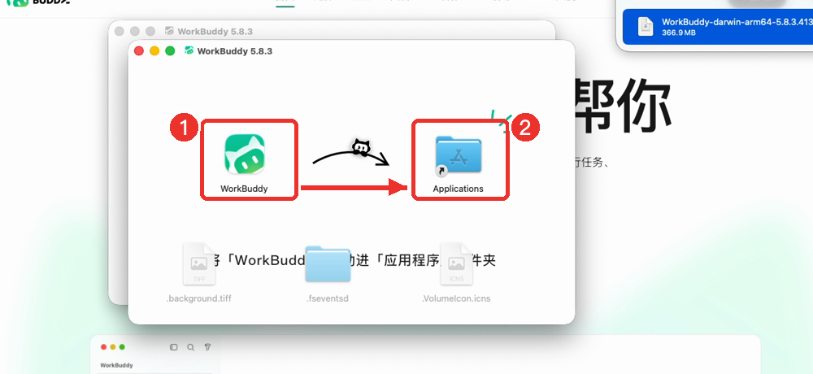

4. 打开 WorkBuddy：打开"访达" → 左边点"应用程序" → 双击 **WorkBuddy**。也可以按 `Cmd + 空格`，输入 `WorkBuddy` 按回车。
5. **第一次打开时**，Mac 可能会问你："这是从互联网下载的 App，确定要打开吗？" → 点 **"打开"**。

**Windows 用户看这里：**

1. 双击下载好的安装包（一般以 `.exe` 结尾），按提示一路点"下一步"。
2. **安装位置不要放在带中文的文件夹里**，用默认位置或者纯英文路径（比如 `D:\Programs\WorkBuddy`）。
3. 如果弹出"你要允许此应用对你的设备进行更改吗？"，点"是"。
4. 如果 Windows 安全中心拦住了，提示"Windows 已保护你的电脑"，点"更多信息"→"仍要运行"。
5. 装好后，从桌面快捷方式或开始菜单打开 WorkBuddy。具体按钮文字以你屏幕上实际显示为准。

## 第 5 步：点"登录"

打开 WorkBuddy，第一次会看到下面这个页面：一个小机器人，下面写着"WorkBuddy，我帮你"。

1. 点中间黑色的 **"登录"** 按钮（图中 1 号）。

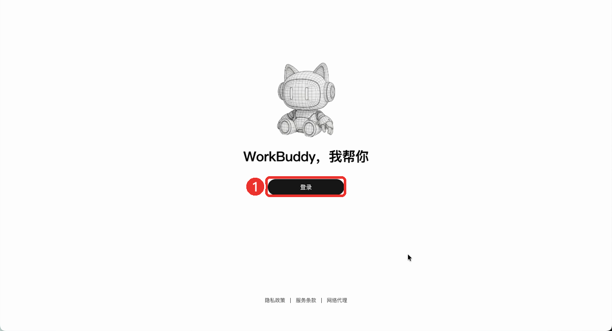

2. 它会**自动打开浏览器**，让你在浏览器里登录。

**如果浏览器没有弹出来：** WorkBuddy 里会出现"没有自动打开浏览器？"的提示。

1. 点 **"复制登录链接"**（图中 1 号）。
2. 打开浏览器，点地址栏，按 `Cmd + V`（Windows 按 `Ctrl + V`）粘贴，按回车。

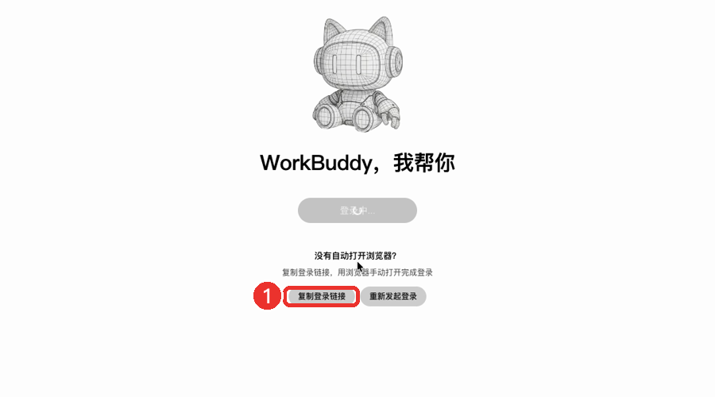

## 第 6 步：在浏览器里登录

### 方法一：微信扫码（最省事，推荐）

1. 浏览器里的登录页面，默认显示 **"微信扫码登录"** 和一个二维码。
2. 拿出手机，打开微信 → 右上角"+" → "扫一扫"，对准屏幕上的二维码扫一下。
3. 在手机上点确认登录。

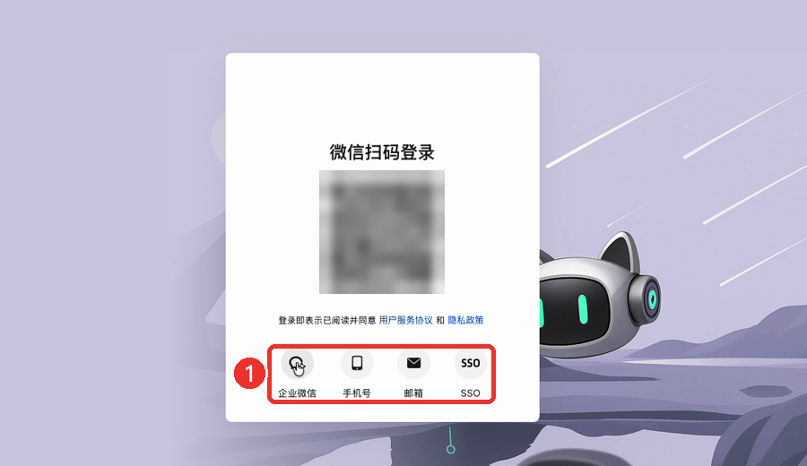

### 方法二：不用微信

二维码下面那一排（上图 1 号）是其他登录方式：**企业微信、手机号、邮箱、SSO**。点哪个就切换到哪种登录方式。

比如**手机号登录**：

1. 点下面的 **"手机号"** 图标，页面变成"手机验证码登录"。
2. 在第一个框（图中 1 号）填你的手机号。
3. 点 **"获取验证码"**（图中 2 号），手机会收到一条短信，把里面的验证码填到左边的框里。
4. 把下面 **"我已阅读并同意……"** 前面的**小圆圈勾上**（图中 3 号）。**不勾的话登录不了**，这一步最容易忘。
5. 最后点 **"手机号登录"**（图中 4 号）。

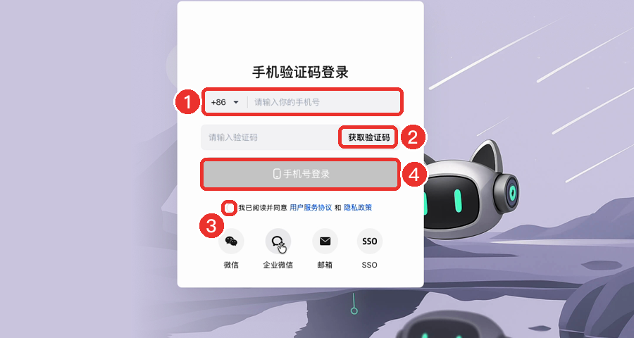

**正确的样子：** 登录成功后，回到 WorkBuddy 窗口，就能看到第 1 章那个主界面了（左边任务列表、中间输入框）。

**如果不一样：**

- 浏览器显示登录成功，但 WorkBuddy 还停在登录页：回到 WorkBuddy，再点一次"登录"或"重新发起登录"。
- 收不到验证码：等 1 分钟后再点"获取验证码"，或者换微信扫码。

## 第 7 步：看积分余额

登录以后，先看三个地方。第一个是积分。

1. 点 WorkBuddy 窗口**左下角你的头像**。
2. 弹出的菜单上方（图中 1 号）能看到你的**套餐**（比如"体验版"）和**积分余额**。

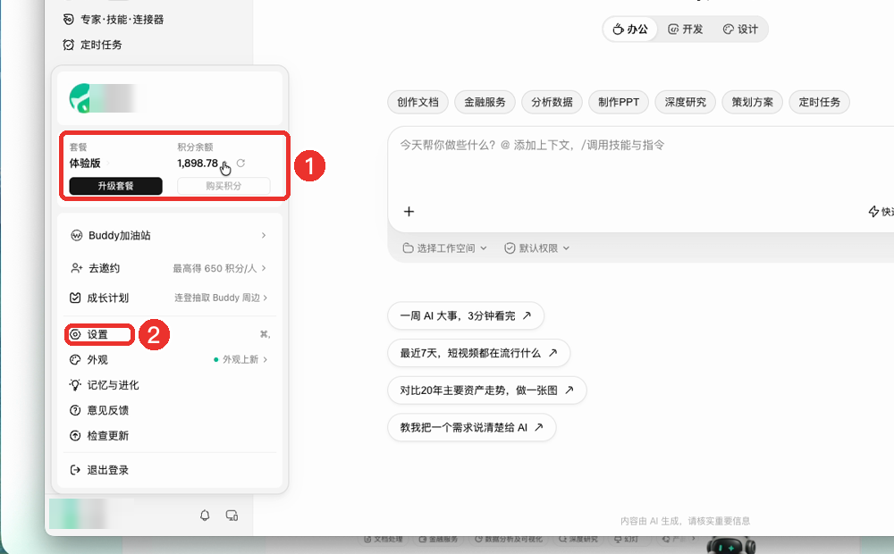

**为什么要看这个？** WorkBuddy 每做一件事都会消耗积分，积分用完就没法继续让它干活。所以要知道在哪里看余额。

## 第 8 步：打开"运行时防止系统休眠"

1. 还是在头像菜单里，点 **"设置"**（上一张图 2 号）。
2. 设置窗口打开后，左边默认选中的是 **"通用"**（图中 1 号）。如果不是，点一下"通用"。
3. 看最上面的 **"语言"**（图中 2 号），确认是 **"简体中文"**。不是的话，点它选"简体中文"。
4. 往下找到 **"运行时防止系统休眠"**（图中 3 号），点右边的开关，让它变成**绿色**（打开）。

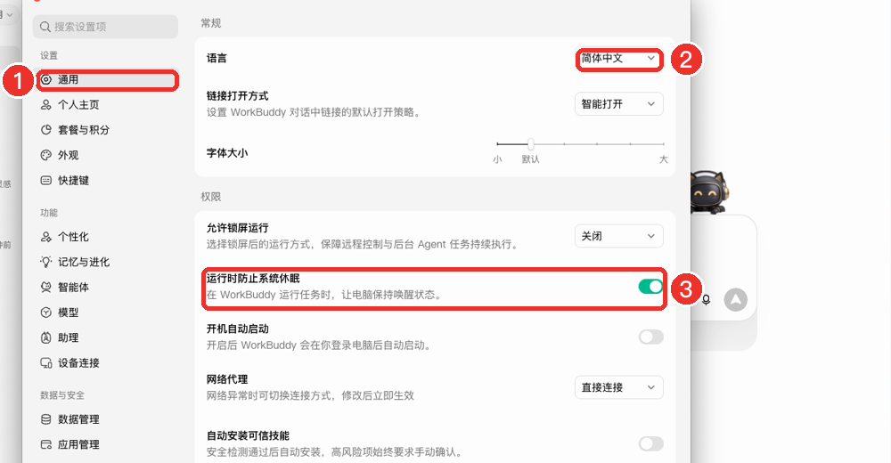

**为什么要开？** 后面让它装环境、跑项目，一等就是好几分钟。电脑一休眠，任务就会被打断。

## 第 9 步：确认"安全中心"保持打开

1. 在设置窗口左边，往下找到最后的 **"安全中心"**，点它（图中 1 号）。
2. 往下看，确认这两个开关是**绿色（打开）**的：
    - **"沙箱安全"**（图中 2 号）：让它在一个隔离的安全范围里干活。
    - **"自动备份"**（图中 3 号）：它改文件之前会先自动备份。文件被改坏了也能找回来。
3. 这两个**不要关**。这一页其他的东西**都不用改**。

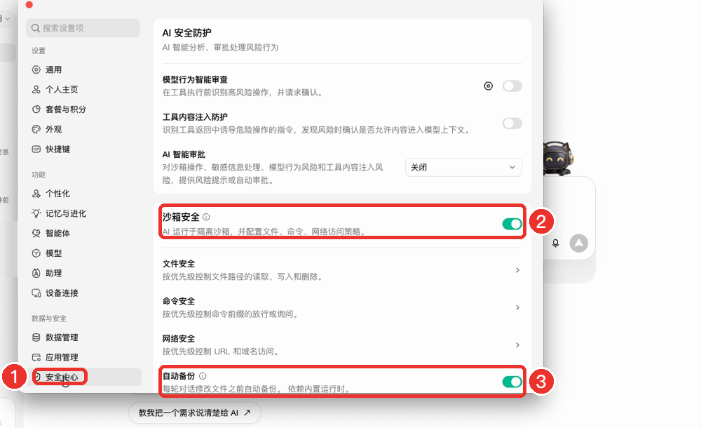

## 第 10 步：看更详细的积分明细（可选）

1. 设置窗口左边点 **"套餐与积分"**（图中 1 号）。
2. 上面（图中 2 号）能看到总剩余积分，以及分别来自套餐、奖励、购买的积分。
3. 下面"积分明细"（图中 3 号）能看到每类积分**什么时候刷新**、什么时候到期、已经用了多少。

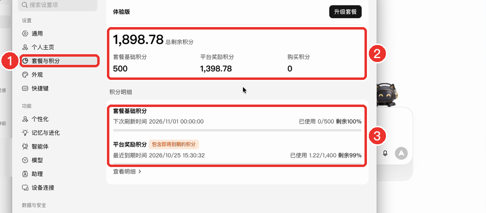

看完后，点设置窗口左上角的**红色圆点**关掉设置窗口。

## 第 11 步：认识模型选择，先用默认的"快速"

1. 回到主界面，看输入框右下角的 **"快速"**（图中 3 号），点一下。
2. 弹出的列表就是可以选的模型。每个模型右边的数字（比如 0.21x、0.65x、1.20x），是**消耗积分的倍数**：数字越大，同样一件事花的积分越多。

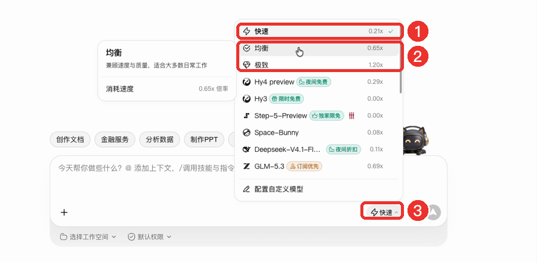

**新手怎么选：**

- 先用默认的 **"快速"**（图中 1 号），又快又省积分。
- 如果发现它的回答明显不对、或者一个问题反复做不好，再换成 **"均衡"** 或者 **"极致"**（图中 2 号）试试。
- 列表里其他的模型先不用管。

选好后，在空白处点一下关掉列表就行。

## 常见问题

**问：我不知道我的 Mac 是哪种芯片，选错了会怎样？**  
答：选错了一般装不上，或者打开后很卡。按第 2 步的方法看一下"关于本机"里的"芯片"，重新下载对的那个。

**问：第一次打开提示"无法打开，因为无法验证开发者"之类的，怎么办？**  
答：Mac 上可以打开"系统设置 → 隐私与安全性"，往下找到关于 WorkBuddy 的提示，点"仍要打开"。只对从 workbuddy.cn 官网下载的安装包这样做。

**问：点了登录，浏览器没反应？**  
答：用第 5 步的"复制登录链接"，手动粘贴到浏览器打开。

**问：积分用完了怎么办？**  
答：在"套餐与积分"里能看到基础积分每个月什么时候刷新。省积分的办法：日常用"快速"模型，一次把要它做的事说清楚，不要反复重来。

**问：设置里还有很多别的选项，要不要改？**  
答：不要。除了这一章说的"运行时防止系统休眠"，其他都保持默认。
