你也可以用自己常用的 Agent 工具（Codex、Claude Code、Trae 等），这里还是以 WorkBuddy 作为示范。

课程代码要先按[《云效代码获取操作手册》](<004_云效代码获取操作手册.md>)下载好。下面的截图里，代码放在用户文件夹下的 `Courses/xiaozhe-E-commerce`（Windows 建议放 `D:\Courses\xiaozhe-E-commerce`，路径里不要有中文和空格）。

## 第 1 步：让 WorkBuddy 打开课程代码文件夹

先说一个词：**工作空间**。工作空间就是"WorkBuddy 现在在哪个文件夹里干活"。它只能看到、只能改这个文件夹里的东西，所以一定要选对。

1. 打开 WorkBuddy，停在首页，就是写着"WorkBuddy, 我帮你"的那个页面。如果你正在某个对话里，点左上角的 **新建任务** 回到首页。
2. 找到输入框**下面**那一排小字，点 **选择工作空间**（图中 ①）。
3. 会弹出一个小菜单，点最下面的 **打开本地文件夹**（图中 ②）。

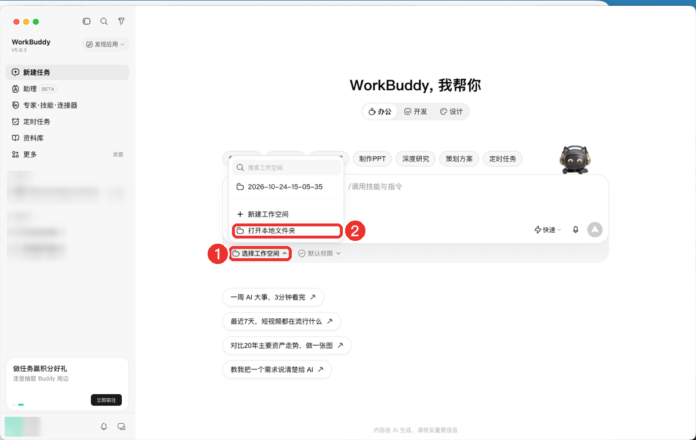

💡 菜单里可能还有一些别的名字（比如一串日期），那是以前用过的空间，不用管，这次一定要点 **打开本地文件夹**。

## 第 2 步：在弹出的窗口里选中 xiaozhe-E-commerce

会弹出一个选文件夹的窗口。照着图里的编号一个一个点：

1. 左边一栏，点你的**用户文件夹**（小房子图标，名字是你的电脑用户名；图里叫 worker2，你的会不一样）。
2. 中间一栏，点 **Courses**。
3. 下一栏，点 **xiaozhe-E-commerce**，让它变成蓝色选中状态。**只点一下，不要再往里点。**
4. 看最右边那一栏：要能看到 `agent-course-versions`、`doc`、`ecommerce-backend`、`frontend` 这些文件夹。看到了，就说明选对了这一层。
5. 点右下角蓝色的 **打开**。

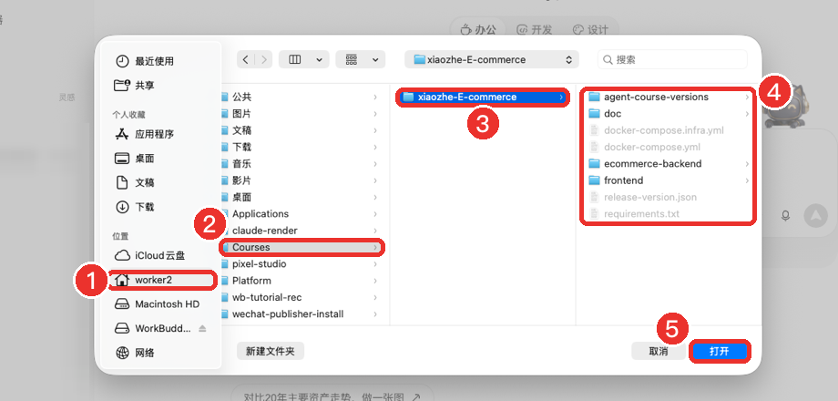

**正确的样子：** 窗口关掉以后，回到首页，输入框下面原来写"选择工作空间"的地方，现在显示 **xiaozhe-E-commerce**。

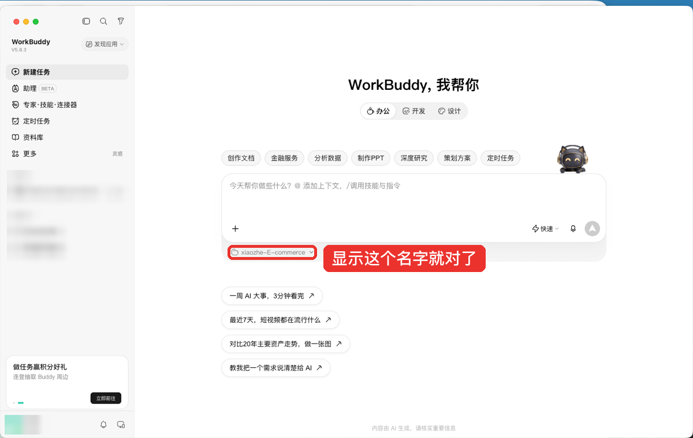

**如果不一样：**

| 你看到的 | 说明 | 怎么改 |
| --- | --- | --- |
| 输入框下面显示的是 `Courses` | 选到了**上一层** | 重新点这个名字 → 打开本地文件夹，这次要点进 Courses，再选中 xiaozhe-E-commerce |
| 显示的是 `agent-course-versions` 或 `lesson-xx-...` | 点得**太深**了 | 同上，重新选，选到能在右边看到 agent-course-versions 的那一层就停 |
| 右边一栏是空的，或者看不到 agent-course-versions | 这个文件夹可能不是完整的课程代码 | 先确认课程代码是否下载完整；把你看到的文件夹名字原样告诉 WorkBuddy，让它帮你判断 |

**Windows 用户看这里：** 弹出的是 Windows 的"选择文件夹"窗口，样子和上图不同，但道理一样：在左边点"此电脑"→ D 盘 → Courses，**单击选中** xiaozhe-E-commerce（不要双击进去），然后点"选择文件夹"。打开后输入框下面同样会显示 xiaozhe-E-commerce。

## 第 3 步：打一个斜杠，看看课程助手在不在

**技能**是什么？可以理解成"给 WorkBuddy 的一本专用说明书"。小哲课程助手就是一本讲这门课的说明书：哪一课讲什么、怎么启动、怎么检查环境，它都知道。课程助手已经放在课程代码里了，我们要让 WorkBuddy 认出它。

1. 用鼠标点一下输入框。
2. 在英文输入法下，按一下键盘上的斜杠键 `/`（在右 Shift 键左边，和问号是同一个键）。

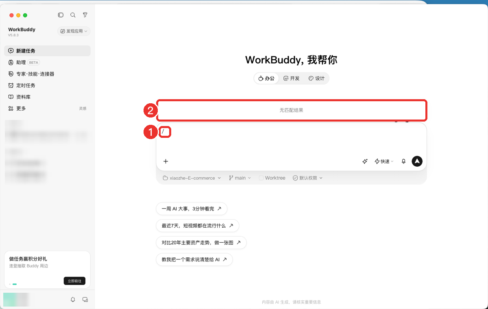

**你可能看到两种情况：**

- 输入框上方出现了 `xiaozhe-release-course-assistant` → 课程助手已经能用了，直接跳到**第 6 步**。
- 输入框上方写着 **无匹配结果**（上图 ②）→ 第一次打开时很常见，说明 WorkBuddy 还没认出课程助手。继续做第 4 步和第 5 步。

⚠️ 打出来的如果是中文的顿号 `、`，说明你在中文输入法下。按一下 Shift 或者 Caps Lock 切到英文，再按一次 `/`。

## 第 4 步：先问它一句，确认代码文件夹没选错

先把输入框里的斜杠删掉（按一下退格键）。

**复制这句话，粘贴到输入框，按回车发送：**

```latex
使用小哲课程助手，请确认我现在打开的是不是小哲电商 Agent 项目课的代码仓根目录，并告诉我代码版本。
```

等它回答。这一步大约要 1 分钟，界面上会滚动显示它在看哪些文件，不用管，等它说完。

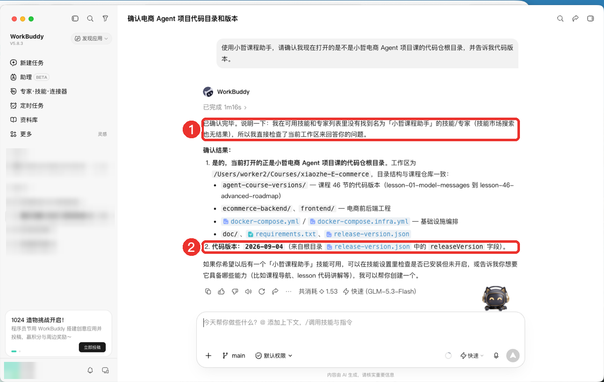

**正确的样子：**

- 它说**是**，当前打开的就是课程代码的根目录（"根目录"就是最外面那一层文件夹）。
- 它告诉你代码版本是 **2026-09-04**（图中 ②）。
- 同时它可能会说：**没有找到名叫"小哲课程助手"的技能**（图中 ①）。这是正常的，下一步就让它装上。

**如果不一样：** 它说"这不是课程代码根目录"，或者找不到 `agent-course-versions`，那就是第 2 步选错了层，回到第 1 步重新选。

## 第 5 步：让 WorkBuddy 自己把课程助手装上

为什么一开始找不到？课程助手放在课程代码里一个叫 `.agents` 的文件夹里，WorkBuddy 默认不去那里找。我们直接让它自己装。

**复制这句话，粘贴到输入框，按回车发送：**

```latex
这个项目里自带了小哲课程助手技能，放在 .agents/skills/xiaozhe-release-course-assistant 文件夹里。请把它安装成当前项目可以使用的技能，装好后告诉我怎么确认它已经生效。
```

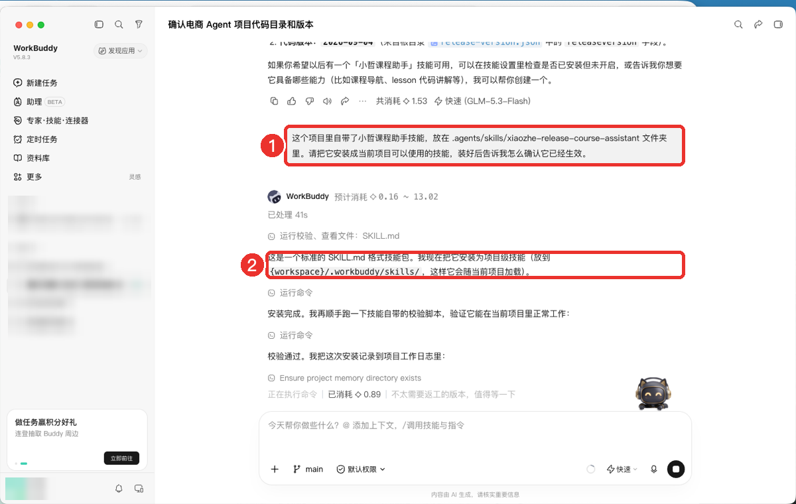

它会自己做这几件事（大约 1 分钟）：

1. 读一遍课程助手的说明书（`SKILL.md`）。
2. 把课程助手复制到项目里的 `.workbuddy/skills/` 文件夹，装成**这个项目专用**的技能（图中 ②）。
3. 顺手跑一遍课程助手自带的检查，确认它能正常工作。

**正确的样子：** 它说已经安装好、检查通过，最后还会告诉你"怎么确认它已生效"。注意看这一句：**要开一个新对话（新一轮会话），技能才会生效**（下图 ①）。

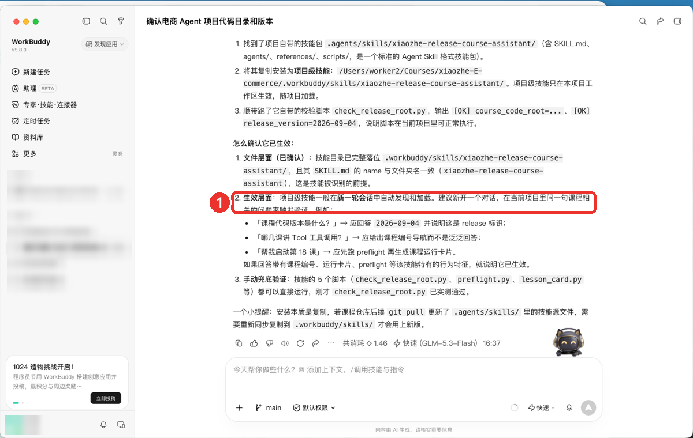

**如果不一样：**

- 它弹出确认框，问你能不能执行某个命令或者改某个文件：看一眼它要做的事，如果只是复制、创建 `.workbuddy/skills` 下面的文件，就点允许；如果它要**删除**文件，或者你看不懂它要干什么，就**点拒绝**，然后把弹窗上的文字原样复制给它，问它为什么要这么做。
- 它说找不到 `.agents/skills/xiaozhe-release-course-assistant`：多半是工作空间选错了层，回到第 1 步。

💡 小知识：以后课程代码更新了，课程助手也可能更新。到时候把上面这句话再发一次，让它重新装一遍就行。

## 第 6 步：新建任务，重新选好工作空间

装好以后要**开新对话**。

1. 点左上角的 **新建任务**（图中 ①）。
2. 新对话要**重新选一次工作空间**：点输入框下面的 **选择工作空间**（图中 ②）。
3. 这次菜单里已经有 **xiaozhe-E-commerce** 了，直接点它（图中 ③）。不用再点"打开本地文件夹"。

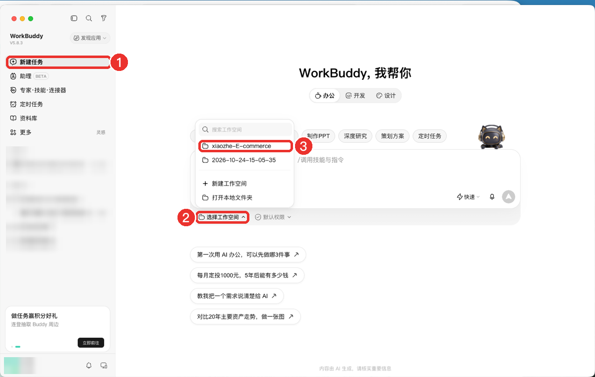

**正确的样子：** 输入框下面又显示 **xiaozhe-E-commerce** 了。

⚠️ 这一步特别容易忘。**以后每次新建任务，都要先看一眼输入框下面是不是 xiaozhe-E-commerce**，不是就先选好，再提问。

## 第 7 步：打斜杠，选中小哲课程助手

1. 点一下输入框，按 `/`。
2. 这次上方会出现 **技能 (1)**，下面一行是 **xiaozhe-release-course-assistant**，后面写着"中文代称：小哲课程助手……"。
3. 用鼠标**点一下这一行**（图中 ①）。

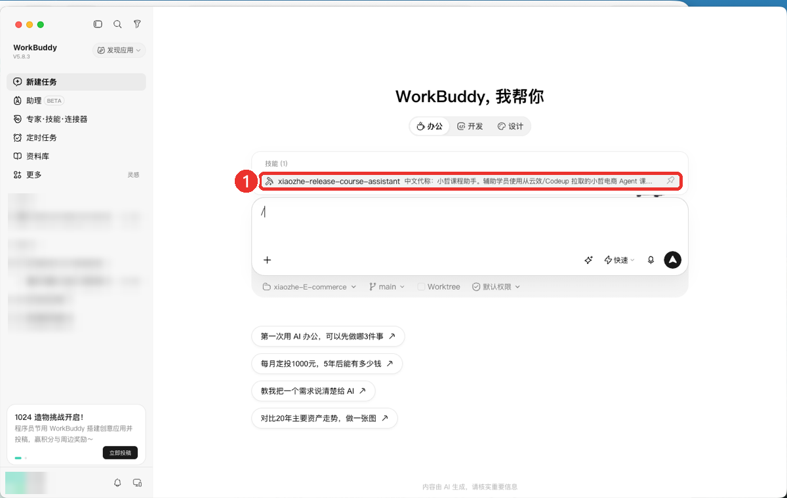

**正确的样子：** 输入框最前面出现一个灰色小标签 `xiaozhe-release-course-assistant`，说明这次提问会用课程助手来回答。

**如果还是"无匹配结果"：**

1. 先确认你是**新建任务**以后打的斜杠，而且工作空间是 xiaozhe-E-commerce。
2. 还是不行，就把第 5 步那句话在新对话里再发一次，让它检查有没有装好。
3. 实在不出现也不耽误学习：提问时在句子最前面加上"**使用小哲课程助手，**"这几个字，效果基本一样。

## 第 8 步：问一个课程问题，验证课程助手生效了

选中课程助手以后（输入框里有那个灰色小标签），接着在后面输入问题。

**复制这句话，粘贴到小标签后面，按回车发送（或者点右下角的黑色箭头按钮，图中 ②）：**

```latex
哪几课讲 Tool 工具调用？我应该从哪一课开始看？
```

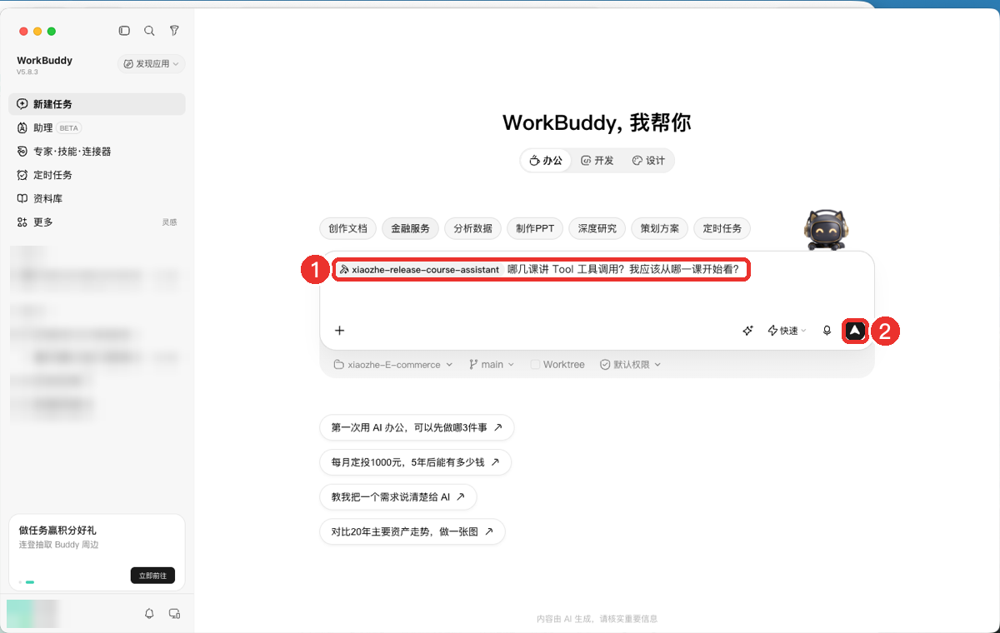

**正确的样子：** 它会列出具体的课次。比如故事课里第 17 到 24 课都和工具调用有关，第 18 课就叫 Tool Calling，还会给你一条建议的学习路线；最后它会问你要不要生成"运行卡片"（就是某一课怎么启动的说明，第 5 章会用到）。

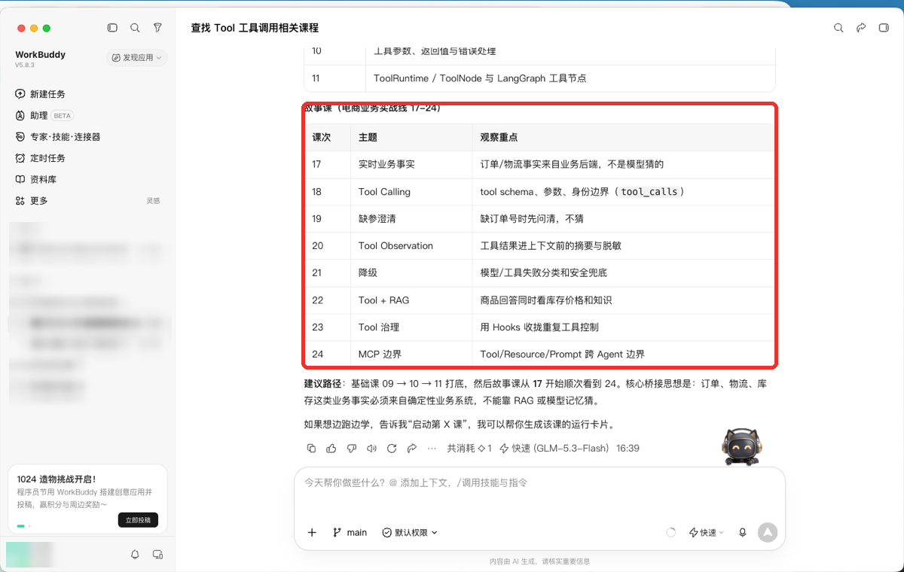

能答出这种**只有这门课才有**的内容（课次编号、每课的主题），就说明课程助手已经生效了。

**如果不一样：** 它只是泛泛地讲"什么是工具调用"，一个课次编号都没提 → 课程助手大概率没用上。回到第 6 步，确认是新对话、工作空间对、输入框里有那个小标签。

---

## 常见问题

**问：每次打开 WorkBuddy 都要重新装课程助手吗？**  
答：不用。装一次就一直在。只是**每次新建任务都要选好工作空间**，课程助手是跟着这个项目走的，工作空间不对就看不到它。

**问：工作空间选错了，会不会把电脑弄坏？**  
答：不会。最多是它找不到课程文件、回答不对。重新选一次就好。

**问：我用的是 Codex / Claude Code / Trae，课程助手怎么装？**  
答：课程助手就在课程代码的 `.agents/skills/xiaozhe-release-course-assistant` 文件夹里。在你的工具里打开课程代码文件夹，把第 5 步那句话发给它，它会按自己工具的方式装好。不同工具放技能的位置不一样，让它自己处理就行。

**问：它说装好了，但斜杠里就是看不到？**  
答：九成是没有新建任务。技能要在**新对话**里才会被加载。
