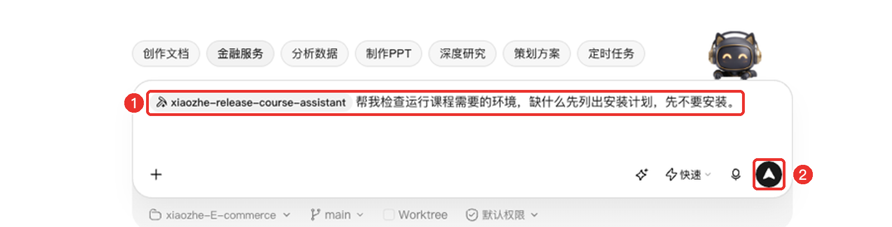
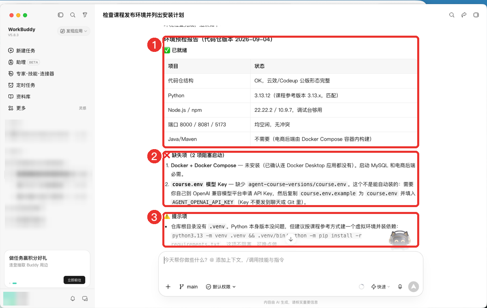
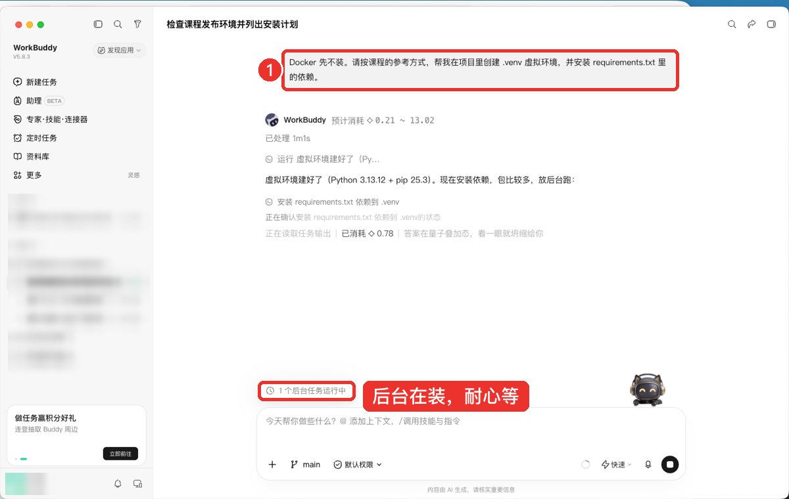
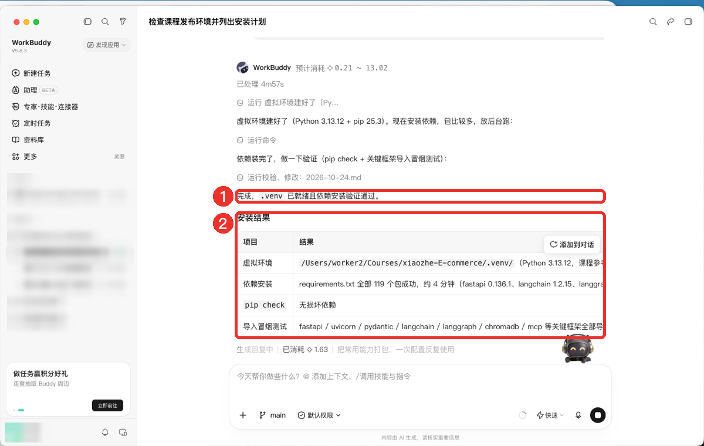
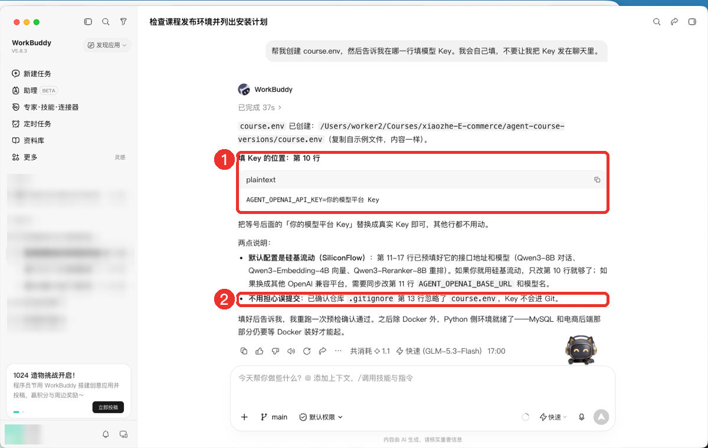
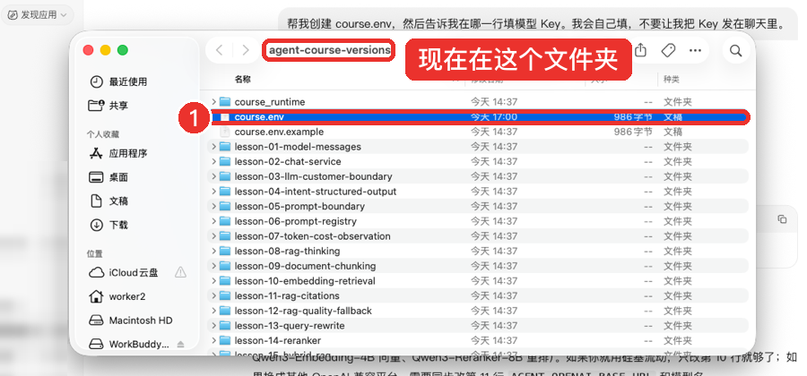
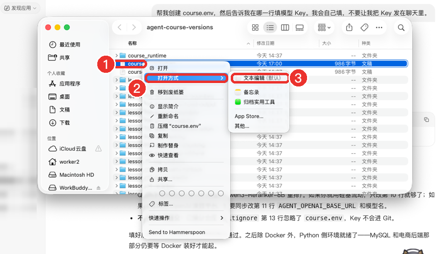
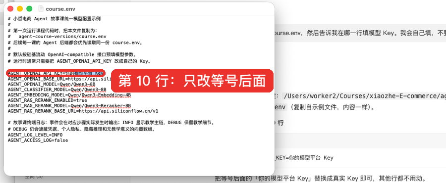
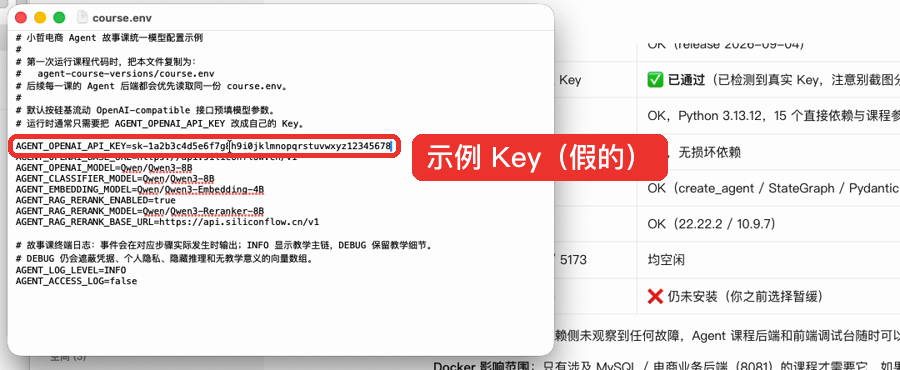
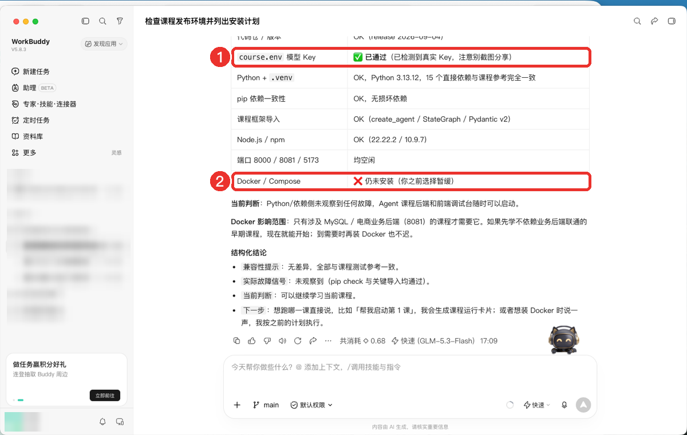

你也可以用自己常用的 Agent 工具（Codex、Claude Code、Trae 等），这里还是以 WorkBuddy 作为示范。

## 第 1 步：新建任务，选好工作空间和课程助手

每次开新任务都是这三个动作（第 3 章学过）：

1. 点左上角 **新建任务**。
2. 点输入框下面的 **选择工作空间**，选 **xiaozhe-E-commerce**。
3. 在输入框里按 `/`，点 **xiaozhe-release-course-assistant**，输入框里出现灰色小标签。

## 第 2 步：让它检查环境，先不要安装

**复制这句话，粘贴到小标签后面，按回车发送：**

```latex
帮我检查运行课程需要的环境，缺什么先列出安装计划，先不要安装。
```



💡 **为什么要说"先不要安装"？** 让它先把缺什么讲清楚，你看明白了，再决定装不装、什么时候装。以后遇到任何"要往电脑上装东西"的事，都建议先这么问一句。

等 1～2 分钟，它会给出一份**环境预检报告**。



**怎么看这份报告：**

1. **已就绪**（图中 ①）：已经没问题的。一般 Python 3.13 和 Node 都已经有了，因为 **WorkBuddy 自己带了 Python 和 Node**，这两样不用另外装。
2. **缺失项**（图中 ②）：还缺的。一般会缺两样：
    - **Docker**：后面第 17 课以后才用得到，**这一章先不装**，第 6 章再装。
    - **course.env**：填模型 Key 的配置文件，这一章就把它弄好。
3. **提示项**（图中 ③）：建议做的事。它建议在项目里建一个 `.venv` 虚拟环境，把课程需要的依赖装进去。

**如果你的报告和这里不一样：** 每台电脑情况不同，这很正常。比如你的电脑上可能显示 Python 或 Node 缺失。看不懂哪一项，就直接问它："第 X 项是什么意思？不装会怎样？"

**Windows 用户看这里：** 报告里的版本号、路径会和图上不一样（路径会是 `D:\Courses\...` 这种），只要看"已就绪 / 缺失项"两个分类就行。如果它说要用 `winget` 帮你装软件，Windows 会弹出"你要允许此应用对你的设备进行更改吗？"，确认是你让它装的那个软件，就点"是"。

## 第 3 步：让它创建虚拟环境、安装依赖

**复制这句话，按回车发送：**

```latex
Docker 先不装。请按课程的参考方式，帮我在项目里创建 .venv 虚拟环境，并安装 requirements.txt 里的依赖。
```

它会先建好虚拟环境，然后开始装依赖。依赖比较多，它会**放到后台去装**，输入框上方会出现"1 个后台任务运行中"。



⏳ **这一步要等好几分钟**（大约 4～5 分钟）。可以去倒杯水，不用一直盯着。**不要关 WorkBuddy，也不要让电脑休眠。**

🔑 **如果弹出要输入电脑密码的框：** 有时候装软件需要电脑的管理员权限，会弹出一个输入密码的窗口。在 Mac 上输入的是你**开机时用的那个密码**。如果是在命令行里让你输密码，**输的时候屏幕上不会显示任何字，连星号都没有，这是正常的**，输完直接按回车就行。

**正确的样子：** 它说"完成，.venv 已就绪且依赖安装验证通过"（图中 ①），还会给你一张**安装结果**表（图中 ②）：

- 虚拟环境：建在 `xiaozhe-E-commerce/.venv/` 里。
- 依赖安装：requirements.txt 里全部 100 多个包都装成功了。
- pip check：**无损坏依赖**（就是包和包之间没有冲突）。
- 导入冒烟测试：fastapi、langchain、langgraph 这些关键框架都能正常使用。



**如果不一样：**

- 等了 15 分钟以上还在转：网络可能慢。直接问它："依赖安装还在进行吗？卡在哪一步了？"
- 它报了一大段红色错误：不用自己看懂，**把错误原样复制给它**，说"安装依赖时出现这个错误，请帮我看看原因，要改文件或者删东西之前先问我"。

**Windows 用户看这里：** 虚拟环境在 Windows 上一样叫 `.venv`，只是里面的文件结构不一样，这些都由 WorkBuddy 处理，你不用管。如果杀毒软件弹窗问是否允许 python.exe 运行，点允许。

## 第 4 步：让它建好 course.env，告诉你在哪一行填 Key

**复制这句话，按回车发送：**

```latex
帮我创建 course.env，然后告诉我在哪一行填模型 Key。我会自己填，不要让我把 Key 发在聊天里。
```

⚠️ 注意最后那句"**不要让我把 Key 发在聊天里**"。Key 只能由你自己填进文件，绝不发到聊天框里。



**正确的样子：** 它会告诉你：

1. 文件已经建好，位置是 `xiaozhe-E-commerce/agent-course-versions/course.env`。
2. **填 Key 的位置：第 10 行**，这一行现在是 `AGENT_OPENAI_API_KEY=你的模型平台 Key`。把等号后面的"你的模型平台 Key"换成真的 Key，其他行都不用动（图中 ①）。
3. 这个文件已经被 `.gitignore` 排除了，**不会被上传到代码仓库**，Key 不会泄露出去（图中 ②）。

## 第 5 步：去硅基流动拿一个 Key

课程默认用的模型平台是**硅基流动（SiliconFlow）**。

1. 打开浏览器，在地址栏输入 `siliconflow.cn`，按回车。
2. 注册并登录（用手机号就行）。
3. 登录后，在页面左侧菜单里找到 **API 密钥**，点进去。
4. 点 **新建 API 密钥**，名字随便写，比如"小哲课程"。
5. 新建好以后，点那串密钥旁边的**复制**按钮，把它复制下来。

⚠️ 复制下来以后，**马上去做第 6 步**，不要先粘贴到微信、备忘录或者聊天框里"暂存"。  
💡 用别的模型平台也可以，但除了第 10 行的 Key，还要改第 11 行的接口地址和模型名。这种情况下，直接告诉课程助手你用的是哪个平台，让它告诉你具体怎么改（Key 还是你自己填）。

## 第 6 步：用"文本编辑"打开 course.env

1. 点屏幕底部 Dock 栏最左边的笑脸图标，打开**访达**。
2. 进入你的用户文件夹 → **Courses** → **xiaozhe-E-commerce** → **agent-course-versions**。
3. 在文件列表里找到 **course.env**（不是 `course.env.example`，注意看清楚）。



4. 在 **course.env** 上点**右键**（触控板用两根手指一起按，或者按住 Control 键再点）（下图 ①）。
5. 在弹出的菜单里，把鼠标移到 **打开方式**（下图 ②）。
6. 右边又弹出一个小菜单，点 **文本编辑**（下图 ③）。



⚠️ **不要直接双击 course.env。** 双击可能会用别的程序打开，或者提示"无法打开"。一定要用"打开方式 → 文本编辑"。

**Windows 用户看这里：**

1. 打开"此电脑"→ D 盘 → Courses → xiaozhe-E-commerce → agent-course-versions。
2. 在 **course.env** 上点右键 → **打开方式** → **记事本**。如果列表里没有记事本，点"选择其他应用"，在里面找"记事本"。
3. 如果你看到两个很像的文件（course.env 和 course.env.example），Windows 可能把后缀名藏起来了。在资源管理器上方点"查看"→ 勾上"文件扩展名"，就能分清楚了。

## 第 7 步：只改第 10 行，填上你的 Key，保存

打开以后是一个满是英文的窗口。别慌，你**只需要改一行**。

1. 找到这一行（从上往下数第 10 行，也是第一行以 `AGENT_OPENAI_API_KEY=` 开头的）：

```latex
AGENT_OPENAI_API_KEY=你的模型平台 Key
```



2. 用鼠标**选中等号后面的"你的模型平台 Key"这几个字**（从"你"按住拖到"Key"的最后一个字母）。**等号和等号前面的** `AGENT_OPENAI_API_KEY` **一个字母都不要动。**
3. 按 **Command + V**，把刚才复制的 Key 粘贴进去。
4. 检查一下：这一行应该变成 `AGENT_OPENAI_API_KEY=sk-xxxxxxxx……` 这个样子。等号后面**直接**就是 sk-，中间没有空格，也没有引号，后面也不要留下"Key"之类的残字。



上图里的 `sk-1a2b3c4d5e6f7g8h9i0jklmnopqrstuvwxyz12345678` 是**编出来的示例**，不能用，你要填自己在硅基流动复制的那个。

5. 按 **Command + S** 保存。
6. 点窗口左上角的红色圆点，关掉这个窗口。

**如果不一样：**

- 保存时弹出窗口问要不要改成 `.txt` 或者别的格式：选**不改**，保持 `course.env` 这个名字。
- 不小心改坏了别的行：先按 **Command + Z** 撤销到改之前。改乱了也没关系，告诉 WorkBuddy"我把 course.env 改乱了，请帮我按 course.env.example 恢复，第 10 行的 Key 我会重新自己填"。

**Windows 用户看这里：** 记事本里用 **Ctrl + V** 粘贴、**Ctrl + S** 保存。如果记事本问编码，选 **UTF-8**。保存后确认文件名还是 `course.env`，不要变成 `course.env.txt`。

🔒 **再强调一次：Key 就是密码。**

- 只填在 `course.env` 这个文件里。
- 不要发到 WorkBuddy 的聊天框里，也不要发到任何群、私聊。
- 不要截图发给别人（截图里的 Key 一样能被看到）。
- 万一不小心发出去了：马上去硅基流动的"API 密钥"页面把这个 Key 删掉，再新建一个重新填。

## 第 8 步：让它重新检查一遍

回到 WorkBuddy，在**刚才那个对话里**继续发：

**复制这句话，按回车发送：**

```latex
我已经在 course.env 里填好 Key 了，请重新检查环境。
```



**正确的样子：**

1. `course.env 模型 Key` 这一行显示 ✅ **已通过**（图中 ①）。它可能还会提醒你"已检测到真实 Key，注意别截图分享"。注意：它只检查有没有填，**不会把你的 Key 显示出来**。
2. Python、.venv、依赖、Node 都是 OK。
3. 只有 **Docker / Compose** 还是 ❌ 未安装（图中 ②）。没关系，前面的课程不需要 Docker，第 6 章再装。

到这里就可以开始跑课程了。

**如果不一样：**

- 模型 Key 那一行没通过：多半是没保存，或者第 10 行改错了。重新用"文本编辑"打开 course.env 看一眼第 10 行（**看完别截图**），确认等号后面就是你的 Key，然后再检查一次。
- 它让你把 Key 发给它看：**不要发**。回复它"Key 我不会发在聊天里，请告诉我怎么自己检查"。

---

## 常见问题

**问：WorkBuddy 自带 Python 和 Node，那我电脑上原来装的会不会冲突？**  
答：一般不会。课程依赖都装在项目里的 `.venv` 里，和电脑上别的 Python 是分开的。

**问：依赖安装失败了，能不能重来？**  
答：可以。把错误原文复制给它，说"请帮我重新安装依赖，要删除 .venv 之前先问我"。

**问：硅基流动要花钱吗？**  
答：注册后一般会有赠送额度，课程里的练习用量不大。具体额度以硅基流动官网显示为准。

**问：Key 填错了会怎样？**  
答：后面启动课程、和 Agent 对话时会报错，比如页面上只显示"Load failed"。第 7 章讲了这种情况怎么排查。

**问：用 Codex、Claude Code 的同学这一步有什么不同？**  
答：步骤一样：让它检查环境、建 .venv 装依赖、建 course.env；Key 一样是你自己用文本编辑器填进第 10 行，不要发在聊天里。
