用你自己常用的 Agent 工具（Codex、Claude Code、Trae 等）也可以，这里以 WorkBuddy 作为示范。

## 第 1 步：新建任务，选好工作空间

1. 点 WorkBuddy 左上角的 **"新建任务"**。
2. 在输入框下面找到 **"选择工作空间"**，点一下（图里①）。
3. 弹出的列表里，点 `xiaozhe-E-commerce`（图里②）。

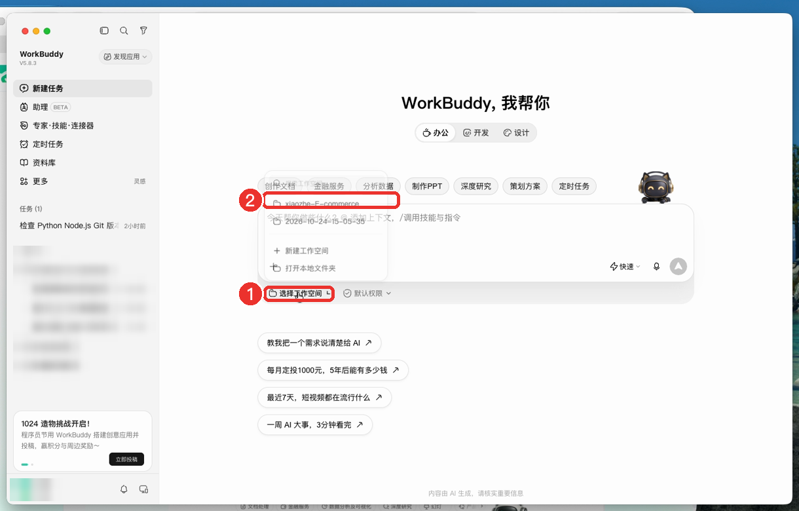

**正确的样子：** 输入框下面原来写着"选择工作空间"的地方，变成了 `xiaozhe-E-commerce`。

**如果不一样：**

- 列表里没有 `xiaozhe-E-commerce`：点列表里的"打开本地文件夹"，找到用户文件夹下的 `Courses`，选中里面的 `xiaozhe-E-commerce` 这一层（不要选 `Courses`，也不要点进更里面的文件夹），再点"打开"。详见第 3 章。

**Windows 用户看这里：** 操作完全一样。课程代码如果放在 `D:\Courses\xiaozhe-E-commerce`，就选这个文件夹。

## 第 2 步：输入 `/`，选中小哲课程助手

1. 点一下输入框，让光标在里面闪。
2. 按键盘上的 `/`（斜杠，一般在右 Shift 左边，和问号是同一个键，**不用**按 Shift）。
3. 输入框上方会弹出技能列表，点 `xiaozhe-release-course-assistant`（图里①）。

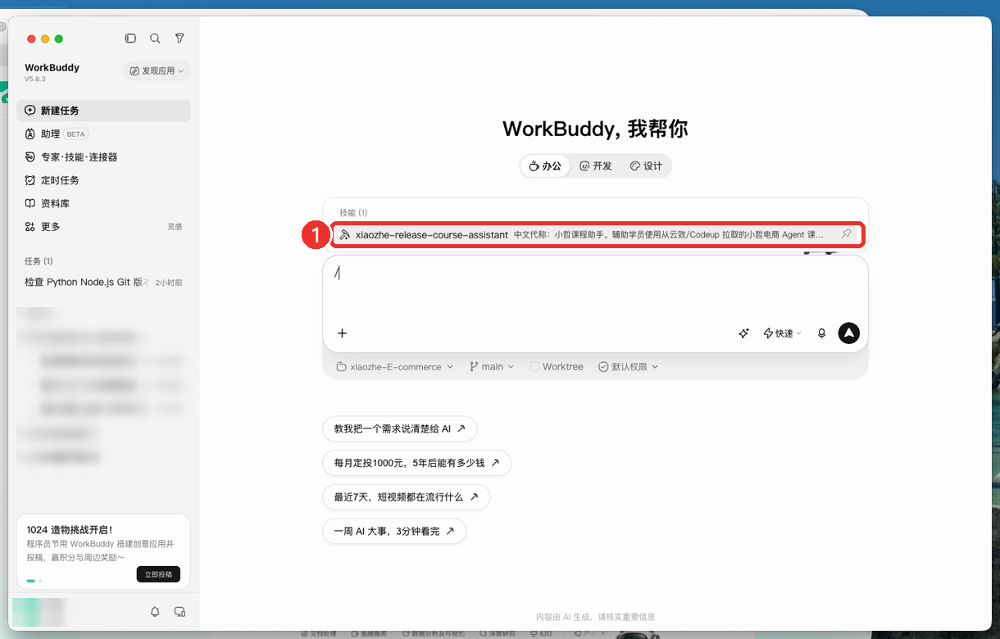

**正确的样子：** 输入框最前面出现一个小标签 `xiaozhe-release-course-assistant`，后面可以接着打字。

**如果不一样：**

- 按了 `/` 没有弹出列表：先确认输入框是空的，光标在里面；中文输入法下有时会打出"、"，切到英文输入法再按一次。
- 列表里找不到课程助手：回到第 3 章，按"装好课程助手"那一步重新做一遍。

## 第 3 步：复制这句话，让它启动第 2 课

**复制这句话，粘贴到输入框（课程助手标签后面），按回车发送：**

```latex
帮我启动第 2 课和调试后台，启动好以后把要打开的网址告诉我。
```

粘贴：Mac 按 `Command + V`，Windows 按 `Ctrl + V`。发送：按回车，或者点输入框右下角的圆形箭头按钮（图里②）。

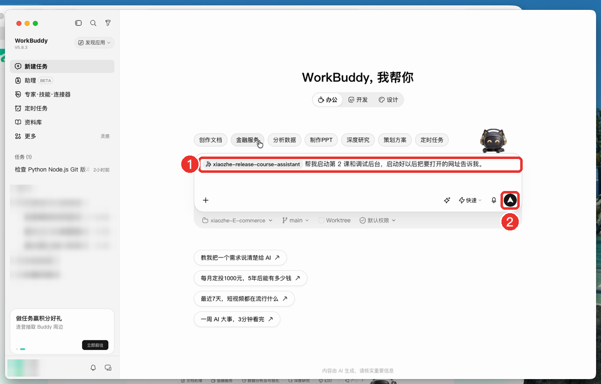

**正确的样子：** 对话区出现你这句话，下面 WorkBuddy 开始干活，会一行一行显示它在做什么，比如"运行命令""运行 好消息"之类。

接下来**不用管它**，让它自己跑。它大概会做这几件事（你在屏幕上能看到对应的文字）：

1. 先检查一遍运行环境（Python、依赖、Node、模型 Key 是否都在）。
2. 看第 2 课需要哪些服务。一般它会发现：**第 2 课用不到 Docker**，所以 Docker 没装也不影响。
3. 启动第 2 课的后端（Agent 服务）。
4. 第一次启动调试后台时，安装它需要的前端依赖（`npm install`），然后启动调试后台。

整个过程大约一两分钟。

## 第 4 步：弹出红字"检测到批量删除操作"，怎么判断

在第 3 步的过程中，对话框底部会弹出一张确认卡片，标题是红字提醒：**"检测到批量删除操作"**。

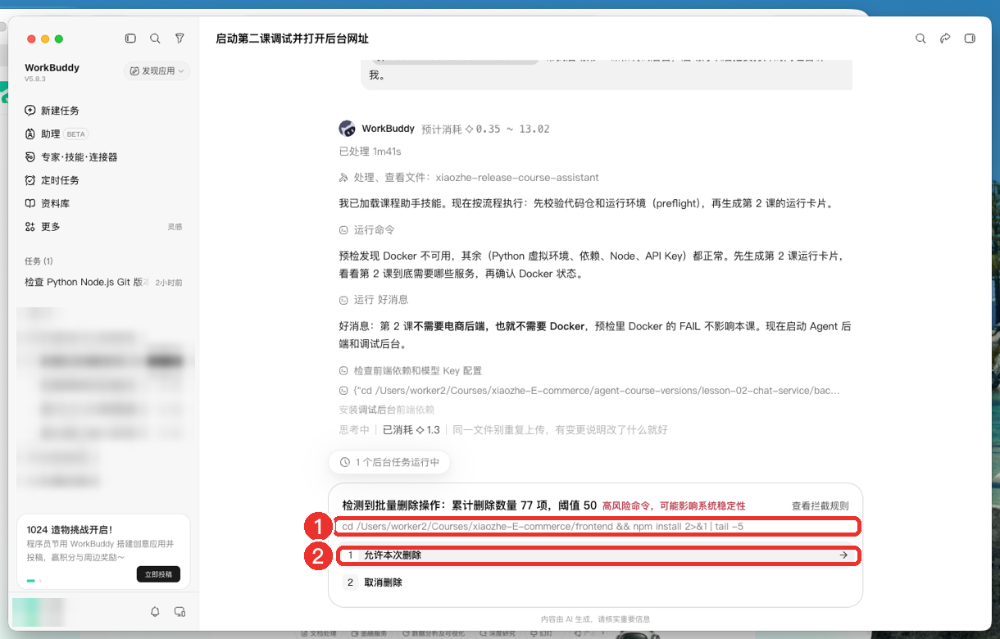

先别慌，按下面的顺序看：

1. **看卡片里的命令（图里①）。** 比如：`cd /Users/worker2/Courses/xiaozhe-E-commerce/frontend && npm install ...`。`npm install` 的意思是"安装前端依赖"，正是我们让它做的"启动调试后台"的一部分。安装依赖时会清理一些旧的临时文件，所以触发了"批量删除"的提醒。
2. **是你让它做的事 → 点"允许本次删除"（图里②）。**
3. **看不懂这条命令，或者明显不是你让它做的事 → 点"取消删除"**，然后把卡片上的文字原样复制给 WorkBuddy，问它："这一步为什么要删除文件？会删掉哪些？"弄清楚了再决定。

⚠️ "允许本次删除"只允许这一次。不要为了省事去改成"以后都允许"之类的设置，这类确认卡片就是保护你文件的最后一道门。

## 第 5 步：等它告诉你"启动成功"，找到调试后台的网址

点完"允许本次删除"后再等一会儿。它最后会给你一段总结：

- 第一行：**"第 2 课已经启动成功，两个服务都通过了健康检查。"**
- 下面一张表"启动后要打开的网址"，第一行就是 **调试后台（主入口）：**`http://localhost:5173`（图里①）。

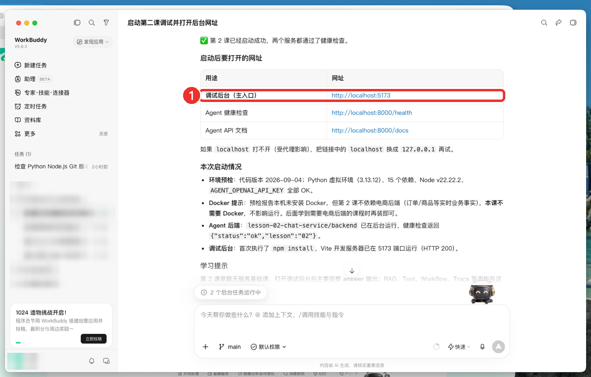

表里三个网址分别是：

| 用途 | 网址 | 你需要打开吗 |
| --- | --- | --- |
| 调试后台（主入口） | `http://localhost:5173` | **要**，这一章的主角 |
| Agent 健康检查 | `http://localhost:8000/health` | 不用，给 WorkBuddy 检查用的 |
| Agent API 文档 | `http://localhost:8000/docs` | 不用，后面学接口时再看 |

💡 `localhost` 的意思是"我自己这台电脑"。这些网址只有你自己的电脑能打开，发给别人是打不开的。

**如果不一样：**

- 它说启动失败，或者一直没有出现这张网址表：把它最后几行的报错原样复制，发给它并加一句"请帮我查原因，要改文件先问我"。第 7 章会专门讲怎么问。
- 它提示"端口被占用"：多半是上次启动的服务没关。跟它说"帮我看看是什么占用了这个端口，如果是之前课程留下的服务就停掉它"。

## 第 6 步：打开调试后台，并放大

有两种打开方法，选一种就行：

- **方法 A：** 直接点表格里的 `http://localhost:5173` 链接。WorkBuddy 会在窗口右边打开一个面板显示调试后台。面板有点窄，点面板右上角的 **放大按钮**（图里①，两个斜箭头的小图标），它会铺满整个 WorkBuddy 窗口。
- **方法 B：** 打开你电脑上的浏览器（Safari、Chrome、Edge 都行），在地址栏输入 `localhost:5173`，按回车。

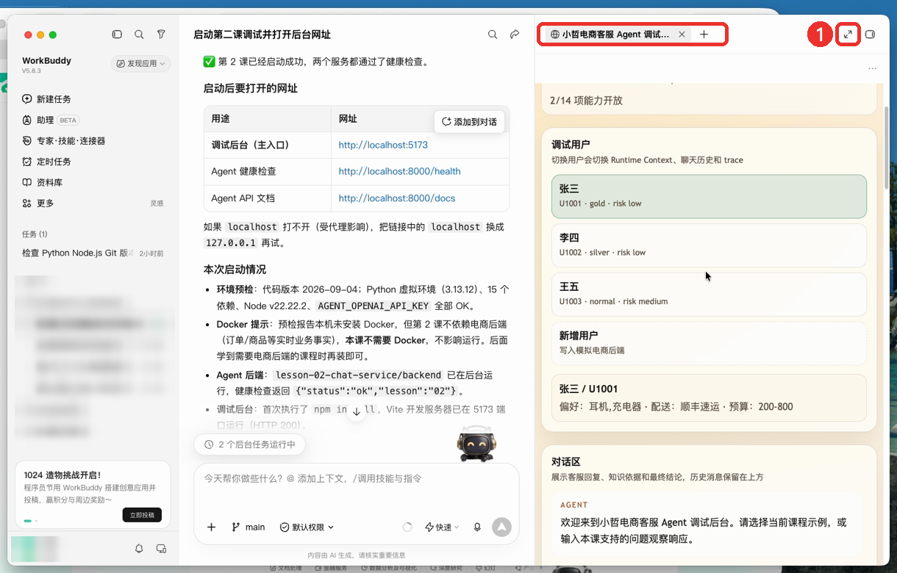

**如果不一样：**

- 页面打不开、一直转圈：照它说的，把网址里的 `localhost` 换成 `127.0.0.1` 再试，也就是 `http://127.0.0.1:5173`。
- 还是打不开：回 WorkBuddy 问它"调试后台 5173 打不开，请帮我检查调试后台是不是还在运行"。

**Windows 用户看这里：** 第一次启动时，Windows 可能弹出"Windows 安全中心/防火墙已阻止此应用的部分功能"之类的窗口，问是否允许 Python 或 Node.js 访问网络。这是课程服务在本机监听端口，一般点"允许"即可（以你屏幕上实际显示的按钮为准）。浏览器推荐用 Edge 或 Chrome。

## 第 7 步：认识调试后台长什么样

放大后，你会看到"小哲电商客服 Agent 调试后台"。先别急着点，花半分钟认一下这几块：

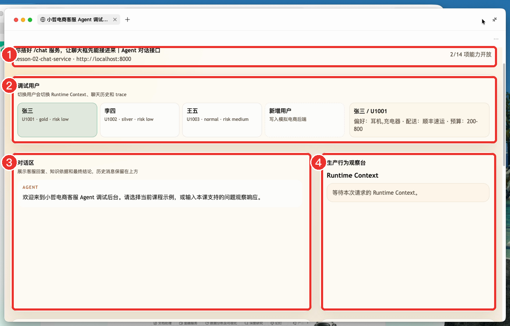

1. **当前课程**：写着这一课做了什么，以及 `lesson-02-chat-service`，说明现在跑的是第 2 课。右边"2/14 项能力开放"表示这一课只开放了一部分功能，后面的课会越开越多。
2. **调试用户**：张三、李四、王五、新增用户，是几个模拟的顾客。默认选中的是张三（U1001，金牌会员）。这一章不用换。
3. **对话区**：你和客服 Agent 的聊天记录会显示在这里。一开始只有一句 AGENT 的欢迎语。
4. **生产行为观察台**：显示这次请求背后的信息。现在写着"等待本次请求的 Runtime Context"，因为你还没发消息。

## 第 8 步：点示例问题，发送给 Agent

1. 在调试后台里**往下翻**（鼠标滚轮或触控板两指往下滑），找到 **"输入用户问题"** 这个框。
2. 它右边有一列现成的**示例问题**，点 **"请用一句话介绍小哲电商客服"**（图里①）。
3. 这句话会自动填进左边的输入框（图里②）。
4. 点橙色的 **"发送给 Agent"** 按钮（图里③）。

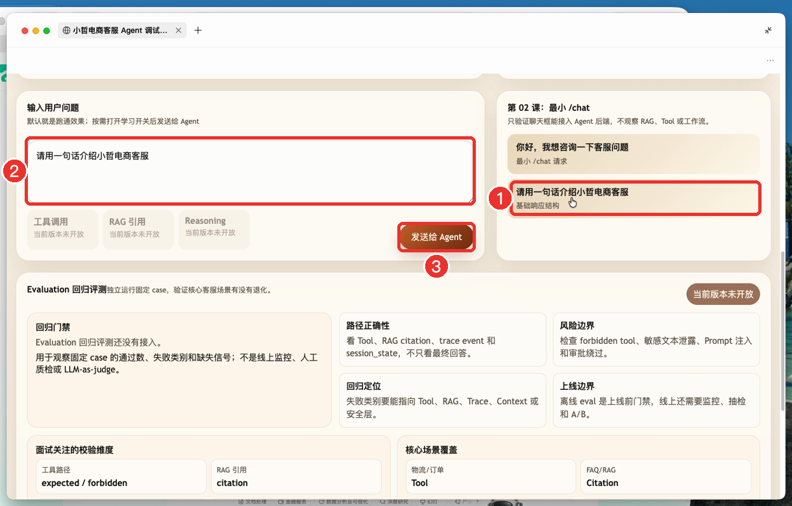

💡 下面那些"工具调用""RAG 引用""Reasoning"开关，第 2 课都还没开放，灰着是正常的，不用管。

## 第 9 步：看到回答，就说明跑通了

发送后，对话区会先显示"Agent 正在分析问题……"，稍等几秒，回答就出来了。

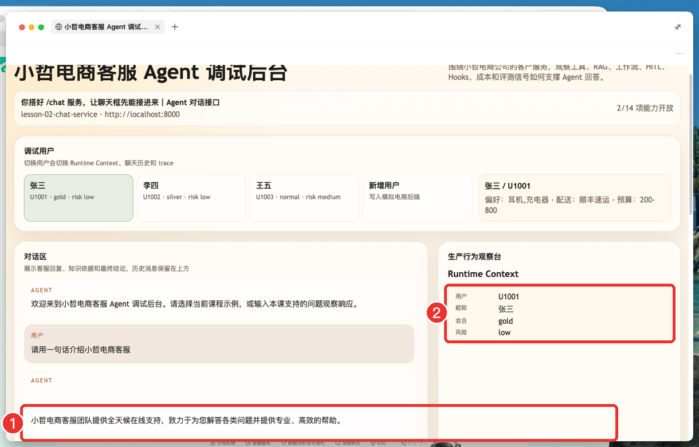

**正确的样子：**

1. 对话区里，你的问题下面出现一段 **AGENT** 的回答（图里①）。比如它回答："小哲电商客服团队提供全天候在线支持，致力于为您解答各类问题并提供专业、高效的帮助。"你的回答文字可能不一样，这很正常，大模型每次说法会略有不同。
2. 右边"生产行为观察台"的 Runtime Context 里，出现了这次请求是谁发的：用户 U1001、昵称张三、会员 gold、风险 low（图里②）。后面的课程，这里会显示越来越多的信息。

🎉 **看到 AGENT 的回答 = 第 2 课跑通了。** 这是你本地跑起来的客服 Agent，第一次真正调用大模型给出的回答。

**如果不一样：**

- 一直停在"Agent 正在分析问题……"，或者回答是一句 `Load failed`、报错信息：多半是模型 Key 有问题或者后端没跑起来。第 7 章用的就是这个例子，照第 7 章的问法把情况告诉 WorkBuddy 就行。
- 想再多试几句：可以自己在输入框里打字，比如"你好，我想咨询一下客服问题"，再点"发送给 Agent"。

## 第 10 步：学完了，让它把服务停掉

1. 先把右边的调试后台面板关掉：点面板右上角，先缩小，再点关闭，回到普通的聊天界面。用浏览器打开的，直接关掉那个标签页就行。
2. 在**同一个任务**的输入框里（不用新建任务），**复制这句话，粘贴到输入框，按回车发送：**

```latex
第 2 课用完了，帮我把刚才启动的服务都停掉。
```

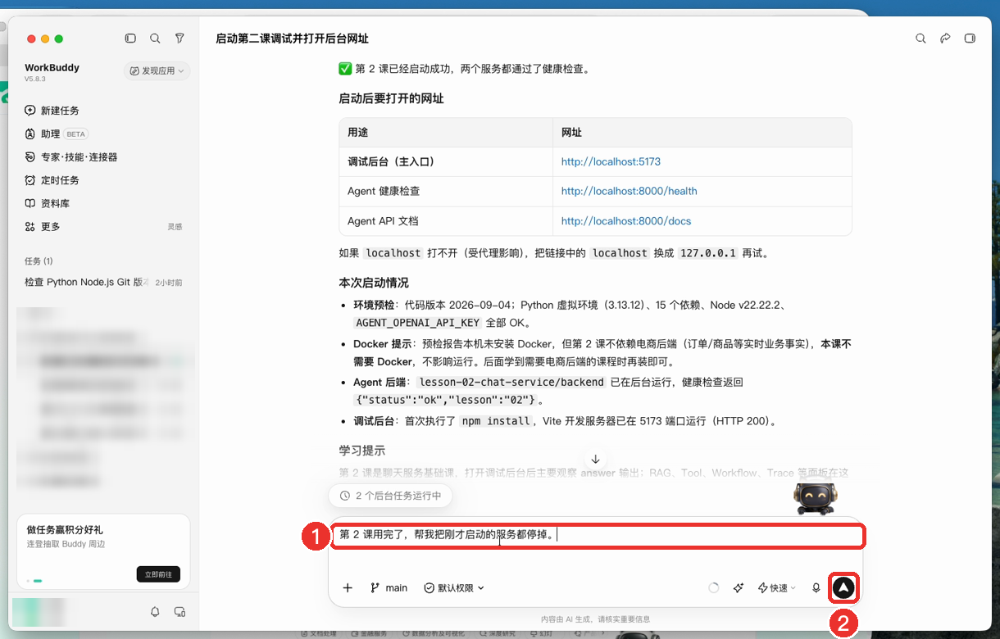

**正确的样子：** 十几秒后它回复"已全部停掉，端口也确认释放了"，并列出：第 2 课 Agent 后端（8000 端口）已停止、调试后台（5173 端口）已停止。

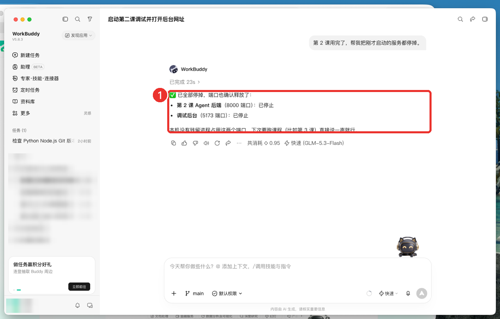

**为什么一定要停？**

- 课程服务会一直占着电脑的"端口"（可以理解成门牌号，比如 8000、5173）。不停的话，下次启动别的课，新服务想用同一个门牌号就会冲突，提示"端口被占用"。
- 后台一直跑着也会占内存和电。
- 停掉不会删你的任何文件和代码，下次学的时候再让它启动就行。

💡 关掉 WorkBuddy 窗口**不等于**停掉服务，服务可能还在后台跑。一定要让它停。

## 常见问题

**问：中途弹出的确认卡片太多了，能不能让它别问？**  
答：不建议。确认卡片是在问你"它要做的这件事你同不同意"。判断方法就一条：看卡片上的命令，是你让它做的事就点允许，看不懂就点取消（或拒绝），然后把卡片上的文字复制给它，让它解释清楚。

**问：我发完启动的话，它没有用课程助手，而是自己乱试。**  
答：多半是忘了第 2 步的 `/` 选课程助手。点"新建任务"重新来一遍，记得输入框最前面要有 `xiaozhe-release-course-assistant` 标签。

**问：调试后台里的回答和截图不一样。**  
答：正常。大模型每次的说法会有变化，只要出现了 AGENT 的回答，不是报错，就算成功。

**问：明天想接着学，要重新做一遍吗？**  
答：要重新启动，但很快。新建任务 → 选工作空间 → `/` 选课程助手 → 发"帮我启动第 X 课和调试后台，启动好以后把要打开的网址告诉我"。学完照样让它停掉。

**问：下次启动提示端口被占用怎么办？**  
答：跟它说"启动时提示端口被占用，帮我看看是哪个程序占的，如果是之前课程留下的服务就停掉，然后重新启动"。
