用你自己常用的 Agent 工具（Codex、Claude Code、Trae 等）也可以，这里以 WorkBuddy 作为示范。

从第 17 课开始，课程要用到"电商后端"：订单、物流、商品这些业务数据。它们跑在 **Docker** 里。所以要先装好 Docker，再跑第 18 课。

💡 **Docker 是什么？** 可以把它理解成一个"软件集装箱"。电商后端、MySQL 数据库这些程序，被打包成一个个集装箱（叫"镜像"和"容器"），装进 Docker 就能直接跑，不用你一个个去安装和配置。你只需要装好 Docker 这一个软件。

## 第 1 步：先问课程助手，第 18 课还缺什么

1. 点 **"新建任务"** → 点 **"选择工作空间"** → 选 `xiaozhe-E-commerce`。
2. 在输入框里按 `/`，选中 `xiaozhe-release-course-assistant`。（这两步和第 5 章第 1、2 步完全一样，忘了就回去看截图。）
3. **复制这句话，粘贴到输入框，按回车发送：**

```latex
我要学第 18 课，帮我检查还缺什么，缺 Docker 就先告诉我怎么装，先不要安装。
```

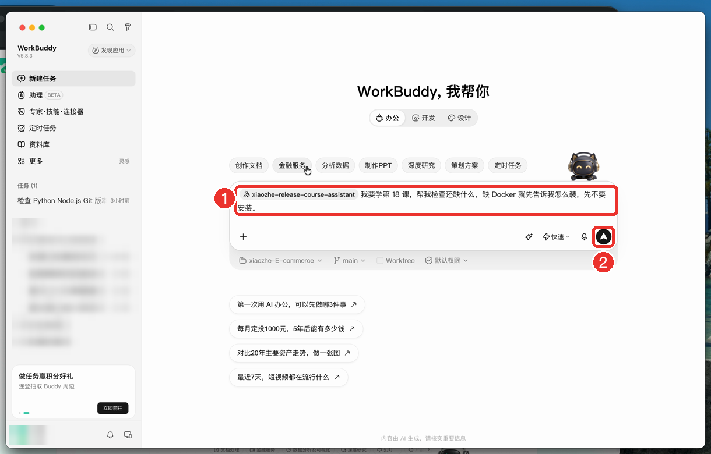

💡 最后那句"先不要安装"很重要：先让它告诉你缺什么、打算怎么做，你看明白了再让它动手。

**正确的样子：** 一两分钟后，它给出检查结果。它会说：

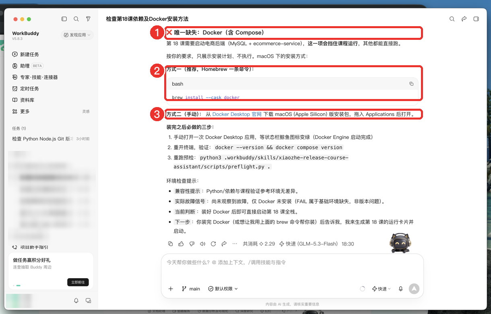

1. **唯一缺失：Docker（含 Compose）。** 第 18 课需要启动电商后端（MySQL + ecommerce-service），这一项会挡住课程运行，其他都能直接跑。
2. **方式一（推荐，Homebrew 一条命令）：** `brew install --cask docker`。
3. **方式二（手动）：** 从 Docker Desktop 官网下载 macOS（Apple Silicon）版安装包，拖入 Applications 后打开。

我们用**方式二**：自己下载安装包，再让 WorkBuddy 帮忙装。原因是国内网络下 Homebrew 下载 Docker 经常很慢甚至失败，而官网安装包用浏览器下载更可控。

## 第 2 步：自己下载 Docker Desktop 安装包

这一步和第 2 章下载 WorkBuddy 一样，用浏览器下载就行。

1. 打开浏览器，进入 Docker 官网的 Docker Desktop 下载页（在搜索引擎里搜"Docker Desktop 下载"，认准 `docker.com` 域名）。
2. 选对版本：
    - **Mac**：先确认芯片。点屏幕左上角苹果图标 →"关于本机"，看"芯片"一行：写着 Apple M1/M2/M3/M4 之类的，选 **Apple 芯片（Apple Silicon）** 版；写着 Intel 的，选 **Intel 芯片** 版。
    - **Windows**：选 Windows 版（一般是 AMD64）。
3. 下载好的文件，Mac 上叫 `Docker.dmg`（约 570 MB），默认在 **"下载"** 文件夹里。**不用双击它**，接下来交给 WorkBuddy。

**如果不一样：**

- 官网打不开，或者下载特别慢：换个网络再试，比如连手机热点。
- 下载下来的文件名不是 `Docker.dmg`（比如 `Docker (1).dmg`）：没关系，下一步发提示词时把名字改成你实际的文件名。

## 第 3 步：让 WorkBuddy 安装 Docker，并配置国内镜像加速

回到 WorkBuddy，**在同一个任务里**，**复制这句话，粘贴到输入框，按回车发送：**

```latex
Docker Desktop 的安装包我已经下载好了，在“下载”文件夹里，叫 Docker.dmg。请用它帮我安装 Docker Desktop。我在国内，连不上 Docker Hub，请顺便帮我配置国内镜像加速。
```

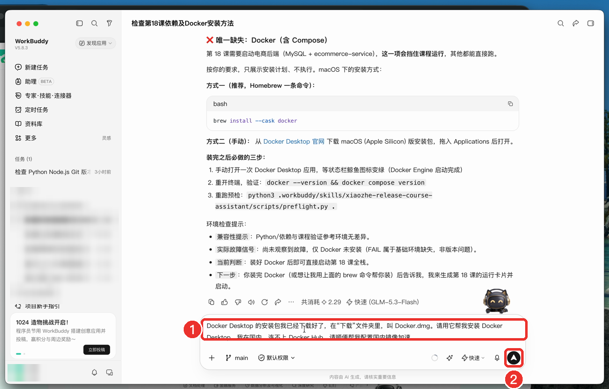

💡 **为什么要配"镜像加速"？** Docker 默认从国外的 Docker Hub 下载镜像，国内网络经常下不动。配了国内加速源，下载就走国内的服务器。常用的三个加速源是：`docker.1ms.run`、`docker.xuanyuan.me`、`docker.m.daocloud.io`（可用的加速源会变，以它实际查到的为准）。

接下来会**连续弹出好几个窗口**，下面第 4 ～ 第 10 步按顺序一个个处理。

## 第 4 步：系统弹窗"WorkBuddy 想访问'下载'文件夹"→ 点"允许"

马上会弹出一个 macOS 系统窗口：**"WorkBuddy"想访问"下载"文件夹中的文件**。安装包就在那里，点 **"允许"**（图里①）。

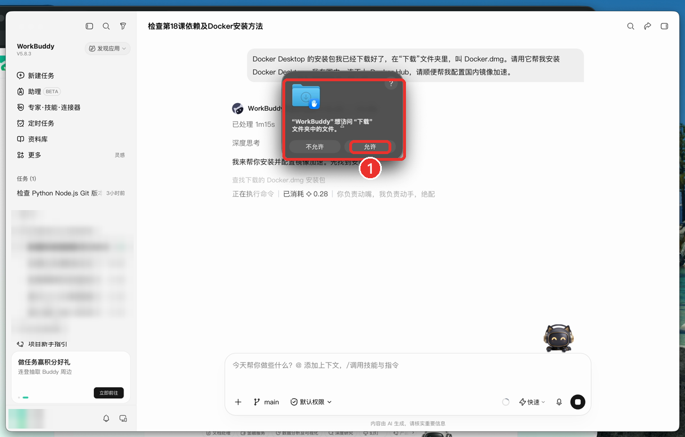

## 第 5 步：WorkBuddy 确认卡片（把 Docker 复制进"应用程序"）→ 点"允许删除"

接着 WorkBuddy 自己弹出一张确认卡片，标题是 **"删除文件命中询问规则，需要确认"**（图里①）。

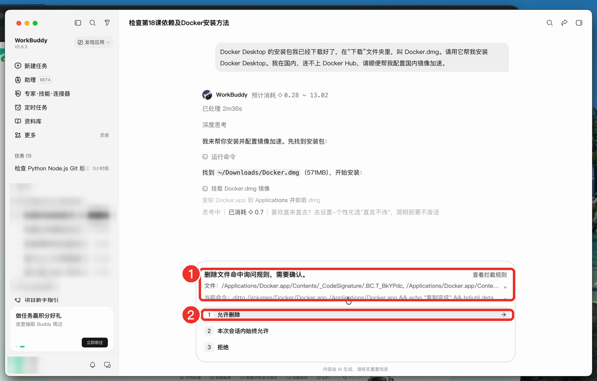

看卡片里的"当前命令"，是 `ditto /Volumes/Docker/Docker.app /Applications/Docker.app ...`。意思是：**把 Docker 从安装包复制到"应用程序"文件夹**（如果原来有旧的就覆盖，所以算作"删除文件"）。这正是我们让它做的安装，点第一项 **"允许删除"**（图里②），**只允许这一次**。

⚠️ 不要选"本次会话内始终允许"。每次都看一眼再点，是好习惯。

## 第 6 步：如果弹出"Docker 已损坏，无法打开"→ 先点"取消"

有时系统会弹出警告 **"Docker"已损坏，无法打开。你应该将它移到废纸篓。** 下面两个按钮："取消"和"移到废纸篓"。

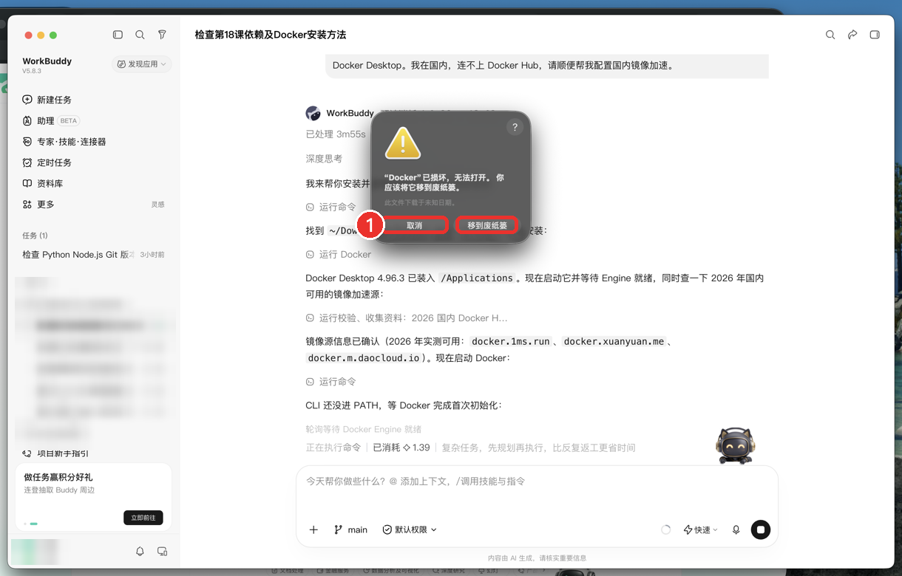

**千万别点"移到废纸篓"！先点"取消"（图里①）。**

你的电脑上不一定会出现这个窗口。没出现就直接跳到第 9 步。

## 第 7 步：先点"停止"，打断它正在做的事

点完取消后，WorkBuddy 可能还在原地等 Docker 启动。点输入框右下角那个 **黑色圆形的停止按钮**（运行中时它是一个方块图标，图里①），先让它停下来。

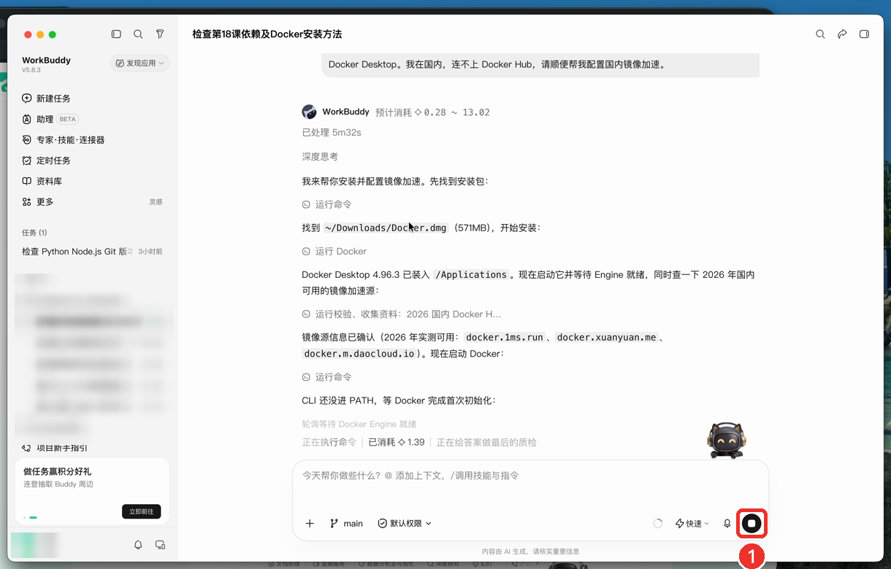

## 第 8 步：把报错原样告诉它，让它查原因并修复

**复制这句话，粘贴到输入框，按回车发送：**

```latex
Docker 启动时弹出了一个窗口：“Docker”已损坏，无法打开，你应该将它移到废纸篓。我点了取消。请帮我检查是什么原因，并修复。
```

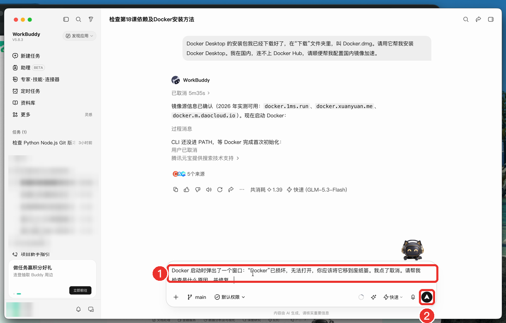

💡 这就是"报错了怎么问"的标准做法：**说清楚弹了什么窗口（原文）、你点了什么、希望它做什么。** 第 7 章会专门讲。

**正确的样子：** 它很快查出原因（图里①）。它的结论是：不是安装包坏了，而是**刚才复制的时候文件没复制完整**（应用包内部的 `Mantle.framework` 资源不完整，签名校验失败），所以系统认为"已损坏"。它的修法是：删掉坏的副本，重新复制一份。

这时又会弹出一张 **"检测到批量删除操作"** 的确认卡片，命令是 `rm -rf /Applications/Docker.app ...` 加上重新 `ditto` 复制。删的是刚才那个复制坏了的 Docker，这是我们让它修复的，点 **"允许本次删除"**（图里②）。

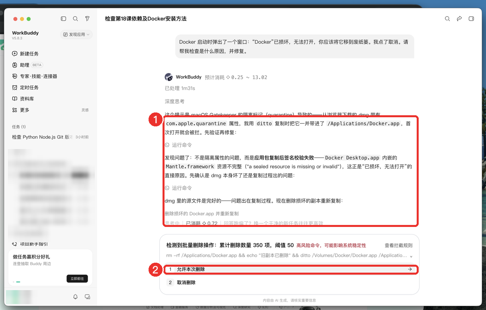

⚠️ 怎么判断这张卡片能不能点允许：看 `rm -rf` 后面删的是什么。这里是 `/Applications/Docker.app`，正是坏掉的那个 Docker，可以删。如果后面跟的是你看不懂的路径，或者是你的文档、桌面、整个用户文件夹，就点"取消删除"，再把卡片原文复制给它问清楚。

## 第 9 步：Docker 第一次打开，你要亲手点的 4 处

修好以后，Docker Desktop 会正常打开。第一次打开有几个窗口**必须你自己点**（WorkBuddy 点不了）。按顺序来：

### ① 服务协议：点"Accept"

窗口标题是 **Docker Subscription Service Agreement**（Docker 订阅服务协议）。点右下角蓝色的 **"Accept"**（接受）。

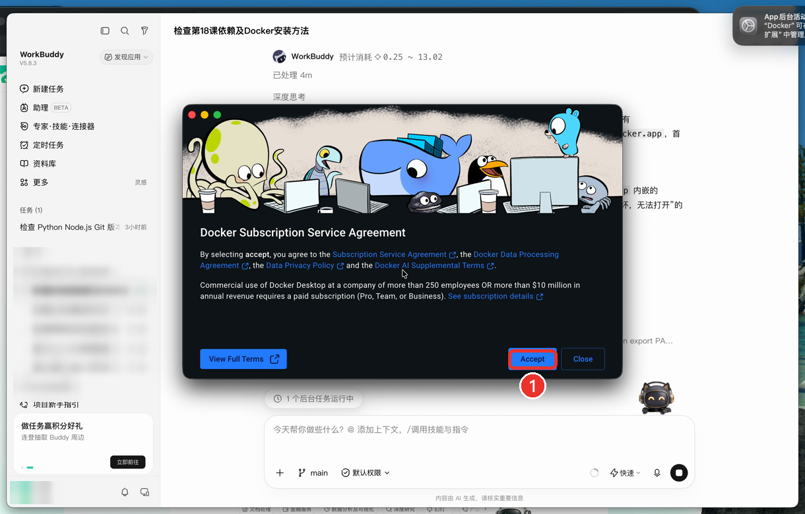

💡 协议里说的是：大公司（250 人以上或年收入 1000 万美元以上）商用要付费。个人学习不受影响。

### ② 选推荐设置，点"Finish"

窗口标题是 **Finish setting up Docker Desktop**。

1. 确认选中的是第一项 **"Use recommended settings (requires password)"**（使用推荐设置，需要密码）（图里①），默认就是选中的。
2. 点右边蓝色的 **"Finish"**（图里②）。

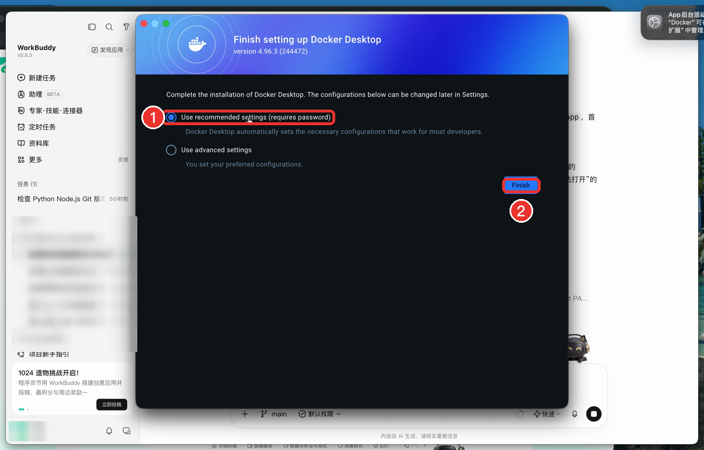

### ③ 输入开机密码，点"好"

马上弹出一个带锁图标的小窗口：**Docker Desktop requires privileged access to apply configuration**，下面写着"输入密码允许此操作"。

1. 用户名那一栏已经自动填好了，不用改。
2. 在**密码**栏输入你的**开机密码**（图里①）。**输的时候屏幕上只显示圆点，不显示字，这是正常的**，输完就行。
3. 点蓝色的 **"好"**（图里②）。

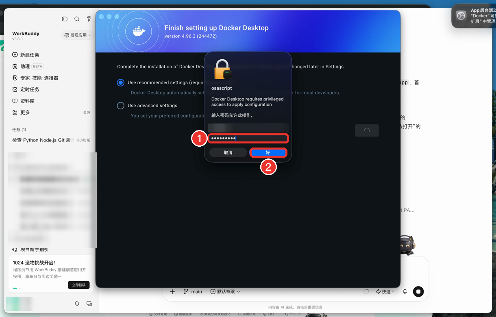

⚠️ 这个密码只输在这个系统窗口里。**永远不要把开机密码发到 WorkBuddy 的聊天框里。**

### ④ 登录页点"Skip"，权限弹窗点"允许"

1. Docker 会显示 **Welcome to Docker**，让你登录或注册账号。**不需要登录**，点右上角的 **"Skip"**（跳过）（图里①）。
2. 同时（或紧接着）会弹出系统窗口：**"WorkBuddy"想访问其他 App 的数据**。WorkBuddy 要读写 Docker 的配置来设置镜像加速，点 **"允许"**（图里②）。

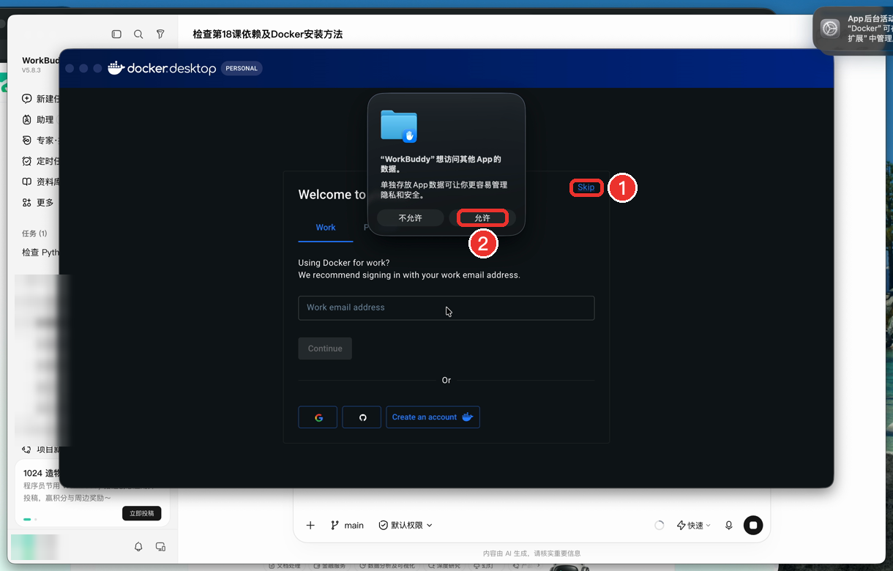

### 怎么确认 Docker 已经跑起来了

看 Docker Desktop 窗口**左下角**：显示 **Engine running**（引擎正在运行），并且是绿色的，就说明 Docker 跑起来了（图里①）。

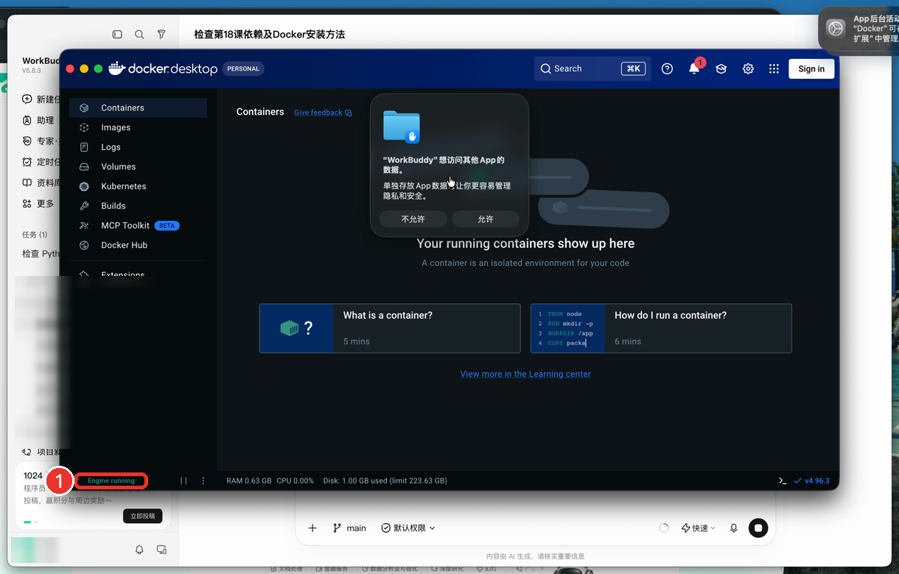

💡 窗口底部可能有一条提示 "Another application changed your Desktop configurations"（另一个应用修改了你的配置），那就是 WorkBuddy 在配加速，不用管，可以点右边的 × 关掉。屏幕右上角可能还有一条"App 后台活动：Docker 可在后台运行"的系统通知，也不用管。

Docker 窗口可以点左上角红色圆点关掉。**关掉窗口不会停掉 Docker**，它会继续在后台运行（屏幕顶部菜单栏会有一个小鲸鱼图标）。

## 第 10 步：WorkBuddy 写入镜像加速配置 → 点"允许写入"

回到 WorkBuddy，它会继续配置镜像加速。它要写入 Docker 的配置文件 `~/.docker/daemon.json`，会弹出确认卡片 **"写入文件命中询问规则，需要确认"**（图里①），文件路径是 `/Users/你的用户名/.docker/daemon.json`。

这是我们让它做的"配置国内镜像加速"，点第一项 **"允许写入"**（图里②）。

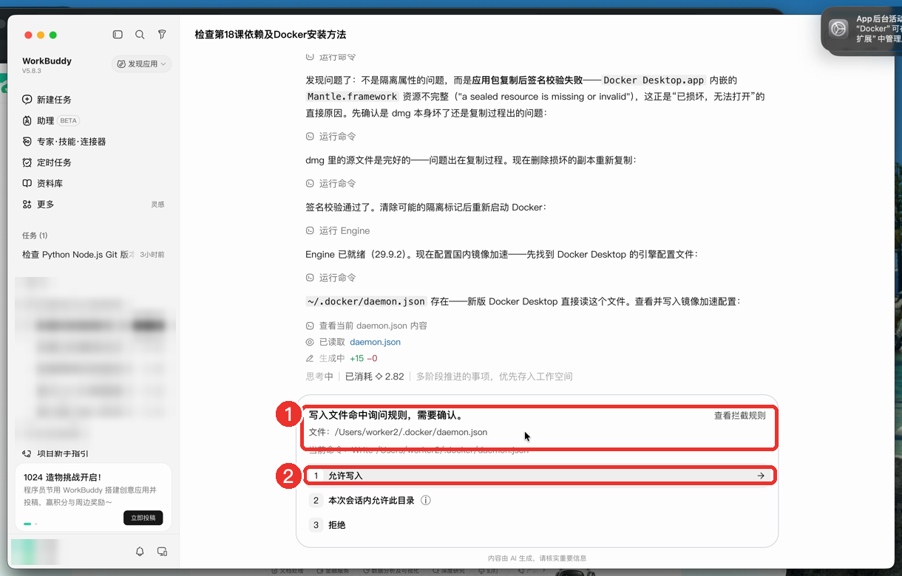

## 第 11 步：看验证结果，全部打勾才算装好

等它配置完、重启 Docker，最后会给出一张**验证结果**表格。

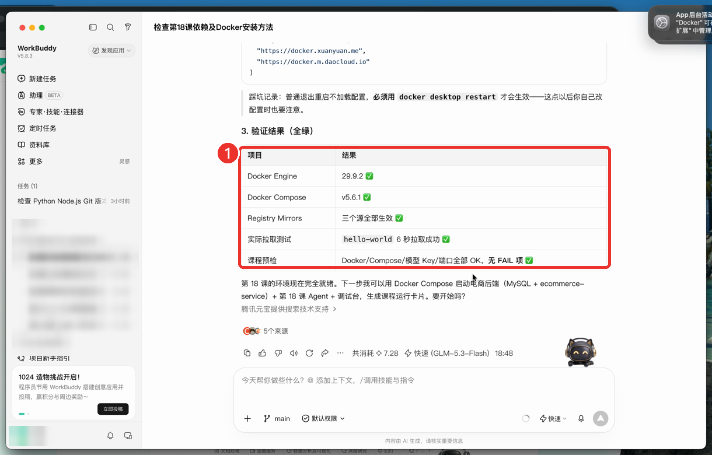

正确的结果是：

| 项目 | 结果 |
| --- | --- |
| Docker Engine | 29.9.2 ✅ |
| Docker Compose | v5.6.1 ✅ |
| Registry Mirrors（镜像加速） | 三个源全部生效 ✅ |
| 实际拉取测试 | hello-world 6 秒拉取成功 ✅ |
| 课程预检 | Docker/Compose/模型 Key/端口全部 OK，无 FAIL 项 ✅ |

版本号和你的不一样没关系，**关键是每一行都打了绿勾**。

**如果不一样：** 哪一行没打勾，就把那一行原样复制给它，说"这一项没通过，请帮我查原因，要改文件先问我"。

## 第 12 步：启动电商后端、第 18 课和调试后台

**复制这句话，粘贴到输入框，按回车发送：**

```latex
好，帮我启动电商后端、第 18 课和调试后台，启动好以后告诉我要打开的网址。
```

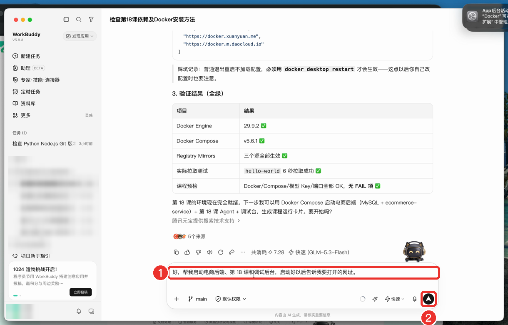

它会先生成第 18 课的"运行卡片"，然后用 Docker Compose 启动 MySQL 和电商后端，再启动第 18 课的 Agent 和调试后台。

⏳ **第一次会很慢，这是正常的。** 第一次启动电商后端，要下载并构建好几个镜像（加起来约 4 GB）。网络好的话十几二十分钟，网络差的话可能一个多小时。

等待期间：

- 只要它的输出还在**往下更新**（有新的一行冒出来），就耐心等。
- **超过十几分钟完全没有任何新输出**，再看下一节"下载镜像卡住了怎么办"。

## 下载镜像卡住了怎么办

**怎么算卡住：** 输出停在"读取基础镜像信息（load metadata）"或某个镜像名上，**超过十几分钟没有任何新输出**。

**为什么会卡：** 构建电商后端时，Docker 拉"基础镜像"不一定走第 3 步配的国内加速，还是直连国外的 Docker Hub，国内网络就下不动。容易卡住的是 `eclipse-temurin:17-jre` 和 `chromadb/chroma:1.0.8` 这两个。WorkBuddy 自己也能查出这个原因（图里①）：

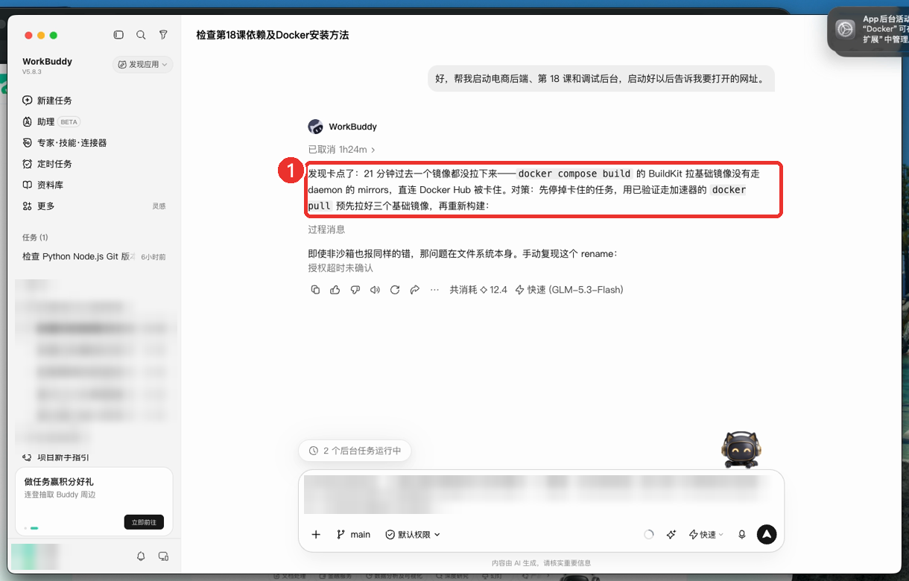

**你这样做：**

1. 点输入框右下角的**停止按钮**（和第 7 步一样），让它停下。
2. **复制这句话，粘贴到输入框，按回车发送：**

```latex
第 18 课启动时构建电商后端卡住了，十几分钟没有进展。请检查是哪个基础镜像拉不下来；如果是构建时没走镜像加速，请用 docker.m.daocloud.io 前缀把缺的镜像手动拉下来，再用 docker tag 改回原名，然后重新启动。
```

3. 它跑命令时会弹确认卡片，命令是 `docker pull ...`、`docker tag ...`、`docker rmi docker.m.daocloud.io/...` 这类，点**允许**。（`rmi` 删的只是带加速源前缀的那个"名字"，镜像本身还在。）
4. 拉完后它会重新启动。照第 12 步继续等它报"全部就绪"。

### 原理（想了解再看，不看也不影响）

它实际执行的是下面这几条命令，**你不需要自己敲**：用带加速源前缀的完整地址把镜像拉下来，再改回原名。这样构建时本地已经有这个镜像，就不会再去外网拉。

```bash
# 1) 从加速源拉（官方镜像要加 library/ 前缀）
docker pull docker.m.daocloud.io/library/eclipse-temurin:17-jre
docker pull docker.m.daocloud.io/chromadb/chroma:1.0.8

# 2) 改回原名
docker tag docker.m.daocloud.io/library/eclipse-temurin:17-jre eclipse-temurin:17-jre
docker tag docker.m.daocloud.io/chromadb/chroma:1.0.8 chromadb/chroma:1.0.8

# 3) 删掉带前缀的那个名字
docker rmi docker.m.daocloud.io/library/eclipse-temurin:17-jre
docker rmi docker.m.daocloud.io/chromadb/chroma:1.0.8
```

- 名字里**没有斜杠**的官方镜像（如 `mysql:8.0`）→ 写成 `docker.m.daocloud.io/library/<名字>`。
- 名字里**带组织名**的（如 `chromadb/chroma:1.0.8`）→ 写成 `docker.m.daocloud.io/<组织>/<名字>`。
- `docker.m.daocloud.io` 不行时，让它把前缀换成 `docker.1ms.run` 或 `docker.xuanyuan.me` 再试。

## 第 13 步：四个服务全部就绪，打开调试后台

构建好以后，它会告诉你 **"第 18 课全栈已就绪，四个服务全部验证通过"**（图里①）：

| 服务 | 状态 |
| --- | --- |
| MySQL（demo-mysql） | Up (healthy) ✅ |
| 电商后端（ecommerce-service） | `{"status":"UP"}` ✅ |
| 第 18 课 Agent | `{"status":"ok","lesson":"18"}` ✅ |
| 调试台 | HTTP 200 ✅ |

下面"请打开这些网址"里，第一个 **Agent 调试后台：**`http://localhost:5173` 就是入口（图里②）。点它，和第 5 章一样在右边打开，再点右上角的放大按钮。

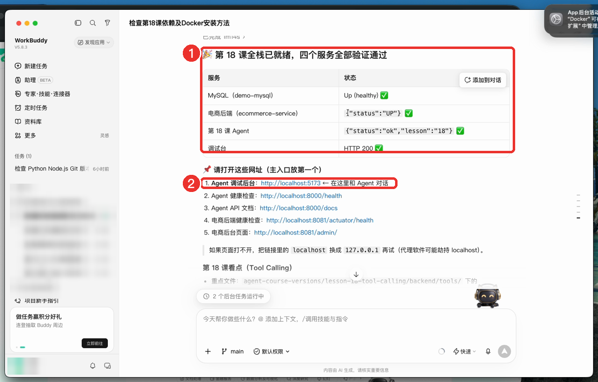

💡 列表里还有 `http://localhost:8081/...`，那是电商后端自己的健康检查和后台页面，这一章不用打开。

## 第 14 步：点示例问题，打开"工具调用"，发送

调试后台的样子和第 2 课一样，只是顶部写着 `lesson-18-tool-calling`，能力开放变成了"9/19"。往下翻到"输入用户问题"：

1. 右边示例问题第一条：**"查一下 S20260602103000009-a1000009 的物流到哪了"**，点它（图里①），它会自动填进左边输入框。
2. 点下面的 **"工具调用"** 开关，让它变成深色（打开状态）（图里②）。这个开关打开后，会显示 Agent 调用工具的过程（Action、Observation 和 Tool Trace）。
3. 点 **"发送给 Agent"**（图里③）。

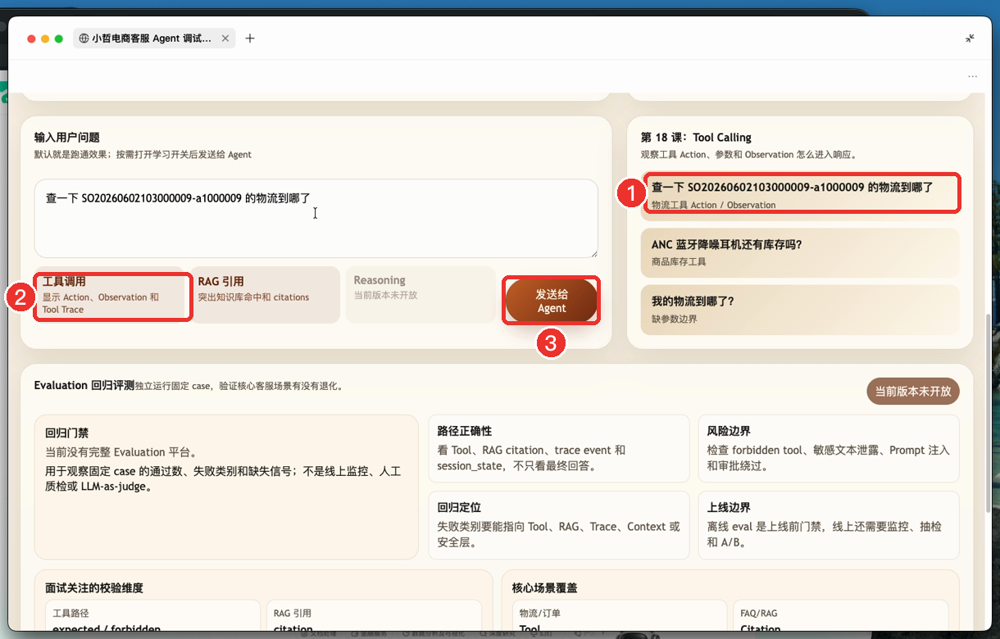

## 第 15 步：看 Agent 真的去查了物流

稍等几秒，看两个地方：

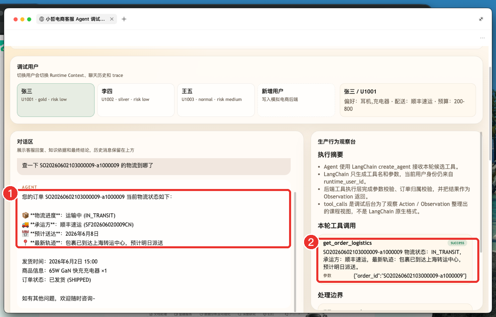

1. **对话区（图里①）：** Agent 回答了这个订单的真实物流。比如：物流进度"运输中（IN_TRANSIT）"，承运方"顺丰速运"，最新轨迹"包裹已到达上海转运中心，预计明日派送"，还有发货时间、商品信息（65W GaN 快充充电器）、订单状态"已发货"。
2. **右边"生产行为观察台"→"本轮工具调用"（图里②）：** 出现了一个叫 `get_order_logistics` 的工具，状态 success，下面"参数"是 `{"order_id": "S20260602103000009-a1000009"}`，就是你问的那个订单号。

🎉 这就是第 18 课要讲的**工具调用**：Agent 不是靠猜着回答，而是真的去调用了电商后端的"查物流"接口，拿到了业务系统里的数据。

**如果不一样：**

- 回答里说"查不到"或者内容很空，右边没有工具调用：确认第 2 小步的"工具调用"开关是打开的，再发一次。
- 报错或者一直转圈：把对话区里的报错原样复制给 WorkBuddy，说"第 18 课调试后台发送后出现这个报错，请帮我查原因，要改文件先问我"。

## 第 16 步：学完了，把所有服务停掉（包括 Docker 里的）

1. 关掉右边的调试后台面板（先缩小，再关闭）。
2. **复制这句话，粘贴到输入框，按回车发送：**

```latex
第 18 课用完了，帮我把刚才启动的服务都停掉，包括 Docker 里的电商后端和 MySQL。
```

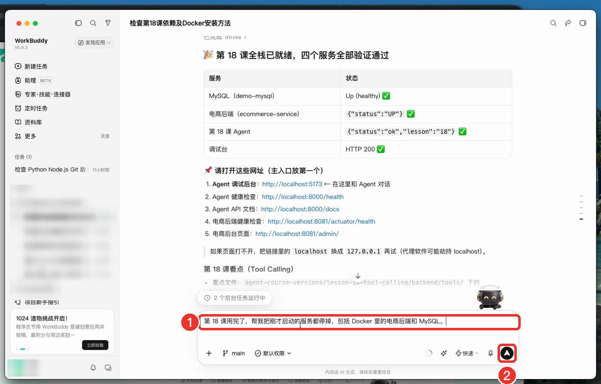

**正确的样子：** 它回复 **"第 18 课所有服务已停止，端口全部释放"**，并列出：电商后端容器、MySQL 容器"已停止并移除"，第 18 课 Agent（8000）、调试台 Vite（5173）"进程已结束"，端口 8000 / 5173 / 8081 / 3306 "全部释放"。

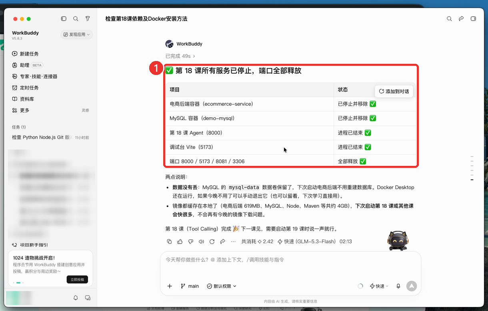

它还会说明两点：

- **数据没有丢：** MySQL 的 `mysql-data` 数据卷保留了，下次启动电商后端不用重建数据库。
- **镜像都缓存在本地了**（电商后端 619MB，加上 MySQL、Node、Maven 等共约 4GB），**下次启动第 18 课或其他课会快很多**，不会再有今晚的镜像下载问题。

💡 "停止并移除容器"不是删数据。容器就像一次运行，停了就收起来；数据存在数据卷里，镜像存在本地缓存里，都还在。

Docker Desktop 本身可以继续开着，也可以在菜单栏小鲸鱼图标里选 Quit 退出。下次要用电商后端的课时，WorkBuddy 会提醒你先把 Docker 打开。

## 常见问题

**问：一定要用 Docker Desktop 吗？我看它推荐用 Homebrew 装。**  
答：两种都行。国内网络下 Homebrew 下载 Docker 经常很慢，所以这里用"浏览器下载安装包 + 让 WorkBuddy 装"的方式，更稳。

**问：弹出"已损坏、移到废纸篓"，我手快点了"移到废纸篓"怎么办？**  
答：不要紧，只是把复制坏的 Docker 扔进了废纸篓，安装包 `Docker.dmg` 还在"下载"文件夹里。跟 WorkBuddy 说："我刚才把 Docker 移到了废纸篓，请用下载文件夹里的 Docker.dmg 重新帮我安装。"

**问：输密码的时候没反应，也没有字。**  
答：这是正常的，macOS 输密码时只显示圆点，有的地方连圆点都不显示。输完直接点"好"或按回车。

**问：第一次启动电商后端等了很久，是不是坏了？**  
答：先看它的输出还有没有更新。有更新就是还在下载/构建，继续等。十几分钟完全没动静，再按"下载镜像卡住了怎么办"那一节处理。

**问：第二天再学第 18 课（或第 17 课之后的其他课），要重新装 Docker 吗？**  
答：不用。先打开 Docker Desktop，等左下角显示 Engine running，然后新建任务 → 选工作空间 → `/` 选课程助手 → 发"帮我启动电商后端、第 X 课和调试后台，启动好以后告诉我要打开的网址"。镜像都缓存好了，会快很多。

**问：确认卡片上写着要改 Docker 的设置，我该点允许吗？**  
答：先看清它要做什么。是你让它做的（比如这一章的"配置国内镜像加速"），可以允许；看不懂、或者和你让它做的事无关，就点"拒绝"，然后把卡片上的文字复制给它，让它解释清楚再说。

**Windows 用户看这里（这一章差别最大，请完整看一遍）：**

1. **安装包：** 在 Docker 官网下载 Windows 版 Docker Desktop（一般叫 `Docker Desktop Installer.exe`）。第 3 步的提示词里，把"叫 Docker.dmg"改成你实际下载的文件名。
2. **WSL2：** Windows 上的 Docker Desktop 依赖 WSL2（Windows 里的一个 Linux 子系统）。WorkBuddy 一般会先帮你装 WSL2，再装 Docker Desktop。装 WSL2 时可能要用 `winget` 或 `wsl --install` 之类的命令，会弹出"是否允许此应用对你的设备进行更改"，点"是"。
3. **要重启电脑：** 装完 WSL2 一般**需要重启电脑**。重启后重新打开 WorkBuddy，回到原来那个任务，说"我已经重启了电脑，请继续刚才的 Docker 安装"。
4. **Mac 才有的弹窗你不会遇到：** "WorkBuddy 想访问下载文件夹""已损坏，移到废纸篓""输入开机密码的锁形窗口"这几个是 macOS 特有的。Windows 上对应的一般是"用户账户控制（UAC）：是否允许此应用对你的设备进行更改"，确认是 Docker 或 WSL 的安装程序就点"是"。
5. **第一次打开 Docker Desktop：** 同样会有服务协议（点 Accept）、登录页（点 Skip）。设置页如果问是否使用 WSL 2，保持推荐的勾选即可（以你屏幕上实际显示为准）。
6. **报"虚拟化未开启"（Virtualization / WSL 2 相关报错）：** 这是电脑 BIOS（主板）里的设置，不同品牌电脑进入方法不一样。**不要自己乱改**，把报错原文复制给 WorkBuddy，问它"我的电脑是 XX 品牌 XX 型号，这个报错怎么处理"，按它说的一步步做，拿不准的步骤先别做。
7. **Docker 是否跑起来：** 同样看 Docker Desktop 窗口左下角显示 **Engine running**（绿色）。关掉窗口后 Docker 会缩到屏幕右下角的托盘区（小鲸鱼图标）。
8. **镜像加速配置位置不同：** Mac 是写 `~/.docker/daemon.json` 文件；Windows 上一般在 Docker Desktop → Settings（设置）→ Docker Engine 里改同一段 JSON，然后点 "Apply & restart"。让 WorkBuddy 帮你改即可，它会告诉你改在哪里。
9. **卡住时的处理方法**和 Mac 完全一样，提示词照用。
