用你自己常用的 Agent 工具（Codex、Claude Code、Trae 等）也可以，这里以 WorkBuddy 作为示范。提示词的意思都一样，换个工具照样能用。

这一章讲两件事：

1. **每节课怎么学**：一套固定的"四步法"，每节课照着做就行。
2. **报错了怎么问**：遇到问题时，怎么跟 WorkBuddy 说，它才能真的帮你查出原因。

# 第一部分：每节课的学习四步法

每节课都按这四步来，顺序不要乱：

| 步骤 | 做什么 | 为什么 |
| --- | --- | --- |
| 第 1 步 | 先看这节课的视频和语雀文档 | 弄清楚这节课**要解决什么问题** |
| 第 2 步 | 让 WorkBuddy 把这一课启动起来，在调试后台亲手试 | 先看到效果，再看代码，心里有数 |
| 第 3 步 | 让它带你按顺序读代码，一个文件一个文件地讲 | 不会迷路，不会一上来就被几十个文件吓到 |
| 第 4 步 | 问它：这一课和上一课比，改了什么 | 每节课只改了一小块，抓住改动就抓住了重点 |

下面用**第 18 课（工具调用）** 做示范。你学别的课时，把提示词里的"18"换成你要学的课号，"17"换成上一课的课号就行。

💡 **怎么替换课号**：提示词里写着"第 X 课"的地方，X 就填一个数字，比如学第 5 课就写"第 5 课"，上一课就写"第 4 课"。只改数字，其他字一个都不用动。

## 第 1 步：先看视频和语雀文档

这一步不用 WorkBuddy。

1. 打开这节课的课程视频，从头看一遍。看不懂的地方先记下来，不用停下来查。
2. 打开语雀知识库《项目故事线》里这节课的文档，看看开头写的"这节课要解决什么问题"。
3. 看完以后，试着用一句话说出来：**这节课解决了上一课的什么不足？** 说不出来也没关系，第 3 步 WorkBuddy 会帮你讲清楚。

## 第 2 步：让 WorkBuddy 把这一课启动起来

这一步在第 5 章、第 6 章已经练过了，这里只把要点再说一遍。

1. 如果你要学的是**第 17 课或以后的课**，先打开 Docker Desktop，等它左下角显示 Engine running（第 6 章讲过）。第 2～16 课不需要 Docker，跳过这一条。
2. 在 WorkBuddy 里点左上角的"新建任务"，选好工作空间 `xiaozhe-E-commerce`，在输入框里输入一个斜杠 `/`，点选 `xiaozhe-release-course-assistant`（小哲课程助手）。不会操作的话，看下面第 3 步的图。
3. 复制下面这句话，把 X 换成课号，粘贴到输入框，按回车发送：

**复制这句话，粘贴到输入框，按回车发送：**

```latex
帮我启动第 X 课和调试后台，启动好以后把要打开的网址告诉我。
```

4. 等它说启动成功，点它给的"调试后台"链接，在调试后台里点一个示例问题，再点"发送给 Agent"，看看 Agent 怎么回答。
5. 多试几个示例问题，留意右边观察台显示的信息。这一课新加的东西，往往就显示在那里。

**正确的样子：** Agent 给出了正常的回答（不是 Load failed，也不是空白）。

**如果不一样：** 跳到本章第二部分"报错了，怎么问"，照着那里的方法问 WorkBuddy。

⚠️ **注意**：学完一课，记得让它把服务停掉（第 5 章最后一步），不然下次启动别的课可能会提示"端口被占用"。

## 第 3 步：让它带你按顺序读代码

这一步是重点，我们一点一点来。

### 3.1　新建任务，选工作空间

1. 点 WorkBuddy 左上角的 **"新建任务"**（图中 ①）。
2. 点输入框下面的 **"选择工作空间"**，在弹出的列表里点 `xiaozhe-E-commerce`（图中 ②）。

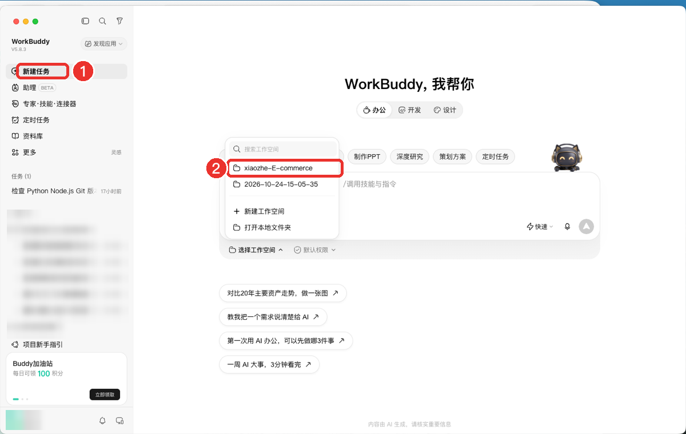

💡 每次新建任务，都要重新选一次工作空间。选好以后，输入框下面会显示 `xiaozhe-E-commerce`。

### 3.2　输入斜杠，选中小哲课程助手

1. 鼠标点一下输入框，让光标在里面闪。
2. 按键盘上的 `/`（斜杠，在键盘右下角，和问号是同一个键，不用按 Shift）。
3. 输入框上方会弹出技能列表，点 `xiaozhe-release-course-assistant` 这一行（图中 ①）。

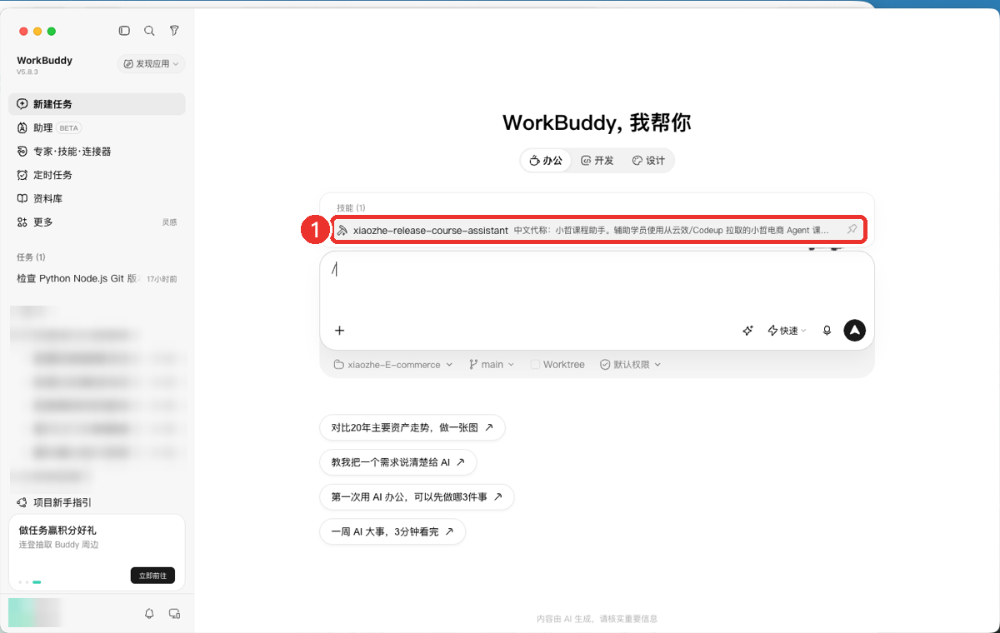

**如果不一样：** 列表里没有这一行、或者显示"无匹配结果"，说明课程助手还没装好，回到第 3 章，按"装好课程助手"那一步再做一次。

**Windows 用户看这里：** 中文输入法下按 `/` 可能会打出顿号"、"。先按 Shift 切到英文输入，再按 `/`。

### 3.3　复制提示词，发送

选中课程助手以后，输入框最前面会出现一个灰色的小标签 `xiaozhe-release-course-assistant`。在它后面粘贴下面这句话（图中 ①），按回车发送。

**复制这句话，粘贴到输入框，按回车发送（把 X 换成课号）：**

```latex
带我学习第 X 课：这一课解决什么问题？先看哪几个文件？按新手顺序一个一个讲。
```

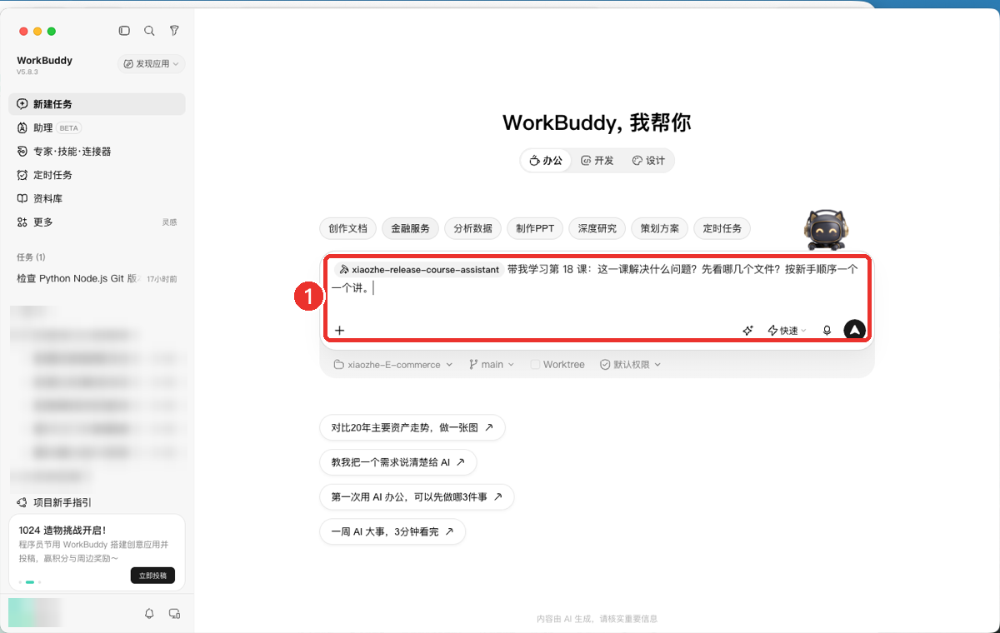

💡 **怎么粘贴**：Mac 上按 `Command + V`，Windows 上按 `Ctrl + V`。复制是 `Command + C` / `Ctrl + C`。

### 3.4　等它读完代码

发送以后，它会先读课程助手的说明，再去读这一课的代码，**大概要等一两分钟**。这段时间界面上会一行一行冒出"已读取 xxx""深度思考"之类的字，这是它在干活，不用管，等它写完就行。

### 3.5　看回答：这一课解决什么问题

回答的开头，会先讲**这一课解决什么问题**（图中红框）。第 18 课的回答大意是：

- 第 17 课：查什么、怎么查，是**后端代码里写死的规则**决定的，模型只负责照着结果说话。
- 第 18 课：改成**模型自己提出要调用哪个工具**，后端负责检查参数和用户身份，再去执行。
- 它总结成一句话：模型从"照稿念"升级为"提申请"，后端从"写死流程"升级为"审批执行"。

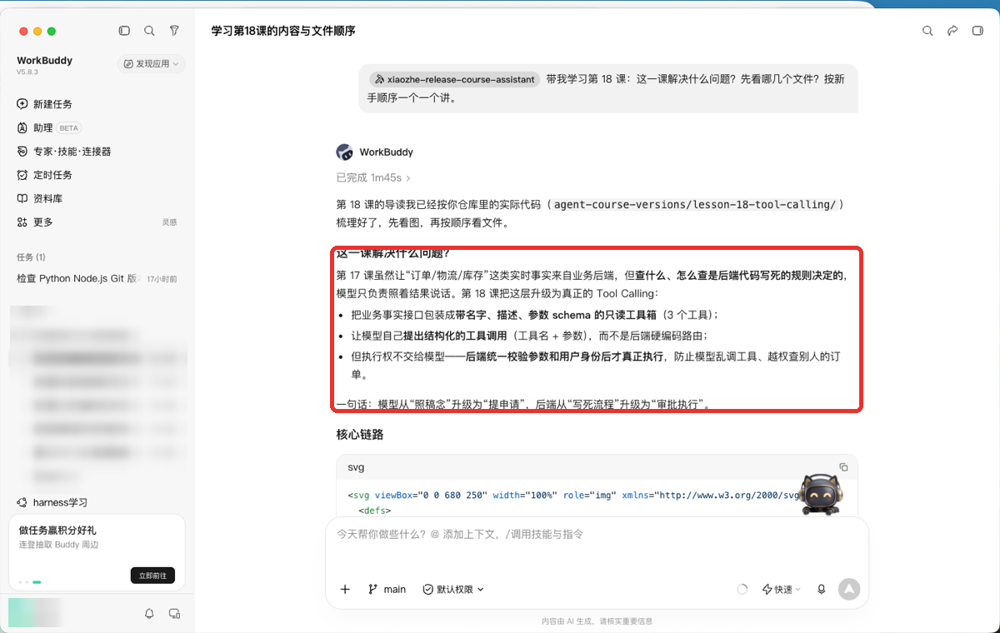

💡 回答里如果出现一大段带 `<svg ...>` 的看不懂的代码，那是它想画一张流程图，但没画出来，显示成了代码。**直接跳过这段就行**，不影响后面的内容。

### 3.6　看回答：按顺序要看的文件

往下滚动鼠标滚轮，会看到一张表，列出了按新手顺序要看的文件，每个文件看什么都写在表里（图中红框）。第 18 课一共列了 6 个文件：

| 顺序 | 文件 | 一句话 |
| --- | --- | --- |
| 1 | `README.md` | 这一课的全景介绍 |
| 2 | `backend/tools/contracts.py` | 模型看到的工具说明书（只有 27 行） |
| 3 | `backend/tools/langchain_tools.py` | 把说明书变成 LangChain 工具 |
| 4 | `backend/tools/tool_runtime.py` | 后端怎么检查和执行 |
| 5 | `backend/tools/runtime_context.py` | 用户身份从哪来 |
| 6 | `backend/agents/customer_service_agent.py` | 把上面这些串起来 |

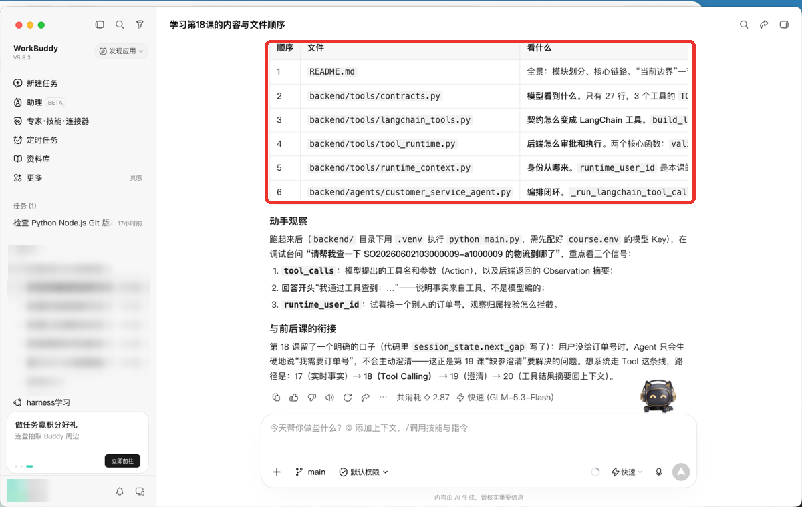

💡 你不用一次看完 6 个文件。**今天看 1～2 个，看懂了再看下一个**，比一口气全扫一遍有用得多。

### 3.7　点文件名，在右边直接打开代码

想看哪个文件，不用自己去文件夹里翻：

1. 滚动回到回答的最上面，找到"已完成 1m45s"这样一行（时间每次不一样）。
2. 点它，展开它的读取过程，会看到一串"已读取 xxx"。
3. 点你想看的文件名，比如 `contracts.py`（图中 ①，蓝色的字）。
4. WorkBuddy 右边会直接打开这个文件的代码（图中 ②）。

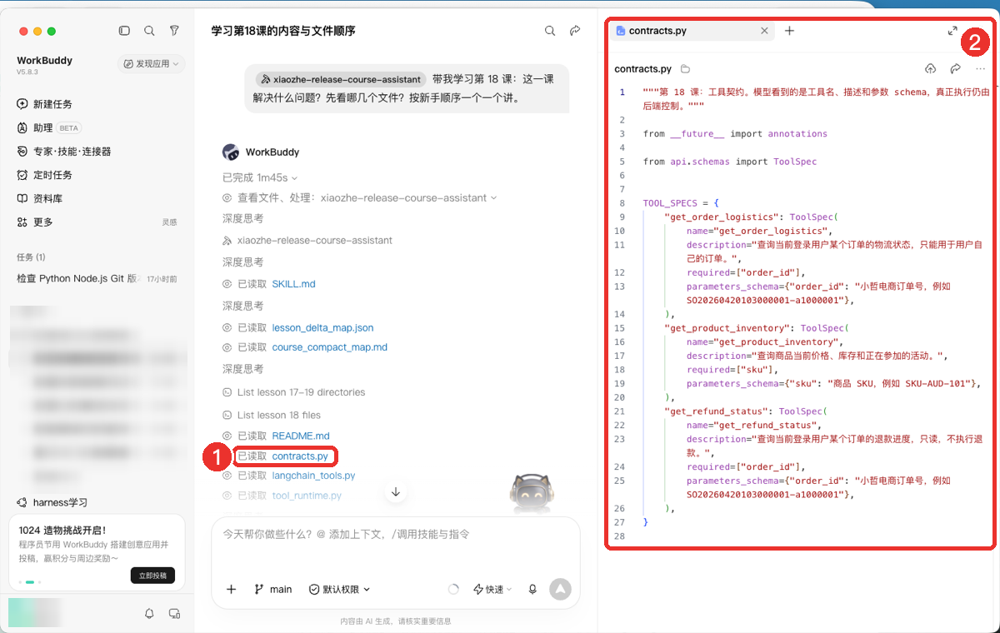

**如果不一样：** 点了没反应，或者找不到"已读取"这一串，就直接问它：`把 contracts.py 的完整路径告诉我`，然后在访达（Windows 是"文件资源管理器"）里按路径找到它，用文本编辑打开看。

💡 右边的代码面板可以关掉：点文件名旁边的 `×`。

## 第 4 步：问它这一课和上一课比，改了什么

不用新建任务，**就在刚才这个任务里接着问**。

1. 点一下下面的输入框（图中 ①）。
2. 复制下面这句话，把 X 换成这一课的课号，Y 换成上一课的课号，粘贴进去，按回车发送。

**复制这句话，粘贴到输入框，按回车发送：**

```latex
第 X 课和第 Y 课比，改了哪些文件？每个改动是为了解决什么问题？
```

比如学第 18 课就写成：`第 18 课和第 17 课比，改了哪些文件？每个改动是为了解决什么问题？`

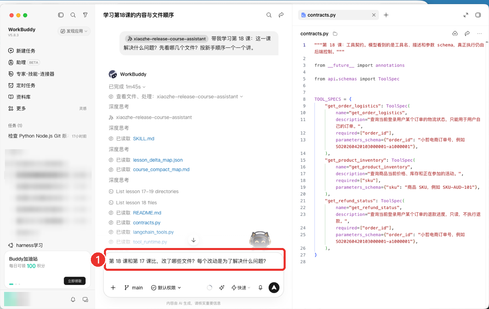

**正确的样子：** 它会真的去对比两课的代码，然后分几块告诉你（图中红框是回答开头）：

- **新增的文件**：这一课的主角，最值得看。
- **删除的文件**：被新做法取代的旧代码。
- **大改的文件**：把新零件串起来的地方。
- **小改的文件**：基本照搬上一课，跟着看一眼就行。

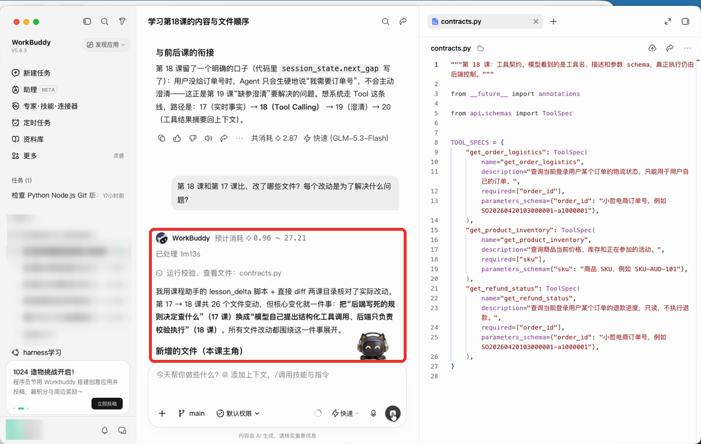

回答最后通常还有一个**"建议阅读顺序"**（图中红框），照着这个顺序看代码就行：

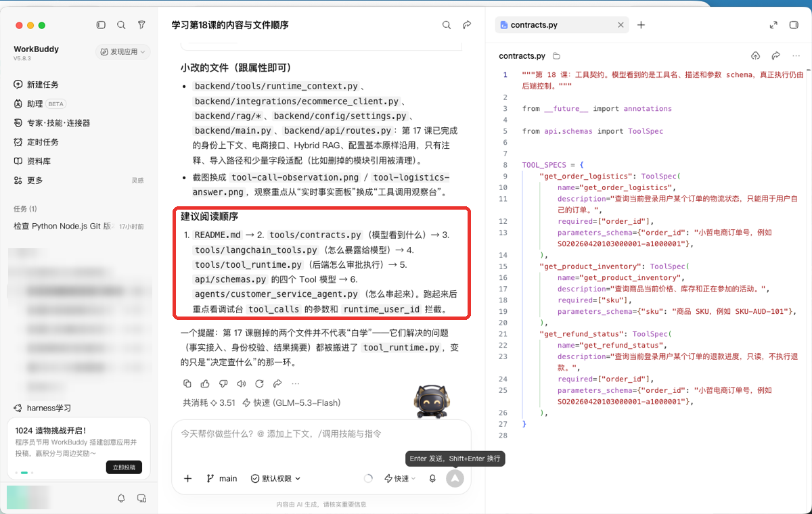

💡 第 18 课和第 17 课比，一共有 26 个文件有变动，但它告诉我们核心只改了一件事：**"后端写死规则决定查什么"换成了"模型自己提出工具调用，后端负责检查和执行"**。每节课都这样，抓住这"一件事"，这节课就学会了一大半。

## 看不懂某段代码？选中它，让它用大白话讲

读代码时遇到看不懂的，**就追问，一点都不丢人**。还是在同一个任务里：

### 第 1 步：在右边选中那段代码

1. 在右边的代码面板里，把鼠标放到你看不懂的那段代码的**第一个字前面**。
2. 按住鼠标左键不放，拖到这段代码的**最后一个字后面**，松开。选中的部分会变成蓝色（图中 ①）。
3. 按 `Command + C`（Windows 按 `Ctrl + C`）复制。

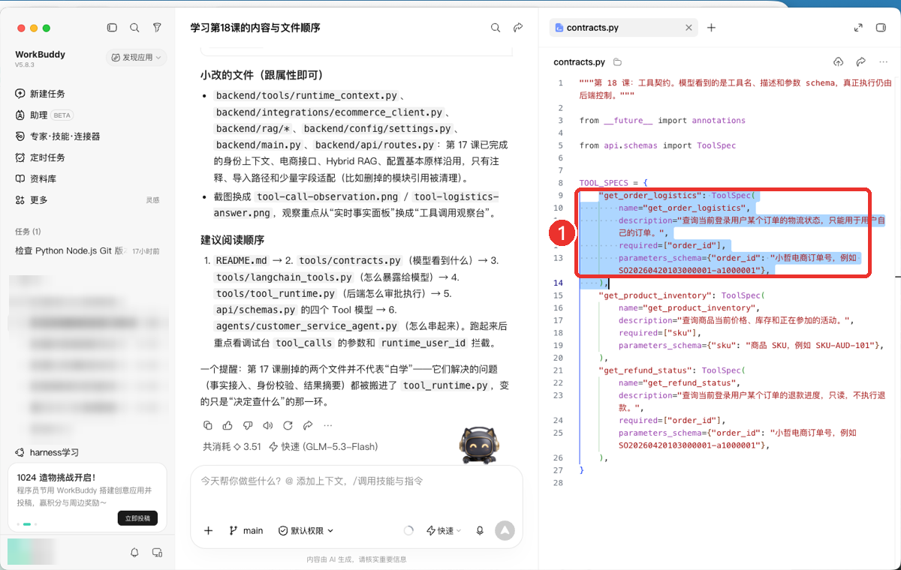

### 第 2 步：连同一句话一起发给它

1. 点下面的输入框。
2. 先打字：`这段代码我没看懂：`
3. 按 `Shift + 回车` 换一行（直接按回车会把消息发出去）。
4. 按 `Command + V`（Windows 按 `Ctrl + V`）把刚才复制的代码粘贴进来。
5. 再按 `Shift + 回车` 换一行，粘贴后半句：`请用大白话解释，再举一个小哲电商的例子。`
6. 检查一遍（图中 ①），按回车发送。

**完整的样子（代码换成你复制的那段）：**

```latex
这段代码我没看懂：（粘贴代码）
请用大白话解释，再举一个小哲电商的例子。
```

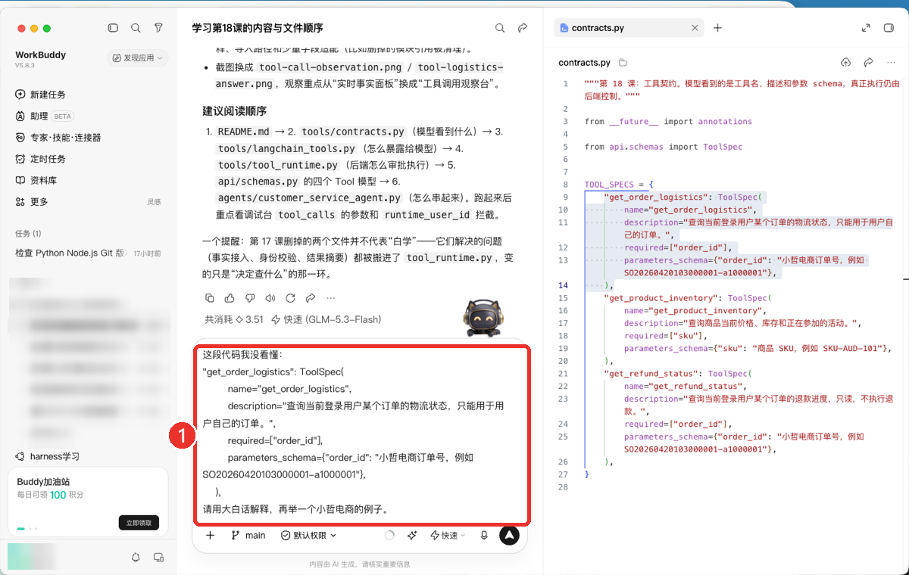

💡 嫌换行麻烦？也可以不换行，全写在一行里，它一样看得懂。

**正确的样子：** 它会逐个字段解释这段代码。比如这次选的是查物流工具的说明书，它讲了：

- `name`：工具的"身份证号"，模型要用它，必须一字不差报出这个名字。
- `description`：唯一的介绍文字，模型选不选这个工具，全靠读这段话。
- `required`：必填参数，少了一个，后端就直接打回去。
- `parameters_schema`：参数要填成什么样，比如订单号长什么样。

最后还举了一个小哲电商的例子（图中红框）：用户问"帮我看看某个订单的快递到哪了"，模型怎么选中查物流的工具、怎么从原话里找出订单号、后端怎么检查、最后怎么查到真实物流。

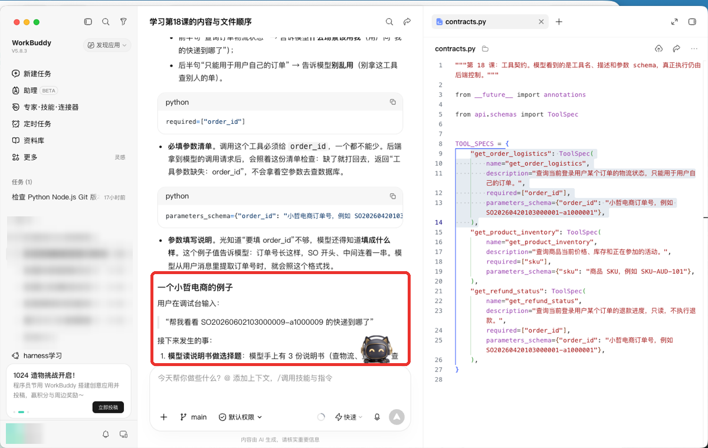

**还是没懂？** 接着问，比如：

```latex
你说的"后端检查"具体是哪个文件里的哪个函数？带我去看看。
```

```latex
能不能再讲简单一点？假设我完全不懂编程。
```

---

# 第二部分：报错了，怎么问

学习过程中，报错是难免的。**报错不可怕，关键是怎么问。**

## 错误的问法 vs 正确的问法

| <br> | 问法 | 结果 |
| --- | --- | --- |
| × 错误 | "跑不起来了，怎么办？" | 它不知道你在做什么，只能瞎猜 |
| √ 正确 | 说清三件事：**我在做哪一步** + **看到的报错原文** + **希望它怎么做** | 它能直接对着问题去查 |

## 报错求助模板（照着填空）

**复制这段话，把括号里的内容换成你的实际情况，再发送：**

```latex
我在做：（哪一课、哪一步。例如：第 2 课的调试后台，点了示例问题“请用一句话介绍小哲电商客服”，然后点了“发送给 Agent”）
我看到的报错原文：（把报错原样粘贴过来，一个字都别改）
补充情况：（可选。例如：服务是刚启动的 / 我刚改过 course.env / 之前都是好的）
请帮我查原因：先看日志，告诉我哪里出错、怎么修。要改文件先问我。
```

填的时候注意这几点：

1. **报错原文要原样复制**，不要自己概括。能选中的文字，就选中后 `Command + C`（Windows `Ctrl + C`）复制过来。
2. **复制不了的报错**（比如系统弹窗），就照着屏幕一个字一个字打出来，再说一句"我点了什么按钮"。第 6 章 Docker"已损坏"那次就是这么问的。
3. **最后那句"要改文件先问我"一定要加**。这样它查到问题后会先告诉你，而不是直接动手改。
4. **报错里如果有 Key**（`sk-` 开头的一长串），先把这一串删掉再发。

## 真实例子：调试后台回复 Load failed

下面是一次真实的排查（这里故意把 course.env 里的 Key 改成了假的）。你遇到的原因不一定是 Key，但问法完全一样。

### 第 1 步：看到报错

在第 2 课的调试后台，点示例问题"请用一句话介绍小哲电商客服"，点"发送给 Agent"。结果 Agent 那一栏只回了一句：**Load failed**（图中 ①）。

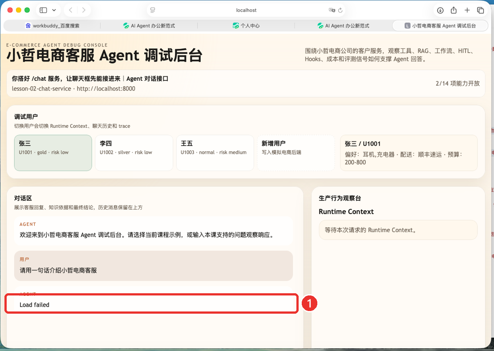

💡 **Load failed 是什么意思**：只是说"浏览器没拿到正常回答"，并不告诉你真正的原因。所以光看这一句，你和 WorkBuddy 都猜不出哪里坏了，得让它去查。

**Windows 用户看这里：** 用 Chrome 或 Edge 时，这句话可能显示成 `Failed to fetch` 之类的英文，意思一样，以你屏幕上实际显示为准，照样原样复制过来。

### 第 2 步：新建任务，按模板描述

1. 点"新建任务"，选好工作空间 `xiaozhe-E-commerce`，输入 `/` 选中小哲课程助手（和第一部分 3.1、3.2 一样）。
2. 把你在做什么、看到了什么写清楚（图中 ①），按回车发送。

这次实际发的是这句：

```latex
我在第 2 课的调试后台点了示例问题“请用一句话介绍小哲电商客服”，发送后 AGENT 回复“Load failed”。第 2 课的服务是刚启动的。请帮我查原因：先看后端日志，告诉我哪里出错、怎么修。要改文件先问我。
```

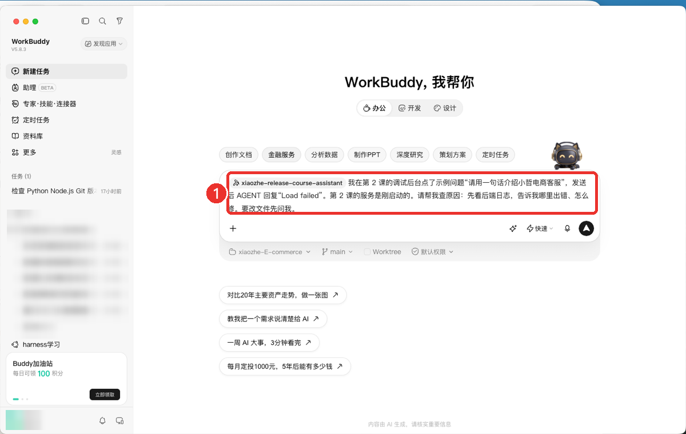

### 第 3 步：等它排查

它会自己一步一步查（图中红框），大约两三分钟：

1. 先检查端口：第 2 课的 Agent 后端（8000）和调试后台（5173）都在运行。
2. 再自己复现了一次刚才的请求，拿到了真正的报错。

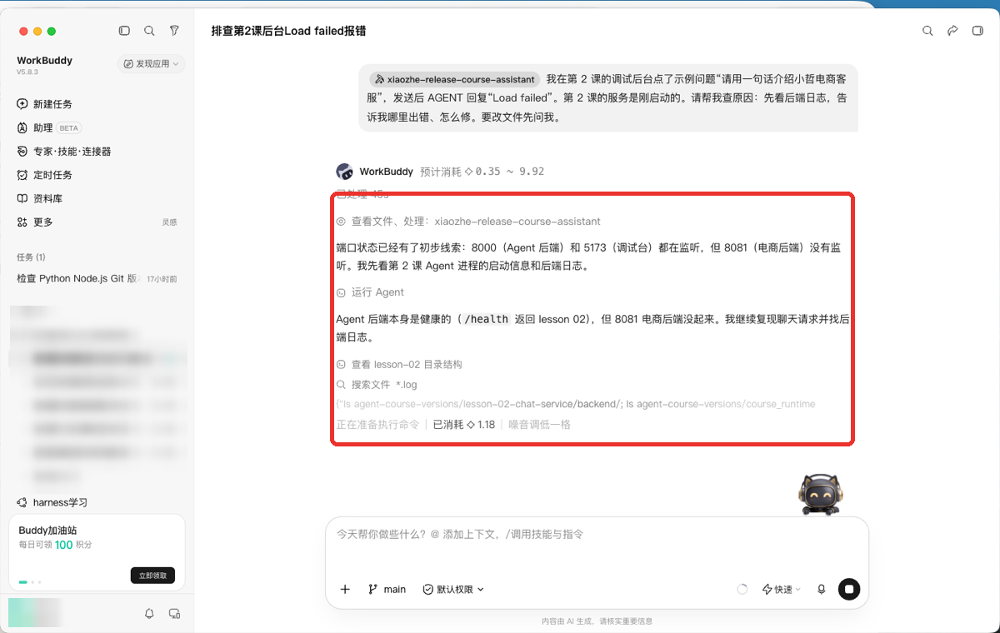

💡 它中途提到"8081 电商后端没有启动"。第 2 课本来就用不到电商后端（第 17 课以后才用），**这一条和这次故障没关系，不用管**。它自己最后也说了"与本次故障无关"。

### 第 4 步：看结论

原因找到了（图中 ①）：

```latex
HTTPStatusError: Client error '401 Unauthorized'
响应体：{"code":30014,"message":"Token is invalid."}
```

翻译成大白话：**模型平台说这个 Key 无效**。`401` 的意思就是"身份验证没通过"。

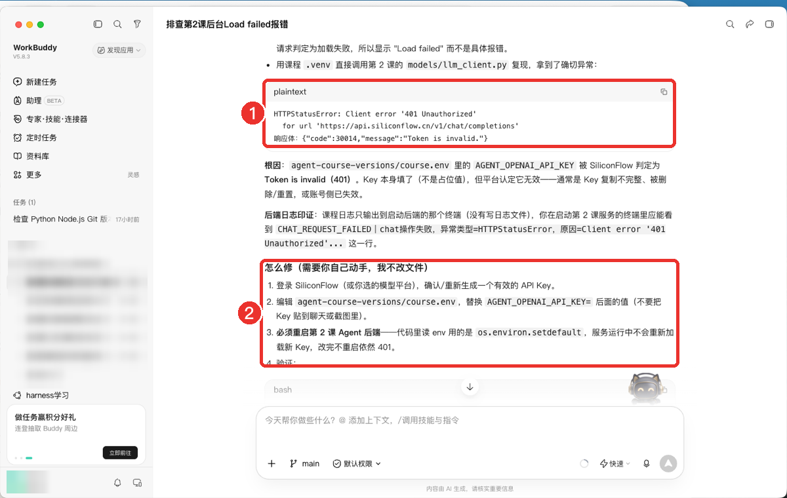

注意看图中 ② 的标题：**"怎么修（需要你自己动手，我不改文件）"**。因为我们说了"要改文件先问我"，它没有乱动文件，只告诉你怎么修：

1. 登录硅基流动（或者你用的模型平台），确认 Key 是对的，或者重新生成一个。
2. 打开 `agent-course-versions/course.env`，替换 `AGENT_OPENAI_API_KEY=` 后面的值。
3. **必须重启第 2 课的服务**，因为服务运行中不会重新读取新的 Key，改完不重启还是会报错。

它还特意提醒：**不要把 Key 贴到聊天里，也不要截图发出去**。

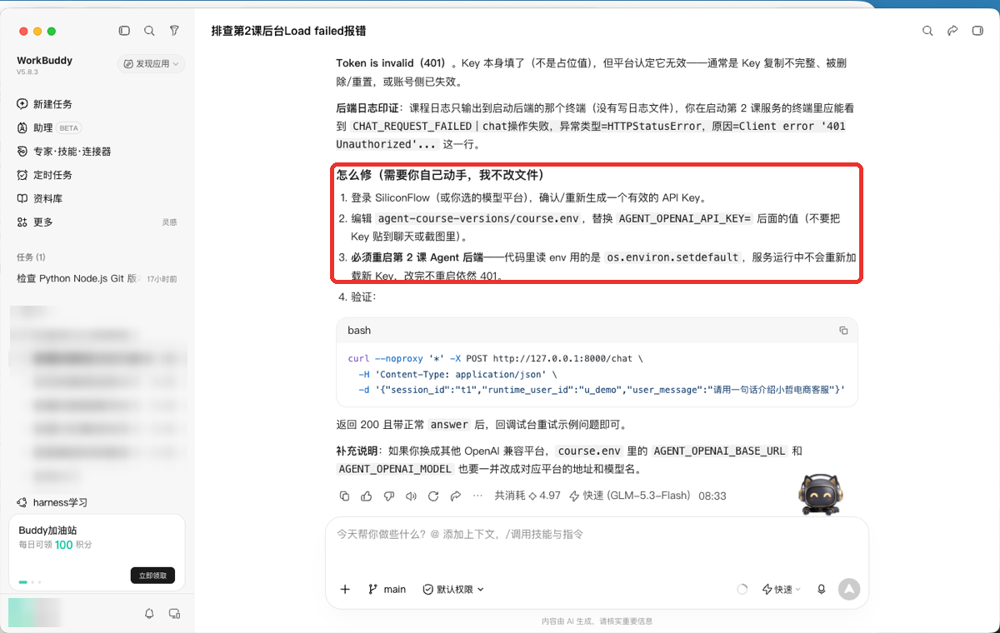

### 第 5 步：自己修好

照着它说的做：

1. 去模型平台复制一个有效的 Key（第 4 章讲过在哪拿）。
2. 用"文本编辑"（Windows 用"记事本"）打开 course.env，只改第 10 行等号后面的部分，保存（第 4 章讲过怎么做）。
3. 回到 WorkBuddy，在同一个任务里说：

**复制这句话，粘贴到输入框，按回车发送：**

```latex
我已经在 course.env 里换好 Key 了，请帮我重启第 2 课和调试后台，然后告诉我怎么确认修好了。
```

4. 重启好以后，回到调试后台再发一次示例问题，看到正常回答就说明修好了。

---

# 第三部分：这三件事不要做

用 WorkBuddy 学习，有三件事一定不要做：

| <br> | 不要做 | 应该怎么做 |
| --- | --- | --- |
| ! | **不要把 Key 发到聊天里** | Key 只填在 course.env 文件里。聊天框、截图、发给别人，都不行 |
| ! | **不要让它随便删文件** | 它要删除或者覆盖文件时，会弹出确认卡片。先看清楚是哪些文件，不是你让它删的，就点拒绝 |
| ! | **它要改 Docker 或系统设置时，别急着点允许** | 先看清楚它要做什么。拿不准就点拒绝，然后问它"你刚才想做什么？为什么要这样做？"，听懂了再让它重新做 |

💡 点了拒绝也不会弄坏任何东西，它只是停下来不做。所以**拿不准的时候，点拒绝永远是安全的**。

---

## 常见问题

**问：一节课要问几次？每次都要新建任务吗？**  
答：**同一节课的问题，都在同一个任务里接着问**，它记得前面聊过什么。换一节课时，再新建任务，重新选工作空间和课程助手。

**问：回答太长了，看不过来怎么办？**  
答：直接说：`用三句话总结一下，我是新手。` 它会给你一个短版本。看懂了短版本，再回头看长的。

**问：它讲的我还是听不懂，是不是我太笨了？**  
答：不是。换个问法就行，比如 `假设我完全不懂编程，再讲一遍`、`能不能打个生活中的比方`。追问多少次都可以。

**问：每次问它都会消耗积分吗？**  
答：会。每次提问大约消耗 2～5 个积分（回答下面"共消耗"那里能看到）。积分余额在哪看，第 2 章讲过。

**问：它要改文件，弹出了确认卡片，我该点什么？**  
答：先看卡片上写的是哪个文件、要执行什么命令。是你让它做的事，就点"允许"（只允许这一次）；不是、或者看不懂，就点"拒绝"，然后问它想做什么。

**问：报错信息很长，要全部复制吗？**  
答：要。宁可多复制，不要只挑一句。它会自己从里面找关键的那一行。但记得把里面的 Key（`sk-` 开头那一串）删掉。

**问：调试后台没报错，但回答明显不对，怎么问？**  
答：一样用三件事的格式：我在第几课、发了什么问题、它回答了什么（原样复制）、我觉得哪里不对，最后加一句"先帮我查原因，要改文件先问我"。

---

到这里，WorkBuddy 上手教程就全部结束了，祝你学得顺利！

- 所有能直接复制的话都整理在：[提示词卡片](<013_提示词卡片.md>)
- 用 Windows 的同学，再看一遍：[Windows 差异说明](<014_Windows 差异说明.md>)
