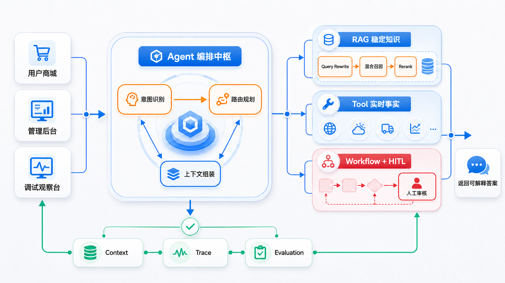
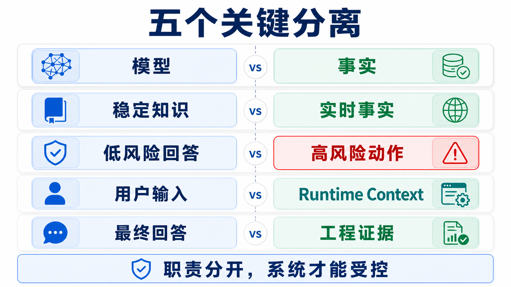
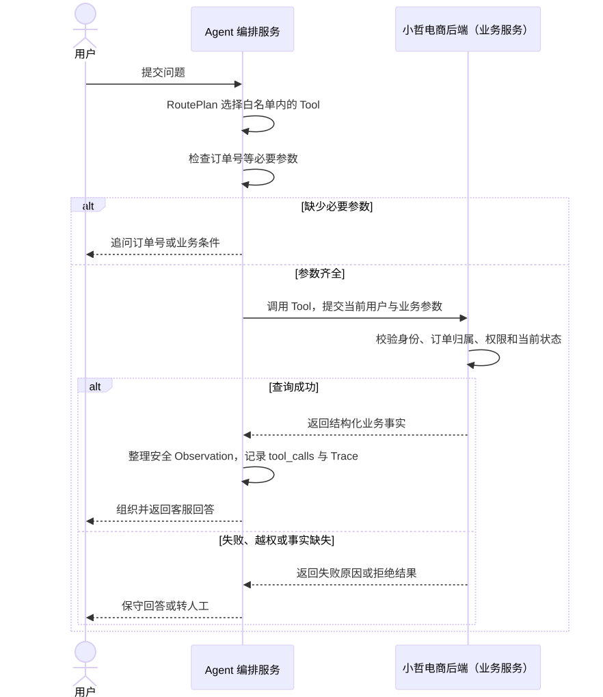
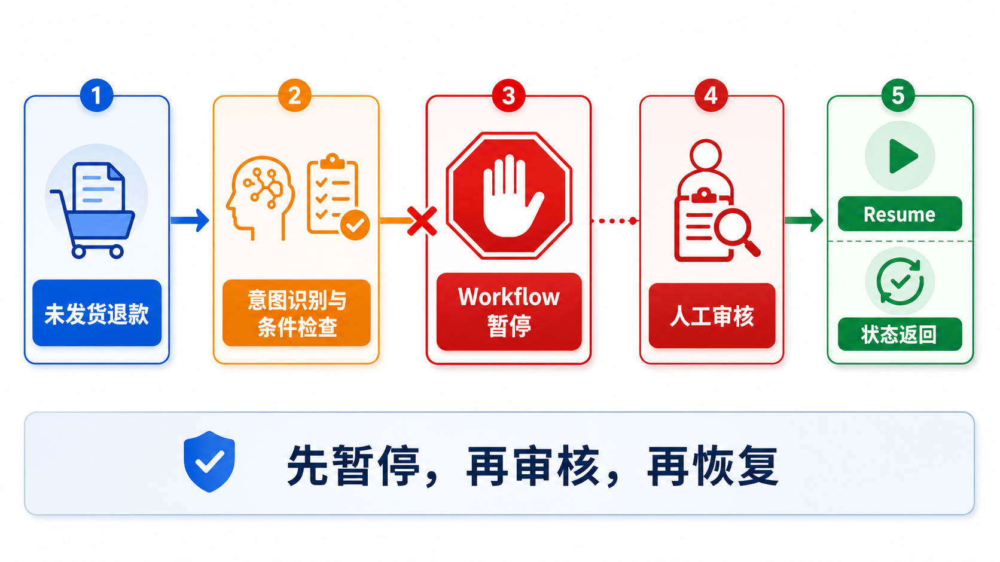
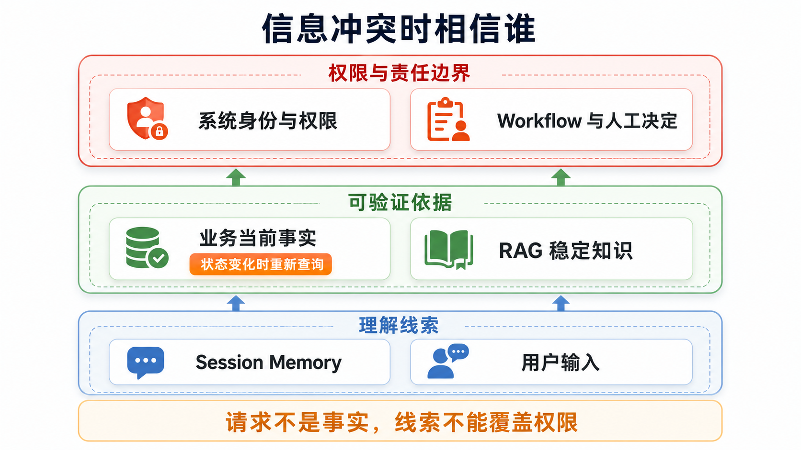

# 小哲电商客服 Agent 系统设计全景

这份材料从整体结构、请求链路、模块分工、高风险流程和工程证据五个角度，介绍小哲电商客服 Agent。这里不展开类和函数，重点是说清各部分怎样配合，以及这个项目为什么不只是一个聊天页面。

开始学习前，你可以先通读一遍，了解 RAG、Tool、Workflow、HITL（Human-in-the-loop，人工介入）、Context、Trace 和 Evaluation 在系统中的位置。学到第 41 课后再回来对照，你会更容易把前面分散的知识串成一条完整链路。

## 1. 先用一句话说清这个系统

小哲电商客服 Agent 是一个受控的客服系统：业务系统提供实时事实，知识库提供稳定依据，Agent 负责编排，Workflow 和人工确认控制高风险动作，Trace 与 Evaluation 记录运行过程并检查改动效果。

先记住一个判断：大模型只是系统中的一个组件，不是系统的全部。

大模型擅长理解用户的自然语言、判断模糊意图和组织最终话术，但它不应该凭空生成订单状态，不应该把过期政策当成当前规则，也不能因为用户说了一句“直接给我退款”就跳过身份、资格和审批。

## 2. 这个系统要解决哪些问题

小哲电商公司的客服请求并不是同一种问题。

| 问题类型 | 典型问题 | 系统需要的能力 |
| --- | --- | --- |
| 普通交流 | “你能帮我做什么？” | 识别交流意图，清楚说明服务边界 |
| 稳定知识 | “电子发票多久能开好？” | 检索发票、活动、售后政策等知识并给出引用 |
| 实时业务事实 | “我的订单到哪了？” | 查询当前用户自己的订单和物流 |
| 混合问题 | “这个商品有库存吗，能参加 618 活动吗？” | 同时组合业务 Tool 与 RAG 知识依据 |
| 高风险售后 | “这个订单还没发货，直接退款。” | 校验身份、订单事实、政策和资格，在未发货退款审批边界暂停并等待人工决定 |
| 异常与越权 | 工具超时、知识没命中、用户要求泄露系统信息 | 保守降级、转人工或拒绝不安全请求 |

如果把这些问题全部交给一次大模型调用，系统就很难稳定区分“可以自然回答”和“必须取得可验证事实”，也守不住高风险动作的责任边界。这正是引入 RAG、Tool、Runtime Context、Workflow、HITL 和 Trace 的原因。

## 3. 从系统全景看各部分的位置

整个项目包含三个交互界面、两个核心后端服务和三类基础资源。客服网关位于电商业务服务内部，是连接商城入口与 Agent 的逻辑边界。

先看下面的主图了解各部分的位置，后面的 Mermaid 图会进一步标出服务、资源和调用关系。



*图：用户请求进入 Agent 后，系统根据意图和 RoutePlan 选择 RAG、Tool 或 Workflow；Context 管理本轮信息，Trace 记录执行过程，Evaluation 检查改动效果。*

后面的彩色流程图中，橙色粗边框标出当前图的重点，绿色表示可信事实、知识依据或经过检查的结果，红色表示不可信输入、必须拦截的条件、人工确认点或降级路径，其他浅色节点串联普通流程。



图中的客服网关负责把登录身份和页面上下文转成 Agent 请求。它属于电商业务服务内部，不是一个独立的后端进程。

三个交互界面面向不同角色，不应该混在一起。

| 系统部分 | 主要职责 | 不负责什么 |
| --- | --- | --- |
| 用户商城与客服入口 | 承接真实用户体验，带着登录身份和页面上下文进入客服 | 不向顾客展示调试 Trace、模型隐藏推理或内部安全策略 |
| 管理后台 | 管理商品、订单、活动和售后审核等业务状态 | 不替代 Agent 理解用户自然语言 |
| Agent 调试观察台 | 展示回答、引用、工具调用、流程状态、公开 Trace、评测和成本摘要 | 不是完整客服坐席、CRM 或质检平台 |
| Agent 编排服务 | 判断路径，组合知识、实时事实、会话上下文和流程状态，生成经过事实与风险检查的回答 | 不绕过业务服务直接读写业务数据库 |
| 电商业务服务 | 管理用户、商品、订单、物流、售后、申请和审批等确定性业务事实 | 不负责大模型话术生成和 Agent 任务规划 |
| 知识资产 | 保存发票、活动、售后政策、FAQ 和 SOP 等稳定内容 | 不保存某个订单的当前状态或某次审批结果 |
| 模型服务 | 提供语言理解、路由候选、回答组织和语义检索所需的模型能力 | 不决定业务权限，不直接批准退款和退货 |

## 4. 先记住五个分离

用了多少框架并不关键，关键是把容易混淆的职责分开。



*图：五组关系不是二选一，而是职责分工。只有把模型、事实、上下文、风险动作和工程证据分开，系统才容易验证和控制。*

### 4.1 模型与事实分离

模型负责理解和表达，事实由可验证的系统提供。回答可以是自然语言，但订单状态、物流信息、库存数量和售后进展不能由模型自己生成。

### 4.2 稳定知识与实时事实分离

售后政策、发票规则和活动说明由 RAG 知识层提供；当前订单、物流、库存和退款进度需要通过 Tool 查询业务服务。知识层既可以使用混合检索，也可以按明确业务意图加载受控政策引用（citation）。两类信息可以在同一轮回答中组合，但不能互相代替。

### 4.3 低风险回答与高风险动作分离

查物流和回答发票问题可以在一轮请求内完成。涉及业务状态变化和人工责任边界的售后动作，应进入显式流程。课程最终快照重点展示两条路径：符合条件的未发货退款会暂停等待人工决定；签收后退货会完成资格检查，并停在提交申请之前。

### 4.4 用户输入与可信运行上下文分离

用户可以说“我是金卡会员”或“那是我的订单”，但系统不能因此相信身份和权限。当前用户、会员等级、风险级别和用户名下的订单候选，应由登录系统和业务服务构建 Runtime Context。特别需要注意的是，课程调试观察台允许你切换预置用户，只是为了观察不同身份下的链路，不是生产环境的鉴权方案。

### 4.5 最终回答与工程证据分离

一句表面正确的回答，不能证明系统走对了路。还要检查它是否调用了正确的 Tool、是否引用了可靠知识、是否在高风险节点暂停，以及修改后是否通过了固定评测。

## 5. 一句用户问题怎样穿过系统

先按编号读完主链路，再看中间展开的六条处理路径。这张图展示一轮请求从进入系统到返回结果的全过程。

```mermaid
flowchart TB    S1["1. 用户发起请求<br/>问题、会话与页面场景"]    S2["2. 请求契约校验<br/>字段、类型与必要身份"]    S3["3. Agent 主入口<br/>加载本轮运行状态"]    S4["4. 模型生成结构化 RoutePlan 候选<br/>意图、RAG、Tool、风险与 Workflow"]    S4G["5. 回退与确定性检查<br/>候选无效时回退，明确边界可覆盖或否决"]    S5["6. 初始 Context 构建<br/>身份、订单线索、历史与冲突"]    S6["7. 服务端确定最终 RoutePlan<br/>检查白名单、风险、Workflow 与必要参数"]    subgraph Paths["8. 选择本轮处理路径"]        P1["A. 澄清<br/>缺少订单号或条件"]        P2["B. 普通交流<br/>直接说明能力与边界"]        P3["C. Business Tool<br/>查询实时业务事实"]        P4["D. RAG / Tool + RAG<br/>查询知识或组合两类证据"]        P5["E. Workflow / HITL<br/>控制高风险售后流程"]        P6["F. 安全或降级<br/>拒绝、保守回答或转人工"]    end    S8["9. 汇总依据并检查风险<br/>来源安全、冲突处理与信息最小化"]    S9["10. 生成本轮结果<br/>模型回答、确定性兜底或流程暂停"]    S10["11. 更新工程状态<br/>Memory、Trace、Cost 与 Workflow"]    S11["12. 返回结构化响应<br/>answer + citations + tool_calls + session_state"]    S12["13. 前端按角色展示<br/>客服结果或调试证据"]    S1 --> S2 --> S3 --> S4 --> S4G --> S5 --> S6    S6 --> P1    S6 --> P2    S6 --> P3    S6 --> P4    S6 --> P5    S6 --> P6    P1 --> S9    P2 --> S9    P3 --> S8    P4 --> S8    P5 --> S8    P6 --> S9    S8 --> S9 --> S10 --> S11 --> S12    classDef main fill:#eef6ff,stroke:#3f6f9f,stroke-width:1.5px,color:#142638;    classDef branch fill:#fffaf0,stroke:#b88935,stroke-width:1px,color:#382b14;    classDef result fill:#eef9f2,stroke:#43835d,stroke-width:1.5px,color:#173523;    classDef emphasis fill:#fff3cd,stroke:#d97706,stroke-width:3px,color:#5a2d00;    classDef evidence fill:#eaf8ef,stroke:#2f855a,stroke-width:2px,color:#173523;    classDef guard fill:#fff0ee,stroke:#c24135,stroke-width:2.5px,color:#501b16;    class S1,S2,S3,S5 main;    class P1,P2,P3,P4,P6 branch;    class S9,S10,S11,S12 result;    class S4,S6 emphasis;    class S8 evidence;    class S4G,P5 guard;
```

这张总图展示系统怎样选择处理路径，并不表示每轮请求都要依次调用 RAG、Tool 和 Workflow。后面每个核心模块的小图，会继续展开其中一段。

- 普通问候可能不需要 RAG 和 Tool。
- 发票、活动与会员知识主要走混合检索；退款、退货政策按明确业务意图加载受控政策引用。
- 订单、物流、库存和退款进度主要走 Tool。
- 商品推荐可以在同一轮内组合 Tool 与 RAG。
- 未发货退款和签收后退货会进入显式 Workflow，不会由模型自由决定是否执行。
- 没有可靠知识、业务服务不可用或请求越权时，系统应保守回答，而不是让模型补齐缺失事实。

## 6. Agent 编排服务内部怎样分层

只看 Agent 服务内部，可以把它分为六层。



图中从“上下文与回答层”回到“入口与契约层”的箭头，表示系统生成结构化响应并返回调用方，不是重新执行一遍六层流程。

这六层围绕一次请求展开：先规划路径，再取得依据、执行流程、组织回答并返回响应。请求、RoutePlan、工具结果、工作流状态和观测信息都使用结构化对象传递，Hooks、Trace、Evaluation 和 Cost 则贯穿各个阶段。

## 7. 逐个理解核心模块

### 7.1 入口与响应契约

入口层首先要把“说了什么”和“这次请求是谁发起的”分开。请求不只有用户问题，还要带上会话标识、可信用户身份和必要的页面上下文。

响应也不只有一段文本。普通聊天响应会分别返回面向用户的回答、引用、工具调用、澄清请求和 `session_state`；工作流状态与公开观测摘要位于 `session_state` 中。这样，商城可以只展示必要的客服结果，调试观察台则可以用同一份响应观察内部链路。

### 7.2 意图、风险与任务规划

规划模块要回答四个问题：

1. 这轮请求想解决什么问题？
2. 需要稳定知识、实时业务事实，还是两者都需要？
3. 允许使用哪些工具，必填参数是否齐全？
4. 这轮是低风险回答，还是必须进入 Workflow 的高风险动作？

意图识别和路由规划不是同一个动作。意图识别回答“用户想解决什么问题”，RoutePlan 回答“系统建议怎样执行、服务端最终允许怎样执行”。模型会一次生成结构化 RoutePlan 候选，其中除了 intent，还包含是否需要 RAG、是否需要业务工具、候选工具列表、知识域、风险等级、Workflow 标记和兜底策略。意图理解与后续路径规划因此通过同一份数据直接关联，不需要先得到一个标签，再靠关键词规则拼装所有字段。

不过，模型候选还不等于执行指令。系统先做结构化校验，检查字段、类型和字段之间的约束；候选无效或模型不可用时，回退到规则分类和确定性基线。

候选通过格式校验后，服务端还会检查退款、退货、安全和降级等明确业务条件，并核对订单号等必要参数是否齐全、候选工具和知识域是否在白名单内、风险等级是否达到最低要求，以及当前请求是否必须进入 Workflow。检查完成后，系统才生成最终 RoutePlan。遇到必须由服务端处理的条件，或者路由被否决时，模型候选不再参与最终计划。模型不能自行发明可执行工具；明确属于退款或退货的请求，也不能被模型降级成普通问答。



图里要分清“模型候选”和“最终计划”。模型候选把 Intent 与后续路径关联起来；服务端再结合实体线索和明确业务规则，决定本轮是否需要 RAG、允许调用哪些 Tool、是否进入 Workflow，以及缺少参数时怎样追问。规则主要负责失败回退和守住业务底线，不承担全部自然语言理解。

### 7.3 Runtime Context、Memory 与 Context Builder

这三个概念解决的问题不同。

| 模块 | 它解决什么 | 不能被当成什么 |
| --- | --- | --- |
| Runtime Context | 提供本轮请求的可信身份、会员等级、风险、页面和权限信息 | 不是用户能通过聊天内容改写的普通文本 |
| Session Memory | 记住最近对话里有用的订单、商品或未完成状态，帮助理解“刚才那个” | 不是长期业务数据库，也不能覆盖当前业务事实 |
| Context Builder | 在入口阶段整理用户输入、Runtime Context、Memory 和历史消息，处理冲突、裁剪与脱敏 | 不负责一次性汇总 RAG、Tool 和 Workflow 的全部结果，也不是把所有历史拼进 Prompt |

当不同来源冲突时，系统优先相信系统身份与当前业务事实，而不是用户的自我声明或过期会话记忆。

下图展示最终回答前怎样整理各类信息，它不对应某一个函数。入口阶段先处理 Runtime Context、Memory、历史消息和用户输入；RAG、Tool 与 Workflow 执行完成后，再把结果交给回答阶段。

```mermaid
flowchart LR    R["可信 Runtime Context<br/>身份、风险与页面"]    M["Session Memory 与历史<br/>最近线索"]    U["用户本轮输入<br/>意图与补充条件"]    E["RAG、Tool 与 Workflow<br/>分支执行后获得的证据"]    C1["1. 标记来源与用途"]    C2["2. 按信任顺序处理冲突"]    C3["3. 检查注入并脱敏"]    C4["4. 保留最近且相关的内容"]    C5["5. 整理成回答可用的 Context<br/>交给回答阶段"]    R --> C1    M --> C1    U --> C1    E --> C1    C1 --> C2 --> C3 --> C4 --> C5    classDef source fill:#fffaf0,stroke:#b88935,color:#382b14;    classDef focus fill:#eef6ff,stroke:#3f6f9f,color:#142638;    classDef emphasis fill:#fff3cd,stroke:#d97706,stroke-width:3px,color:#5a2d00;    classDef evidence fill:#eaf8ef,stroke:#2f855a,stroke-width:2px,color:#173523;    classDef guard fill:#fff0ee,stroke:#c24135,stroke-width:2.5px,color:#501b16;    class M source;    class C1,C4 focus;    class C2,C3 emphasis;    class R,E,C5 evidence;    class U guard;
```

Context 不是拼得越多越好。保留下来的每段信息都要能回答三个问题：它从哪里来、能证明什么、与其他信息冲突时应该让位给谁。

在课程调试模式里，你可以主动切换演示用户，方便验证订单归属和上下文隔离。走商城客服入口时，用户身份应该来自登录态和客服网关；真实生产环境更不能直接相信浏览器传入的用户 ID。

### 7.4 RAG：为稳定知识建立可引用依据

第 41 课把发票类 FAQ、活动、会员、退款和退货政策统一放在知识层管理，但取得引用依据的方式并不相同：

- FAQ、活动和会员问题共享一条混合检索主干：先完成 Query Rewrite（查询改写）和知识域过滤，再进行语义向量与关键词双路召回，最后合并候选。
- 两类问题取得候选后的处理不同。FAQ 检查知识域、分数与来源安全；活动和会员问题还会在检索前排除知识库中尚未发布或不存在的信息，并在检索后按当前问题筛选适用政策，再执行课程版轻量 Rerank（重排）。
- 未发货退款和签收后退货进入受控政策路径。系统根据已经确定的业务意图加载对应政策 citation，不再执行完整的混合检索与重排。

无论走哪条路径，最终回答都会带上 citations，并执行相同的来源安全检查和回答限制。FAQ、活动和会员通过检索取得引用；退款和退货则按明确业务意图加载政策引用。

```mermaid
flowchart TB    R1["1. 最终 Intent 与知识域策略<br/>确定本轮知识证据入口"]    R2{"2. 选择知识证据路径"}    P0{"3B. 活动与会员检索前检查<br/>是否涉及知识库中尚未发布或不存在的信息？"}    subgraph Shared["FAQ、活动与会员共享的混合检索主干"]        direction TB        Q1["3A. Query Rewrite<br/>保留原问题，只改检索 query"]        Q2["4. 按当前 Intent 过滤知识域"]        Q3["5. Hybrid Retrieval<br/>语义向量 + 关键词召回"]        Q4["6. 合并候选"]        Q1 --> Q2 --> Q3 --> Q4    end    H1{"7. 按当前知识类型处理候选"}    F1["8A. FAQ<br/>当前示例为发票；检查分数、知识域与来源安全"]    P1{"8B. 活动与会员<br/>适用政策与当前问题匹配？"}    P2["9B. Rerank 重排<br/>按业务条件调整顺序"]    subgraph Policy["退款与退货：受控政策引用"]        direction TB        C1["3C. 根据明确业务意图<br/>加载对应政策 citation"]    end    R3{"10. 获得可靠 citation？"}    R4["返回 citations<br/>进入回答阶段"]    R5["说明依据不足<br/>保守回答或转人工"]    R1 --> R2    R2 -->|"FAQ"| Q1    R2 -->|"活动 / 会员"| P0    R2 -->|"退款 / 退货"| C1    P0 -->|"否"| Q1    P0 -->|"是"| R5    Q4 --> H1    H1 -->|"FAQ"| F1    H1 -->|"活动 / 会员"| P1    P1 -->|"匹配"| P2    P1 -->|"不匹配或证据不足"| R5    F1 --> R3    P2 --> R3    C1 --> R3    R3 -->|"是"| R4    R3 -->|"否"| R5    classDef focus fill:#eef6ff,stroke:#3f6f9f,color:#142638;    classDef policy fill:#fffaf0,stroke:#b88935,color:#382b14;    classDef emphasis fill:#fff3cd,stroke:#d97706,stroke-width:3px,color:#5a2d00;    classDef ok fill:#eef9f2,stroke:#43835d,color:#173523;    classDef safe fill:#fff0ee,stroke:#c24135,stroke-width:2.5px,color:#501b16;    class R1,R2,Q2,Q4,H1,F1,P1,R3 focus;    class Q1,Q3,P2 emphasis;    class C1 policy;    class R4 ok;    class P0,R5 safe;
```

图中的 FAQ 与活动、会员不是两套 RAG。它们共享 Query Rewrite、知识域过滤、混合检索和候选合并，只在检索前检查与候选处理阶段采用不同规则。电子发票只是当前 FAQ 的示例，不代表系统为发票建立了一条固定的专用检索链。退款和退货则不经过这条共享检索主干，而是按明确业务意图加载受控政策引用。无论走哪条路径，系统最后都要确认 citation 是否可靠，再交给回答阶段。

RoutePlan 会记录本轮是否需要 RAG，以及涉及哪些知识域，但当前快照主要根据已经确定的最终 Intent 进入知识分支。这不代表当前系统已经能根据 RoutePlan 自动组合任意 RAG 流程。

这里的“合并候选”是把同一条改写 query 的向量召回结果与关键词召回结果合并，不是 RAG Fusion。第 41 课只实现单条 Query Rewrite；生成多条 query、分别召回、去重并融合的 RAG Fusion 属于后续升级方向，不在当前执行链路中。

RAG 有三条重要边界：

- 在混合检索路径中，找到“最相似”的片段不等于已经找到可靠答案，还要考虑匹配质量、业务条件和知识范围。
- 在受控政策路径中，citation 只能证明适用的政策依据，不能代替对当前订单状态、用户身份或审批结果的查询。
- 没有可靠命中时，系统应说明缺少依据或转人工，不能让模型凭印象补写政策。

RAG 不用来回答某个订单现在是否发货，也不能作为用户身份和退款审批状态的事实源。

### 7.5 Tool：Agent 怎样调用电商后端查询实时事实

Agent 不直接查询业务数据库。它先根据 RoutePlan 选择允许使用的 Tool，并检查订单号等必要参数；然后调用小哲电商业务服务。电商后端负责核对当前用户、订单归属、权限和业务状态，再把结构化结果返回给 Agent。



图里有两次检查。RoutePlan 白名单限制模型可以尝试哪些 Tool，业务服务复核则决定当前用户实际上能查到什么。订单号等关键参数来自用户输入或受控 Context，并在工具调用前后继续校验，不能由模型随意写进 RoutePlan。

缺少订单号等必要信息时，RoutePlan 会保留工具候选，用来生成澄清提示，但会清空本轮可执行工具。只有用户补充或确认这些信息后，系统才会继续。

Agent 不会绕过业务服务直接访问数据库。Tool 也不会因为模型参数看起来合法，就跳过当前用户订单归属校验。

### 7.6 Workflow、HITL 与 Resume：把高风险动作画成明确流程

普通工具调用适合低风险查询，但不适合处理退款、退货和审批这类有明确业务状态的流程。这些场景需要显式 Workflow，把“查事实”“查政策”“判断资格”和“等待人工决定”变成可见节点。



*图：主图先标出“暂停、人工审核、恢复”三个关键阶段；下方 Mermaid 图再展开资格检查、Checkpoint、Resume 校验和幂等记录。*

课程最终快照对两类售后请求做了不同处理：签收后退货会检查时间、商品属性、原因和政策，然后停在“准备申请”之前；符合条件的未发货退款会保存 checkpoint，返回恢复所需的受控标识，并等待人工决定。

后续 Resume 不是普通聊天续问。课程快照会接收审核人信息与决定，先校验工作流和恢复令牌，再优先查询当前业务事实，最后记录审核结果。课程快照在业务接口无法取得当前订单时，会回退到 checkpoint 保留的冻结快照。

课程快照要求携带审核人 ID 和角色，但完整的审核权限校验仍属于真实上线时要接入的企业权限体系。

```mermaid
flowchart LR    W1["1. 用户提出<br/>未发货退款"]    W2["2. 校验身份并取得<br/>订单事实与退款政策"]    W3{"3. 满足申请条件？"}    W4["说明原因<br/>或转人工"]    W5["4. 暂停 Workflow<br/>保存 Checkpoint 与恢复标识"]    W6["5. 人工给出决定<br/>通过、拒绝或补材料"]    W7["6. Resume 校验<br/>令牌、流程与当前事实"]    W8["7. 幂等记录结果<br/>或继续保持暂停"]    W9["8. 返回 Workflow 状态<br/>不承诺真实资金已退款"]    W1 --> W2 --> W3    W3 -->|"否"| W4    W3 -->|"是"| W5 --> W6 --> W7 --> W8 --> W9    classDef focus fill:#eef6ff,stroke:#3f6f9f,color:#142638;    classDef emphasis fill:#fff3cd,stroke:#d97706,stroke-width:3px,color:#5a2d00;    classDef human fill:#fff0ee,stroke:#c24135,stroke-width:3px,color:#501b16;    classDef safe fill:#fff0ee,stroke:#c24135,stroke-width:2.5px,color:#501b16;    classDef ok fill:#eef9f2,stroke:#43835d,color:#173523;    class W1,W2,W3 focus;    class W5,W7 emphasis;    class W6 human;    class W4 safe;    class W8,W9 ok;
```

这条链路保证了三件事：

- 模型可以解释条件和下一步，但不负责批准。
- 审批等待期间业务状态可能变化，生产环境应在恢复前强制重新检查；课程快照优先查当前事实，但保留了冻结快照回退。
- 重复提交同一个审批结果时，幂等机制用来防止重复记录课程环境中的模拟审批结果。

### 7.7 Prompt、模型与安全边界

Prompt 保存的是稳定行为规则，例如小哲电商公司客服身份、事实优先级、拒答边界和工具使用原则。它不应该写入当前订单、库存、退款结果等随时变化的业务事实。

在最终系统中，模型主要承担两种职责：

- 结构化路由候选：把意图、知识需求、工具需求、风险和 Workflow 建议放进同一份候选契约。候选必须经过严格校验，再由服务端检查并确定最终执行范围；模型不可用或输出不可信时，系统进入明确的保守回退。
- 最终话术：只基于 Tool Observation、RAG citations、Workflow 状态和经过筛选、脱敏的上下文生成客服回答。

退款、退货、越权、注入和服务故障等情况由服务端的明确规则处理，安全责任不能全部交给模型。

### 7.8 Hooks、Trace、Evaluation、Feedback 与成本记录

这些机制让你回答两个实际问题：“系统刚才为什么这样处理？”“改完以后有没有影响其他场景？”

| 能力 | 主要作用 | 学习时要观察什么 |
| --- | --- | --- |
| Hooks | 在工具前后、错误和完成阶段统一执行校验、脱敏、降级和记录 | 第 41 课主要通过 Trace、工具状态、安全和降级事件观察检查结果，不是等待一个独立 `hooks` 响应字段 |
| Trace | 记录可展示的意图、路由、RAG、Tool、Workflow 和成本事件 | 执行阶段、状态、关联标识和安全摘要 |
| Evaluation | 用固定业务 case 检查回答、工具、引用、流程状态和安全信号 | 不只看最终文本，还要看路径是否正确 |
| Feedback | 把用户反馈、Trace 和 Eval 结果联系起来，给出初步失败归因 | 问题更可能属于 Prompt、RAG、Tool、Context 还是 Workflow |
| Cost | 记录请求类型、模型调用、RAG 命中、Tool 次数、上下文压缩与预算信号和 Workflow 路径 | 本轮是轻路径、重路径还是恢复路径，成本信号是否异常 |

Trace 展示的是公开执行摘要和工具轨迹，不是模型隐藏思维链。Feedback 的自动归因也只是候选结论，真正的责任确认和修复决策仍然需要人来复核。

## 8. 系统遇到冲突时相信谁

系统会同时收到用户话术、会话记忆、知识片段、工具结果和工作流状态。它们的用途不同，可信级别也不同。



*图：用户输入和 Session Memory 用于理解请求，业务事实与 RAG 提供可验证依据，系统身份、权限和人工决定守住责任边界。状态可能变化时，仍要重新查询当前业务事实。*

| 信息来源 | 在系统中的作用 | 冲突时的处理原则 |
| --- | --- | --- |
| 系统提供的身份、权限与风险上下文 | 确定“你是谁、能查什么、哪些动作需要审批” | 不被用户话术覆盖 |
| 电商业务服务的当前事实 | 提供订单、物流、库存、售后和审批状态 | 优先于过期会话、知识片段和用户自述 |
| 已发布知识的 RAG 引用 | 提供政策、FAQ 和 SOP 依据 | 只在它所描述的稳定知识范围内有效 |
| Workflow Checkpoint 和人工决定 | 记录高风险流程暂停在哪里、谁做了什么决定 | 生产恢复应强制复核当前业务事实；课程快照优先查当前事实，查不到时会回退到冻结快照 |
| Session Memory | 帮助理解“刚才那个订单”等上下文引用 | 仅作为线索，不代替当前业务查询 |
| 用户输入 | 表达意图、补充条件和提供线索 | 不作为身份、权限、当前业务状态或审批结果的权威来源 |

可以这样记：

用户输入是请求，Memory 是线索，RAG 是稳定知识依据，Tool 是实时业务事实，Workflow 是高风险过程状态，系统身份和人工决定则守住权限与责任边界。

## 9. 为什么不能只看最终回答

普通聊天页面可能只展示最终文本，但一个可维护的 Agent 系统还要说明自己走过哪条路径。

| 可观察结果 | 它能证明什么 | 它不能单独证明什么 |
| --- | --- | --- |
| `answer` | 用户最终看到的回答 | 不能单独证明回答依据正确 |
| `citations` | 本轮使用了哪些稳定知识片段 | 不能证明某个订单的当前状态 |
| `tool_calls` | 调用了哪些业务能力，调用是否成功 | 不能证明高风险动作已经获得审批 |
| `session_state.workflow` | 高风险流程当前节点、资格和待处理动作 | “暂停等审批”不等于退款已完成 |
| `trace` | 规划、RAG、Tool、Workflow、安全和成本的公开执行摘要 | 不是模型隐藏思维链 |
| `eval report` | 固定 case 下的回答、路径、引用、状态和禁用行为是否回归通过 | 不等于所有真实用户问题都已经通过 |
| `cost summary` | 这轮走了什么路径，大概调用了哪些模型、RAG 和 Tool 能力 | 不是完整计费或 FinOps 系统 |

当你在调试观察台里复盘问题时，可以按下面的顺序检查：

1. 意图和路由是否正确。
2. 需要实时事实时是否调用了正确的 Tool。
3. 需要政策依据时是否有可靠 citations。
4. 涉及高风险动作时是否进入 Workflow 并在 HITL 边界暂停。
5. 服务不可用、依据不足或请求越权时是否保守降级。
6. 修改 Prompt、RAG、Tool 或 Workflow 后，固定评测是否仍然通过。

## 10. 系统怎样通过反馈继续改进

上线后发现问题，还要经过“保留证据、判断原因、修改对应模块、补充评测、执行回归”，才能确认修复是否有效。

```mermaid
flowchart LR    Request["真实请求"] --> Response["Agent 回答与路径"]    Response --> Trace["保留 Trace 与用户反馈"]    Trace --> Attribution["人工复核并归因<br/>Prompt / RAG / Tool / Context / Workflow"]    Attribution --> Fix["修改对应模块"]    Fix --> Cases["补充或更新固定 Eval Case"]    Cases --> Regression["执行回归评测"]    Regression -->|"通过"| Release["进入有限范围验证"]    Regression -->|"失败"| Attribution    Release --> Request    classDef normal fill:#eef6ff,stroke:#3f6f9f,color:#142638;    classDef emphasis fill:#fff3cd,stroke:#d97706,stroke-width:3px,color:#5a2d00;    classDef evidence fill:#eaf8ef,stroke:#2f855a,stroke-width:2px,color:#173523;    class Request,Response,Fix,Cases normal;    class Attribution,Regression emphasis;    class Trace,Release evidence;
```

这个过程要守住两条边界：

- 自动归因只是候选线索，不能取代人对 Trace、业务事实和评测结果的复核。
- 固定评测通过只证明已知 case 没有回归，不代表可以立即进入全量无人值守运行。

## 11. 从运行拓扑理解各进程的关系

从云效小仓运行项目时，各进程之间的关系如下。

```mermaid
flowchart LR    Browser["浏览器"]    Workbench["Agent 调试观察台<br/>React"]    ShopAdmin["用户商城 / 管理后台"]    Agent["第 41 课最终 Agent<br/>FastAPI"]    Ecommerce["小哲电商业务服务<br/>Spring Boot"]    DB[("MySQL")]    Knowledge["课程知识与评测数据<br/>随 Agent 快照内置"]    Model["模型提供方<br/>对话 + Embedding"]    Browser --> Workbench --> Agent    Browser --> ShopAdmin --> Ecommerce    Ecommerce -->|"商城客服网关"| Agent    Agent -->|"Tool"| Ecommerce    Ecommerce --> DB    Agent --> Knowledge    Agent --> Model    classDef normal fill:#eef6ff,stroke:#3f6f9f,color:#142638;    classDef emphasis fill:#fff3cd,stroke:#d97706,stroke-width:3px,color:#5a2d00;    classDef evidence fill:#eaf8ef,stroke:#2f855a,stroke-width:2px,color:#173523;    class Browser,Workbench,ShopAdmin,Model normal;    class Agent emphasis;    class Ecommerce,DB,Knowledge evidence;
```

排查运行问题时，不要把“页面能打开”当成“Agent 全链路正常”。同样，Agent 健康检查通过，也不能证明业务 Tool、Embedding、对话模型和售后 Workflow 都已经验证。

第 41 课可以在配置模型和业务服务后走真实在线链路，也为离线课堂回归保留了显式开关。只有显式设置 `AGENT_COURSE_OFFLINE_RAG=1` 时才使用离线字符向量，显式设置 `AGENT_COURSE_OFFLINE_FACTS=1` 时才允许使用课程预置的业务事实数据。`AGENT_COURSE_DISABLE_LLM=1` 只禁用模型，不会自动启用这份预置数据。

这些离线替身和规则回退只能证明课程链路可重复，不能冒充真实 Embedding、实时业务接口或在线模型效果。

排查时要沿真实请求链路分层看：页面是否请求到 Agent，Agent 是否走到预期路径，Tool 是否获得业务事实，RAG 是否获得可靠知识，高风险场景是否停在正确节点。

## 12. 课程项目已经做了什么，还没做什么

这个项目采用了贴近真实 Agent 工程的分层和风险边界，但课程环境不等于完整企业客服平台。

| 方向 | 课程项目已经展示 | 真实上线还需要补齐 |
| --- | --- | --- |
| 业务接入 | 通过受控 Tool 查询商品、订单、物流、售后等课程业务事实 | 替换为企业内部服务、统一鉴权、权限、字段映射、限流和审计 |
| 知识检索 | 展示知识切分、Embedding、混合检索、重排、citations 和低置信兜底 | 知识审核、版本发布、权限过滤、实时更新和运营平台 |
| 高风险流程 | 未发货退款展示 HITL、Checkpoint、Resume 和幂等；签收后退货展示资格判断并停在提交申请前 | 企业工作流平台、完整审核权限、多级审批、工单、真实退款和财务对账 |
| 观测与评测 | 展示公开 Trace、固定 case、反馈归因和请求级成本摘要 | 指标平台、告警、分布式追踪、真实计费、线上质检和 A/B 实验 |
| 状态存储 | 课程快照使用便于学习的轻量会话、Trace 和 Workflow 状态 | 持久化、分布式一致性、过期策略、容灾和多实例协调 |
| 运行与安全 | 展示服务身份、订单归属校验、注入防护、降级和高风险人工边界 | 密钥托管、网络隔离、零信任、全量审计、灰度、回滚和高可用部署 |

特别注意：课程中的退款审批和申请结果是为了展示 Agent 工程边界，不代表真实资金已经退回用户账户。课程中的调试观察台也不是完整客服坐席平台。

## 13. 在云效小仓里怎样找到代码和运行资料

这份材料只讲逻辑结构。课程正文请在语雀中阅读；要查看源码、运行项目或排查环境问题，请从你在云效拉取的代码仓根目录进入。

| 你想看什么 | 云效小仓路径 |
| --- | --- |
| 各课 Agent 代码快照 | `agent-course-versions/` |
| 第 41 课最终综合 Agent | `agent-course-versions/lesson-41-final-rehearsal/backend/` |
| 小哲电商业务服务 | `ecommerce-backend/` |
| Agent 调试观察台 | `frontend/` |
| 云效代码获取说明 | `doc/云效代码获取操作手册.md` |
| 项目课入门说明 | `doc/小哲电商 Agent 项目课入门指引.md` |
| 启动、模型配置和排错 | `doc/运行手册.md` |
| 初始化数据库内容 | `doc/小哲电商初始化数据库内容.xlsx` |

学习路线可以按系统能力来记：

| 课程范围 | 对应系统能力 |
| --- | --- |
| 故事课 01-07 | 对话入口、结构化输出、Prompt 和成本观察 |
| 故事课 08-16 | RAG、知识切分、引用、质量门禁、查询改写、重排和混合检索 |
| 故事课 17-24 | 业务事实、Tool Calling、澄清、Observation、降级、Hooks 和 MCP 边界 |
| 故事课 25-31 | Planner、Workflow、HITL、Checkpoint、Resume 和幂等 |
| 故事课 32-36 | Memory、Runtime Context、Context Builder、压缩和注入防护 |
| 故事课 37-41 | Trace、Evaluation、Feedback、成本记录与最终总演习 |
| 故事课 42-44 | 复用第 41 课 Agent 做综合场景验证 |
| 故事课 45 | 生产交付、有限灰度和上线边界 |
| 故事课 46 | 增强路线图与项目收束 |
