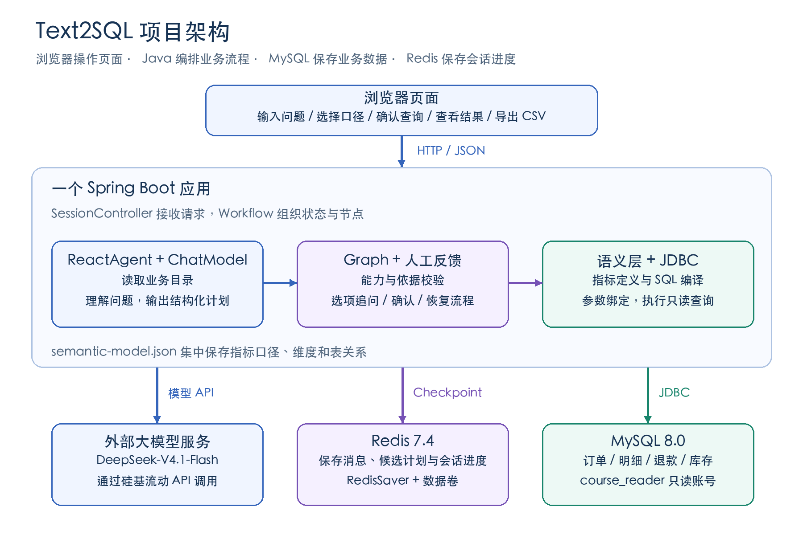
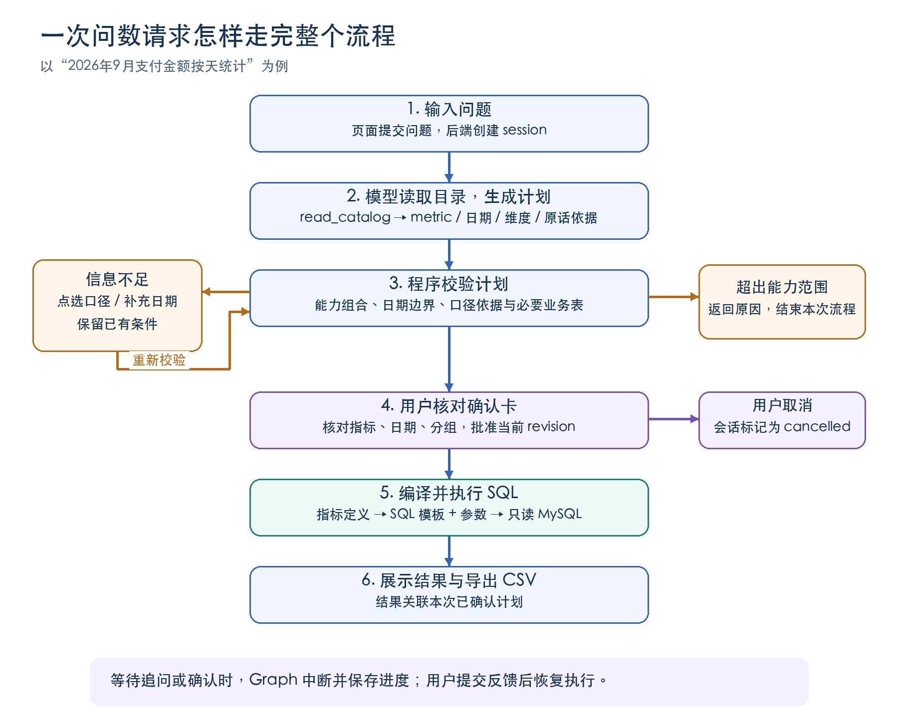

在这门加餐里，你会为小哲电商做一个问数助手。运营在网页上输入“2026年9月支付金额按天统计”，系统把问题整理成查询计划，展示确认卡，等用户核对后查询数据库，最后给出表格和 CSV。

这篇文档先帮你建立整个项目的地图。阅读后，你应该能回答三个问题——每项技术解决什么问题，一次请求经过哪些模块，以及跟课时该从哪个文件开始看。

## 1. 先看整个系统怎样组成



整个项目围绕一个 Spring Boot 应用展开。它同时提供网页静态资源和 HTTP 接口，内部使用 Spring AI Alibaba 组织模型调用、计划校验和人工反馈。Docker Compose 启动应用、MySQL 与 Redis 三个常驻服务。

你可以按四个部分理解它。

| 部分 | 做什么 | 你能看到的效果 |
| --- | --- | --- |
| 浏览器页面 | 输入问题、补充信息、核对确认卡、展示结果 | 运营可以通过页面完成一次问数 |
| Java 应用 | 调模型生成计划，检查计划，等待用户确认，编译并执行查询 | 每一步都有明确状态和处理入口 |
| MySQL | 保存订单、商品明细、退款、发货和库存等业务数据 | 查询返回真实数据库中的统计结果 |
| Redis | 保存 Graph 的会话状态与检查点 | 应用重建后可以继续待确认的会话 |

模型通过外部 API 调用。当前代码使用硅基流动上的 `deepseek-ai/DeepSeek-V4.1-Flash`，运行时从环境变量读取你自己的 Key。Docker 中运行的是应用和数据服务，模型请求仍需要网络。

架构中的主线可以记成一句话——**模型提出查询计划，程序检查并编译，用户核对后批准执行。**

## 2. 技术栈里，每项技术负责哪一段

下面的版本来自当前课程完成版的 `pom.xml`、`Dockerfile` 和 `compose.yaml`。跟课时沿用工程提供的版本，可以减少框架接口差异带来的干扰。

| 技术 | 当前课程版本或实现 | 在项目中的职责 |
| --- | --- | --- |
| Java | 17 | 编写计划对象、业务校验、图节点和 SQL 编译器 |
| Spring Boot | 3.4.8 | 启动 Web 服务、组织依赖注入、提供配置与数据源 |
| Spring AI | 1.1.2 | 提供 `ChatModel`、消息、工具定义和 `BeanOutputConverter` |
| Spring AI Alibaba | Agent Framework 1.1.2.2 | 提供 `ReactAgent`、`StateGraph`、中断恢复与 `RedisSaver` |
| 模型服务 | 硅基流动 API，DeepSeek-V4.1-Flash | 理解用户问题，结合业务目录生成结构化决策 |
| MySQL | 8.0 镜像系列 | 保存并查询课程业务数据 |
| JDBC | `DataSource`、`PreparedStatement`、MySQL Connector/J | 获取连接、绑定查询参数、读取结果 |
| Redis | 7.4-alpine 镜像系列 | 持久化会话检查点，数据卷保存 Redis 数据 |
| Redisson | 3.22.0 | 为框架的 `RedisSaver` 提供 Redis 客户端 |
| 网页 | HTML、CSS、原生 JavaScript | 输入、澄清选项、确认卡、结果表与 CSV 下载 |
| 构建与交付 | Maven 3.9.6、Docker、Docker Compose | 编译 Java，启动应用和依赖服务，切换课程版本 |

Spring AI 中的 `OpenAiChatModel` 在这里连接兼容相应协议的硅基流动服务。具体供应商地址、模型名和调用参数集中在 `AiConfiguration.java`。

前端文件直接放在 Spring Boot 的 `static/` 目录，由同一个应用提供访问入口。因此，跑起项目后，浏览器访问 `http://localhost:18323/` 就能打开页面。

## 3. ReactAgent 和 Graph 各自做什么

这两个组件出现在同一个框架里，但处理的流程层次不同。

### ReactAgent 负责理解问题和调用目录工具

`QueryPlanner` 创建一个 `ReactAgent`，给它业务提示词、结构说明和 `read_catalog` 工具。Agent 读取目录后，将自然语言整理成程序可处理的决策。

例如，用户输入“2026年9月支付金额按天统计”，计划中的关键字段会表达为下面的形式。

```json
{
  "metric": "paid",
  "start": "2026-09-01",
  "end": "2026-10-01",
  "dimension": "day",
  "category": null,
  "end_inclusive": false
}
```

`metric` 表示选择了哪个指标，`dimension` 表示按什么分组。日期采用左闭右开的区间，上面的范围覆盖整个九月。`category=null` 表示本次没有品类筛选。

完整决策还包含 `status`、`reason`、候选表和原话依据。`status` 可以表达查询、追问或拒绝，原话依据说明指标、日期等字段来自用户哪条消息中的哪段文字。

`BeanOutputConverter` 将模型返回的文本转换成 Java 对象，之后由业务代码继续检查字段含义。

### Graph 负责整个问数流程

`Workflow` 使用 `StateGraph` 组织全局流程，当前主节点依次承担下面的职责。

| 节点 | 对应职责 |
| --- | --- |
| `planner` | 调用 `QueryPlanner`，得到模型决策 |
| `plan_validation` | 检查能力组合、日期和原话依据，决定进入追问、确认或结束 |
| `human_feedback` | 在需要用户补充或批准时中断，收到反馈后恢复 |
| `sql_execute` | 对已经批准的计划编译 SQL 并执行查询 |

ReactAgent 负责“这句话表达了什么，以及需要读取哪些业务说明”。Graph 负责“现在走到哪一步，什么时候等用户，下一步允许执行什么”。

## 4. 语义层怎样把业务口径落实到查询

运营说“支付金额”，程序需要知道计算哪个字段、哪些订单参与、按哪个时间归属。项目把这些定义集中在 `semantic-model.json` 中。

你可以把语义层拆成三件相互配合的东西。

| 组成 | 保存或处理的内容 | 对应位置 |
| --- | --- | --- |
| 业务定义 | 指标名称、别名、口径说明、支持维度、来源表和关联关系 | `semantic-model.json`、`Catalog` |
| 查询计划 | 本次选择的指标、日期、维度和品类条件 | `Types.Plan` |
| SQL 编译 | 按业务定义和当前计划生成 SQL 模板与参数 | `SemanticSqlCompiler` |

例如，支付成功订单实付金额以支付时间归属，按天查询时对支付日期分组。退款后净额则需要先按订单聚合已完成退款，再关联订单计算，防止一单多次退款把订单实付重复累计。

这些计算规则在代码和指标定义中明确表达。模型根据目录选择指标，编译器按照已支持的组合生成查询，业务口径由这套定义统一管理。

目录当前包含14张候选表的说明。`read_catalog` 一次返回这个小目录中的模型、关系和指标摘要，适合本课的有限业务范围。模型给出的候选表会接受已知表和必要表检查，多选的已知表记录警告。最终 SQL 使用的表由指标定义和编译器确定。

这样，你在课上能沿着“运营用语 → 指标标识 → 计算定义 → SQL”找到完整的对应关系。

## 5. 一次问数请求怎样走完



以“2026年9月支付金额按天统计”为例，你可以沿着六步看系统工作。

### 第一步，页面提交问题

网页向 `POST /sessions` 提交问题。`SessionController` 创建会话 id，记录用户消息，并启动 Graph。

### 第二步，模型生成候选计划

`QueryPlanner` 把已有消息交给 ReactAgent，Agent 结合 `read_catalog` 返回的业务定义生成决策。程序将响应转换成 `Decision` 对象。

### 第三步，程序检查能否继续

`PlanContract` 检查指标与分组组合、日期区间和库存快照日期。`QueryRules` 检查候选表，以及指标、日期、维度和筛选条件的依据。

对于“销售额”“净额”等需要明确口径的表达，程序结合已登记的歧义词和用户原话检查。日期依据也需要能解析，并与计划的区间相符。

需要补充口径或日期时，流程进入澄清。用户可以点选口径、选择日期，已有分组和品类条件会继续保留；点选值写入计划后重新接受校验。用户也可以选择重新描述，由规划步骤处理更新后的上下文。

### 第四步，展示确认卡并等待用户

计划通过检查后，系统展示指标、日期、分组等信息。`HumanFeedbackNode` 中断流程，检查点保存到 Redis。

用户批准时，请求带上当前 `revision`。后端核对版本和会话状态，再推进执行。用户修改条件会产生新的版本，之前的确认卡随之失效。

### 第五步，编译并执行查询

`SemanticSqlCompiler` 把计划编译成 SQL 模板和参数列表。`ReadOnlyQueryExecutor` 使用 `PreparedStatement` 绑定参数，以 `course_reader` 账号访问 MySQL。

执行器同时设置查询超时和结果行数上限。SQL 执行完成后，结果与会话一起保存，状态变为 `done`。

### 第六步，页面展示结果

页面结合本次已确认计划解释结果列，展示表格，并生成 CSV 下载。金额指标的单位为分，读取结果时要同时查看指标和单位。

## 6. MySQL 与 Redis 为什么同时存在

这两个服务保存不同类型的数据。

**MySQL 保存电商业务事实。** 例如一张订单支付了多少、发生过几次退款、某天某个商品的库存余额。问数最终要读取这些数据。

**Redis 保存问数过程。** 例如用户刚才问了什么、模型提出了哪个计划、当前在等补充日期还是等确认、确认卡是第几个版本。`RedisSaver` 把 Graph 检查点写入 Redis，`StateCodec` 集中处理框架状态与业务会话之间的转换。

因此，应用重建后可以通过会话 id 取回进度，用户继续核对之前的计划。Compose 为 MySQL 和 Redis 分别配置数据卷，日常停止项目时应保留这些卷。

## 7. 跟课时，代码从哪里看

你拉取课程仓库后，Text2SQL 工程位于 `text2sql-course/`。先根据学习目标选择入口。

```
text2sql-course/
├── app/                     最终完成版应用
│   ├── pom.xml              Java 与框架依赖
│   └── src/main/
│       ├── java/course/text2sql/
│       └── resources/
│           ├── semantic-model.json
│           ├── decision-schema.json
│           ├── policy.txt
│           └── static/      网页文件
├── lessons/01…16/           逐课 start、end 和代码说明
├── demos/                   视频结尾成果演示配套
├── courses/basic/           基础课独立 Demo
├── labs/                    课堂复现与验证材料
├── data/                    数据库初始化数据
└── compose.yaml             最终版服务启动配置
```

看后端时，建议沿下面的顺序阅读。

| 想弄清的问题 | 先看哪些文件 |
| --- | --- |
| 页面请求进入哪里 | `SessionController.java` |
| 整个流程如何连接 | `Workflow.java`、`HumanFeedbackNode.java` |
| 模型怎么调用、输出什么 | `AiConfiguration.java`、`QueryPlanner.java`、`decision-schema.json` |
| 业务目录从哪来 | `Catalog.java`、`semantic-model.json` |
| 计划为什么被追问或拒绝 | `PlanContract.java`、`QueryRules.java`、`MeaningEvidence.java`、`DateEvidence.java` |
| SQL 怎么生成和执行 | `SemanticSqlCompiler.java`、`ReadOnlyQueryExecutor.java` |
| 会话和框架状态如何衔接 | `Types.java`、`StateCodec.java` |
| 页面怎么响应状态变化 | `static/app.js` |

`DateEvidence` 和 `MeaningEvidence` 可以作为现成组件阅读。先掌握“程序检查口径和日期依据”的思路，再按需要查看解析细节。

跟着视频写代码时，从当课的 `lessons/NN/start` 开始，完成后对照 `end`。想先体验最终成果，可以从根目录 Compose 启动 `app/`；想体验某一课结尾展示的能力，使用 `demos/` 中对应版本。

## 8. 这些模块会在哪几课搭起来

| 故事课 | 你在搭建什么 |
| --- | --- |
| 01–02 | 认识最终成果，先把支付金额和统计粒度算清楚 |
| 03–04 | 接入模型，把问题转换成计划，再让 Agent 读取业务目录 |
| 05–07 | 集中管理指标定义，校验能力，检查口径和日期依据 |
| 08–09 | 按语义定义编译参数化 SQL，落实只读执行 |
| 10–12 | 引入 Graph 人工确认、点选澄清和旧确认卡失效 |
| 13 | 用 Redis 保存会话进度，验证重启恢复 |
| 14–15 | 接上网页输入、确认、结果展示和 CSV 导出 |
| 16 | 用参考答案和执行结果验收整个项目 |

基础概念按需回查第34–40课，其中36讲 Spring AI，37讲 ReactAgent，38讲 Graph 与持久化，39讲 SQL 执行约束。原课程的消息、工具调用、状态图和人工反馈知识可以继续复用。

## 9. 当前产品范围与启动准备

常规问数采用**单指标、最多一个分组维度**，选择目录已经定义的指标。当前支持的主要组合如下。

| 指标 | 支持的分组 |
| --- | --- |
| 支付成功订单实付金额 | 合计、按天、按月、按品类 |
| 支付成功订单数 | 合计、按天、按月 |
| 实付减这些订单全部已完成退款，含跨月退款 | 合计、按天、按月 |
| 已发货订单数 | 合计、按天、按月 |
| 指定日期库存余额 | 合计、按品类 |

课程数据覆盖2026年1–10月，库存提供2026年10月31日快照。课堂示例优先使用明确的指标、日期和单一分组。

开始动手前，你需要拉取课程代码，准备可用的模型 Key，并启动 Docker Desktop 的 Linux 容器环境。源码构建时会下载基础镜像和 Maven 依赖。已启动 Docker 的情况下，继续使用当前环境即可。

你也可以在课程仓库中让导学 Skill 协助定位课次、检查环境和启动项目。首次启动、配置 Key 和资源包选择的具体步骤见入门指引。

## 10. 接下来从这里开始

- [Text2SQL 加餐学习入口](<122_Text2SQL 加餐学习入口.md>)
- [基础课目录与故事课对应表](<124_Text2SQL 基础课目录与故事课对应表.md>)

先运行一次完整问数，再回到第01课开始逐版搭建。这样，每当课程里出现一个新组件，你都能把它放回这张架构图中，理解它接住了前一版的哪个问题。
