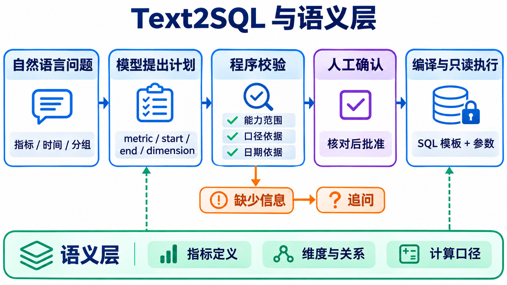
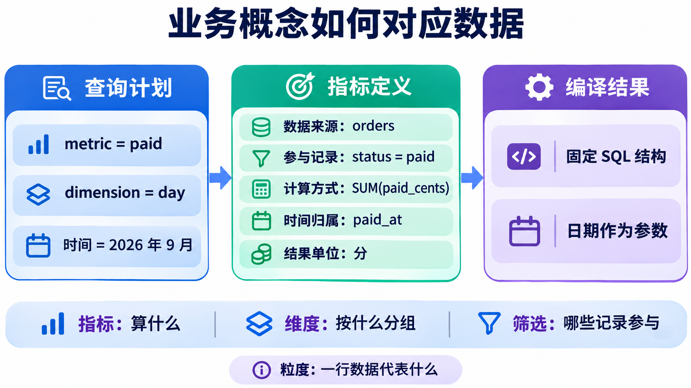
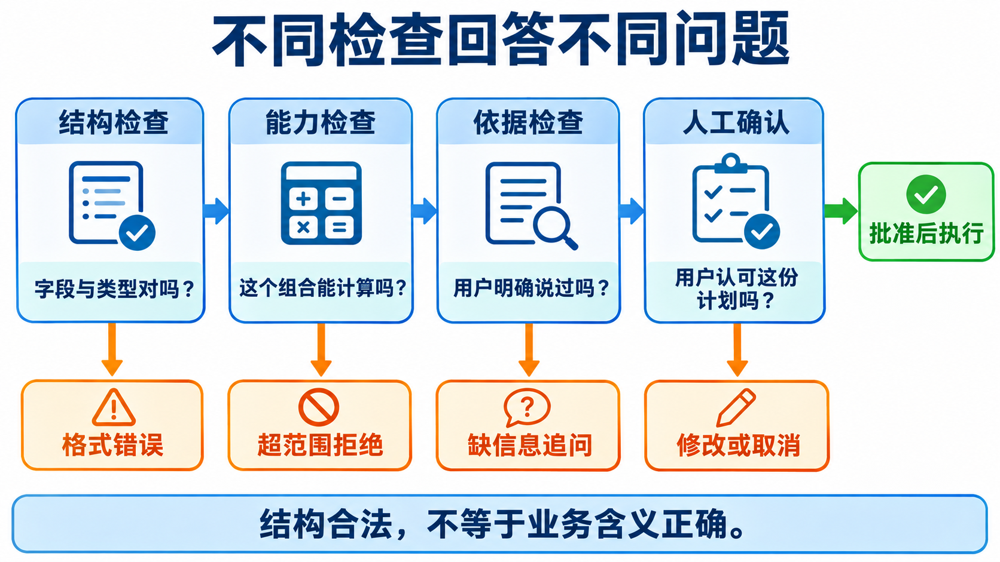

本节总览图：问题先转成计划，经校验和确认后编译执行。语义层提供计算口径，缺少信息时进入追问。

## 课程目标

学完这一节，你应该能说清：

- Text2SQL 在转换什么，为什么知道表结构仍然可能查错。
- 指标、维度、筛选和数据粒度的区别。
- 模型直接写 SQL 与语义层编译 SQL 的基本区别。
- 查询计划如何对应业务定义，再生成 SQL 模板和参数。
- 结构检查、能力检查、依据检查分别负责什么。
- Agent 框架在目录调用、流程编排与人工确认中的作用。

基础课 **34**。前置知识：01「什么是 AI Agent」、02「模型与消息」、07「结构化输出」。Demo 使用 Java 17。

---

## 1. 什么是 Text2SQL

Text2SQL 是将自然语言问题转换为 SQL 查询的技术。问数应用通常还会执行查询，并把结果展示给用户。

例如：

```
2026 年 9 月，按天统计支付成功订单的实付金额。
```

在约定按支付时间归属的业务中，可以对应：

```sql
SELECT DATE(paid_at) AS day, SUM(paid_cents) AS value
FROM orders
WHERE status = 'paid'
  AND paid_at >= '2026-09-01'
  AND paid_at < '2026-10-01'
GROUP BY DATE(paid_at)
ORDER BY day;
```

查询需要明确支付状态、金额、时间和分组。

“九月销售额”还缺年份和明确口径。SQL 能执行，不代表这些业务选择正确。

Text2SQL 涉及**语言理解、业务含义与数据库查询**。

---

## 2. 指标、维度、筛选与粒度

问数问题可以先拆成四个概念：

| 概念 | 回答的问题 | 示例 |
| --- | --- | --- |
| 指标 | 算什么？ | 支付成功订单实付金额 |
| 维度 | 按什么分组？ | 按天、按月、按品类 |
| 筛选 | 哪些记录参与？ | 九月、品类为键盘 |
| 粒度 | 一行代表什么？ | 一笔订单、一条商品明细、一次退款 |

“按品类”决定分组，“只看键盘”限定参与记录，两者可以同时出现。

一单有多条明细时，关联后订单实付会重复出现，直接求和可能算大。

指标定义需要说明计算字段、参与记录、时间归属和计算粒度。

---

## 3. 两种常见实现路线

### 路线一：模型直接生成 SQL

```
用户问题 + 表结构 + 业务说明
  → 模型生成 SQL
  → 检查 SQL
  → 执行并展示
```

这条路线组合灵活，但可能写错关联、漏条件或重复聚合。执行成功后仍需核对业务含义。

### 路线二：模型生成计划，程序编译 SQL

```
用户问题 + 业务目录
  → 模型提出候选计划
  → 检查计划并等待确认
  → 程序编译 SQL
  → 执行并展示
```

模型输出指标、日期和维度，程序按已支持的定义生成 SQL。

本项目以第二条为主路线，模型写 SQL 作为对照。两者都需要独立答案验证。

---

## 4. 语义层与查询计划



语义映射图：paid 对应指标定义，编译器读取定义生成结构，日期作为参数。

**语义层**描述业务概念与数据的映射，包括指标、维度、模型、关系和口径。

**查询计划**表达本次选中的定义与条件：

```json
{
  "metric": "paid",
  "dimension": "day",
  "start": "2026-09-01",
  "end": "2026-10-01"
}
```

paid 是指标标识，对应这组程序定义：

```
来源：orders
条件：status='paid'
计算：SUM(paid_cents)
时间：paid_at
单位：分
```

日期采用 `[start, end)`：包含 9 月 1 日，不含 10 月 1 日，完整覆盖九月。

注册表集中保存定义，编译器实现受支持的组合。新增指标仍要核对分组、关联及测试，不能只添加名称。

---

## 5. 可运行 Demo：把计划编译成 SQL

Demo 从固定计划开始，输出 SQL 与参数；模型接入在后续 Spring AI 基础课展开。

前提：Java 17，或已安装 Docker。无需模型 Key，也无需启动数据库。

源码：[SemanticLayerDemo.java](https://codeup.aliyun.com/6a4a062c08f52788b13355e9/xiaozhe-E-commerce/blob/main/text2sql-course/courses/basic/demos/34-semantic-layer/SemanticLayerDemo.java)，只支持 paid 按天统计：

```java
import java.time.LocalDate;
import java.util.List;
import java.util.Map;

public class SemanticLayerDemo {
    record Plan(String metric, String dimension, LocalDate start, LocalDate end) {}
    record Metric(String source, String value, String timeColumn, String condition) {}
    record Sql(String text, List<LocalDate> params) {}

    static final Map<String, Metric> METRICS = Map.of(
        "paid", new Metric("orders", "SUM(paid_cents)", "paid_at", "status='paid'")
    );

    static Sql compile(Plan plan) {
        Metric metric = METRICS.get(plan.metric());
        if (metric == null) throw new IllegalArgumentException("unsupported metric");
        if (!plan.dimension().equals("day")) {
            throw new IllegalArgumentException("only day dimension is supported");
        }
        if (!plan.start().isBefore(plan.end())) {
            throw new IllegalArgumentException("start must be before end");
        }
        String group = "DATE(" + metric.timeColumn() + ")";
        String sql = "SELECT " + group + " AS day, " + metric.value()
            + " AS value FROM " + metric.source()
            + " WHERE " + metric.condition()
            + " AND " + metric.timeColumn() + ">=?"
            + " AND " + metric.timeColumn() + "<?"
            + " GROUP BY " + group + " ORDER BY day";
        return new Sql(sql, List.of(plan.start(), plan.end()));
    }

    public static void main(String[] args) {
        if (args.length != 0 && args.length != 4) {
            throw new IllegalArgumentException("usage: metric dimension start end");
        }
        Plan plan = args.length == 0
            ? new Plan("paid", "day", LocalDate.parse("2026-09-01"), LocalDate.parse("2026-10-01"))
            : new Plan(args[0], args[1], LocalDate.parse(args[2]), LocalDate.parse(args[3]));
        Sql sql = compile(plan);
        System.out.println(sql.text());
        System.out.println(sql.params());
    }
}
```

在源码所在目录运行：

```shell
java SemanticLayerDemo.java
```

只有 Docker 的环境可以执行：

```shell
docker run --rm -v "${PWD}:/demo:ro" -w /demo \
  maven:3.9.6-eclipse-temurin-17 java SemanticLayerDemo.java
```

应得到：

```
SELECT DATE(paid_at) AS day, SUM(paid_cents) AS value FROM orders WHERE status='paid' AND paid_at>=? AND paid_at<? GROUP BY DATE(paid_at) ORDER BY day
[2026-09-01, 2026-10-01]
```

观察点：

- Plan 表达本次查询条件，Metric 保存可复用的指标定义。
- 表名、字段和表达式来自程序定义，日期没有拼进 SQL 文本。
- Sql 同时携带模板与参数，实际执行时还需要通过 PreparedStatement 绑定参数。
- 这里只打印编译结果；打印成功不表示数据库已经查到了数据。

再把时间改成十月：

```shell
java SemanticLayerDemo.java paid day 2026-10-01 2026-11-01
```

SQL 文本应保持不变，参数改成十月区间。然后试一个本 Demo 未支持的分组：

```shell
java SemanticLayerDemo.java paid category 2026-09-01 2026-10-01
```

应得到 `only day dimension is supported`，由程序拒绝。Docker 环境把参数追加到文件名之后即可。

---

## 6. 不同检查分别负责什么



检查分层图：结构、能力、依据和批准分别由不同步骤检查。

| 检查 | 典型问题 | 处理方式 |
| --- | --- | --- |
| 结构检查 | 日期字段缺失、输出无法转换 | 返回格式错误或要求重新生成 |
| 能力检查 | 指标与维度组合未实现 | 拒绝超范围计划 |
| 依据检查 | “销售额”被擅自选成支付金额 | 追问明确口径 |
| 人工确认 | 用户发现日期或分组不对 | 修改、取消或批准 |

引用存在不等于含义充分：“库存余额”不是日期，“2026年9月”不能支持十月计划。

完整项目中，ReactAgent 读目录并提出计划，Graph 组织校验、反馈和执行。框架管流程，业务定义管计算，用户确认本次选择。

---

## 7. 常见错误

### 错误一：把别名当作歧义的解决办法

同义词可以映射指标；“销售额”存在两种口径时仍需追问，别名不能代替用户选择。

### 错误二：JSON 合法就直接执行

paid 和 category 是合法字符串，但这个组合是否受支持，需要单独检查。

### 错误三：使用 DISTINCT 修复所有重复聚合

`SUM(DISTINCT paid_cents)` 按金额值去重，会错误合并金额相同的不同订单。应先分析粒度。

### 错误四：用“执行成功”作为唯一验收标准

漏状态条件也能返回结果。应核对完整计划与独立参考 SQL 的答案。

---

## 8. 本节知识框架总结

```
Text2SQL 与语义层
  → 自然语言映射到业务含义和查询
  → 指标：算什么；维度：按什么分组
  → 筛选：哪些记录参与；粒度：一行代表什么
  → 直接生成 SQL / 先生成计划再编译
  → 语义定义提供口径，计划提供本次条件
  → SQL 模板与用户参数分开
  → 结构、能力、依据与人工确认各有职责
```

## 9. 本节小结

你需要记住：

1. Text2SQL 同时涉及语言理解、业务口径和 SQL 查询。
2. 语义层集中表达业务概念与数据的映射，查询计划表达本次选择。
3. 模型提出计划，程序按支持的定义编译，用户核对后批准。
4. 参数化 SQL 解决值的绑定，业务检查解决口径与能力，两者都需要。
5. Agent 框架帮助组织流程，指标计算规则仍需明确定义。

课后练习：

1. 运行默认 Demo，把指标、维度和日期对应到生成的 SQL。
2. 改成十月，比较 SQL 文本与参数分别有哪些变化。
3. 输入 category 分组，定位阻止它执行的代码。
4. 解释“查询库存余额”为什么需要补日期；本 Demo 没有完成哪一层检查？

下一节基础课 35 进一步讲解指标口径与统计粒度。
