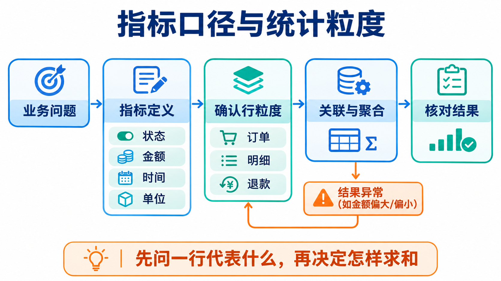
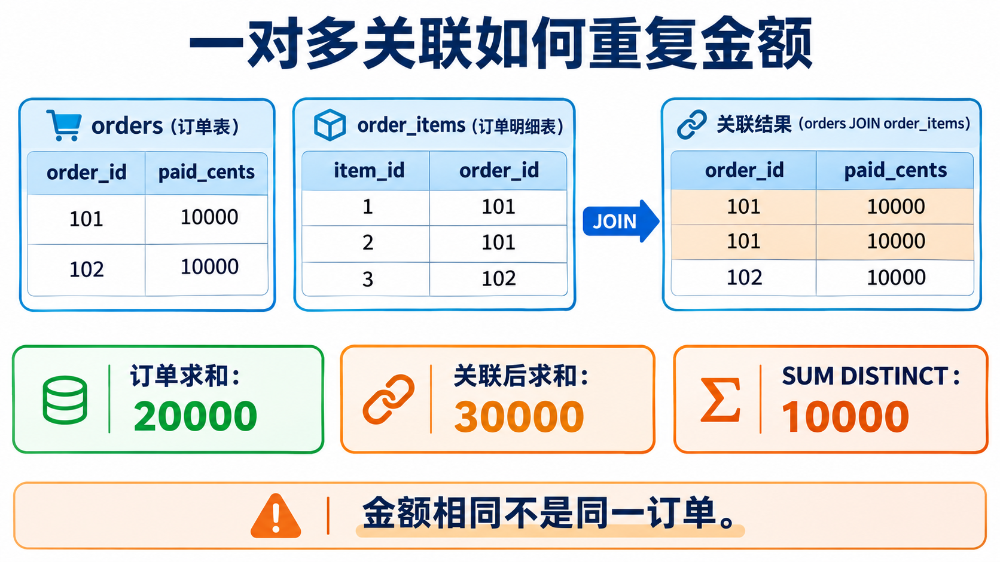
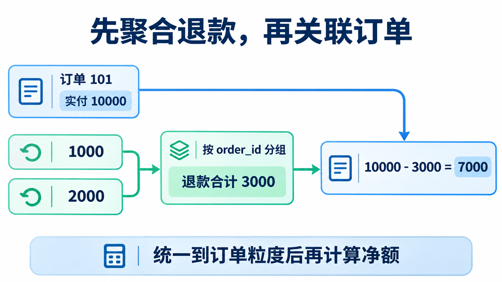

本节总览图：先定义指标口径，确认每张表一行代表什么，再选择关联与聚合顺序，最后用独立结果核对。

## 课程目标

学完这一节，你应该能说清：

- 指标口径包含哪些条件，为什么只给字段名不够。
- 订单、商品明细、退款记录的粒度有什么不同。
- 一对多关联为什么会使订单金额重复出现。
- SUM(DISTINCT 金额)为什么不能代替订单去重。
- 为什么退款应先按订单聚合，再参与净额计算。
- 如何用少量可手算数据验证一条统计 SQL。

基础课 **35**。前置知识：34「Text2SQL 与语义层」，以及 SELECT、JOIN、GROUP BY 的基本用法。对应故事课第 02、08 课。

---

## 1. 指标口径是一组计算约定

“支付金额”可以表达成一组明确约定：只统计支付成功订单，汇总订单实付金额，以支付时间确定归属月份，单位使用分。

| 口径项 | 本课程支付金额约定 | 不能混用的概念 |
| --- | --- | --- |
| 参与记录 | 支付成功订单 | 全部已创建订单 |
| 金额 | 优惠后的实付金额 | 原价、商品标价 |
| 时间 | paid_at | created_at |
| 单位 | 分 | 页面未经说明换成元 |
| 统计对象 | 一笔订单算一次 | 每条商品明细都算整单金额 |

两条 SQL 都叫“九月支付金额”，若一条按创建时间筛选，一条按支付时间筛选，就不一定得到相同结果。评测时先对齐口径，再比较代码。

正常提问可以写成“2026年9月支付成功订单实付金额按天统计”。业务定义已经规定了时间归属；用户提供具体月份和分组即可。

---

## 2. 粒度回答一行代表什么

粒度是数据记录的单位。读一张表时，先说清它的主键代表什么。

```
orders：一行是一笔订单
order_items：一行是一条订单商品明细
refunds：一行是一次退款记录
```

同一订单可能有两条明细，也可能发生两次退款。因此，order_id 在 orders 中唯一，在另外两张表中可以重复。

关联后的粒度由匹配关系决定。订单101匹配两条明细，结果会有两行；如果它又匹配两条退款，未经预聚合就同时关联，可能产生四行。

SQL 没有凭空改变订单的钱，它只是按照关联规则展开了记录。错误通常发生在展开以后仍把订单级金额当成每行都能累加的值。

---

## 3. 一对多关联如何重复金额



关联展开图：两笔订单金额均为10000分，第一笔有两条明细。订单表合计20000分，关联后直接求和30000分，按金额值去重却只剩10000分。

以订单101和102为例：

```
原订单：101 → 10000，102 → 10000
关联明细后：101 → 10000，101 → 10000，102 → 10000
```

如果目标是订单支付金额，正确汇总应在订单粒度完成。仅为了查看订单中有哪些商品，就关联全部明细并求和，会把订单101算两遍。

如果只想筛选“包含某类商品的订单”，可以考虑 EXISTS 或先得到去重订单ID，再回订单表求和；如果目标是按品类分配金额，则需要明确定义分摊规则。两类问题不能用同一个随意 JOIN 代替。

本课集中验证订单粒度与退款粒度的转换，品类分摊使用项目已经提供的业务定义。

---

## 4. DISTINCT 去掉的是值，不是业务对象

```sql
SUM(DISTINCT paid_cents)
```

这条表达式先去除重复金额值，再求和。它不知道订单101和102是两个独立对象。

两个订单恰好都付10000分时，正确合计20000分，而上式只得到10000分。因此它既不能正确修复一对多关联，也会错误合并本来应该分别统计的订单。

`COUNT(DISTINCT order_id)` 可以用于明确要求去重的订单计数，但不能因此推导出所有 SUM 也应加 DISTINCT。每个聚合函数去重的对象，需要与业务指标一致。

排查时不要先猜应该加哪个关键字。先打印关联后的主键和金额，数一数一个订单出现几次，再决定要在哪一层聚合。

---

## 5. 可运行 Demo：三种汇总与退款修复

本例使用 MySQL 8 的 CTE 构造少量数据，不创建或修改业务表。两笔订单金额相同，是为了让错误的 DISTINCT 无法碰巧通过。

完整文件：[grain.sql](https://codeup.aliyun.com/6a4a062c08f52788b13355e9/xiaozhe-E-commerce/blob/main/text2sql-course/courses/basic/demos/35-grain/grain.sql)。在课程代码包根目录启动数据库后运行：

```shell
docker compose up -d --wait db
docker compose exec -T db mysql --default-character-set=utf8mb4 \
  -ucourse_reader -pdemo-readonly-local text2sql_course \
  < courses/basic/demos/35-grain/grain.sql
```

文件内容如下：

```sql
-- 两笔金额相同的订单、三条明细，全部是只读CTE。
WITH orders AS (
 SELECT 101 id, 10000 paid_cents UNION ALL SELECT 102, 10000
), items AS (
 SELECT 1 id, 101 order_id UNION ALL SELECT 2,101 UNION ALL SELECT 3,102
)
SELECT (SELECT SUM(paid_cents) FROM orders) AS correct_total,
       SUM(o.paid_cents) AS duplicated_total,
       SUM(DISTINCT o.paid_cents) AS wrong_distinct
FROM orders o JOIN items i ON i.order_id=o.id;

-- 一笔订单两次退款：先观察错误的关联后计算。
WITH orders AS (SELECT 101 id, 10000 paid_cents),
refunds AS (SELECT 101 order_id, 1000 cents UNION ALL SELECT 101,2000)
SELECT SUM(o.paid_cents-r.cents) AS wrong_net
FROM orders o JOIN refunds r ON r.order_id=o.id;

-- 再把退款统一到订单粒度。
WITH orders AS (SELECT 101 id, 10000 paid_cents),
refunds AS (SELECT 101 order_id, 1000 cents UNION ALL SELECT 101,2000),
refund_by_order AS (SELECT order_id,SUM(cents) cents FROM refunds GROUP BY order_id)
SELECT SUM(o.paid_cents-COALESCE(r.cents,0)) AS correct_net
FROM orders o LEFT JOIN refund_by_order r ON r.order_id=o.id;
```

观察结果：

| 查询 | 预期结果（分） | 解释 |
| --- | --- | --- |
| correct_total | 20000 | 两笔订单分别累加 |
| duplicated_total | 30000 | 订单101出现两次 |
| wrong_distinct | 10000 | 两笔相同金额被合并 |
| wrong_net | 17000 | 实付被重复带入两次 |
| correct_net | 7000 | 10000减去1000与2000 |

按顺序运行，先解释错误数值如何形成，再看修复后的数值。只看最后一行7000，会错过这组数据为什么能检验关联逻辑。

---

## 6. 退款先聚合到订单粒度



退款聚合图：两笔退款先合并为订单101的一行3000分，再与订单实付10000分相减，得到7000分。

退款表不能直接当作订单表的同粒度附表。正确做法是先按 order_id 聚合已完成退款，再将结果关联回订单。

```sql
SELECT order_id, SUM(cents) AS refund_cents
FROM refunds
GROUP BY order_id;
```

实际课程数据还需要限定退款状态为已完成。上面的 Demo 用两行已经确认参与计算的退款，只突出聚合关系。

使用 LEFT JOIN 是为了保留没有退款的订单。没有匹配退款时为 NULL，`COALESCE(..., 0)` 将它作为零退款处理；否则减法可能产生 NULL，导致该订单不按预期参与汇总。

本课程净额口径为“该批支付订单实付，减这些订单全部已完成退款，包含跨月退款”。订单时间筛选用于确定是哪一批订单，不能再随意给退款加同月限制。

若业务需要“退款发生月净额”，那是另一项口径，应单独定义。语义层要明确选择，不能仅凭同一个净额名称混用。

---

## 7. 常见错误

### 错误一：只检查 SQL 能否执行

数据库会执行合法的关联与求和，即使结果在业务上重复计算。需要用可手算的例子核对行与值。

### 错误二：两个一对多表同时直接关联

两条明细乘两条退款可能得到四行。各自先聚合到目标粒度，再考虑如何关联。

### 错误三：在 WHERE 中误删无退款订单

LEFT JOIN 后把右表条件放进 WHERE，可能过滤掉右表为空的订单。应先在退款聚合子查询中限定退款状态，再关联。

### 错误四：把没有数据和金额为零混为一谈

空分组结果与合计零有不同含义。测试中应分别保存，不要把两种情况都当作“没有执行成功”。

---

## 8. 本节知识框架总结

```
口径与粒度
  → 定义状态、金额、时间与单位
  → 主键说明一行代表的对象
  → 一对多关联会展开行
  → SUM DISTINCT 按金额值去重
  → 退款先按订单汇总，再关联
  → LEFT JOIN 保留无退款订单
  → 用有区分度的小数据验证
```

## 9. 本节小结

你需要记住：

1. 指标名称不够，计算约定也必须明确。
2. 聚合前确认当前一行的粒度是否发生变化。
3. 去重对象应是业务对象，而不是碰巧相同的金额。
4. 聚合与关联的顺序会改变结果，不能只看最终 SQL 是否报错。
5. 先用小样本手算，再用课程全量数据核对。

课后练习：

1. 给订单101增加一条明细，预测三种汇总值，再运行确认。
2. 将订单102金额改为12000，解释 DISTINCT 为什么会暂时看起来正确。
3. 给退款示例增加一笔500分退款，核对净额变为6500分。
4. 在退款示例增加一笔无退款订单，解释为什么应保留 LEFT JOIN。
