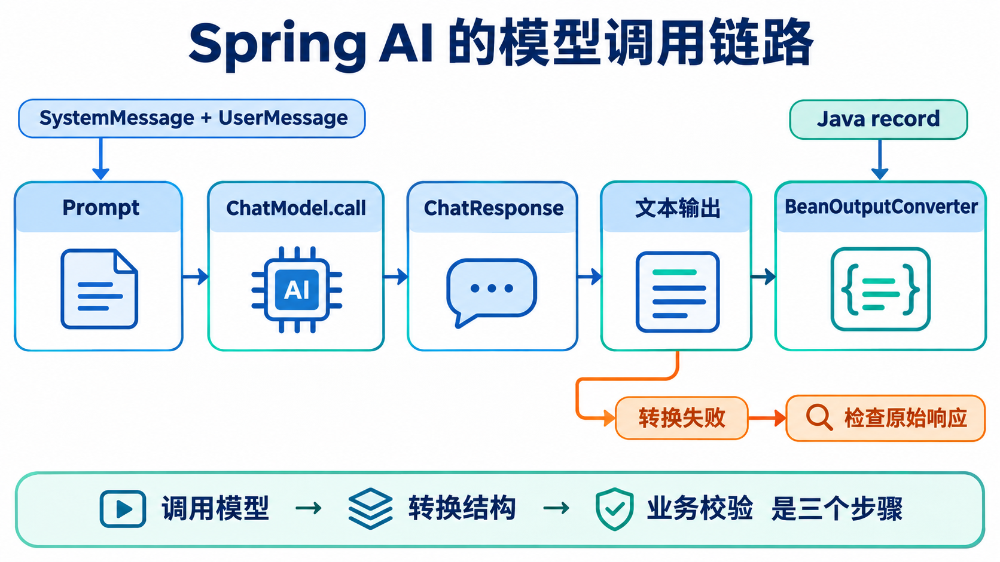
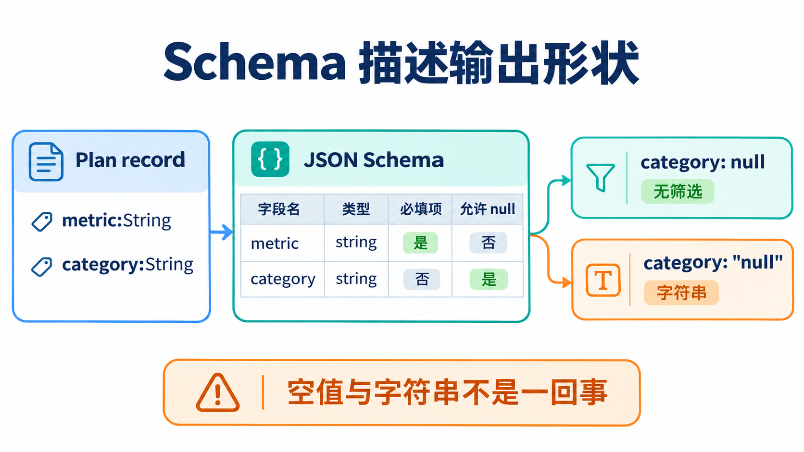
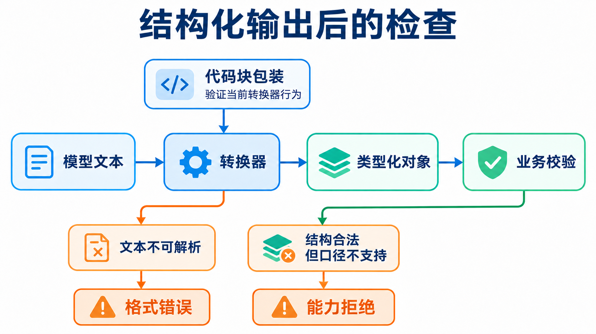

本节总览图：Prompt 组织消息，ChatModel 返回 ChatResponse，程序取出文本，再由 BeanOutputConverter 转成 Java 对象并进行业务检查。

## 课程目标

学完这一节，你应该能说清：

- Spring AI 的 ChatModel、Prompt 和 ChatResponse 各自负责什么。
- SystemMessage 与 UserMessage 为什么需要区分。
- BeanOutputConverter 如何提供格式说明并转换响应。
- JSON null 与字符串 "null" 的业务区别。
- 结构化转换成功后，还需要检查哪些业务条件。
- 如何保存真实响应，而不是只保留转换后的对象。

基础课 **36**。复用原基础课02「模型与消息」、07「结构化输出」；对应故事课第03、06课。示例固定 Java17、Spring AI1.1.2，与项目依赖一致。

---

## 1. 从 Python 模型调用转到 Java

原基础课已经介绍模型、消息和结构化输出。换成 Java 后，概念保持一致，主要变化是接口和对象类型。

| 原来熟悉的概念 | Spring AI 中的对应 | 本节作用 |
| --- | --- | --- |
| 模型客户端 | ChatModel | 发起模型调用 |
| 系统消息、用户消息 | SystemMessage、UserMessage | 区分规则与输入 |
| 请求内容 | Prompt | 组织消息与本次选项 |
| 模型响应 | ChatResponse | 保存生成内容及元数据 |
| 结构化对象 | Java record + 转换器 | 供程序读取字段 |

ChatModel 是接口，不等于某一个供应商。OpenAiChatModel 是一个实现，可以连接兼容相应协议的服务。本项目使用硅基流动的 DeepSeek-V4.1-Flash；模型是否可调用由账号权限和服务可用性决定。

温度设置为0有助于减少采样变化，但不保证每次输出完全相同。课堂验证仍需重复调用并检查业务字段。

---

## 2. Prompt 与消息角色

系统消息描述任务规则，用户消息承载本次问题。把两者分别组织，便于检查哪些约定来自程序、哪些信息来自用户。

```java
var prompt = new Prompt(List.of(
    new SystemMessage("将明确的支付金额问题转换成计划"),
    new UserMessage("2026年9月支付成功订单实付金额按天统计")
));
```

这里的规则没有实际查询数据库，也没有授权执行。它只是告诉模型本次应该输出什么。用户给定月份后，模型还需要按规则生成规范日期。

尽量让业务含义和格式约束都能被直接读懂。例如“end为不包含的结束日期”比“日期正常化”具体；“没有品类筛选时category为JSON null”比“不要乱填”更明确。

提示词负责传达要求，后续程序检查负责判断要求有没有被满足，两者不能互相替代。

---

## 3. BeanOutputConverter 做哪两件事



Schema 图：Java字段会形成模型可读的结构说明；缺少品类筛选时，空值表示没有条件，字符串 "null" 则仍是一个字符串。

先定义输出对象：

```java
public record Plan(String metric, String start, String end,
                   String dimension, String category) {}
```

再构造转换器：

```java
var converter = new BeanOutputConverter<>(Plan.class);
String format = converter.getFormat();
Plan plan = converter.convert(responseText);
```

`getFormat()` 给出输出格式说明；`convert()` 把收到的文本转成目标对象。这两个动作分别发生在调用前和响应后。

本 Demo 使用格式提示和转换器，不把它等同于服务商原生的严格 JSON Schema 模式。服务商约束、框架转换和业务检查是不同层次。

另外，Java 的 String 类型本身没有表达完整业务契约。字段可为空、字段可以省略、字段必须满足某个枚举，是不同要求。项目后续使用显式 decision-schema.json 描述更完整结构，再由 PlanContract 检查能力组合。

---

## 4. 可运行 Demo：抽取查询计划

源码位于 [demos/java](https://codeup.aliyun.com/6a4a062c08f52788b13355e9/xiaozhe-E-commerce/blob/main/text2sql-course/courses/basic/demos/java/README.md)，所有Java基础示例共用一份锁定版本的pom。先配置 `SILICONFLOW_API_KEY`，Key只放环境变量，不写进源码。

模型创建方法使用项目相同的配置：

模型工厂见 [DemoModels.java](https://codeup.aliyun.com/6a4a062c08f52788b13355e9/xiaozhe-E-commerce/blob/main/text2sql-course/courses/basic/demos/java/src/main/java/basic/DemoModels.java)。它创建OpenAiChatModel，设置模型名、temperature=0、maxTokens=1800，并关闭由模型客户端自动执行工具。第37课由ReactAgent管理工具调用。模型配置集中在这一处，避免每个Demo各写一份。

请求和转换代码如下，完整文件为 [StructuredDemo.java](https://codeup.aliyun.com/6a4a062c08f52788b13355e9/xiaozhe-E-commerce/blob/main/text2sql-course/courses/basic/demos/java/src/main/java/basic/StructuredDemo.java)：

```java
package basic;
import java.util.List;
import org.springframework.ai.chat.model.ChatModel;
import org.springframework.ai.chat.messages.*;
import org.springframework.ai.chat.prompt.Prompt;
import org.springframework.ai.converter.BeanOutputConverter;
public class StructuredDemo {
    public record Plan(String metric, String start, String end, String dimension, String category) {}
    public static Plan run(ChatModel model, String question) {
        var converter = new BeanOutputConverter<>(Plan.class);
        String rule = "把明确的支付成功订单实付金额问题转为计划。metric=paid，dimension=day，"
            + "日期为ISO格式，end不包含。没有品类筛选时category为JSON null，不是字符串null。只返回JSON。";
        var prompt = new Prompt(List.of(new SystemMessage(rule + "\n" + converter.getFormat()),
            new UserMessage(question)));
        String text = model.call(prompt).getResult().getOutput().getText();
        System.out.println("raw=" + text);
        return converter.convert(text);
    }
    public static void main(String[] args) {
        String question = args.length == 0 ? "2026年9月支付成功订单实付金额按天统计" : args[0];
        System.out.println(run(DemoModels.create(), question));
    }
}
```

在 demos/java 目录编译并运行：

```shell
mvn -q package dependency:build-classpath -Dmdep.outputFile=classpath.txt
java -cp "target/classes:$(cat classpath.txt)" basic.StructuredDemo
```

推荐使用配套 run.sh，它在 Docker 内执行上述操作并转入相应Java入口：

```shell
./run.sh basic.StructuredDemo
```

预期字段为 paid、day、2026-09-01、2026-10-01、category=null。raw行保存模型原文；Plan行显示转换后的Java对象。字段顺序或JSON缩进不作为成功条件。

再运行十月问题：

```shell
./run.sh basic.StructuredDemo '2026年10月支付成功订单实付金额按天统计'
```

观察日期是否整体变成十月，结束上界是否为2026-11-01。不要只检查metric仍是paid，就忽略日期错误。

---

## 5. 空值、代码块与原始响应

JSON null 是缺少筛选条件的表达：

```json
{"category": null}
```

下面则表示category字段的值是一串字符：

```json
{"category": "null"}
```

若直接将后者当作品类过滤值，查询会寻找名字为null的品类。转换成String并不会自动纠正它。

另一个常见变化是模型把JSON放在Markdown代码块里。当前锁定版本的转换器对常见代码块有处理能力，但应通过固定文本验证实际行为，不能依据视觉外观猜测。

本课配套的 ConversionDemo 使用固定响应，检查正常null、字符串null与代码块，不发送模型请求。它与真实模型示例分别记录，便于解释一次失败究竟发生在生成阶段还是转换阶段。

```shell
./run.sh basic.ConversionDemo
```

保存原始响应后，排错可以还原现场。只保存Plan对象，会失去外层包装、字段遗漏和原始措辞等线索。

---

## 6. 转换成功以后仍要校验



检查图：不能解析的响应停在格式错误；已经转换成对象但超出产品能力的计划，需要在业务检查中拒绝。

比如metric填成不存在的标识，仍可能成功转成String；start晚于end，也可能成功转成两个字符串。BeanOutputConverter不会自动知道课程支持哪些指标或日期范围。

完整项目继续检查指标维度组合、日期区间、目录名称，以及口径和日期的原话依据。本节Demo先展示生成与转换这一段，便于独立观察。

异常处理也要分层：响应不可转换时保留原文；服务调用失败时保留请求失败原因；程序自身的缺陷不能全部包装成“模型没答好”。

---

## 7. 常见错误

### 错误一：把temperature=0当作确定性保证

相同问题仍可能因服务实现、模型版本和输出过程产生差异。录制前需要重复验证，课堂错误复现使用固定样例。

### 错误二：只在提示词中说“输出JSON”

模型不知道字段名、类型、空值与日期边界。应提供格式说明和具体业务定义。

### 错误三：转换器接住了就自动执行

转换成功只是拿到了对象。执行前仍要做能力、依据与确认检查。

### 错误四：把所有响应清洗成看似正确

不要无条件删除字符、补日期或改指标。可处理约定的包装格式，但无法确认的内容应返回明确失败或追问。

---

## 8. 本节知识框架总结

```
Spring AI
  → ChatModel提供调用接口
  → Prompt组织不同角色的消息
  → ChatResponse包含内容与元数据
  → getFormat提供格式说明
  → convert转换成Java对象
  → null与字符串null有不同含义
  → 结构转换之后继续做业务校验
```

## 9. 本节小结

你需要记住：

1. 先分清请求、响应、原文和结构化对象的位置。
2. 模型配置与业务提示分别维护，Key只通过环境传入。
3. 格式说明有助于输出稳定，仍需处理转换失败。
4. Schema描述结构，业务检查决定计划是否可用。
5. 真实调用与固定响应各自解决不同验证问题。

课后练习：

1. 分别运行九月、十月的明确问题，核对五个字段。
2. 运行ConversionDemo，解释字符串null为什么不会自动成为空值。
3. 打印getFormat内容，找出Plan字段的对应位置。
4. 列出转换成功但应该被业务检查拒绝的两种计划，不要求真实模型故意生成错误。
