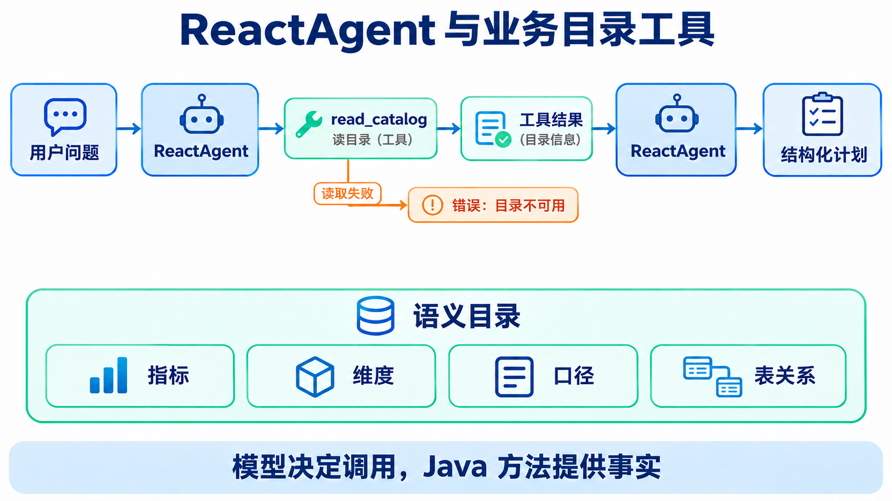
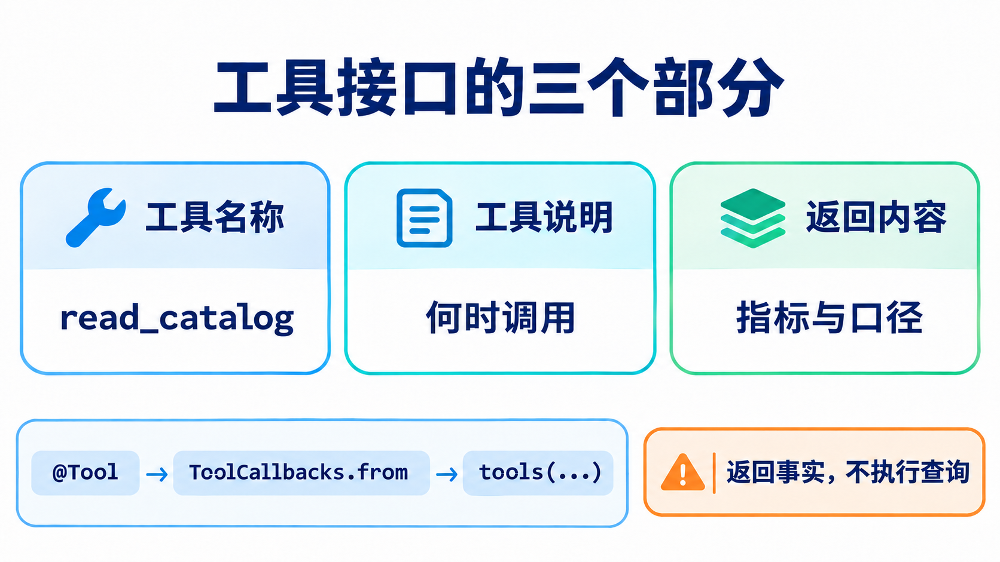
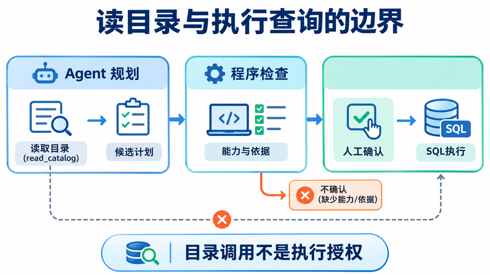

本节总览图：Agent根据任务调用目录工具，工具返回业务定义，模型再形成结构化计划。工具调用发生在规划阶段，查询执行另有确认边界。

## 课程目标

学完这一节，你应该能说清：

- ReactAgent在模型与工具之间做什么。
- @Tool、ToolCallbacks.from和tools(...)分别负责哪一步。
- 工具说明、参数、返回内容为什么属于接口契约。
- 如何确认read_catalog真的被调用。
- 全量读取小目录与检索大量表结构有什么区别。
- 为什么读过目录仍然需要程序校验和人工确认。

基础课 **37**。复用原基础课09「Tool Calling基础」、10「工具参数、返回值与错误处理」，并先学习新增36。对应故事课第04、05课。

---

## 1. ReactAgent 的职责

普通ChatModel调用收到消息后返回响应。需要工具时，模型会提出工具调用请求；Java程序执行工具，把结果交回模型，再继续生成。

ReactAgent组织这个循环：

```
问题与行为说明
  → 模型选择工具
  → 框架执行对应Java方法
  → 工具结果成为新的上下文
  → 模型继续回答或提出计划
```

工具不是一段写在提示词里的描述。模型看到工具定义之后，框架必须能找到并调用真实方法，方法结果也必须返回到这次交互中。

本项目使用ReactAgent读取业务目录。目录很小，一次返回指标、维度与口径说明，帮助模型将自然语言对齐到项目已有能力。

模型读取目录后的输出仍是候选计划。目录回答“有哪些定义”，不负责替用户决定含糊口径，也不代表已经批准访问数据库。

---

## 2. 工具定义包含哪些信息



工具契约图：名称让模型引用工具，说明告诉模型何时使用，返回内容提供明确业务事实。注解定义方法，再通过ToolCallbacks注册到Agent。

```java
@Tool(name = "read_catalog",
      description = "Read the supported metric before planning")
public String readCatalog() {
    return "paid=支付成功订单实付金额；按支付时间归属；单位分";
}
```

名称应稳定且表达用途。description帮助模型判断何时需要工具；返回值则是工具执行之后提供的事实，两者不能混成同一段宣传式说明。

无参数工具适用于固定的小目录。以后若目录很大，可以设计检索输入，但需要真实实现检索、评测召回，并说明漏掉定义时怎么办，不能仅把方法改名为search就算完成。

工具返回JSON还是文本，要看消费者需要什么。基础Demo用一段短文本突出调用机制；项目的Catalog返回结构化目录，方便统一维护多项定义。

---

## 3. 从 Java 方法到 Agent 工具

定义方法后，还要把实例转换成框架能使用的工具回调：

```java
.tools(ToolCallbacks.from(new Catalog()))
```

只写@Tool但不注册，Agent并不会自动获得这个对象。相反，把方法注册后也不意味着每次都一定调用；是否发生调用仍应观察实际执行记录。

ReactAgent.builder中的几个字段分别承担不同职责：

| 配置 | 含义 | 本课选择 |
| --- | --- | --- |
| name | Agent标识 | catalog_planner |
| model | 使用哪个模型客户端 | 与第36课共用 |
| instruction | 任务与行为约定 | 先读目录，再生成计划 |
| tools | 可调用的Java动作 | read_catalog |
| 输出约束 | 期望的结果结构 | Plan格式说明与转换器 |

目录工具不是模型本身。模型请求调用时，代码会进入readCatalog；返回值会被框架包装成工具结果，再交给模型。

项目的模型配置把内部工具执行关闭，由Agent框架组织工具循环。阅读配置时应知道哪个层负责调用，避免把两个层的工具机制混在一起解释。

---

## 4. 可运行 Demo：读取目录再生成计划

使用 [demos/java](https://codeup.aliyun.com/6a4a062c08f52788b13355e9/xiaozhe-E-commerce/blob/main/text2sql-course/courses/basic/demos/java/README.md) 的共享环境，Java17、Spring AI1.1.2、Spring AI Alibaba1.1.2.2。模型创建沿用第36课的DemoModels，Key通过环境变量传入。

核心代码如下；包名与import见完整文件 [ToolDemo.java](https://codeup.aliyun.com/6a4a062c08f52788b13355e9/xiaozhe-E-commerce/blob/main/text2sql-course/courses/basic/demos/java/src/main/java/basic/ToolDemo.java)：

```java
public class ToolDemo {
    public static class Catalog {
        @Tool(name="read_catalog", description="Read the supported metric and its business meaning before planning")
        public String readCatalog() {
            System.out.println("TOOL read_catalog called");
            return "paid=支付成功订单实付金额，按支付日期归属；支持按天；单位分；仅提出计划。";
        }
    }
    public static StructuredDemo.Plan run(ChatModel model, String question) throws Exception {
        var converter = new BeanOutputConverter<>(StructuredDemo.Plan.class);
        var agent = ReactAgent.builder().name("catalog_planner").model(model)
            .instruction("必须先调用read_catalog。只按目录生成计划。end为排他日期，日期用ISO格式；"
                + "无品类筛选时category为JSON null。最终仅返回符合Schema的JSON对象，不要解释文字或Markdown。")
            .outputSchema(converter.getJsonSchema())
            .tools(ToolCallbacks.from(new Catalog())).build();
        String text = agent.call(question).getText();
        System.out.println("raw=" + text);
        return converter.convert(text);
    }
    public static void main(String[] args) throws Exception {
        String question = args.length == 0 ? "2026年9月支付成功订单实付金额按天统计" : args[0];
        System.out.println(run(DemoModels.create(), question));
    }
}
```

instruction只放业务指令，结构定义通过outputSchema传入。当前框架会解析instruction模板，直接拼入带花括号的JSON Schema可能触发模板错误。BeanOutputConverter在这里提供Schema并转换最终文本。

运行：

```shell
./run.sh basic.ToolDemo
```

输出中应先看到：

```
TOOL read_catalog called
```

随后看到模型原始文本与转换后的Plan。默认问题应得到paid、day、九月起点和十月一日排他上界，category为空。

这里的日志由Java工具方法打印，比模型在回答中声称“我已读取目录”更直接。一次调用可能产生不止一轮模型请求；因此费用与耗时不能简单按“点了一次按钮”计算。

换一个明确月份，再运行：

```shell
./run.sh basic.ToolDemo '2026年10月支付成功订单实付金额按天统计'
```

应再次观察工具日志和计划。不要只看到paid就结束，还要核对日期、分组和空值。每次以新Agent运行。

---

## 5. 从固定目录走到指标注册表

基础Demo的目录只有一项paid。正式课程把定义集中在semantic-model.json，再通过Catalog读取。

```
指标：标识、展示名、别名、口径、支持维度
模型：实际业务表及说明
关系：表之间怎样关联
歧义词：哪些表达需要明确口径
```

例如，paid的口径包含支付成功、实付金额、按支付日期归属；net则需要明确扣除哪些订单的哪些退款。把这些约定放在统一位置，可以减少修改口径时漏改提示词的风险。

但是“登记了歧义词”不等于程序已经执行了追问。目录让模型看到定义，依据检查负责验证用户是否给出充分信息。两者都要有明确的调用位置。

本项目的表名选择用于候选计划的检查与解释。默认主路线的SQL由程序按照指标定义编译。课上应沿真实代码说明职责，不把所有行为都归给Agent。

---

## 6. 目录工具与执行工具的边界



边界图：目录属于规划上下文；候选计划必须经过程序检查与人工确认，才能进入SQL执行。

read_catalog不需要拿到数据库写权限，也不应该顺便执行用户提出的SQL。它的输入输出越聚焦，学员越容易理解工具行为。

如果工具读取失败，程序应保留失败原因，让调用方知道当前缺少目录。不能偷偷返回空目录，再让模型把缺失信息补成看似完整的计划。

对于本课的小型固定目录，读文件或返回内存内容就足够。暂时不引入向量数据库、动态Schema扫描或多方言适配；这些功能只有在实际需求出现并具备验证方法时再设计。

人工确认也不能省略。即使目录正确、计划结构合法，用户仍可能发现问题的时间范围或统计对象不是自己的原意。

---

## 7. 常见错误

### 错误一：注解写好了，却没有注册实例

检查ToolCallbacks.from传入的是哪个对象，以及tools(...)是否在当前Agent构建链上调用。

### 错误二：只看模型自述，不看工具执行

“我已经查过目录”不是调用证据。Demo使用方法日志，评测可以记录实际工具消息。检测代码留在演示或评测模块。

### 错误三：把全量目录称作语义检索

一次返回小目录属于全量提供上下文。检索需要候选筛选、排序和漏召回评测，不能靠改名字获得。

### 错误四：让工具包含多个无关职责

读取目录、修复计划、执行SQL、返回报表全部塞进一个方法，会让流程边界消失。先保持工具只提供业务事实。

### 错误五：工具返回内容与注册表不一致

修改定义以后检查read_catalog的实际返回值。只确认配置文件已经保存，无法证明Agent读到了新定义。

---

## 8. 本节知识框架总结

```
ReactAgent与工具
  → 模型提出工具调用
  → 框架找到真实Java方法
  → @Tool定义名称与说明
  → ToolCallbacks.from注册实例
  → 工具结果进入后续上下文
  → Agent提出结构化候选计划
  → 程序校验与用户确认后执行
```

## 9. 本节小结

你需要记住：

1. 工具要真实注册、执行并返回结果。
2. 目录提供事实，不能替代业务检查。
3. 观察方法日志，区分工具调用与模型自述。
4. 小目录先全量读取，复杂检索是另一项能力。
5. Agent规划与SQL执行之间保留明确边界。

课后练习：

1. 运行九月、十月两条明确问题，保存工具日志与计划。
2. 在本独立Demo的目录说明中标注金额单位，解释它与计划字段的关系。
3. 列出read_catalog应该返回和不应该执行的内容，各两项。
4. 解释为什么读到“净额”定义后，用户只说“销售额”仍需要明确口径。
