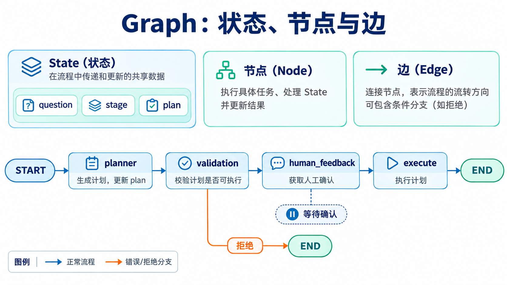
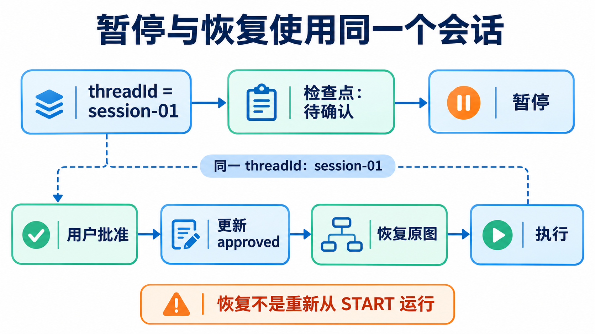
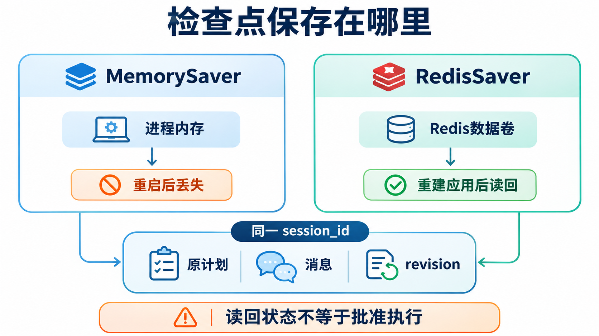

本节总览图：状态在节点之间传递，边决定下一步。问数计划经过校验，停在人工反馈处，批准后才执行；拒绝分支直接结束。

## 课程目标

学完这一节，你应该能说清：

- StateGraph、节点、边与CompiledGraph的关系。
- Java Graph与原LangGraph课程的概念如何对应。
- ReplaceStrategy怎样影响状态字段更新。
- 中断、更新状态、恢复与重新开始有什么区别。
- threadId为什么必须在整个会话中保持一致。
- MemorySaver与RedisSaver分别保存到哪里。

基础课 **38**。复用原基础课20「为什么需要LangGraph」、21「状态节点和边」、23「持久化恢复与时间旅行」、24「Human-in-the-loop与Interrupt」。对应故事课第10–13课。

---

## 1. 从熟悉的图概念迁移到 Java

本节使用Spring AI Alibaba1.1.2.2。已经学过LangGraph的同学，可以先按概念对照，再看具体Java API。

| 概念 | Java版本中的位置 | 作用 |
| --- | --- | --- |
| 图定义 | StateGraph | 描述节点与连接 |
| 状态 | OverAllState及业务Session | 保存当前已知信息 |
| 节点 | node_async或节点类 | 读取状态、返回更新 |
| 边 | addEdge、addConditionalEdges | 决定下一步 |
| 可运行图 | CompiledGraph | 执行定义好的流程 |
| 会话标识 | RunnableConfig.threadId | 定位同一条运行记录 |
| 检查点 | SaverConfig + Saver | 保存可恢复状态 |

概念相近不代表方法签名相同。例如，不能把Python里的interrupt调用原样翻译成同名Java函数。需要按当前版本的InterruptableAction和恢复接口实现。

本项目将模型调用、业务检查和数据库执行分在不同节点，便于观察状态在哪里改变，也便于验证未批准时执行节点没有运行。

---

## 2. 状态与更新策略

状态需要保存流程继续运行所必需的数据。问数项目包括消息、候选计划、当前stage、用户选项、revision与结果。

如果节点对同一个字段返回新值，框架需要知道是替换、追加还是按某种规则合并。这就是状态更新策略的作用。

```java
new StateGraph(() -> Map.of(
    "question", new ReplaceStrategy(),
    "stage", new ReplaceStrategy()
));
```

ReplaceStrategy表示用新值替换旧值。它不等同于自动合并业务字段；如果你把整份Session替换了，未保存的字段也不会被框架凭空找回来。

课程把业务状态保持为类型化Session，在StateCodec集中处理框架所需的序列化。节点不需要到处手写JSON读写，学员可以把注意力放在状态变化上。

---

## 3. 可运行 Demo：节点执行后读取检查点

这个最小Demo只展示图定义、调用与检查点。它不调用模型，也不访问数据库。保存的confirm是业务状态值，图在END结束；真正暂停等待用户的节点在下一节说明。

完整文件：[GraphDemo.java](https://codeup.aliyun.com/6a4a062c08f52788b13355e9/xiaozhe-E-commerce/blob/main/text2sql-course/courses/basic/demos/java/src/main/java/basic/GraphDemo.java)。

```java
package basic;
import java.util.Map;
import com.alibaba.cloud.ai.graph.*;
import com.alibaba.cloud.ai.graph.checkpoint.config.SaverConfig;
import com.alibaba.cloud.ai.graph.checkpoint.savers.MemorySaver;
import com.alibaba.cloud.ai.graph.state.strategy.ReplaceStrategy;
import static com.alibaba.cloud.ai.graph.action.AsyncNodeAction.node_async;
public class GraphDemo {
    public static void main(String[] args) throws Exception {
        var builder = new StateGraph(() -> Map.of(
            "question", new ReplaceStrategy(), "stage", new ReplaceStrategy()));
        builder.addNode("prepare", node_async(state -> {
            String question = (String) state.value("question").orElseThrow();
            System.out.println("question=" + question);
            return Map.of("stage", "confirm");
        }));
        builder.addEdge(StateGraph.START, "prepare");
        builder.addEdge("prepare", StateGraph.END);
        var graph = builder.compile(CompileConfig.builder().saverConfig(
            SaverConfig.builder().register(new MemorySaver()).build()).build());
        var config = RunnableConfig.builder().threadId("basic-38").build();
        graph.invokeAndGetOutput(Map.of("question", "2026年9月支付金额按天统计"), config);
        System.out.println("saved stage=" + graph.getState(config).state().value("stage").orElseThrow());
    }
}
```

在共享 [demos/java](https://codeup.aliyun.com/6a4a062c08f52788b13355e9/xiaozhe-E-commerce/blob/main/text2sql-course/courses/basic/demos/java/README.md) 环境运行：

```shell
./run.sh basic.GraphDemo
```

应看到：

```
question=2026年9月支付金额按天统计
saved stage=confirm
```

观察点：节点从state读取question，返回stage更新；compile后得到可运行图；使用同一个config读取保存的状态。

这里没有静态全局变量保存问题。换一个threadId会指向另一份会话状态，不能据此断言原状态消失了。

---

## 4. 人工反馈是一处真正的暂停点



恢复图：创建、保存和恢复始终使用同一个threadId。用户批准改变等待状态，再从原暂停位置继续；不是重新从START运行。

完整项目的HumanFeedbackNode实现InterruptableAction。当stage是confirm或clarify时，返回InterruptionMetadata，告诉框架在这里等待。

```java
return Set.of("clarify", "confirm").contains(session.stage)
    ? Optional.of(InterruptionMetadata.builder(node, state)
        .addMetadata("stage", session.stage).build())
    : Optional.empty();
```

confirm表示计划齐全、等待批准；clarify表示信息尚缺、等待补充。两者都不能直接进入SQL执行。

API收到用户操作后，才会把stage改成approved、chosen、pending或cancelled。图的条件边根据更新后的状态选择下一步。

| 反馈后的状态 | 下一步 |
| --- | --- |
| approved | SQL执行 |
| chosen | 使用点选结果，重新校验计划 |
| pending | 用户重新描述，重新规划 |
| cancelled | 结束 |

点选补日期应保留既有分组；自由回复会重新进入规划。把这两种操作分开，能够减少模型重复解释已经确定字段的机会。

---

## 5. 恢复接口与会话版本

本项目先更新人工反馈节点对应的状态，再传入恢复标记：

```java
var updated = graph.updateState(config(session.id),
    StateCodec.write(session), "human_feedback");
graph.invokeAndGetOutput((Map<String, Object>) null,
    RunnableConfig.builder(updated)
        .addMetadata(RunnableConfig.HUMAN_FEEDBACK_METADATA_KEY, "resume")
        .build());
```

这段调用依赖当前版本接口。重点是更新哪份状态、从哪个节点继续，以及为什么threadId不变。不要为了模仿示例反复新建会话id。

恢复前还要检查revision。旧确认卡携带旧版本，即使它曾经是合法卡片，也不能批准用户后来修改的新计划。

版本检查和状态推进要在同一最小临界区完成，否则两个并发确认可能同时通过。框架保存检查点，不等于自动实现所有业务并发约束。

---

## 6. MemorySaver 与 RedisSaver



检查点图：MemorySaver依赖当前进程内存，RedisSaver把状态写入Redis。应用重建后仍要用原会话id读取，恢复不会自动批准。

MemorySaver适合最小Demo和早期版本：

```java
SaverConfig.builder().register(new MemorySaver()).build()
```

最终课程使用RedisSaver，已有RedissonClient时注册：

```java
SaverConfig.builder()
    .register(RedisSaver.builder().redisson(redis).build())
    .build()
```

服务重启后能读取id还不够，还要核对消息、计划、选项、revision和执行次数。检查点里丢一个字段，就可能让界面看似恢复、实际语义已经变化。

Redis容器重建时保留数据卷；`docker compose down -v`会删除卷，不适合用来演示“保存后恢复”。这是存储生命周期的问题，不是Saver失效。

---

## 7. 在真实项目中观察暂停与恢复

从完整课程代码包启动最终版，配置自己的模型Key。创建明确问题：

```shell
curl -s http://localhost:18323/sessions \
  -H 'Content-Type: application/json' \
  -d '{"question":"2026年9月支付金额按天统计"}'
```

保存返回的id与revision，检查stage=confirm、executions=0。然后以实际值提交confirm：

```json
{"revision":0,"action":"confirm"}
```

提交地址为 `/sessions/{id}/respond`。确认后stage应为done，executions为1；不要把重新创建会话当成恢复原会话。

若演示重启恢复，应新建待确认会话，先保留完整JSON，再重建应用读取同一id。基础Demo帮助理解API，故事课第10–13课完成这些状态交互。

---

## 8. 常见错误

- **把stage写成confirm当成图已经暂停。** 业务字段和框架中断是两层机制，最小Demo没有中断节点。
- **恢复时换了threadId。** 新id对应新记录，无法定位原暂停点。
- **从START重新执行当作恢复。** 会重复规划，甚至重复副作用。
- **只检查恢复后页面能打开。** 需要比对完整计划与执行次数。
- **把Redis持久化当成自动批准。** 用户确认仍是业务动作。

---

## 9. 本节知识框架总结

```
Graph
  → State保存信息，策略决定字段更新方式
  → Node执行一步，Edge决定路由
  → compile后可运行
  → threadId定位同一会话
  → InterruptableAction建立等待点
  → 用户反馈后更新并恢复
  → MemorySaver / RedisSaver保存检查点
  → revision保护确认的业务语义
```

## 10. 本节小结

你需要记住：图定义、业务状态、检查点和用户批准各有职责。状态可以被保存，也可以被恢复，但它是否允许执行仍取决于业务条件。

课后练习：

1. 运行GraphDemo，指出状态更新与读取检查点的代码。
2. 画出confirm、clarify、approved、cancelled的合法路径。
3. 在完整项目中创建九月明确查询，核对确认前后执行次数。
4. 新建待确认会话，重建应用后比较消息、计划与revision，不提交自动确认。
