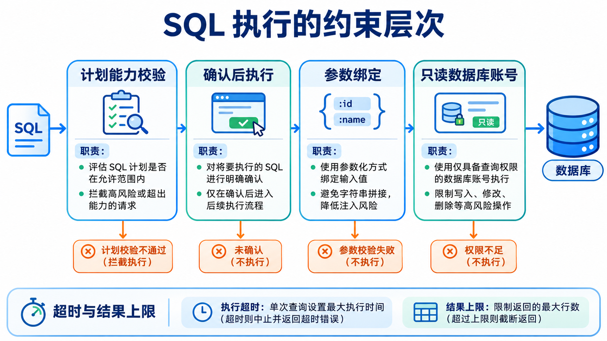
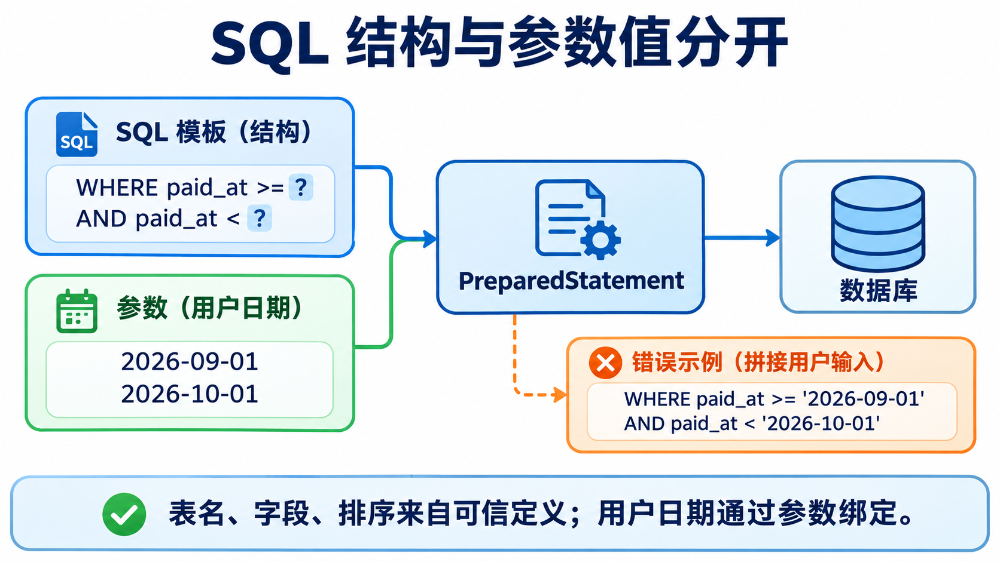
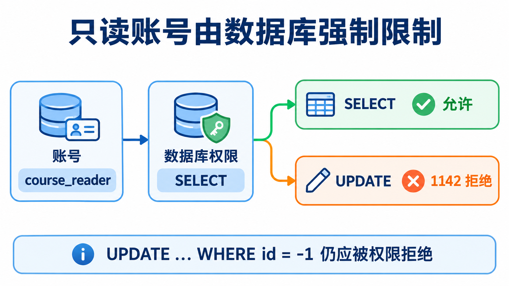

本节总览图：计划检查决定能做什么，确认决定是否执行，参数绑定决定用户输入如何进入SQL，只读账号决定数据库最终允许哪些操作。超时和结果上限约束单次查询的资源使用。

## 课程目标

- 区分模型提示、业务校验和数据库权限的职责。
- 理解参数值与SQL结构为什么必须分开。
- 用PreparedStatement执行带日期条件的查询。
- 通过无数据修改的权限探针验证只读账号。
- 说清确认、版本号、超时和结果上限分别解决什么问题。

基础课 **39**。复用原基础课10「工具参数返回值与错误处理」、25「错误处理与容错」。建议先读基础课35；对应故事课08、09、10、12。

---

## 1. SQL 安全包含不同层次

问数助手允许用户用自然语言提出需求，但它不需要接受任意数据库操作。课程产品的职责是查询指定业务指标。删除订单、改库存、建表，都不属于这个产品的功能。

把“只能查询”写进提示词，可以帮助模型理解任务，却不能改变数据库连接的权限。连接账号若具有UPDATE权限，一条意外进入执行器的更新语句仍可能成功。

因此需要把限制放到不同位置：

| 层次 | 检查的问题 | 本项目的做法 |
| --- | --- | --- |
| 业务能力 | 计划是否属于产品支持范围 | 检查指标、维度和筛选组合 |
| 用户反馈 | 当前计划是否已被批准 | 确认卡与revision |
| SQL构造 | 输入值是否改变语句结构 | 程序模板与参数绑定 |
| 数据库权限 | 连接账号能否写数据 | 只授予查询所需权限 |
| 资源约束 | 查询是否过久或返回过多 | 超时与结果上限 |

这些措施并不重复。参数化查询解决不了指标口径错误，只读账号也不会阻止一条错误的SELECT。理解职责，才能在故障发生时找到应该修复的位置。

## 2. SQL结构和参数值

SQL结构包括表名、字段、运算符、关联方式与排序方向。参数值则包括日期、品类名称等需要代入查询的具体数据。

下面是结构固定的日期筛选：

```sql
SELECT DATE(paid_at), SUM(paid_cents)
FROM orders
WHERE status = 'paid'
  AND paid_at >= ? AND paid_at < ?
GROUP BY DATE(paid_at)
ORDER BY DATE(paid_at);
```

两个问号分别绑定开始日期和结束上界。九月完整月份对应2026-09-01至2026-10-01，结束上界不包含。这样不需要猜测九月最后一天的最后一毫秒。



图中上半部分是程序确定的结构，下半部分是日期参数。数据库驱动将参数作为值处理。图中的内联日期展示拼接后的形状；风险来自用不可信文本拼接语句，而不是日期字面量本身。

不能用问号替代表名：`SELECT * FROM ?`不是动态选择表的正确方法。对于表、字段和排序，本项目从受控定义中选择；对于日期和品类，用参数绑定。不要把用户提供的任意字段名直接拼进SQL。

## 3. PreparedStatement 的调用顺序

Java JDBC中的PreparedStatement让SQL模板和参数设置分开：

```java
try (var statement = connection.prepareStatement(sql)) {
    statement.setString(1, "2026-09-01");
    statement.setString(2, "2026-10-01");
    try (var rows = statement.executeQuery()) {
        while (rows.next()) {
            System.out.println(rows.getString(1) + "=" + rows.getLong(2));
        }
    }
}
```

参数索引从1开始。第一个日期对应第一个问号，第二个日期对应第二个问号。顺序写反后，语句仍然可能执行成功，只是范围为空，因此还要验证业务结果。

try-with-resources用于关闭语句和结果集。这里不是捕获后忽略错误；数据库连接失败、权限异常等仍然向调用方传播。

正式项目的编译器同时返回SQL和参数列表，执行器按顺序绑定。这样查看编译结果时，可以同时检查“查什么”和“用什么值查”，而不需要把日期拼进SQL字符串才能调试。

## 4. 可运行 Demo：查询与只读探针

先按课程代码包说明启动MySQL教学数据库，初始化脚本会创建course_reader账号。它的口令仅用于本地教学数据库。Demo使用该账号，不使用root。

完整文件：[SafetyDemo.java](https://codeup.aliyun.com/6a4a062c08f52788b13355e9/xiaozhe-E-commerce/blob/main/text2sql-course/courses/basic/demos/java/src/main/java/basic/SafetyDemo.java)。运行入口与依赖说明见[demos/java](https://codeup.aliyun.com/6a4a062c08f52788b13355e9/xiaozhe-E-commerce/blob/main/text2sql-course/courses/basic/demos/java/README.md)。

```shell
export COURSE_JDBC_URL='jdbc:mysql://db:3306/text2sql_course?useSSL=false&allowPublicKeyRetrieval=true'
export COURSE_DOCKER_NETWORK='你的课程数据库所在网络名'
./run.sh basic.SafetyDemo
```

这里的db是Docker网络中的数据库别名，text2sql_course必须与初始化库名一致。若你的部署配置使用其他名称，请按实际配置填写，不要把宿主机localhost误当成容器里的数据库。

核心查询代码：

```java
String sql = "SELECT DATE(paid_at), SUM(paid_cents) FROM orders "
    + "WHERE status='paid' AND paid_at>=? AND paid_at<? "
    + "GROUP BY DATE(paid_at) ORDER BY DATE(paid_at)";
try (var statement = connection.prepareStatement(sql)) {
    statement.setString(1, "2026-09-01");
    statement.setString(2, "2026-10-01");
    statement.setQueryTimeout(5);
    statement.setMaxRows(10);
    try (var rows = statement.executeQuery()) {
        while (rows.next())
            System.out.println(rows.getString(1) + "=" + rows.getLong(2));
    }
}
```

Demo会输出最多10行日期与金额，金额单位为分。具体金额由配套数据库决定，不用模型回答的数字作标准答案。正常查询后，继续运行权限探针：

```java
try (var probe = connection.createStatement()) {
    probe.executeUpdate("UPDATE orders SET paid_cents=paid_cents WHERE id=-1");
    throw new IllegalStateException("readonly probe unexpectedly allowed UPDATE");
} catch (SQLException exception) {
    if (exception.getErrorCode() != 1142) throw exception;
    System.out.println("UPDATE rejected: 1142");
}
```

这条语句不会改变金额，且课程库没有id=-1的订单。它仍需要UPDATE权限，所以正确结果是MySQL返回1142。即使一行都不修改，权限不足也应该被拒绝。

如果得到连接失败或表不存在，不能算只读验证通过。代码只接受预期权限错误，其他数据库错误继续抛出，方便定位环境问题。

## 5. 只读账号由数据库强制执行



权限图：同一个course_reader连接能SELECT，但UPDATE被数据库拒绝。验证的是账号权限，不是模型是否听从提示词。

管理员初始化账号时，授予课程数据库的SELECT权限；应用只拿到这个查询账号。管理员连接用于建库和初始化，不能顺手保留在应用配置里。

另外两个容易混淆的“只读”概念需要区分：

- 提示词中的“只读”：模型的任务要求。
- JDBC连接上的只读标记：驱动和事务层面的设置，其实际行为与数据库有关。
- 数据库账号的SELECT授权：服务器实际执行的访问限制。

本课用第三层作为权限边界，用实际探针证明它存在。讲解时应展示查询成功和写入拒绝两个结果，只展示后一项无法排除账号根本连不上数据库。

只读权限也有范围。只授予课程所需库表，才能避免意外读取其他业务数据；如果未来存在不同用户的数据可见范围，还需要额外的产品设计。本课先把单个教学数据库的执行边界讲清楚。

## 6. 确认与资源约束

只读不等于可以直接执行。错误口径的查询虽然不会修改数据库，却可能把错误数字用于汇报。因此项目先展示指标、日期、分组和筛选，再接受用户确认。

确认卡对应某一个revision。用户修改日期后，旧卡片不能批准旧计划或新的未审阅计划。这个检查发生在执行前，与数据库权限配合使用。

超时和结果上限则约束查询资源。`setQueryTimeout(5)`设置语句超时，具体取消行为由驱动和数据库实现；不能把它当成整个HTTP请求严格五秒完成的承诺。`setMaxRows(10)`限制返回行数，不保证数据库只扫描10行。

如果结果被截断，界面应明确说明。把前10行的合计当作整月总额，会产生新的业务误解。教学Demo的10行用于观察API，完整项目使用自身配置的结果上限。

## 7. 常见错误

1. **提示词写了只读，就用管理员账号。** 权限边界仍然缺失，应该用查询账号运行并做探针。
2. **所有动态内容都用问号。** 问号绑定值，表名和字段必须由受控结构选择。
3. **SQL能执行就认为日期对了。** 参数顺序和区间语义仍需要核对。
4. **任何SQLException都当作安全拦截成功。** 只有预期权限错误能证明本项通过。
5. **只读账号可以替代确认卡。** 账号限制写入，确认卡核对用户意图，作用不同。
6. **结果上限能替代业务范围限制。** 返回少不代表扫描少，也不代表查询口径正确。

## 8. 本节知识框架总结

```
执行边界
  → 能力校验：是否支持这份计划
  → 用户确认：是否批准当前revision
  → SQL模板：结构由程序确定
  → 参数绑定：用户值不参与结构拼接
  → 数据库账号：SELECT允许，UPDATE拒绝
  → 超时和行数：限制单次查询资源
  → 验证：正常查询 + 预期权限错误
```

## 9. 本节小结

安全措施应落实在实际执行链路上。你需要能指出：SQL从哪里产生、参数在哪里绑定、哪个账号发起查询，以及未确认时哪一步阻止执行。

课后练习：

1. 运行SafetyDemo，保留查询结果与1142拒绝记录。
2. 把查询日期整体改为2026年10月，保持参数化写法，核对结束上界为2026-11-01。
3. 将结果上限改成3，观察返回行数；解释为什么这不能证明只扫描了3行。
4. 说明为什么不能用“表不存在”作为只读探针通过的证据。
5. 在故事课第12课的旧确认卡演示中，指出revision与数据库只读权限分别保护什么。
