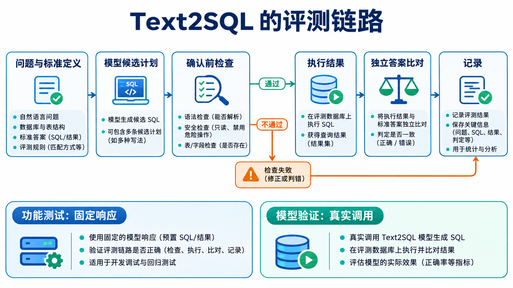
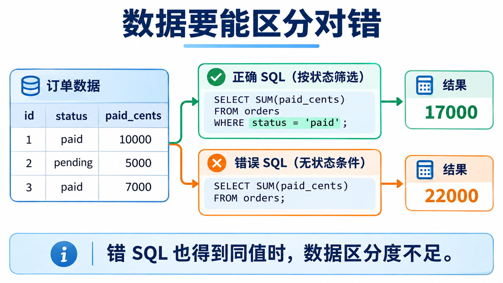
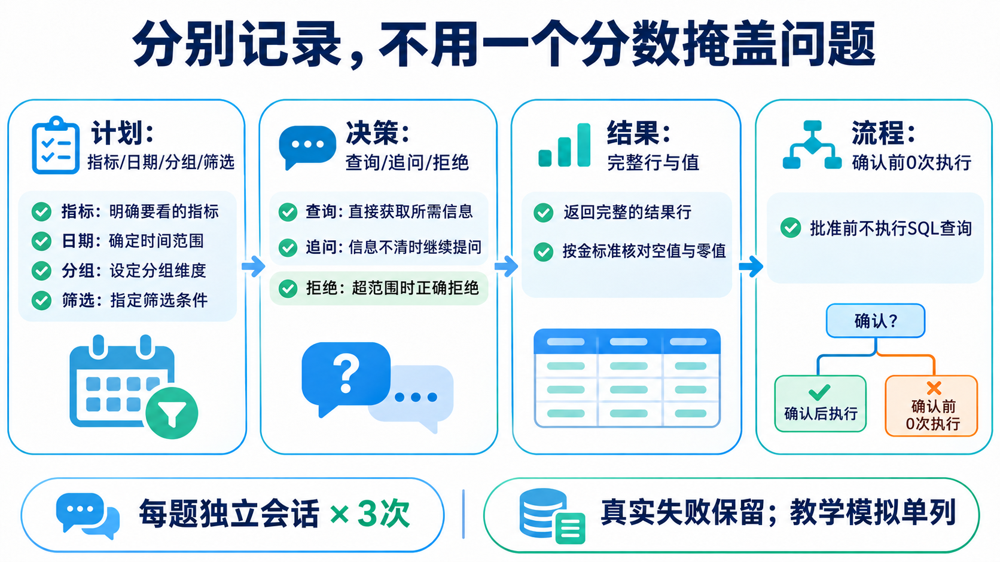

本节总览图：先确定问题和标准，再运行系统，分别核对计划、决策、执行结果与确认流程。图中模型直接生成SQL属于对照路线；课程主路线先生成计划，再由程序编译SQL。

## 课程目标

- 区分SQL文本相同、执行结果相同和业务条件正确。
- 编写独立于待测编译器的金标准。
- 构造能区分正确SQL和错误SQL的数据。
- 分开检查查询、澄清、拒绝及确认流程。
- 区分固定响应测试与真实模型重复验证。
- 保存失败记录，并按检查项解释结果。

基础课 **40**。复用原基础课27「评估与测试」；建议先读34、35、39。对应故事课第16课，也用于检查前面各节的课堂示例。

---

## 1. 先定义“答对”是什么

问数项目不能只检查HTTP返回200，也不能只检查SQL执行没有报错。一个完整的正确查询，需要满足用户指定的指标、日期、分组和筛选条件，并得到对应结果。

例如问题是“2026年9月支付金额按天统计”。程序返回九月总额，数值可能看起来合理，但缺少按天分组；返回十月每日金额，表格形状正确，但日期错误。两者都不应算答对。

可以把一次检查分成四层：

| 层次 | 检查内容 | 典型失败 |
| --- | --- | --- |
| 计划 | 指标、日期、维度、筛选 | 日期上界错、分组遗漏 |
| 决策 | 查询、追问或拒绝 | 信息齐全仍追问、歧义词直接查询 |
| 结果 | 完整行、列、值与单位 | 重复聚合、少一行、金额单位错 |
| 流程 | 确认前后状态及执行次数 | 未确认就查库、旧卡仍可执行 |

这四层应单独记录。把所有问题压成一个通过率，会让你不知道下一步应修SQL、交互还是模型输入。

## 2. 金标准必须独立

金标准是预先确定的正确答案，可以包含标准计划、手写SQL和预期结果。它应来自业务口径和数据，而不是直接调用待测系统的编译器产生。

如果被测编译器把退款重复扣了两次，评分脚本又调用同一个编译器生成“标准SQL”，两边就会一起出错，仍然显示一致。

对于小数据，可以手工计算答案。对于课程数据库，可以独立写标准SQL，再核对少量关键订单的贡献。例如支付金额按支付时间筛选、退款按明确的口径归属、品类金额按明细金额汇总。这些定义应该在运行前确定。

题目记录可以采用如下形式：

```json
{
  "id": "paid-september-day",
  "question": "2026年9月支付金额按天统计",
  "expectedStage": "confirm",
  "expectedPlan": {
    "metric": "paid", "start": "2026-09-01",
    "end": "2026-10-01", "dimension": "day", "category": null
  },
  "golden": "golden/paid-september-day.sql"
}
```

示例中的日期使用左闭右开区间。金标准文件由人根据业务定义编写，不从候选计划反推；否则模型选错指标后，标准答案也跟着变了。

## 3. 为什么不能只比 SQL 字符串

两条SQL可以用不同别名、子查询或CTE表达同一逻辑。文本不同并不意味着结果不同。相反，文本看起来很像，只少了一个状态条件，也可能算出错误金额。

因此结果比对通常比字符串完全匹配更贴近业务。但结果一致仍有前提：测试数据必须包含能暴露差异的记录。

若九月没有任何订单，正确SQL和筛错月份的SQL都返回空结果；若所有订单都支付成功，漏写状态条件的SQL也可能得到相同金额。

这就是为什么需要同时核对完整计划与实际结果。计划检查避免丢失用户条件，结果检查发现编译与执行错误。两者提供不同证据。

## 4. 数据要有区分度



区分度图：三笔订单中，两笔paid金额为10000和7000，一笔pending金额为5000。正确结果17000，漏状态条件得到22000。单位均为分。

为了检查一个错误，需要准备能让它发生影响的数据：

| 要检查的错误 | 数据至少包含什么 |
| --- | --- |
| 漏状态筛选 | 有非零金额的未支付订单 |
| 日期边界错 | 区间外及上界当天的订单 |
| 关联重复金额 | 一笔订单有两条商品明细 |
| 退款重复扣减 | 一笔订单有多条成功退款 |
| SUM(DISTINCT)误用 | 不同订单恰好有相同金额 |

三五条精心选择的数据就能暴露逻辑错误。大数据量用于观察性能，不能代替语义区分度。

还可以主动运行一条故意错误的SQL，检查它是否得到不同结果。如果错误版本也通过，就先改验证数据，而不是把这个通过当成系统可靠的证据。

## 5. 可运行 Demo：正确SQL与漏筛选SQL

完整文件：[EvaluationDemo.java](https://codeup.aliyun.com/6a4a062c08f52788b13355e9/xiaozhe-E-commerce/blob/main/text2sql-course/courses/basic/demos/java/src/main/java/basic/EvaluationDemo.java)。使用第39课同一只读数据库连接，所有数据通过CTE定义，不创建或修改表。

```shell
export COURSE_JDBC_URL='jdbc:mysql://db:3306/text2sql_course?useSSL=false&allowPublicKeyRetrieval=true'
export COURSE_DOCKER_NETWORK='你的课程数据库所在网络名'
./run.sh basic.EvaluationDemo
```

Demo先定义三条记录，再运行两个候选查询：

```java
String data = "WITH orders AS (SELECT 1 id,'paid' status,10000 paid_cents "
    + "UNION ALL SELECT 2,'pending',5000 UNION ALL SELECT 3,'paid',7000) ";
String correct = data + "SELECT SUM(paid_cents) FROM orders WHERE status='paid'";
String wrong = data + "SELECT SUM(paid_cents) FROM orders";
List<Long> golden = List.of(17000L);
```

金标准17000来自10000加7000的手工计算。`run`方法执行SQL并读取结果，最后分别比较：

```java
List<Long> goodRows = run(connection, correct);
List<Long> badRows = run(connection, wrong);
System.out.println("golden=" + golden);
System.out.println("correct=" + goodRows + ", pass=" + golden.equals(goodRows));
System.out.println("wrong=" + badRows + ", pass=" + golden.equals(badRows));
if (!golden.equals(goodRows) || golden.equals(badRows)) {
    throw new IllegalStateException("fixture cannot distinguish the SQL error");
}
```

预期输出：

```
golden=[17000]
correct=[17000], pass=true
wrong=[22000], pass=false
```

这里的wrong不是请求模型随机犯错，而是人为构造的教学模拟。它的作用是验证评测数据能区分对错。每次运行结果应一致，不需要支付模型调用费用。

## 6. 结果怎样比较

简单单值可以直接比较Long；真实表格需要先约定列含义、单位和排序规则。金额优先以分或精确十进制比较，不要随手转成浮点数后设置很宽的误差范围。

如果问题没有要求排序，可以按完整分组键排序后比较所有行。若问题要求排序，则要检查原结果顺序。不能把结果转成集合后丢掉重复行，因为重复行本身可能就是错误。

空结果、NULL和0也要区分。没有订单、存在订单但金额为0、某个聚合表达式返回NULL，不一定表达同一业务含义。标准答案应明确预期，不应在评分时随意统一成0。

对于按天统计，至少核对日期与金额两列、行数和完整日期集合。只检查第一行或者总和相等，可能漏掉某一天多算、另一天少算的情况。

## 7. 固定响应与真实模型各测什么

固定响应适合复现格式错误、能力拒绝、日期依据不足、旧卡失效等教学问题。你能准确控制输入，让程序走到目标分支，观察修复前后的行为。

真实模型验证检查的是：在当前模型、提示词、目录与调用配置下，课堂问法能否稳定得到正确计划和决策。应保存原始响应，不能只看转换后的对象。



记录图：计划、决策、结果和流程分别检查。超范围问题正确拒绝也算正确决策，结果空值按金标准判断。

录制准备可以让每道明确示例在独立会话中运行3次。重复运行是检查课堂稳定性，不代表统计上证明所有问法都可靠。日期、模型名、配置和版本要随记录保存，便于下次录制前复查。

对缺日期问题，还要按指定选项补充后检查原来的分组是否保留。对确认流程，先断言执行次数为0，再确认并比较结果。这样避免“最终有表格”掩盖中途已经提前执行的问题。

## 8. 记录与判断

一份有用的记录至少包含：题目id、原问题、运行次数、期望计划、实际计划、状态、结果差异、模型用量和失败原因。失败记录应保留原样。

如果一个课堂例子不稳定，可以改成更明确的问法，再重新验证。新旧问题要分别保存，不能把失败那次删掉，只留下改写后的成功记录。

教学模拟标注来源，真实模型按实际次数报告。功能测试与模型示例的结果分开统计。

## 9. 常见错误

- 用待测编译器生成标准答案，造成同源错误。
- 用两份都没有目标日期数据的数据库，误以为结果相等就是正确。
- 只比金额总和，忽略分组、日期和重复行。
- 为提高澄清正确率，让所有明确问题也先追问。
- 只保留最终成功，删除最初失败或改写记录。
- 把固定错误响应的功能测试称为真实模型准确率。

## 10. 本节知识框架总结

```
Text2SQL评测
  → 先定义问题、口径与预期决策
  → 独立金标准，避免与待测代码同源
  → 构造区分度数据，并运行错误SQL
  → 比较完整计划、行列与数值
  → 检查确认前后执行次数
  → 固定响应测分支，真实调用测示例稳定性
  → 保留原始结果与修改记录
```

## 11. 本节小结

评测的关键是让“正确”和“看起来正确”产生可观察的差别。小数据、独立答案和完整条件检查，是建立这种差别的起点。

课后练习：

1. 运行EvaluationDemo，解释17000与22000分别怎么得到。
2. 把pending订单金额改为0，再运行错误SQL，说明为什么此时数据失去区分度；应触发Demo的失败断言。
3. 为一对多关联重复聚合设计三到五条数据，并手算标准答案。
4. 在完整项目独立创建三次“2026年9月支付金额按天统计”，先核对确认卡，再确认查询，用独立SQL比较完整结果。
5. 为上一题写记录表，分别填写计划、决策、结果和确认前执行次数，不只写一个通过或失败。
