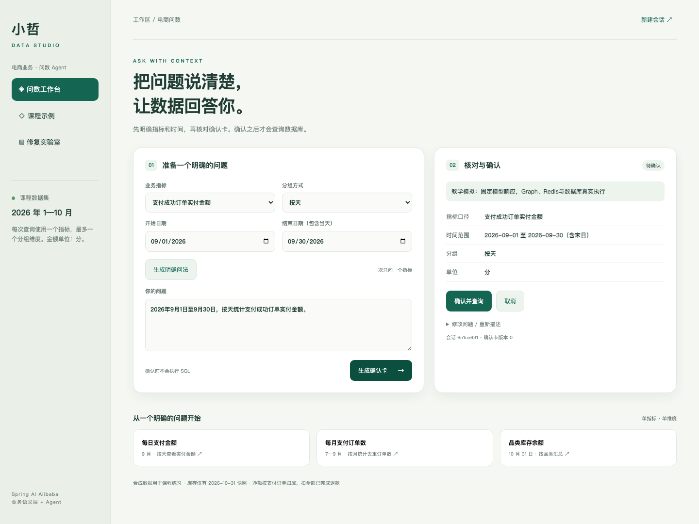
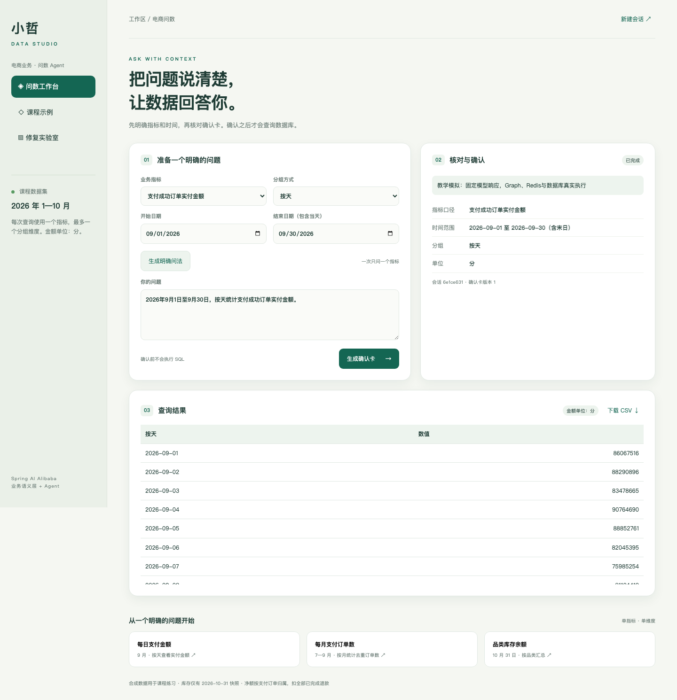
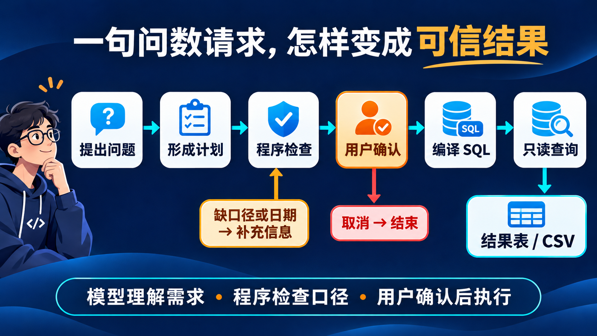

新增基础课编号：34（[基础课目录与对应表](<124_Text2SQL 基础课目录与故事课对应表.md>)）。

前置知识：原基础课「什么是 AI Agent」。本课对应 V01：先认识最终产品，再建立最小服务入口。


## 周一早上，你又成了人工查询接口

周一早上，你刚打开开发工具，运营的消息就来了。

帮我拉一下九月每天的支付金额，下午开会要用。

你回了一句“稍等”，打开数据库，找出上次写过的 SQL，把日期换成九月，执行，导出表格。

文件刚发出去，第二条消息又到了。

老板说先不看金额了，想看看每天有多少笔支付成功的订单。

你又切回数据库。

没过多久，仓库同事也来敲你：

十月三十一日那份库存余额，能不能也帮我查一下？

这些问题并不难。麻烦的是，每次都要有人把业务说法翻译成数据库查询。

运营不知道哪张表存订单实付，不知道支付日期和下单日期是不是一回事，也不敢直接在数据库里执行 SQL。最后，只能把问题发给开发。

你真正写代码的时间，被一条条“帮我查个数”切得七零八落。

老板看见你又在导表，顺口问了一句：

我们不是已经有 AI 了吗？能不能让运营自己说一句话，它就把数查出来？

这个要求听上去很简单。

用户说中文，模型写 SQL，数据库返回结果，再把结果放到页面上。

你甚至已经能在脑子里画出那个聊天框了。

但财务从旁边补了一句：

查得快可以，别把口径查错了。上次两张表都叫“销售额”，一个扣了退款，一个没扣，会上对了半天。

老板把任务交给你：

那你做一个。让运营少找你，也让我看得懂它到底在查什么。

这就是这门课的起点。

我们接下来要做的，是小哲电商的问数助手：用户用自然语言说明需求，系统把需求整理成可检查的查询计划，核对以后，再从数据库取得结果。

## 先看看我们最后要交付什么

先打开课程根目录的完成版，看看项目最后会长成什么样。

运营在页面上输入：

```
统计2026年9月支付成功订单实付金额，按天汇总。
```

系统没有立刻扔出一串数字，而是先给出一张确认卡。



*完成版界面演示：此处使用已有的固定响应教学截图。先看右侧卡片，再决定是否查询。*

确认卡要让运营看懂四件事：

| 项目 | 这次要确认的内容 |
| --- | --- |
| 指标 | 支付成功订单的实付金额 |
| 日期 | 2026 年 9 月 1 日至 9 月 30 日 |
| 分组 | 按支付日期，每天一行 |
| 单位 | 分 |

运营看过以后，点击“确认并查询”。页面才展示每天的结果，还可以导出 CSV。



这里请沿着三个位置看一遍：左侧是用户要查什么；右侧是程序准备按什么条件查；下方是执行后的结果。金额列的单位是分，不是元。例如截图第一行的 `86067516` 分，换算成元是 `860675.16` 元。不要在抄报表时把单位丢掉。

*这两张图来自同一次完成版教学演示；正式查询流程会在后续版本逐步加入。*

如果日期写错了，他可以修改；如果这次不查了，可以取消。后面我们还会处理一种容易忽略的情况：用户修改过问题，却又点了旧页面上的确认按钮。

你可以把最终体验记成一条线：

```
说清需求 → 看懂计划 → 核对确认 → 得到结果 → 导出使用
```

这里最重要的，不是聊天框的样式。

是用户能在结果出现之前，看清系统准备按什么口径查。

财务说的“别把口径查错了”，不能只靠我们在开头写一句提示。它得变成用户看得到、程序也能检查的流程。

## 一句“查支付金额”，里面其实藏着好几个决定

你把运营刚才的问题抄到白板上。

```
统计2026年9月支付成功订单实付金额，按天汇总。
```

这句话里有三类关键内容。

第一类是指标：到底算什么。

这里要算支付成功订单的实付金额。它不是订单标价，也不是优惠前金额，更不是用户尝试支付过多少次。

第二类是范围：哪些数据算进去。

这里限定在 2026 年 9 月，而且是按支付时间选择订单。九月下单、十月支付的订单，和八月下单、九月支付的订单，应该怎样处理，要由这个时间口径决定。

第三类是维度：结果怎样分组。

这里要求按天，所以结果是一日一行。如果不分组，最后就是整个区间的一个汇总值。

这些内容先被整理成一份查询计划。后面代码里的 `Plan`，就是承接这些决定的对象。

第 01 课先不用背字段名。你先知道，它把一句自然语言中原本挤在一起的意思拆开，让模型、程序和用户能讨论同一件事。

| 业务说法 | 计划中要表达的意思 |
| --- | --- |
| 支付成功订单实付金额 | 选择支付金额指标 |
| 2026 年 9 月 | 选择一个明确的日期范围 |
| 按天 | 选择一个分组维度 |

老板看着白板说：

所以不是它回我一句“好的，我帮你查”，这件事就算开始了？

你点头。

系统首先要知道“帮你查”到底意味着什么。否则模型哪怕写出一条能执行的 SQL，也可能在回答另一个问题。

## 为什么中间还要有一层业务定义

运营问的问题是中文，数据库里存的是表、字段和记录。

中间缺了一份大家共同认可的业务解释。

例如，“支付金额”至少要说明：

- 从订单实付金额字段取值。
- 只统计当前口径下的支付成功订单。
- 按支付日期选择范围。
- 结果以分为单位。

我们把这些定义集中管理，形成这门课的业务语义层。

“语义层”这个名字听起来有点大，你可以先把它理解成一份程序能读取的业务说明书。

它把业务名称和数据库里的计算方式联系起来。

用户说“支付金额”，模型要理解他选择了哪个指标；程序根据这个指标的定义，决定使用哪个时间字段、哪些条件和哪一种聚合方式。

这样，口径就不必每次都从一段临时提示词里重新拼出来。

假设财务明确了退款后净额的算法，我们会把算法写进指标定义。模型负责识别用户是否选择了这个口径，程序负责按这份定义生成查询。

第 01 课先认识这个位置。到第 05 版，我们会真正打开指标注册表，看定义怎样被目录工具、校验器和编译器共同使用。

## 模型、框架和数据库，各做哪一段

我们先把完整产品的主链路画出来。



*图 1-2：缺少口径或日期时先补充、再检查；只有用户确认后，才能进入查询。*

这张图是最终产品的业务流程。后面的课次会逐段把它实现出来。

现在先分清各部分的工作。

| 部分 | 在这个项目里负责什么 |
| --- | --- |
| Spring Boot | 提供 Java 服务入口，让页面能调用后端 |
| Spring AI | 通过 ChatModel 接入模型，并处理结构化输出 |
| Spring AI Alibaba | 用 ReactAgent 接工具，用 Graph 组织暂停、反馈和后续执行 |
| 业务语义层 | 定义指标口径，并把受支持的计划编译成 SQL |
| MySQL | 保存业务数据，真正计算查询结果 |
| Redis | 在后续版本中保存检查点，让待确认的会话可以恢复 |
| 网页 | 收集问题，展示计划、选择和结果 |

你已经学过 LangGraph 的话，可以先沿用“状态、节点、边、中断”的概念来理解流程。到了 Java 框架的课次，我们再对照具体接口。

但现在不用急着写完整的 Graph。

第 01 课的任务是让你看见目标，再把最小服务启动起来。模型接入、目录工具、查询计划和执行流程，会随着业务问题逐版加入。

## 先答应老板哪些事情

老板听完之后，开始加需求：

那以后是不是随便什么报表都能问？我把库连上，它就知道怎么查？

你没有把这个承诺接下来。

这次先围绕现有电商数据，做一组明确的指标。正常问题使用一个指标、一个支持的分组维度，再给出明确日期。

完整课程里会用到这些指标：

| 指标 | 用户需要说明什么 |
| --- | --- |
| 支付金额 | 支付成功订单的实付金额及日期范围 |
| 支付订单数 | 支付成功订单数量及日期范围 |
| 退款后净额 | 这批支付订单的实付减全部已完成退款，含跨月退款 |
| 已发货订单数 | 已发货订单及日期范围 |
| 指定日期库存余额 | 明确的库存快照日期 |

不同指标允许的分组方式，以注册表为准。例如库存数据按快照日期理解，不能把它当成一段时间内不断发生的支付流水。

多指标、多维度的组合分析先留到后续产品扩展。第一版产品先把常见、明确的查询做顺：能看懂计划，能核对口径，能取得结果。

这也是为什么我们从一句很具体的问题开始：

```
统计2026年9月支付成功订单实付金额，按天汇总。
```

用户已经明确给出了指标、范围和分组，适合用来观察整个流程。

## 看完成版，是为了知道终点；动手从 V01 开始

刚才体验的网页在课程根目录 `app/` 中。

现在回到本课代码：

```
lessons/01/start/    上一阶段：最小服务与健康检查
lessons/01/end/      本课完成：增加最小启动页面
```

你会发现，这个阶段的工程很小。没有模型规划器，没有 SQL 编译器，也没有 Redis 会话逻辑。

先看 `Application`：

```java
@SpringBootApplication
public class Application {
    public static void main(String[] args) {
        SpringApplication.run(Application.class, args);
    }
}
```

这段是 Spring Boot 的启动入口。它把应用运行起来，让后面的控制器可以接收请求。

启动入口不负责理解用户问题。后面即使加了模型和 Graph，这个类也不需要变成一个塞满业务逻辑的大文件。

再看 `StageController`：

```java
@RestController
public class StageController {
    @GetMapping("/health")
    public Map<String, String> health() {
        return Map.of("status", "ok");
    }
}
```

`@RestController` 表示这个类提供 HTTP 接口，`@GetMapping("/health")` 让浏览器或工具可以访问健康检查。

返回的 `status=ok` 表示服务已经接住请求。后面排查问题时，你可以先确认服务有没有启动，再去检查模型、数据库和业务流程。

本课的启动页位于：

```
src/main/resources/static/index.html
```

Spring Boot 会提供这个静态页面。它现在只告诉你服务已经启动，并给出健康检查入口。后面完成问数流程之后，我们再接上真正的提问、确认和结果页面。

先把服务壳跑通，后续每增加一个能力，都有明确的地方可以观察它。

## 从 start 到 end，亲手补上第一页

先打开 `lessons/01/start/`，看下面三个位置：

```
src/main/java/course/text2sql/
├── Application.java        启动应用
└── StageController.java    接收 /health 请求
src/main/resources/
└── application.properties  当前阶段配置
```

`start` 已经有启动类和健康检查。本课真正新增的只有 `src/main/resources/static/index.html`，不要把前面解释过的两个 Java 类重复创建一遍。

在 `src/main/resources/` 下建立 `static` 文件夹，添加这个页面。下面只是把 end 中的一行 HTML 展开排版，内容相同：

```html
<!doctype html>
<html lang="zh-CN">
<meta charset="utf-8">
<title>问数 Agent · V01</title>
<h1>问数 Agent 服务已启动</h1>
<p>本版只有健康检查，下一版开始认识电商数据。</p>
<a href="/health">查看健康检查</a>
</html>
```

这里没有前端框架，也没有发出模型请求。它只是给你一个能让老板点开的入口。

当浏览器请求 `/` 时，Spring Boot 会找到静态目录里的 `index.html`。点击“查看健康检查”以后，浏览器改为请求 `/health`，这个请求才会进入控制器：

```
访问 / → static/index.html → 看到启动页
点击链接 → GET /health → StageController.health() → {"status":"ok"}
```

两条路径都在同一个服务里，但一个返回页面，一个返回 JSON。知道这个区别，后面把页面接到 `/plan` 时就不会把“网页打开了”和“规划接口成功了”混成一回事。

## 怎么验证这一课完成了

以下命令从课程代码包根目录开始。如果完成版还在运行，先在它的目录执行 `docker compose down`，再切换到本课；两个版本不能同时占用 18323 端口。

```shell
cd lessons/01/end
cp .env.example .env
docker compose up -d --build --wait
```

本课没有模型调用，不需要为了 `/health` 填写真实密钥。Docker 构建 Java 服务，Compose 同时准备课程使用的数据库和 Redis；本课应用还没有使用它们查数或保存会话。

打开 `http://localhost:18323/`，应看到“问数 Agent 服务已启动”和健康检查链接。再点击链接，应看到：

```json
{"status":"ok"}
```

也可以从终端检查同一个请求：

```shell
curl -i http://localhost:18323/health
```

看两处：HTTP 状态是 `200`，响应正文是 `{"status":"ok"}`。如果想自己从 start 完成这一课，就在 start 中加入刚才的 HTML，再用同样的命令启动 start，不必再启动 end。

| 看到的现象 | 先检查哪里 |
| --- | --- |
| 根页面没有内容，但 /health 正常 | HTML 是否在 `src/main/resources/static/index.html`，修改后是否重新构建 |
| 两个地址都连接不上 | `docker compose ps` 查看 app 是否启动，再看 `docker compose logs app` |
| 启动提示端口已占用 | 是否忘记停掉之前的课程版本 |
| /health 正常，但没有提问框 | 当前就是 V01；完整提问页面在后面的版本加入 |

最后运行本版固定测试：

```shell
docker compose --profile check run --rm check
```

这一课的提交物是启动页、健康响应，以及你自己画的一条请求路径。离开本课时执行 `docker compose down`，下一课从它的 end 继续。不要添加 `-v`，避免顺手删除课堂数据卷。

## 本课知识小结

| 知识点 | 你需要理解的内容 | 小哲电商项目里的位置 |
| --- | --- | --- |
| Text2SQL | 将自然语言需求落到数据库查询的过程 | 运营说需求，系统最终取得统计结果 |
| 查询计划 | 把指标、日期和分组变成可检查的结构 | 先让人和程序知道准备算什么 |
| 业务语义层 | 集中定义指标与计算口径 | 避免每次临时猜测字段和算法 |
| 人工确认 | 执行前让用户核对准备查询的内容 | 确认卡连接需求与实际执行 |
| 最小服务 | 给后续能力一个稳定运行入口 | Application、StageController 和启动页 |

课后可以做一个很小的练习：把本课的明确问题拆成指标、日期和分组三项，再用自己的话解释“确认卡应该让用户看懂什么”。

提交最小启动页与 `/health` 的结果，然后说明它和刚才体验的完整问数产品，还差哪几段能力。

## 小哲心中隐隐的担心

老板看过完成版的体验，也看见你把开发起点搭了起来。

行，后面就照这个方向做。

运营赶紧把第一条真实需求发过来：

先把九月支付金额弄准，最好以后还能看商品。

你决定先手写一条 SQL，把正确答案算清楚。

你从订单表查出金额，又顺手关联了商品明细。SQL 没报错，结果也正常返回。

可同一批订单，只是多关联了一张表，金额竟然变大了。

模型还没接进来，数据库查询已经出了问题。

下一课，我们先把这件事查清楚：一张订单关联了两条明细以后，到底还是一张订单，还是已经变成了两行？
