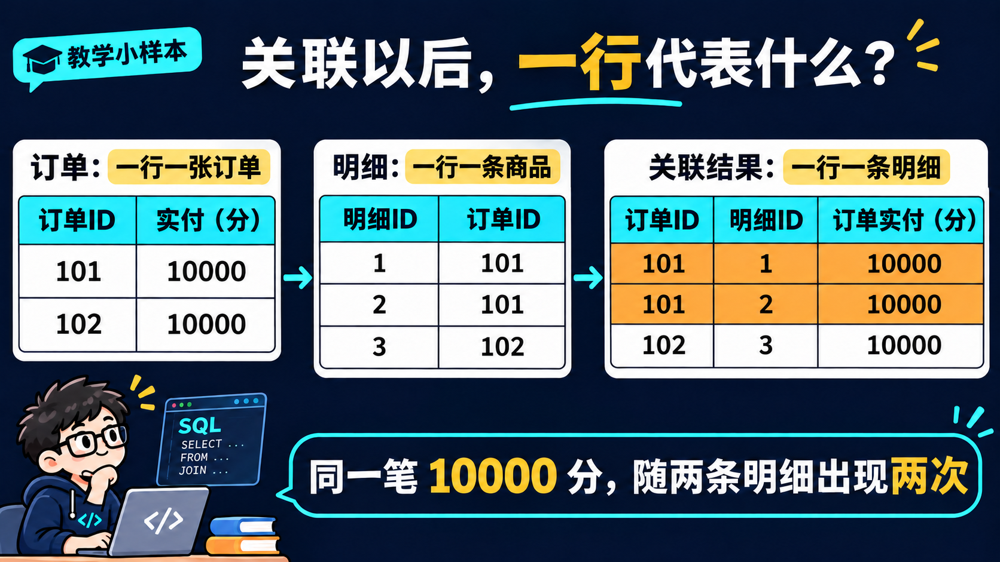
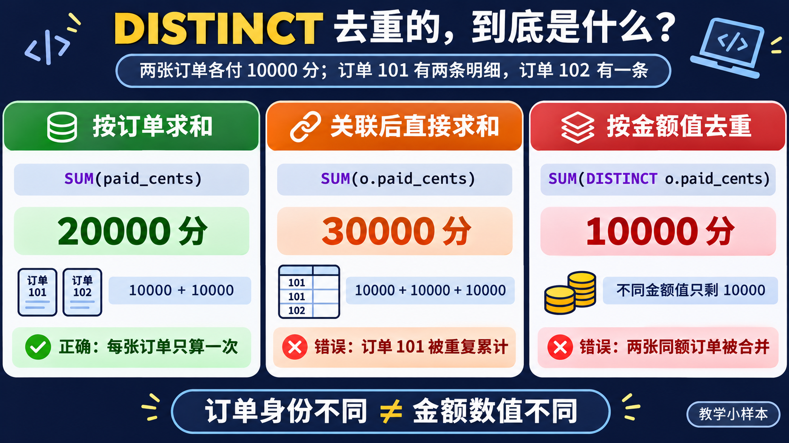

新增基础课编号：35（[基础课目录与对应表](<124_Text2SQL 基础课目录与故事课对应表.md>)）。

前置知识：SQL 的 SELECT、WHERE、JOIN 与 GROUP BY；新增基础课「指标口径与统计粒度」。本课对应 V02：先写独立参考 SQL，弄清楚每一行代表什么。


## 模型还没接，数字先错了

上一课，老板把问数助手的任务交给你。

运营的第一条需求也很明确：

```
统计2026年9月支付成功订单实付金额，按天汇总。
```

你决定先自己写 SQL。

理由很简单：以后模型把问题转成计划，程序再把计划编译成 SQL，总要有一个可以对照的业务答案。我们自己先算不清楚，就不知道后面哪一步算错了。

你先查订单表，金额看着正常。

接着想到运营说的“以后还要看商品”，就提前关联了订单明细表。

SQL 没有报错，字段都能找到，查询也很快。

只是总金额变大了。

你重新看了一遍日期，没有写错；支付状态也没漏。两次查询选的明明是同一批订单。

你把结果拿给财务：

我只是加了一张商品明细表，订单没变，为什么金额会变？

财务看了一眼：

一张订单有两件商品，你是不是把整张订单的钱算了两遍？

这一句，比任何 SQL 优化建议都重要。

我们今天先不讲模型，也不急着讲框架。先弄明白：查询中的每一行，到底代表哪个业务对象。

## 先用两张订单把问题缩小

直接看十万条订单，很难看出一笔钱在哪一步重复了。

我们先用一个教学小样本。金额都以分为单位，下面两张订单都已支付。

**订单表：一行是一张订单。**

| id | paid_cents | paid_at | status |
| --- | --- | --- | --- |
| 101 | 10000 | 2026-09-01 10:00:00 | paid |
| 102 | 10000 | 2026-09-01 11:00:00 | paid |

**订单明细表：一行是一条商品明细。**

| id | order_id | 商品 |
| --- | --- | --- |
| 1 | 101 | 键盘 |
| 2 | 101 | 鼠标 |
| 3 | 102 | 耳机 |

先不用写 SQL，直接看订单表。

101 号订单支付 10000 分，102 号订单也支付 10000 分。两张订单合计 20000 分，也就是 200 元。

请把 20000 记下来。这是我们等会儿判断 SQL 是否算对的手工答案。

订单明细里有三行，但支付成功订单只有两张。

这两个数字同时成立，因为它们数的是不同东西。

## JOIN 以后，每一行已经变了

现在把两张表关联起来：

```sql
SELECT
    o.id AS order_id,
    i.id AS item_id,
    o.paid_cents
FROM orders o
JOIN order_items i ON i.order_id = o.id;
```

在刚才的小样本里，关联结果是：

| order_id | item_id | paid_cents |
| --- | --- | --- |
| 101 | 1 | 10000 |
| 101 | 2 | 10000 |
| 102 | 3 | 10000 |

看见问题了吗？

订单表里的 101 号订单，关联以后出现了两行。因为它分别匹配到了键盘和鼠标两条明细。

数据库并没有凭空复制一张订单。它是在列出所有匹配的“订单—明细”组合。

但是 `paid_cents` 保存的是整张订单的实付金额。这个订单级金额随着关联结果，一起出现了两遍。

如果这时执行：

```sql
SUM(o.paid_cents)
```

实际加起来的是：

```
10000 + 10000 + 10000 = 30000 分
```

原本 200 元的两张订单，被算成了 300 元。

错的不一定是关联条件。这里的 `i.order_id = o.id` 本身就是正确的关系。

错在关联后的数据已经变成明细粒度，我们却仍然把每一行上的订单总金额直接加了起来。

## “粒度”就是先回答：一行代表什么

统计粒度不需要背一个很抽象的定义。

你只要在每张表、每个中间结果旁边问一句：

这里的一行，代表什么？

| 数据位置 | 一行代表什么 | 同一张订单会出现几次 |
| --- | --- | --- |
| orders | 一张订单 | 一次 |
| order_items | 一条商品明细 | 取决于这张订单有多少条明细 |
| orders关联order_items | 一组匹配的订单与明细 | 通常也是每条明细一次 |

`SUM` 不知道一行是订单还是明细。它只负责把你交给它的数加起来。

`COUNT(*)` 也不知道你想数订单。关联后有三行，它就返回三行。

所以正确顺序应该是：先确认要统计哪个业务对象，再决定从什么粒度的数据上计算。



*图 2-2：订单表是一行一张订单；关联结果是一行一条明细。橙色两行属于同一张订单。*

这也是 Text2SQL 项目必须理解业务数据的原因。

模型可以生成语法正确的 SQL，却未必自动知道我们这次是在统计订单级金额。程序后面能不能稳定编译，也取决于我们现在有没有把这些定义写清楚。

## 别急着加 DISTINCT

你第一反应是：既然重复了，那去重不就好了？

你把 SQL 改成：

```sql
SUM(DISTINCT o.paid_cents)
```

这次结果又变了，变成 10000 分。

为什么比正确答案还少？

因为 `DISTINCT` 放在 `paid_cents` 上，去重的是金额数值。

101 和 102 是两张不同的订单，但它们恰好都支付了 10000 分。按金额去重，就只剩一个 10000。

它并不知道你真正想去重的是订单身份。

同样写着 DISTINCT，放在不同位置，含义完全不同。

```
COUNT(DISTINCT o.id)
```

这表示按订单 ID 计算不同订单数。在当前小样本中，它会得到 2。

```
SUM(DISTINCT o.paid_cents)
```

这表示把不同的金额值各加一次。在当前小样本中，它会得到 10000。

| 写法 | 实际处理对象 | 小样本结果 |
| --- | --- | --- |
| 关联后 COUNT(*) | 关联结果行 | 3 |
| COUNT(DISTINCT o.id) | 不同订单 | 2 |
| 关联后 SUM(o.paid_cents) | 每行携带的订单金额 | 30000分 |
| SUM(DISTINCT o.paid_cents) | 不同金额数值 | 10000分 |
| 直接从订单表 SUM(paid_cents) | 每张订单一次实付 | 20000分 |



*图 2-3：同一组教学数据，三种写法分别得到 20000、30000 和 10000 分。修复要找回订单粒度。*

所以不要把 DISTINCT 当成看到重复数字时的通用修复按钮。

你要先说清楚究竟按什么身份去重，以及那份金额属于哪一层业务对象。

## 这次问题根本不需要关联商品表

再读一遍运营最初的问题：

```
统计2026年9月支付成功订单实付金额，按天汇总。
```

这里没有要求按商品分组，也没有要求筛选某个品类。

需要的字段都在订单表里：支付状态、支付时间、订单实付金额。

所以这一题最直接的修复，就是去掉没有参与需求的明细关联，回到订单粒度计算。

```sql
SELECT
    DATE(paid_at) AS day,
    SUM(paid_cents) AS value
FROM orders
WHERE status = 'paid'
  AND paid_at >= '2026-09-01'
  AND paid_at < '2026-10-01'
GROUP BY DATE(paid_at)
ORDER BY day;
```

这条就是 V02 里的 `explore.sql` 所表达的查询。

我们先把每一段都对回用户原话，不急着只看最后的金额。

| SQL片段 | 对应的业务意思 |
| --- | --- |
| FROM orders | 从订单粒度出发 |
| status = 'paid' | 按当前课程口径，只选支付成功状态的订单 |
| paid_at的范围 | 根据支付时间选择九月订单 |
| SUM(paid_cents) | 累加订单实付金额，单位分 |
| GROUP BY DATE(paid_at) | 同一天的支付订单合成一行 |
| ORDER BY day | 按日期展示结果 |

SQL 的正确性来自这些片段共同表达了用户的意思。只看能否执行，检查不到这种业务对应关系。

## 九月的最后一天，为什么写“小于十月一日”

运营看见这条 SQL，指着日期问：

我说的是九月，为什么代码里还有十月一日？

因为 `paid_at` 通常不只是一个日期，还带有时分秒。

如果把结束条件写成：

```sql
paid_at <= '2026-09-30'
```

比较的边界通常是九月三十日零点。当天上午、下午和晚上的支付，都可能被排除。

我们用一个左闭右开的区间表达完整九月：

```
包含：2026-09-01 00:00:00
不包含：2026-10-01 00:00:00
```

这样九月三十日的支付时间自然都落在范围里。

这个约定以后会贯穿查询计划、SQL参数和网页日期显示：用户看到“九月一日至九月三十日”，程序内部可以统一表示成“大于等于九月一日，小于十月一日”。

本课先把 SQL 的含义理解清楚。第 06 版会用日期规范化代码处理末日边界，不要求每个后续节点都各加一次天数。

## 先把“支付金额”写成一份业务约定

你把修好的 SQL 给运营看。

运营说：

好，这次对了。那以后就把这个叫支付金额。

你没有只把名字记下来。你还记下这次一起确定的口径。

| 定义项 | 本课约定 |
| --- | --- |
| 指标名称 | 支付成功订单实付金额 |
| 数据来源 | orders |
| 原始粒度 | 一行一张订单 |
| 金额字段 | paid_cents |
| 状态条件 | status = 'paid' |
| 时间归属 | paid_at，支付时间 |
| 聚合方式 | 对选中订单的实付金额求和 |
| 展示单位 | 分 |
| 本课分组 | 按支付日期 |

这张表以后会逐步进入指标注册表，成为模型和程序可以共同读取的定义。

它还提醒我们，名字相似的东西不一定是同一个指标。

“支付金额”和“退款后净额”都与钱有关，但后者还要明确扣哪些退款、退款状态是什么、跨月退款怎么算。

本课先把支付金额这一件事算对。后面进入退款净额时，再拿一张订单对应多笔退款的例子，验证另一个一对多关联。

如果以后要筛选“买过某个商品的订单”，可以再看[延伸阅读：用明细筛选订单](<150_延伸阅读：用明细筛选订单.md>)。本课先把按天支付金额算对，不把筛选订单和按商品分摊混在一起讲。

## 把错误和修复放在同一份小实验里

下面这段 SQL 用公共表表达式构造两张教学订单，不需要改动业务表。它只在这一次查询中定义样本，不会创建永久表。

先在课程代码包根目录启动数据库。如果前一课还在运行，先到前一课目录停掉服务，再回根目录执行：

```shell
docker compose up -d --wait db
docker compose exec db mysql --default-character-set=utf8mb4 -ucourse_reader -pdemo-readonly-local text2sql_course
```

看到 `mysql>` 提示符后，把下面整段从 `WITH` 到末尾分号一起粘贴进去。只复制 `SELECT` 的一半，会找不到前面临时定义的样本。

文档包里也保存了这组独立实验：[01-订单粒度.sql](https://codeup.aliyun.com/6a4a062c08f52788b13355e9/xiaozhe-E-commerce/blob/main/text2sql-course/labs/02-grain/01-订单粒度.sql)，方便逐步复现。

我们一次返回三个值：原始订单金额、错误关联金额、按金额去重后的金额。

```sql
WITH
sample_orders AS (
    SELECT 101 AS id, 10000 AS paid_cents
    UNION ALL
    SELECT 102, 10000
),
sample_items AS (
    SELECT 1 AS id, 101 AS order_id
    UNION ALL
    SELECT 2, 101
    UNION ALL
    SELECT 3, 102
)
SELECT
    (SELECT SUM(paid_cents)
     FROM sample_orders) AS correct_total,

    (SELECT SUM(o.paid_cents)
     FROM sample_orders o
     JOIN sample_items i ON i.order_id = o.id) AS joined_total,

    (SELECT SUM(DISTINCT o.paid_cents)
     FROM sample_orders o
     JOIN sample_items i ON i.order_id = o.id) AS distinct_amount_total;
```

这份固定小样本已在 Worker2 的 MySQL 8 执行核对，结果与手工推演一致：

| correct_total | joined_total | distinct_amount_total |
| --- | --- | --- |
| 20000 | 30000 | 10000 |

这三个数分别说明：

- 从订单粒度直接汇总，得到正确的 20000 分。
- 一对多关联后直接求和，把 101 订单多算一次，得到 30000 分。
- 按金额值去重，又把两张同额订单合成一个金额，得到 10000 分。

修复后再做一个变化：给 101 号订单增加第三条明细。

具体改动只有一处：在 `sample_items` 中 `SELECT 3, 102` 后面加入：

```sql
UNION ALL
SELECT 4, 101
```

重新执行整段查询，不是只运行新加的两行。正确总额仍然应该是 20000 分，错误关联总额会变成 40000 分，而按金额去重仍为 10000 分。

| 样本 | 正确总额 | 关联后直接求和 | 按金额值去重 |
| --- | --- | --- | --- |
| 订单 101 两条明细 | 20000 | 30000 | 10000 |
| 订单 101 三条明细 | 20000 | 40000 | 10000 |

两组结果均已用同一份 MySQL 8 小样本核对；可查看[实验输出](https://codeup.aliyun.com/6a4a062c08f52788b13355e9/xiaozhe-E-commerce/blob/main/text2sql-course/labs/02-grain/验证结果.txt)。

这一步的目的，是观察“只增加明细、不增加订单金额”时结果是否保持稳定。你既要看到修复后的数字正确，也要看到它不再跟着明细条数乱变。

这样就能看清，错误查询的结果跟着明细数量变化，而我们真正要统计的订单实付并没有变化。

这个小实验的用途，是让你有一组可以自己手算、可以重复执行的对照数据。后面看到一条复杂查询，也可以先把它缩小到这样的样本，找出重复发生在哪一步。

## 再回到课程数据，建立第一条参考查询

小样本解决的是“为什么会错”。现在回到课程数据，运行本课的 `explore.sql`。

代码位置：

```
lessons/02/end/explore.sql
```

它直接从 `orders` 查询九月支付金额，按天分组。

这时应用服务仍然是上一课的最小入口。第 02 版新增的学习产物，就是这条独立参考 SQL；我们先用数据库客户端把它执行清楚。

在课程根目录按运行手册启动数据库后，可以进入 MySQL 客户端：

```shell
docker compose exec db mysql --default-character-set=utf8mb4 -ucourse_reader -pdemo-readonly-local text2sql_course
```

随后粘贴 `lessons/02/end/explore.sql` 的内容执行。这里使用课程合成数据的只读账号。

如果不进入交互客户端，可以在代码包根目录直接把文件送入 MySQL：

```shell
docker compose exec -T db mysql --default-character-set=utf8mb4 -ucourse_reader -pdemo-readonly-local text2sql_course < lessons/02/end/explore.sql
```

这里的 `-T` 适合从文件输入；重定向左边仍然是容器内的 MySQL，右边的文件由当前终端读取。因此要先确认你站在代码包根目录。

`start` 与 `end` 的业务 Java 文件没有变化。本课新增的是 `explore.sql`。你在 start 中保存相同查询，就完成了这一版迭代，不需要添加模型或 HTTP 查询接口。

检查结果时，不要只看“有数字了”。请对照这几个业务问题：

1. 日期是否落在九月？
2. 每一行是否代表一个有符合条件支付记录的日期？
3. value 是否是以分为单位的订单实付之和？
4. SQL中是否出现了这次需求用不到的明细关联？

这条查询只返回有符合条件记录的分组。某天没有记录时，不会自动补出一行零；不要把“没返回日期行”和“系统没有执行”混在一起。

等后面编译器生成 SQL 时，我们会回到这份口径和参考查询，检查它是否表达了同样的意思。

## 本课练习：别让明细数量决定订单金额

练习分两步完成。

第一步，运行教学小样本，把三个结果记下来，再把 101 订单的明细增加一条。

你需要解释：为什么只有错误关联查询的金额继续变大？为什么 `SUM(DISTINCT paid_cents)` 仍然不能修好问题？

第二步，用课程数据运行明确的查询：

```
统计2026年9月支付成功订单实付金额，按天汇总。
```

提交参考 SQL 和一段结果，并在旁边写清楚四件事：统计对象、状态条件、时间字段、金额单位。

这一题只有一个指标、一个分组维度。先把这份定义和 SQL 对齐，再去考虑更复杂的业务需求。

## 本课知识小结

| 知识点 | 核心概念 | 小哲电商项目里的落点 |
| --- | --- | --- |
| 统计粒度 | 查询中的一行代表哪个业务对象 | orders是订单，order_items是明细 |
| 一对多关联 | 一行父记录可能匹配多行子记录 | 一张订单有多条商品明细 |
| 重复聚合 | 关联展开后，同一份父级金额被多次累加 | 订单实付由20000误算成30000 |
| 去重对象 | DISTINCT作用于具体表达式 | 去重订单ID和去重金额值含义不同 |
| 时间口径 | 用哪个业务时间决定数据归属 | 支付金额按paid_at选取九月订单 |
| 左闭右开 | 包含起点、不包含终点 | 九月一日至十月一日前 |
| 参考查询 | 用明确口径与独立SQL形成对照 | 为后续计划和编译器提供检查依据 |

## 小哲心中隐隐的担心

财务核对过金额，终于把那句“你是不是算了两遍”收了回去。

运营也看懂了：不是表关联得越多，答案就越完整。有时候，多关联一步，反而把每一行的意思改掉了。

但他的最初诉求还在。

这条 SQL 现在对了，可下次换个日期，我还是要找你改啊。

你知道，该把模型接进来了。

先不让它直接决定如何执行查询，而是让它把用户的问题整理成一份计划：算什么、查哪段时间、按什么分组。

只要这份计划能被 Java 程序稳定接住，后面就能接上我们已经说清楚的业务口径。

你打开模型返回的第一份结果，看到品类字段写着：

```json
"category": "null"
```

下一份结果又把整个 JSON 包进了 Markdown 代码块。

口径和 SQL 刚算明白，新的问题来了：模型说自己返回了结构化数据，Java 到底能不能按约定把它接住？
