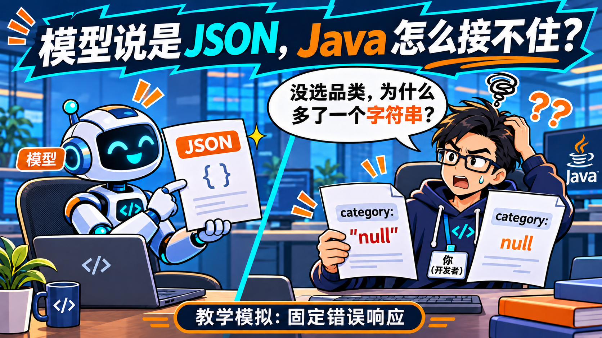
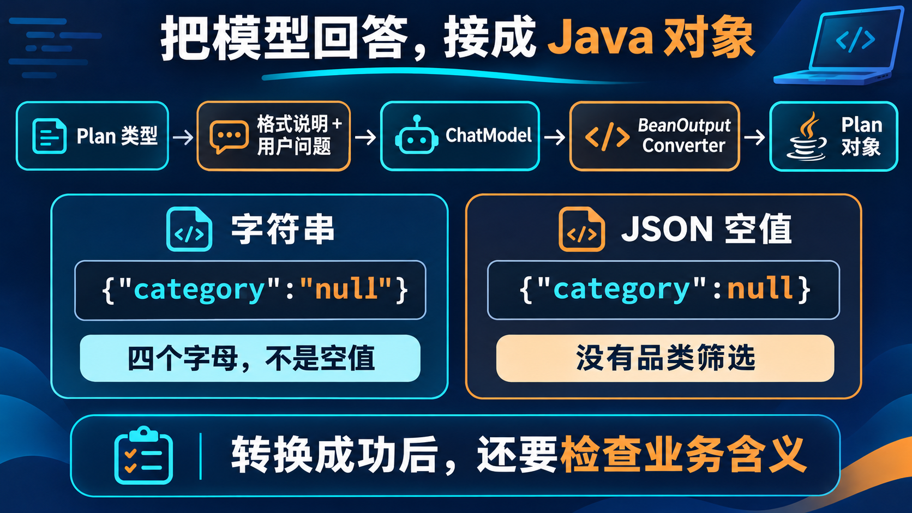

新增基础课编号：36（[基础课目录与对应表](<124_Text2SQL 基础课目录与故事课对应表.md>)）。

前置知识：复用原基础课「模型与消息」「结构化输出」；新增基础课「Spring AI 基础」中的 ChatModel、Prompt、BeanOutputConverter。对应 V02 → V03：让自然语言变成 Plan，暂不执行查询。



## SQL 算对了，运营还是得来找你

上一课，你终于把支付金额算清楚了。

两张订单的实付是 20000 分，关联商品明细后不能重复累计。那条参考 SQL 也保存进了工程。

运营看完很满意，第二天又发来一句：

昨天看九月，今天改看十月吧，还是每天一行。

你打开 SQL，改了两个日期，突然停住了。

你想做问数助手，结果只是把“开发帮忙查数”做得更熟练了。每换一个月份，运营还是要来找你。

于是你把问题交给模型：

```
统计2026年9月1日至9月30日支付成功订单实付金额，按天汇总。
```

你没有要求模型给出最终金额。模型还没查数据库，不应该知道金额。

这一轮只让模型做一件事：把这句话整理成计划，告诉程序要算什么、查哪段时间、怎样分组。

老板问：

你已经有 SQL 了，为什么还要加这张计划？

因为 SQL 负责执行算法，计划负责表达需求。把它们分开，后面才有地方检查口径、让用户确认，也能用同一个算法处理不同日期。

## 先约好程序到底接什么

你没有先写一大段提示词，而是打开 `Types.java`，定义这一版要接收的对象：

```java
public record Plan(String metric, String start, String end, String dimension,
                   String category, Boolean end_inclusive) {}
```

这六个字段，就是模型与 Java 之间的约定。这里的 `record` 是 Java 的数据载体，适合表示一组固定字段；读取字段用 `plan.metric()`、`plan.start()`，不用自己写一排 getter。

| 字段 | 这个问题要表达什么 | 示例 |
| --- | --- | --- |
| metric | 统计哪个指标 | `paid` |
| start | 区间从哪天开始 | `2026-09-01` |
| end | 区间到哪天结束 | `2026-09-30` |
| dimension | 结果按什么分组 | `day` |
| category | 是否筛选单个品类 | JSON `null` |
| end_inclusive | end 这一天是否包括在内 | `true` |

`paid` 是程序使用的指标标识，支付成功订单实付金额是业务名称。标识保持简短稳定，业务说明可以完整展开。

`category=null` 表示没要求品类筛选，不是一个叫 null 的商品品类。

最后一个布尔值也不是装饰。`end=2026-09-30` 且 `end_inclusive=true`，与 `end=2026-10-01` 且 `end_inclusive=false` 都可以表达完整九月。日期和是否含末日要一起读，不能看到日期字符串不同，就判定两个计划一定不同。

本课先把这份意思接住，统一日期边界的程序会在后面加入。

## 第一份响应：没有品类，却有了四个字母

为了稳定复现，我们在本课演示材料中准备了固定模型响应。下面都是**教学模拟**，不需要等线上模型随机犯错。

第一份响应长这样：

```json
{
  "metric": "paid",
  "start": "2026-09-01",
  "end": "2026-09-30",
  "dimension": "day",
  "category": "null",
  "end_inclusive": true
}
```

乍看没问题，所有字段都在。

但 Java 接到 `category` 后，拿到的是一个字符串。它的内容恰好由 n、u、l、l 四个字母组成。

这时下面两个判断的含义完全不同：

```java
plan.category() == null          // 有没有品类值
"null".equals(plan.category())   // 字符串内容是不是四个字母 null
```

如果把第二种输入当成正常筛选条件，后面就可能去找一个名叫 null 的品类。结果查不到数据，还容易被误以为“九月没有销售”。

所以这个问题不在数据库，也不在 SUM。它发生在模型输出进入业务对象的那一刻。

修正后的协议值应当是：

```json
"category": null
```

这里没有双引号。

不要为了省事，把所有字符串 `"null"` 全局替换为空值。转换器的职责是按类型读取响应，字段是否允许为空、没有筛选时该怎么表达，要先在输出约定中说清楚。

## 第二份响应：内容是 JSON，外面却套了一层 Markdown

另一份固定响应里，模型在 JSON 外面包了代码块：

````
```json
{"metric":"paid","start":"2026-09-01","end":"2026-09-30","dimension":"day","category":null,"end_inclusive":true}
```
````

人读起来很舒服：它还帮你做了代码高亮。

但如果把整段直接交给只接受 JSON 的解析器，开头的反引号就不属于 JSON 语法。

这两种失败要分开处理。字符串 `"null"` 是合法 JSON 中的错误业务值；代码围栏是外层输出包装的问题。不能用一句“JSON 格式有问题”把它们混起来。

你需要的是一条稳定的转换边界：先告诉模型返回什么结构，再用适配模型输出的转换器把响应接进 Java。



## ChatModel 负责调用，转换器负责接住

打开 `QueryPlanner.java`。这一版的核心方法很短，可以从上往下读完整条链路：

```java
public Plan interpret(String question) {
    var converter = new BeanOutputConverter<>(Plan.class);
    String instruction = "把明确的支付金额按天问题转换成计划。metric=paid，dimension=day，"
            + "category没有筛选时为JSON null。end_inclusive说明是否包含末日。仅生成计划，不执行。";
    var response = model.call(new Prompt(
            instruction + "\n" + converter.getFormat() + "\n" + question));
    return converter.convert(response.getResult().getOutput().getText());
}
```

第一步，`new BeanOutputConverter<>(Plan.class)` 告诉转换器目标类型是 Plan。这样格式说明与读取目标来自同一个 Java 类型，避免提示词写六个字段，代码却只接五个。

第二步，`converter.getFormat()` 把结构要求交给模型。它包含依据类型生成的 JSON Schema 和输出要求；不是给用户看的帮助文字。

第三步，补充类型本身表达不出来的业务含义。比如 `String category` 可以装很多字符串，但“未筛选时应返回 JSON null”需要额外说明。V03 在指令里明确这一点；下一课的显式 Schema 会进一步把字段可空类型列出来。

第四步，`model.call(...)` 发起模型调用。`Prompt` 承载这次输入，返回值 `ChatResponse` 包含模型输出。我们取出文本，再交给转换器。

最后，`converter.convert(...)` 返回 Plan。后面的代码读 `plan.metric()`，不需要每个节点都重新拆一遍 JSON。

这条链路没有生成 SQL，也没有访问订单表。它只是把用户问题变成程序可处理的数据。

## 模型连接放在哪里

`AiConfiguration.java` 提供一个 `ChatModel` Bean，`QueryPlanner` 通过构造器接收它：

```java
private final ChatModel model;
public QueryPlanner(ChatModel model) {
    this.model = model;
}
```

Spring 创建组件时，会把配置好的模型对象传进来。规划器因此不用自己查环境变量、拼请求地址或管理连接配置。

这份代码锁定 Spring AI 1.1.2、Spring AI Alibaba 1.1.2.2、Spring Boot 3.4.8、Java 17。模型配置在当前快照里明确使用 `deepseek-ai/DeepSeek-V4.1-Flash`，密钥从 `SILICONFLOW_API_KEY` 读取。

本课不用把这些底层配置逐行抄一遍。抓住三个位置即可：模型连接在配置类，业务指令在规划器，结果形状在 Types。

`temperature=0.0` 会减少输出的随机变化，但不等于模型永远返回同一个正确计划。对固定格式故障的讲解，我们用保存好的输入来重复观察。

## /plan 把这一轮串起来

上一课只有 `/health`，这一课增加一个真正接收业务问题的入口：

```java
@PostMapping("/plan")
public Plan plan(@RequestBody String question) throws Exception {
    return planner.interpret(question);
}
```

`@RequestBody String` 接的是原始文本，不是一个包含 `question` 字段的请求对象。下面运行时会用 `Content-Type: text/plain`，让请求与接口约定一致。

整个过程可以读成一句话：

```
POST /plan 的正文
→ StageController 接收 question
→ QueryPlanner 组织格式要求和问题
→ ChatModel 返回文本
→ BeanOutputConverter 转成 Plan
→ Spring 把 Plan 返回为 JSON
```

这里有两次不同方向的转换。模型文本转 Java 对象由转换器负责；Java 对象转 HTTP JSON 由 Web 框架负责。后者能成功，不代表前者一定理解对了。

## 在自己的版本里找到变化

从 `lessons/03/start` 开始，它与第 02 课 end 相同。对照本课 end，重点看这些变化：

```
src/main/java/course/text2sql/
├── AiConfiguration.java   新增模型连接
├── Types.java             新增 Plan
├── QueryPlanner.java      新增结构化规划
└── StageController.java   增加 POST /plan
src/test/java/course/text2sql/
└── StageTest.java         用固定响应验证链路
```

建议按 Types、模型配置、规划器、控制器的顺序阅读。数据先约好，才知道模型要返回什么；规划器先成立，控制器才有可调用的业务方法。

本课 `changes.patch` 能看到这些文件的变化。原来的 `explore.sql` 保留，它仍然是我们理解支付金额的参照。

## 先跑固定样例，再体验真实模型

先运行不消费模型额度的固定测试。站在课程代码包根目录：

```shell
cd lessons/03/end
cp .env.example .env
docker compose --profile check run --rm check
```

`StageTest` 把一个固定 `ChatResponse` 交给真实 `QueryPlanner`。它检查 `metric=paid`、`category` 是 Java null，并确认规划器调用了 ChatModel。

文档包还附带本课的故障演示模块，见 [labs/README.md](https://codeup.aliyun.com/6a4a062c08f52788b13355e9/xiaozhe-E-commerce/blob/main/text2sql-course/labs/README.md)。它把带代码围栏的响应分别交给普通 JSON 解析器和 `BeanOutputConverter`，观察前者失败、后者接住；再比较 `"null"` 与 `null` 进入 Plan 后的差别。

要体验真实调用，在 `.env` 中填写自己的密钥，然后启动：

```shell
docker compose up -d --build --wait
curl -sS http://localhost:18323/plan \
  -H 'Content-Type: text/plain; charset=utf-8' \
  --data-binary '统计2026年9月1日至9月30日支付成功订单实付金额，按天汇总。'
```

检查六个字段的意思，而不是逐字符比对 JSON 排版：

- 指标是 paid，分组是 day。
- 没有品类筛选，category 是真正的 null。
- 日期区间完整覆盖九月；end 与 end_inclusive 配套理解。
- 返回的是计划，不是金额结果。

如果没有拿到计划，先看 `docker compose logs app`。连接失败查模型配置；结构转换失败看返回格式；转换成功但业务含义错误，则要回到字段约定，不能只用“HTTP 200”判定完成。

## 本课练习与知识小结

练习仍使用一个指标、一个维度的明确问题：

```
统计2026年10月1日至10月7日支付成功订单实付金额，按天汇总。
```

提交请求文本、返回的 Plan，并用一句话解释 category 和 end_inclusive。再运行固定故障样例，说明代码围栏与字符串 null 为什么是两类问题。

| 知识点 | 本课学会什么 |
| --- | --- |
| Plan | 用固定字段表达需求，便于后续校验和确认 |
| ChatModel | 统一模型调用入口，连接配置由外部组件提供 |
| BeanOutputConverter | 生成格式说明，并把模型响应转换成 Java 对象 |
| JSON null | 表达没有值，与字符串 `"null"` 不同 |
| 格式与含义 | 能转换成对象之后，仍需核对业务意思 |

## 小哲心中隐隐的担心

老板看着返回的计划说：

行，这次至少不需要你手改日期了。

你也终于有了一个能接住模型输出的入口。

但运营随口问了句：

你告诉它我们有哪些表了吗？它怎么知道“支付金额”放在哪？

你回头看提示词。里面写了 paid，也写了 day，却没有给它一份完整的业务目录。

如果模型只凭名称联想，它可能猜一个听起来很合理的表名。

下一课，我们给 Agent 一项具体行动：先调用工具读业务目录，再整理查询计划。
