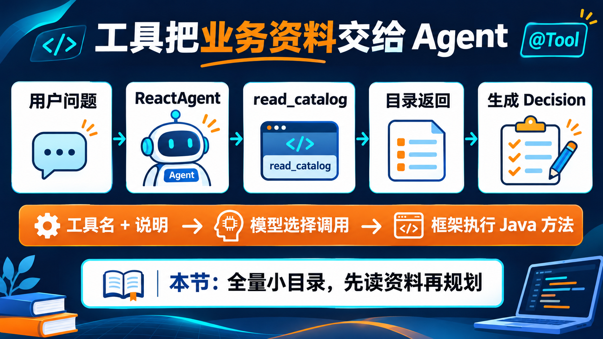

新增基础课编号：37（[基础课目录与对应表](<124_Text2SQL 基础课目录与故事课对应表.md>)）。

前置知识：复用原基础课「Tool Calling 基础」「工具参数、返回值与错误处理」；新增基础课「Spring AI Alibaba 的 ReactAgent 与工具」。对应 V03 → V04：Agent 调用 read_catalog，返回 Decision。


## 格式终于对了，资料从哪里来

上一课的 `/plan` 已经能把一句问题转成 Java 对象。

运营换日期，你不用再改 SQL。返回值里有指标、时间和分组，没有品类时也知道用 JSON null。

老板看着六个字段说：

都写得这么清楚了，下一步直接查库吧。

你却想起上一课末尾那个问题：模型知道我们公司的数据放在哪里吗？

一个字段叫 `metric`，不等于里面装的指标一定存在。一个字符串写着表名，也不等于数据库里真的有这张表。

你准备了一份固定错误响应，把后续规划器可能遇到的问题提前摆上桌。这是**教学模拟**：模型把查询对象写成 `sales_summary`，指标写成 `daily_revenue`。

两个名称看着很专业，像是一个规范的数据仓库。

但当前课里的支付金额标识是 `paid`，订单表是 `orders`。模型交来的名称，与我们实际约定的对象对不上。

这一次，你没有拿错误计划去执行 SQL。你先问：

如果从来没给过业务资料，凭什么要求它准确说出我们自己的名字？

## 别让业务目录继续藏在开发脑子里

财务知道支付金额不等于标价。开发知道 orders 是一行一张订单。运营知道这次想看每天的金额。

模型如果只拿到用户那一句话，三个人掌握的资料并没有自动进入它的输入。

我们需要把可用资料整理成一个明确入口。Agent 想规划问题时，可以先读它，再使用里面的名称和口径。

这一版先把目录做得很小，只讲一个指标：支付成功订单实付金额。

```java
public final class Catalog {
    public static final Catalog DATA = new Catalog();

    @Tool(name="read_catalog",
          description="Read the supported business metric before planning.")
    public String readCatalog() {
        return "本阶段只演示paid：支付成功订单实付金额，单位分，按orders.paid_at归属；"
                + "orders每行是一张订单，status=paid才计入。支持day分组，时间须由用户给出。";
    }
}
```

这段方法没有查询数据库。它返回的是课程已经确认过的业务说明。

我们不是让模型发现“哪个字段大概像金额”，而是把人已经确认的事实告诉它：指标叫 paid，来源是 orders，时间按 paid_at，状态选 paid。

第 02 课花时间对清楚的粒度，现在终于有了进入 Agent 的位置。

## @Tool 为什么不只是一个名字

`@Tool` 的名字和说明会成为模型可见的工具定义。

`name="read_catalog"` 告诉模型调用哪项能力。`description` 说明什么时候应该用它。Java 方法体则是真正执行时返回资料的地方。

这里要区分三个动作：

1. 开发把方法注册成工具。
2. 模型发出调用 read_catalog 的请求。
3. 框架执行 Java 方法，把返回值交回模型。

给方法加注解，不等于它已经被调用了。必须把工具注册到 Agent 中，并让模型发出相应调用。

这个工具没有参数，因为本课目录很小，直接一次返回。用户问题也不用当参数传进去，它已经在 Agent 的对话输入中。



## 从一次 ChatModel 调用，变成带工具的 Agent

打开 `QueryPlanner.java`，这一版的规划入口换成了 ReactAgent：

```java
var agent = ReactAgent.builder()
        .name("query_planner")
        .model(model)
        .instruction(Json.resource("policy.txt"))
        .tools(ToolCallbacks.from(Catalog.DATA))
        .outputSchema(Json.resource("decision-schema.json"))
        .build();
```

先看 `model(model)`。上一课配置好的 ChatModel 继续使用，换成 Agent 不需要重新找一套模型连接方式。

再看 `tools(...)`。`ToolCallbacks.from(Catalog.DATA)` 把带注解的方法适配成框架能调用的工具。业务目录仍是普通 Java 对象，工具调用的协议细节由适配层处理。

`instruction(...)` 读取行为要求，其中明确写了先调用 read_catalog。它解决的是“处理任务时先做什么”。

`outputSchema(...)` 指定最终 Decision 的输出结构。它解决的是“做完之后交回什么”。工具定义、行为指令、输出结构各有用途，不要全挤成一段自然语言。

接下来才把会话里的问题交给 Agent：

```java
String result = agent.call(Json.write(Map.of(
        "messages_oldest_first", session.messages))).getText();
return parseDecision(result);
```

`messages_oldest_first` 表示按先后顺序提供用户消息。这一课只有一条问题；后面用户补日期、修改条件时，仍然可以沿用同一份输入结构。

Agent 在内部可以经历模型调用、工具调用、读取工具结果，再给出最终文本。外部控制器依然只调用 `planner.interpret(session)`。

ReAct 在这里的用途很具体：模型需要先拿资料，再完成规划。本课只有一个目录工具，不需要为了显得复杂再加十个无关工具。

## 为什么不再只返回 Plan

你很快发现，仅有 Plan 不够用。

用户问题完整时，可以生成查询计划；问题缺日期时，需要追问；要求超出课程能力时，需要拒绝。三种情况不能都塞进一个貌似完整的计划里。

所以 V04 引入 Decision：

```java
public record Decision(
        String status,
        String reason,
        List<String> missing_fields,
        Plan plan,
        List<String> tables,
        Map<String, List<Evidence>> evidence) {}
```

| 字段 | 在这一轮规划中承担什么作用 |
| --- | --- |
| status | 选择 query、clarify 或 reject |
| reason | 简短解释当前决定 |
| missing_fields | 如果需要追问，缺哪类信息 |
| plan | 完整计划或保留已知条件的部分计划 |
| tables | 模型认为涉及哪些业务表，便于核对 |
| evidence | 指出计划里的信息来自用户哪句话 |

正常查询示例可以读成：

```
status=query：信息足够，准备进入后续检查
plan.metric=paid：用户要的是支付成功订单实付金额
tables=[orders]：本次按天统计使用订单表
evidence：指标、日期、分组分别引用用户原话
```

这里的 `query` 是规划状态，不表示 SQL 已经执行。当前版本仍然只返回规划结果。

`tables` 也不会拿来拼接 SQL。主路线之后按指标定义编译查询，这个字段用于解释与核对。真正的能力检查会在第 06 课接进来。

## 把空值要求写进显式 Schema

上一课已经见过 `"null"` 与 `null` 的区别。这一版打开 `decision-schema.json`，可以看到品类字段的明确类型：

```json
"category": {
  "type": ["string", "null"]
}
```

再看 `plan`：它允许一个计划对象，也允许 null。原因是拒绝请求时，可能根本没有可执行计划。

这两个空值处在不同层级：没有品类筛选，不意味着没有整个计划；没有计划，也不能伪造一个 query 状态蒙混过去。

`parseDecision` 用转换器接住 JSON，再检查必要字段是否齐全。比如不是拒绝状态，却连 plan 或 dimension 都没有，就不能把它当成完整决定继续使用。

这仍然是结构检查。它让后面的程序知道数据长什么样，业务含义则需要后续专门的校验器检查。课堂上看到一个对象成功返回时，先读它的内容，不要只盯着“没有抛异常”。

## 复现错误以后，怎样验证资料确实接上了

本课的演示材料放在 [labs/README.md](https://codeup.aliyun.com/6a4a062c08f52788b13355e9/xiaozhe-E-commerce/blob/main/text2sql-course/labs/README.md) 对应目录，准备了错误与修正后的两份固定 Decision。

第一份故意写入不存在的表 `sales_summary` 和指标 `daily_revenue`。第二份使用目录里的 orders 与 paid，并保留同一个九月按天查询。

演示按这个顺序来：

1. 先读错误文件，指出它与课程目录冲突的两个名称。
2. 调用真实 `read_catalog` 工具，看到返回的 paid、orders、paid_at 和统计粒度。
3. 把修正后的固定 Decision 交给本版真实 `parseDecision`，确认能够转换成对象。
4. 对照用户问题检查日期、分组和原话引用没有被替换掉。

固定样例在这里帮助我们重复看清“没有资料时会猜什么、补上资料以后应该按什么约定回答”。真实模型体验则使用同一个 Agent 入口，观察工具调用及最终决定。

不要把模型最后写了 `tables=[orders]` 当成工具执行证据。要观察工具是否被调用，可以在 `Catalog.readCatalog()` 上打断点；本课的固定测试还会通过 `ToolCallbacks` 直接调用注册后的工具，验证适配路径。

## 在 V04 中运行这一条问题

从课程代码包根目录进入本课，先停掉上一版服务，再启动本版：

```shell
cd lessons/04/end
cp .env.example .env
# 在 .env 中填写自己的模型密钥
docker compose up -d --build --wait
curl -sS http://localhost:18323/plan \
  -H 'Content-Type: text/plain; charset=utf-8' \
  --data-binary '统计2026年9月1日至9月30日支付成功订单实付金额，按天汇总。'
```

这次接口返回 Session，Decision 在 `decision` 字段里面。上一版直接返回 Plan，所以不要仍然去响应根部找 metric。

重点检查：

```
response.decision.status
response.decision.plan.metric
response.decision.plan.dimension
response.decision.tables
response.decision.evidence
```

对于这条明确问题，我们期望 query、paid、day，涉及 orders，原话依据能在提交的问题中找到。没有发起实际数据库查询，也不会出现支付金额结果表。

不需要真实模型时，运行 `docker compose --profile check run --rm check`。本版 StageTest 使用固定规划器返回 Decision，检查控制器返回结构、目录存在和解析行为。它适合查程序接线，不需要你为重复跑测试支付模型费用。

## 这次改了哪些文件

从 `lessons/04/start` 对照 end：

```
src/main/java/course/text2sql/
├── Catalog.java          目录工具
├── Json.java             资源读取与集中 JSON 转换
├── QueryPlanner.java     ChatModel 单次调用换成 ReactAgent
├── Types.java            加入 Decision、Session 等载体
└── StageController.java  /plan 返回 Session
src/main/resources/
├── policy.txt            行为要求
└── decision-schema.json  最终响应结构
```

Types 中已经有后续反馈和执行需要的载体，本课只沿着 Session.messages、Session.decision、Decision 和 Plan 阅读。先把当前请求走通，不必为了认识每个类型而提前展开确认卡和 SQL 执行。

`policy.txt` 也已经列出后续支持的指标和约束；V04 的目录工具本身仍只返回 paid 的简短说明。因此本课示例只使用明确的支付金额按天查询。下一课才把完整指标注册表接到工具上。

## 本课练习与知识小结

继续用九月支付金额按天这条问题。请提交四项：工具注册位置、工具返回的业务说明、响应中的 Decision、每个关键字段对应的用户原话。

再用一句话回答：如果在响应里看到 orders，为什么还不能仅凭这一个字段断言 Agent 调用了工具？

| 知识点 | 本课落点 |
| --- | --- |
| 工具定义 | @Tool 让模型知道工具名称和用途 |
| 工具执行 | ToolCallbacks 将模型调用接到真实 Java 方法 |
| ReactAgent | 组织读目录、获取资料和生成决定的过程 |
| Decision | 同时表达查询、追问和拒绝，而非强行凑计划 |
| 显式 Schema | 说明字段类型和空值位置，帮助输出稳定落到对象 |

## 小哲心中隐隐的担心

运营看见模型终于用了正确的指标和表名，松了一口气。

财务却开始补充：

支付金额你写清楚了，退款后净额呢？发货订单数呢？库存的日期怎么算？

你看着 Catalog 里那段字符串，开始往后加。

加到第三个指标时，你又打开提示词改了一遍。再回到工具说明，发现有一处还没同步。

这时候问题已经不是模型有没有资料，而是资料能不能长期保持一致。

下一课，我们把目录中的指标从一段字符串，整理成程序能够读取的语义注册表。
