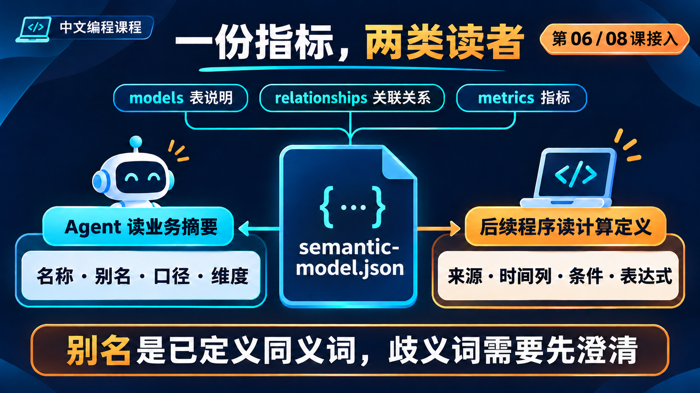

新增基础课编号：34、37（[基础课目录与对应表](<124_Text2SQL 基础课目录与故事课对应表.md>)）。

前置知识：新增基础课「Text2SQL 与语义层」「指标口径与统计粒度」；复用原基础课「工具参数、返回值与错误处理」。对应 V04 → V05：用 semantic-model.json 管理指标，目录工具从定义生成业务摘要。


## 目录有了，口径却开始到处复制

上一课，你给 Agent 接上了 read_catalog。

模型先读资料，再生成计划，至少不必完全凭“支付金额”几个字去猜公司的表名。

这时财务带来一个新要求：

支付金额和退款后净额要分清楚。净额扣的是这些订单全部已完成的退款，跨月也扣，别拿退款申请金额来算。

你点头，打开 Catalog，在原来的字符串后面加了一段。

接着你又打开 policy.txt，把净额的说明改了一遍。

刚准备提交，运营问：

那页面上说的“实付金额”，跟你目录里的“支付金额”是不是同一个东西？

你又去检查别名。

每处都不复杂，问题是同一项业务定义散在几个地方。修改时要靠人记住哪里出现过它，漏一处就留下两个版本的答案。

这次你决定先不加新的模型调用。你要把指标整理成一份能被程序读取的登记册。

## 先把一条指标写完整

你拿出第 02 课那张支付金额口径表。

当时我们已经确认：从 orders 出发，按 paid_at 选择日期，状态是 paid，累加 paid_cents，金额单位分。

这些不是模型的创作结果，是业务与开发共同确认的计算规则。现在把它们从讲义中的表格搬进 `semantic-model.json`。

先看 paid 的核心字段，下面节选自本版文件：

```json
"paid": {
  "name": "支付成功订单实付金额",
  "aliases": ["支付金额", "实付金额"],
  "description": "按支付日归属，金额单位分；品类支付金额按明细分摊。",
  "dimensions": ["none", "day", "month", "category"],
  "tables": ["orders"],
  "source": "orders o",
  "timeColumn": "o.paid_at",
  "condition": "o.status='paid'",
  "expression": "COALESCE(SUM(o.paid_cents),0)"
}
```

这份节选没有展示品类关联等附加字段；完整定义仍在源码里。先把最常用的支付金额按天这一条读通。

从名字往下看，你能找到两类信息。

一类给人和模型理解：name、aliases、description、dimensions。它们回答“用户在说什么”“可以怎样分组”。

另一类给后续程序计算：source、timeColumn、condition、expression。它们回答“从哪取数”“筛选什么”“如何求和”。

同一个 paid 标识，把这两类信息连到一起。

## 名称、别名和歧义词不能混成一组

运营说支付金额，另一个同事说实付金额。如果业务已经确认它们指向同一个指标，就放进 aliases。

```json
"aliases": ["支付金额", "实付金额"]
```

别名的价值是让模型把不同说法对应到同一项定义。它不是让开发收集所有可能出现的句子，然后逐条写正则。

财务又问：

那销售额也加进去？大家平时都这么说。

这时不能只因为大家常说，就直接当作同义词。

有人把销售额理解成支付金额，有人要扣退款，有人说的是下单金额。它们名字接近，却会得到不同答案。

所以注册表另外保存：

```json
"ambiguousTerms": ["销售额", "GMV", "订单量", "净额"]
```

这一组表示需要额外确认的说法。V05 会把它们交给 Agent 作为规划资料；第 07 课再把关键歧义检查接到程序入口。

本课先建立一个业务判断：确定的同义词可以映射，含糊的名称要先把口径问清。不是所有“常用词”都应该收进 aliases。

## 表说明解释数据是什么，关系说明一行怎样变多

完整文件不只有 metrics，还包括 models 和 relationships。

models 记录表的业务含义。例如 refunds 是已执行退款事实，refund_requests 是退款申请。申请金额不一定实际退掉，不能因为字段都带 refund 就拿来互换。

payment_transactions 则是支付渠道尝试流水。一张订单可能支付失败后重试，因此不能直接把流水行数当成支付成功订单数。

这些说明解决的是“看起来相关的表，到底能不能回答这个问题”。

relationships 则记录表之间怎么关联：

```json
{
  "models": ["orders", "order_items"],
  "joinType": "ONE_TO_MANY",
  "condition": "orders.id=order_items.order_id"
}
```

第 02 课里，一张订单对应两条明细，订单金额就随关联出现两次。现在 ONE_TO_MANY 把这个关系明确写了下来。

但登记了关系，并不等于程序会自动选对聚合方式。关系告诉你行数可能怎样变化，指标定义仍然要说明应该在订单粒度还是明细粒度上计算。

这就是 models、relationships、metrics 分开的原因：表是什么、表怎么连、业务怎么算，是三个不同的问题。



## 品类金额为什么另有一个表达式

打开 paid 的完整定义，会看到：

```json
"categoryJoin": " JOIN order_items i ON i.order_id=o.id JOIN products p ON p.id=i.product_id",
"categoryExpression": "COALESCE(SUM(i.paid_cents),0)"
```

这里累加的是 `i.paid_cents`，不是 `o.paid_cents`。

这一处正好接住第 02 课的教训：订单关联明细后，不能把整张订单实付在每条明细上重新算一遍。课程数据里的明细实付承担了商品分摊金额的角色，按品类统计时使用这份明细金额。

财务不需要读懂整条 SQL，也能确认业务意思：订单总额按订单算；品类分摊按明细金额算。

定义把这个区别放在同一个指标里保存，后续编译器根据分组或筛选需求选择对应路径。

今天不展开净额退款子查询的实现，那个一对多案例会在第 08 课完整复现和修复。本课先认识计算规则存在哪里，避免提前把后面的算法全部讲一遍。

## Catalog 怎样把文件读成对象

V04 的 Catalog 是一个返回固定字符串的类。V05 把它改成承接注册表的 record：

```java
public record Catalog(
        Map<String, Object> models,
        List<Object> relationships,
        Map<String, Metric> metrics,
        List<String> ambiguousTerms,
        Map<String, String> dimensionDefinitions) {
    public static final Catalog DATA =
            Json.read(Json.resource("semantic-model.json"), Catalog.class);
}
```

这里省略了内部 Metric 定义和工具方法，先看加载路径。

`Json.resource(...)` 从应用资源里读文件，`Json.read(...)` 按 Catalog 类型解析。加载完成后，程序通过 `Catalog.DATA.metrics()` 取得指标集合，通过 `get("paid")` 找到具体指标。

文件位于 `src/main/resources/`，打包时一起进入应用。它不是某台开发电脑上的临时绝对路径。

也要注意加载时机：这里用的是静态初始化。本版没有做热更新。修改 JSON 后，需要重新构建并启动对应应用，正在运行的进程不会自动重新读一遍文件。

## 工具返回摘要，不把所有计算片段塞给模型

再看 `readCatalog()`，它没有直接把整个 Catalog 对象原样输出：

```java
Map<String, Object> definitions = new LinkedHashMap<>();
metrics.forEach((key, metric) -> definitions.put(key, new TreeMap<>(Map.of("name", metric.name(),
        "aliases", metric.aliases(), "description", metric.description(),
        "dimensions", metric.dimensions().stream().sorted().toList(),
        "tables", metric.tables().stream().sorted().toList()))));
return Json.write(new TreeMap<>(Map.of("models", models, "relationships", relationships,
        "metrics", definitions, "ambiguousTerms", ambiguousTerms)));
```

字段按固定顺序输出，维度和表集合也先排序，让相同目录在服务重启后仍提供相同的模型输入。

工具挑出了名称、别名、口径、允许维度和基础表信息。模型先用这些资料判断用户在说哪项指标。

SQL 来源、条件和表达式仍保存在 Metric 中，留给后续程序读取。这样模型做规划时，不必同时承担“理解用户”和“现场重新编一套计算公式”两件事。

同一份文件，因此有两种读取方式：Agent 经工具看业务摘要，程序经类型化对象看计算定义。

这里仍然是小目录的全量读取。十四张表说明加五项指标，适合先把业务关系看完整。等数据目录变大，才需要考虑怎样缩小候选范围。

## 这一版真正集中到了哪里

老板听完说：

那以后所有业务口径只改这一个文件？

你打开实际代码，没有把话说满。

这一版已经把完整指标数据集中到了注册表，目录工具也从它生成摘要。接下来的能力校验和 SQL 编译会继续读取这些定义。

但 policy.txt 里仍保留了部分能力与口径说明，decision-schema.json 里也列出了允许的指标标识。增加一种新指标，仍然要检查这些位置是否一致，不能只往 JSON 多加一项就认为功能自动完成。

这里先分清：指标定义适合集中管理；流程要求和输出协议还有各自的文件。后续真正扩展能力时，需要同时考虑它们之间的约束。

本课当前先使用已经定义好的五项指标，正常示例始终使用单指标、单维度、明确日期。我们这课练的是看懂这份定义，暂不扩展指标数量。

## 做一个只改定义、不改工具的实验

为了观察这次改造带来的变化，文档包提供了独立教学测试，不需要修改冻结代码。

实验在内存中复制一份注册表，把 paid 的 description 改成带有“教学标记”的说明，再用这份数据创建 Catalog 对象。

然后调用它的 `readCatalog()`。

你会在返回摘要中看到这个教学标记，而 Java 工具方法完全没有改动。说明目录输出来自输入定义，不再是一段另写的业务字符串。

这一步不是让学员随意改金额算法。它只是用一个无害的描述变化，验证数据从哪来。

演示模块还会对比两种读取结果：

```
Catalog 中的 paid.expression 存在
read_catalog 摘要中的 paid.expression 不输出
```

这能帮助你看清业务摘要与计算定义之间的分工。两份输出不同，是因为各自的读者需要不同信息。

相关命令和文件见 [labs/README.md](https://codeup.aliyun.com/6a4a062c08f52788b13355e9/xiaozhe-E-commerce/blob/main/text2sql-course/labs/README.md)。课堂主线依然是完整的 V05 快照，实验放在单独目录里。

## 从 V04 切换到 V05，看两处变化

本课真正新增和修改的文件只有两处：

```
src/main/resources/semantic-model.json        新增：集中定义
src/main/java/course/text2sql/Catalog.java    修改：读文件并生成摘要
```

QueryPlanner 的工具注册方式没变，工具仍叫 read_catalog。控制器也没换 URL，仍然接受 `POST /plan`。

从课程代码包根目录进入本课：

```shell
cd lessons/05/end
cp .env.example .env
# 真实模型体验时填写自己的密钥
docker compose up -d --build --wait
curl -sS http://localhost:18323/plan \
  -H 'Content-Type: text/plain; charset=utf-8' \
  --data-binary '统计2026年9月1日至9月30日支付成功订单实付金额，按天汇总。'
```

仍然使用上一课同一句问题，是为了观察目录来源的变化，而不是同时更换指标、时间和分组。

预期仍是 paid、day、九月日期区间。JSON 的说明文字可以不同，但不应该因为目录换了存储方式，连用户要查的事也变了。

固定测试用 `docker compose --profile check run --rm check`；独立教学实验则检查注册表加载、摘要生成与字段分工。两种入口都不需要为了复现效果去随机碰模型失败。

## 本课练习：把口径读回业务语言

请在 semantic-model.json 里找到 paid，完成下面几项：

1. 写出它的两个别名，解释为什么“销售额”没有直接放进去。
2. 找出时间字段、状态条件和默认求和表达式。
3. 解释按品类金额为什么换成明细实付。
4. 从工具返回值中找到 name、dimensions 和 tables，说明哪些计算字段留在程序内部。

再读 count 的定义，只回答一个问题：为什么支付订单数使用订单身份计数，而不是直接数支付尝试流水？不需要添加第二个指标查询，也不需要修改生产逻辑。

| 知识点 | 在项目里的落点 |
| --- | --- |
| models | 解释表里记录的业务对象 |
| relationships | 说明关联关系和一对多方向 |
| metrics | 把指标名称、口径与计算定义组织在一起 |
| aliases | 表示已经确认的同义说法 |
| ambiguousTerms | 保留需要确认口径的说法 |
| 目录摘要 | 从定义生成模型需要的业务资料 |

## 小哲心中隐隐的担心

财务终于不用在一大段 Java 字符串里寻找“退款扣什么”。运营也能从别名和描述看懂支付金额的意思。

老板指着注册表说：

既然支持哪些分组都写了，那模型总不会再乱配了吧？

你看了一眼 net 的 dimensions。这里允许 none、day、month，没有 category。

如果模型仍然给出“退款后净额按品类”的计划，JSON 可能完全合法，字段也都齐全。

目录告诉了模型规则，但程序还没有逐项检查这份计划是否在能力范围内。

下一课，我们把注册表里的定义用起来：模型提出计划，程序决定这份计划能不能进入后续流程。
