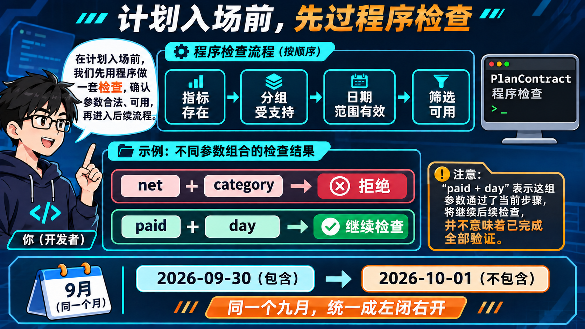

新增基础课编号：34、36（[基础课目录与对应表](<124_Text2SQL 基础课目录与故事课对应表.md>)）。

前置知识：第 03 课的 Plan、第 05 课的指标注册表；基础知识「结构化输出」「指标口径与统计粒度」。对应 V05 → V06：把目录中的能力定义变成程序检查，并统一日期区间。


## 老板看见字段齐全，就以为能交给数据库

上一课，你把指标整理进了 semantic-model.json。

支付金额按什么日期，退款后净额扣哪些退款，每个指标允许什么分组，都有地方可以查。Agent 也能通过 read_catalog 读到这些业务资料。

老板看着一个格式整齐的计划说：

指标有了，日期有了，分组也有了，这次总能查了吧？

你差点点头。

但你拿出一份固定计划，里面只有一个组合值得注意：

```json
{
  "metric": "net",
  "start": "2026-09-01",
  "end": "2026-09-30",
  "dimension": "category",
  "category": null,
  "end_inclusive": true
}
```

这是**教学模拟：固定错误计划**。它想把退款后净额按品类分组。

JSON 合法，字段类型也没错。BeanOutputConverter 可以把它转换成 Plan。你如果只检查“能否解析”，这份计划已经过关了。

可你打开注册表，net 的 dimensions 明明只有：

```json
["none", "day", "month"]
```

没有 category。

## 问题不是缺了一个 GROUP BY

财务看着你问：

我们的退款按订单登记。订单里有键盘也有鼠标，你准备把退款分给哪一个品类？

你这才意识到，不能只往 SQL 末尾加一个分组字段。

支付金额按品类有明细分摊金额，退款后净额却没有在当前课程中定义品类退款分摊算法。没有业务定义，就不应该假装有一个可以执行的计算方式。

因此这次要修复的，是“程序把不支持的计划继续往下传”的问题。

不是把用户要求的按品类悄悄改成按天，也不是让模型少写一个条件。如果用户的原要求不受支持，系统就要明确停下来。

后面若用户重新提出“按天统计同一净额”，那是一条新的、明确的需求，程序再按支持的组合处理。

## 注册表告诉模型，校验器约束程序

你在 `PlanContract.java` 中加入第一道检查：

```java
var metric = Catalog.DATA.metrics().get(plan.metric());
if (metric == null || !metric.dimensions().contains(plan.dimension())) {
    throw new IllegalArgumentException("不支持该指标或分组");
}
```

读起来很直接。

先按 metric 找指标。找不到，说明计划使用了当前目录没有定义的名字。

找得到，再检查它允许的维度里有没有计划要求的 dimension。一个分组名字本身存在，不代表它能和所有指标组合。

这两步共同约束的是“指标与分组的组合”，而不是两张互不相关的白名单。

你也不需要再复制一份 net 支持哪些分组的列表到 Java。第 05 课整理好的定义，在这里直接成为程序的检查依据。



## 九月三十日到底包不包括

运营又提交了一个完全正常的问题：

```
统计2026年9月1日至9月30日支付成功订单实付金额，按天汇总。
```

这次指标和分组没问题，日期却还有两种表达方式：

| 输入计划 | 表示的范围 |
| --- | --- |
| end=2026-09-30，end_inclusive=true | 包括九月三十日 |
| end=2026-10-01，end_inclusive=false | 不包括十月一日 |

它们都可以表示完整九月。

如果每个后续节点都自己理解一次这个布尔值，有的节点加一天，有的没加，还有的可能重复加一天。相同需求就会在不同阶段变出不同日期。

所以你给后续程序约定一个统一形式：左闭右开。开始日期包含，结束日期不包含。

```java
LocalDate end = LocalDate.parse(plan.end());
if (Boolean.TRUE.equals(plan.end_inclusive())) {
    end = end.plusDays(1);
}
Plan normalized = new Plan(
        plan.metric(), plan.start(), end.toString(),
        plan.dimension(), plan.category(), false);
validate(normalized);
return normalized;
```

这段节选来自 `normalize`。方法前面还会检查 end_inclusive 不能缺失，因为程序不能替用户猜末日是否包含。

最值得看的不是 `plusDays(1)`，而是新计划中的 `false`。它说明转换已经完成；后续再遇到同一计划，不应该又多加一天。

固定测试会把规范化后的计划再次交给 normalize，确认结果不变。一个日期边界，只处理一次。

## 有开始和结束，不代表区间有效

把边界统一以后，才方便检查日期跨度：

```java
long days = ChronoUnit.DAYS.between(
        LocalDate.parse(plan.start()),
        LocalDate.parse(plan.end()));
if (days <= 0 || days > 366) {
    throw new IllegalArgumentException("日期范围须为1至366天");
}
```

现在 days 的含义很清楚：排他末日减开始日期。

例如九月一日至十月一日前，跨度为 30 天。同一天且 end_inclusive=true，会先转换成下一天，得到一个完整单日。

但开始和结束都是九月一日，末日又不包含，就什么都没选中，days 为零，不能当作正常日期范围继续走。

课程还把最长区间限制为 366 天。这是当前产品范围，避免一个小型问数入口直接承担无限跨度的查询。

## 日期规则也要随指标变化

运营问支付金额，一段时间可以汇总很多订单；问库存余额，就不是同一回事。

当前课程数据只有 2026 年 10 月 31 日的库存快照。计划里写“九月库存”，并不会让数据库自动拥有那天的数据。

注册表的 snapshotDate 给出受支持的快照日期，校验器检查它与计划是否一致：

```java
if (metric.snapshotDate() != null
        && !(plan.start().equals(metric.snapshotDate()) && days == 1)) {
    throw new IllegalArgumentException("该日期没有受支持的库存快照");
}
```

这里同时检查日期和跨度。要的应是已定义快照那一天，而不是从那天开始的一整个月。

品类筛选也类似。计划中 category 非空时，程序会检查这个指标是否定义了相应关联路径；空白品类值也不能作为正常筛选条件。

这些检查并不是让你不断扩展功能，而是保证当前承诺过的能力有明确入口条件。

## 在控制器中接上这道门

你把 PlanContract 写好以后，还要确认主流程真的调用了它。

打开本版 `StageController`，找到生成 Decision 后的分支：

```java
if (session.decision.status().equals("query")) {
    Decision d = session.decision;
    session.decision = new Decision(
            d.status(), d.reason(), d.missing_fields(),
            PlanContract.normalize(d.plan()),
            d.tables(), d.evidence());
}
```

只有模型声称可以查询时，才对完整计划做规范化与校验。模型已经要求澄清或拒绝的决定，不在这里强行凑成一个查询计划。

V06 遇到非法组合会抛出异常，阻止计划继续返回为正常结果。它还没有把异常统一转换成面向用户的拒绝状态；下一课接入 QueryRules 后，才会把这类已知失败整理进 session.stage 和 reason。

所以这一课演示错误样例时，看的是校验器抛出“不支持该指标或分组”，不要期待当前 HTTP 接口已经显示一张完整的拒绝卡片。

## 固定案例怎样跑出修复前后

这课不用反复问模型，等待它刚好生成一次 net/category。

独立演示模块保存了同一份固定计划。先看第 05 版：它只有目录和规划，尚未在控制器里调用 PlanContract。再看第 06 版：计划必须经过 normalize，里面随即调用 validate。

运行 [labs/README.md](https://codeup.aliyun.com/6a4a062c08f52788b13355e9/xiaozhe-E-commerce/blob/main/text2sql-course/labs/README.md) 中第 06 课测试，可以看到四组检查：

| 固定输入 | 应观察到什么 |
| --- | --- |
| net + category | 抛出不支持组合的异常 |
| 明确的 net + day | 组合校验可以通过 |
| 九月三十日，包含末日 | 转成十月一日，不包含末日；重复规范化保持不变 |
| 空区间、不支持的品类筛选、错误库存日期 | 对应检查拦截 |

其中 net/day 是对另一个明确支持组合的检查，不是程序偷偷把 net/category 改写了。请在演示时把这两份输入分开。

## 在本版接口里核对正常日期

本课新增 `PlanContract.java`，并修改控制器接入规范化。`QueryPlanner` 的模型调用方式不需要再换一遍。

```
lessons/06/start/ → V05，已有目录
lessons/06/end/   → V06，增加计划校验
src/main/java/course/text2sql/PlanContract.java
src/main/java/course/text2sql/StageController.java
```

停掉上一课服务后，从课程代码包根目录进入本课：

```shell
cd lessons/06/end
cp .env.example .env
# 真实模型体验时填写自己的密钥
docker compose up -d --build --wait
curl -sS http://localhost:18323/plan \
  -H 'Content-Type: text/plain; charset=utf-8' \
  --data-binary '统计2026年9月1日至9月30日支付成功订单实付金额，按天汇总。'
```

在返回的 decision.plan 中，检查 start 是九月一日、end 是十月一日、end_inclusive 是 false。此时九月三十日没有丢失，只是换成了内部统一表达。

不调用模型的原章节测试仍是：

```shell
docker compose --profile check run --rm check
```

整月问法同样完整：“2026年9月支付金额按天统计”表示九月全月、按天分组。提示词明确这一约定，程序仍把自然月末转换为下月一日的排他上界；不需要学员每次展开起止日期。

## 本课练习与知识小结

正常练习使用明确问题：

```
统计2026年10月1日至10月7日支付成功订单实付金额，按天汇总。
```

写出规范化后的起止日期与 end_inclusive，再说明 net 为什么不能直接搭配 category。最后提交固定测试中非法组合被拦截的结果。

| 知识点 | 本课带走什么 |
| --- | --- |
| 结构与能力 | 字段可解析，不代表组合受支持 |
| 计划校验 | 从注册表读取约束，程序明确执行 |
| 日期规范化 | 把包含末日转换成排他末日，后面统一使用 |
| 快照与流水 | 库存某日余额不能当作任意区间的订单流水 |
| 拒绝与改写 | 不支持的要求应停下，不能悄悄删条件 |

## 小哲心中隐隐的担心

老板看见不支持的计划被拦住，终于觉得程序像是有一道门了。

但下一次，老板只问了一句：

上月销售额是多少？

模型填上 paid、九月一日至十月一日。字段合法，日期有效，paid 也受支持。

校验器一路通过。

你却不敢直接交付：老板从来没说过销售额就是支付金额。

下一课，我们要检查另一件事——计划里的口径和日期，究竟是不是用户明确给过的。
