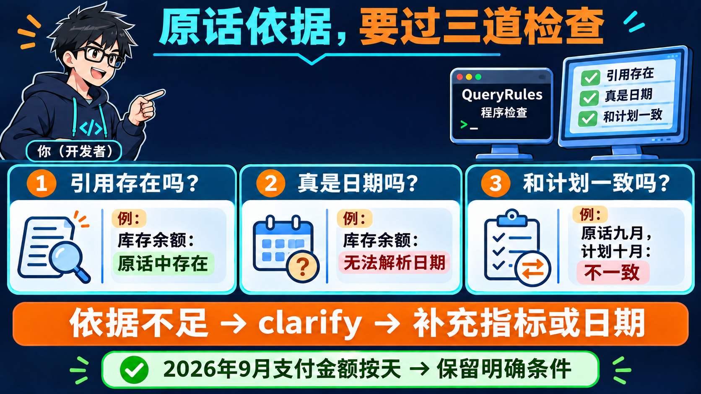

新增基础课编号：34（[基础课目录与对应表](<124_Text2SQL 基础课目录与故事课对应表.md>)）。

前置知识：第 05 课的别名与歧义词、第 06 课的能力校验；原基础课「结构化输出」。对应 V06 → V07：检查用户原话依据，缺少明确口径或日期时转为 clarify。


## 这次没有非法字段，还是不能放心

上一课，你已经给查询计划加上程序检查。

不支持的指标与分组组合过不去，日期范围有边界，库存也只能使用已有快照。

老板在群里发来一句：

上月销售额是多少？

模型很快给出一份计划：paid，九月一日至十月一日，不分组。

你检查了一遍：指标存在，日期合法，分组也支持。它不像上一课那个净额按品类的错误，校验器找不到任何不支持的组合。

但财务看见“支付金额”四个字，立刻问：

老板要的是扣退款以后，还是没扣退款？他说清楚了吗？

你回头翻聊天记录，只有“销售额”。

这次错的不是数据类型，也不是程序能力，而是模型替用户做了一个没有得到确认的业务决定。

本课用固定响应模拟这个过程，让同一份“看着很完整”的计划进入真正的检查链路。

## 另一份计划，日期也是模型自己补的

仓库同事问：

查一下库存余额。

模型填入 2026 年 10 月 31 日，因为课程设定的业务今天是这一天，数据也恰好只有这份快照。

程序当然能查这份库存，但用户没有指定日期。

“系统有哪天的数据”和“用户想查哪天的数据”不是一回事。不能因为只有一份快照，就直接替对方选了这份快照。

你需要的规则很明确：要进入后面的查询流程，指标口径和日期必须有用户原话依据，或者来自后续交互中的明确选择。

## 先让计划附上原话位置

V04 已经定义了 Evidence：

```java
public record Evidence(int message, String quote) {}
```

message 是用户消息的编号，从 0 开始；quote 是该条消息中的连续原文。

例如用户说：

```
2026年9月支付金额按天统计
```

相应依据可以是：

```json
{
  "metric": [{"message": 0, "quote": "支付金额"}],
  "date": [{"message": 0, "quote": "2026年9月"}],
  "dimension": [{"message": 0, "quote": "按天"}]
}
```

这份依据不是让模型写长篇理由。它要指出计划里的关键决定从哪里来，程序才能回到输入中核对。

目录能解释支付金额怎样计算，却不能作为“用户接受了这个口径”的证据。因此 quote 应该来自用户消息，不是从 read_catalog 复制一段定义。

## 第一关：引用的文字真的存在吗

打开 `QueryRules.java`，先看 `hasEvidence` 的判断核心：

```java
item.message() >= 0
        && item.message() < session.messages.size()
        && item.quote() != null
        && !item.quote().isBlank()
        && session.messages.get(item.message()).contains(item.quote())
```

这几步分别确认消息位置有效、引用非空、原话里确实有这段文字。

假设用户只说“查一下库存余额”，模型却引用“2026年10月31日”。这段日期根本不在原话里，第一关就过不去。

你不需要再调用一个模型判断“它是不是说过”。这部分可以直接由程序核对。

但只做到这里，还不够。

## 第二关：原话存在，不代表它能证明这个字段

你又准备了一个固定错误响应：

```json
"date": [{"message": 0, "quote": "库存余额"}]
```

用户原话里确实有库存余额。字符串包含检查会返回 true。

问题是，库存余额不是日期。

所以日期依据还要经过解析：引用本身必须能表达一个受支持的日期或区间。解析不出来，就不能把它当作日期依据。

同样，销售额确实出现在原话里，也不能直接证明用户选择了 paid。它在第 05 课的 ambiguousTerms 中，就是因为口径没有被唯一确定。

这一步补上的是依据的业务含义，而不是再多检查几个 JSON 字段有没有值。



## 第三关：解析出来的日期，要和计划一致

还有一种情况更隐蔽：用户说九月，引用也写九月，但计划被填成十月。

如果只检查引用存在、日期可解析，仍然会放过它。

所以我们要同时比较两个区间：

```
用户原话 / 日期引用 → 解析成区间
模型计划 → 规范化后的区间
两个区间必须一致
```

课程里的 `MeaningEvidence.date` 会检查引用解析结果与 plan 是否匹配，也检查对应整条用户消息解析的范围。

这能拦住“引用九月，执行十月”的固定案例。它把用户表达的范围和程序准备使用的范围对在一起。

本课业务今天固定为 2026-10-31，所以“上月”在课堂中始终对应九月。它不是录课电脑当前日期，隔几天重录也不会突然换月。

## 两个现成组件，课上不逐行讲日期正则

`DateEvidence` 和 `MeaningEvidence` 作为现成组件提供。你不需要为了做问数 Agent，先花一整课重写日期解析器。

只看它们在主流程中的职责：

| 组件 | 接收什么 | 判断什么 |
| --- | --- | --- |
| DateEvidence | 一段日期原文 | 能否解析成课程支持的连续区间 |
| MeaningEvidence.date | 会话、计划与日期依据 | 原文日期是否真实支持计划区间 |
| MeaningEvidence.metric | 会话、计划与口径信息 | 有没有明确口径，是否仍有未解决歧义 |

日期解析函数返回 Optional。不能确定，就返回空结果，让流程追问，不把一个普通业务词强行解释成今天。

口径检查会使用注册表里的 ambiguousTerms，也会识别课程支持的明确说法。这是一组有限业务规则，不是把所有自然语言都变成正则解析器。

你在课上需要讲清楚的是：模型提出字段值，程序检查字段值的依据；日期语法的具体实现留在组件里，想深入的学员可以课后读。

## 让程序真正使用已有的歧义词

上一课之后，注册表已经有销售额、GMV、订单量、净额这些名称。但如果只是把它们交给模型参考，模型仍可能忽略它们。

这一版把歧义检查接到程序里。最近的相关用户消息含有歧义词，又没有明确指定当前口径，就返回不充分。

例如：

| 用户原话 | 固定计划的假设 | 程序应该怎样处理 |
| --- | --- | --- |
| 2026年9月销售额按天 | 默认 paid | 追问 metric，保留九月和按天 |
| 2026年9月支付金额按天 | paid | 口径明确，继续检查 |
| 查询库存余额 | 默认今天 | 追问 date |
| 查询2026年10月31日库存余额 | 指定当天快照 | 日期明确，继续检查 |

不是只要出现销售额三个字就永远拒绝。如果用户明确说明“这里的销售额指支付金额”，检查的目标仍然是确定口径。课程正常练习则直接使用支付金额等明确名称，先把主链路走稳。

## 检查不足以后，保留已经说清楚的条件

`QueryRules.check` 在计划规范化和表检查之后，收集缺少依据的字段：

```java
List<String> missing = new ArrayList<>();
if (session.choice.metric() == null
        && (!hasEvidence(session, "metric") || !MeaningEvidence.metric(session))) {
    missing.add("metric");
}
if (session.choice.start() == null
        && (!hasEvidence(session, "date") || !MeaningEvidence.date(session))) {
    missing.add("date");
}
```

这里节选了口径和日期部分。显式分组、品类筛选也要检查相应依据。

missing 不为空时，流程转为 clarify；已有条件则继续保留在原计划中：

```java
session.decision = new Decision(
        "clarify", reason, missing,
        old.plan(), old.tables(), old.evidence());
```

用户说“九月销售额按天”，缺的是指标口径，不是让用户把九月和按天重说一遍。

`session.choice` 是为后面的明确选项预留的入口。V07 还没有完整的点选界面和暂停恢复流程；本课先实现“必须追问什么”。第 11 课再让用户通过选项补齐，避免自由回复时丢掉已有条件。

## 看哪一个状态，才知道检查后的决定

本课 `/plan` 仍然返回 Session，但处理顺序变成：

```java
session.decision = planner.interpret(session);
QueryRules.check(session);
return session;
```

先有模型决定，再有程序检查结果。界面应当以 `session.stage` 判断接下来走哪条路。

| stage | 当前含义 |
| --- | --- |
| reject | 计划能力、日期或表等检查不通过 |
| clarify | 需要用户补充明确依据 |
| review | 通过本轮检查，等待后续环节 |

注意 review 只是本版的下一阶段标记，不表示 V07 已经执行了一次额外模型复核，也不表示确认卡已经出现。

还有一个容易看错的细节：程序拒绝时可能只修改 session.stage 和 reason，原始 decision 中的 query 仍被保留。观察最终处理结果要看外层 stage，不能只看模型最初的 status。

## 固定样例，先看错误怎么被拦

文档包的第 07 课实验把固定模型响应送入真实 QueryRules，不调用模型 API。

按下面五个观察点演示：

1. 销售额被默认成 paid，程序追问 metric，并保留 day。
2. 库存余额被引用成日期，程序追问 date。
3. 用户没说日期，模型编造日期引用，程序追问 date。
4. 引用九月、计划十月，程序追问 date。
5. 明确的支付金额按天和指定日期库存继续到 review，没有多余追问。

最后一项同样重要。修澄清不能变成“所有问题都让用户重说”。明确输入应该继续往后走。

运行方式见 [labs/README.md](https://codeup.aliyun.com/6a4a062c08f52788b13355e9/xiaozhe-E-commerce/blob/main/text2sql-course/labs/README.md)，测试文件为 `07-demo/src/test/java/course/text2sql/EvidenceDemoTest.java`。

## 在 V07 中观察正常路径

本课新增 QueryRules 与两个依据组件，控制器只需接入一次 check：

```
lessons/07/end/src/main/java/course/text2sql/
├── QueryRules.java       检查顺序与状态分流
├── MeaningEvidence.java  口径和日期依据判断
├── DateEvidence.java     现成日期解析组件
└── StageController.java  接入 QueryRules.check
```

停掉上一版服务后运行：

```shell
cd lessons/07/end
cp .env.example .env
# 真实模型体验时填写自己的密钥
docker compose up -d --build --wait
curl -sS http://localhost:18323/plan \
  -H 'Content-Type: text/plain; charset=utf-8' \
  --data-binary '统计2026年9月支付金额，按天汇总。'
```

重点检查 stage、reason、decision.missing_fields 和 decision.evidence。正常明确计划应进入 review；固定歧义案例则由演示测试稳定复现，不必让线上模型重复猜错。

## 本课练习与知识小结

运行两条明确问题：九月支付金额按天，以及 2026 年 10 月 31 日库存余额。说明每项计划决定对应哪段用户原话。

再观察固定的销售额案例，提交程序追问的字段，并检查原来的日期、分组是否仍在计划中。DateEvidence 的内部正则不作为本课默写或重写作业。

| 知识点 | 本课带走什么 |
| --- | --- |
| 引用真实性 | 原话里确实存在这段文字 |
| 依据充分性 | 文字能支持这个口径或日期，而非只碰巧出现 |
| 日期一致性 | 用户范围与计划范围一致 |
| 强制澄清 | 关键依据不足时由程序转追问 |
| 条件保留 | 追问缺失字段，不清空已明确的信息 |

## 小哲心中隐隐的担心

老板这次补得很明确：

查九月支付订单的实付，减去这些订单全部已完成退款，跨月退款也算。

你终于不用猜他要哪种净额了。

计划合法，依据也够。下一步该把它编译成 SQL。

可一张订单可能退两次款。你把订单和退款直接关联，发现算出的净额居然比原始实付还高。

第 02 课那个一对多的问题，又换了一张表回来找你了。
