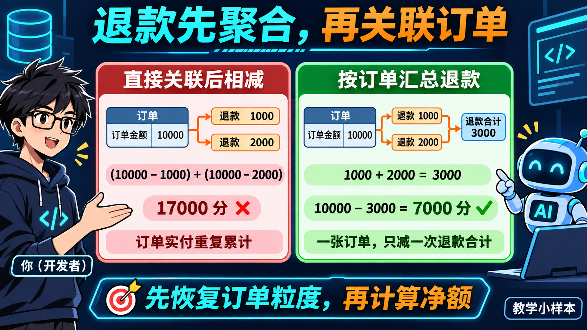

新增基础课编号：35、39（[基础课目录与对应表](<124_Text2SQL 基础课目录与故事课对应表.md>)）。

前置知识：第 02 课的统计粒度、第 05 课的指标注册表、第 06 课的日期规范化；新增基础知识「SQL 安全」中的参数化查询。对应 V07 → V08：从已定义计划编译 SQL，修复退款一对多聚合。


## 口径问清楚了，数字却又错了

上一课，老板终于明确了净额算法：这批支付订单的实付，减去它们全部已完成退款，包含跨月退款。

你不再需要猜“销售额”到底指什么。

模型可以把需求整理成 net 计划，程序也能检查日期和原话依据。现在，轮到你把计划变成数据库能够执行的语句。

你先拿一个最小样本试算：一张订单支付 10000 分，后来分两次退款，分别退 1000 分和 2000 分。

手算很简单：

```
10000 − 1000 − 2000 = 7000 分
```

你把订单和退款关联，写下：

```sql
SELECT SUM(o.paid_cents - r.amount_cents) AS value
FROM sample_orders o
JOIN sample_refunds r ON o.id = r.order_id;
```

结果居然是 17000 分。

财务看了看：

退完钱，净额还比实付高？你是不是又把同一张订单算了两遍？

## 先看关联后的两行，别急着看最终 SUM

这个案例使用固定教学小样本，不依赖模型生成错误 SQL。

订单只有一行：

| 订单 | 实付（分） |
| --- | --- |
| 1 | 10000 |

退款有两行，均视为已完成：

| 订单 | 本笔退款（分） |
| --- | --- |
| 1 | 1000 |
| 1 | 2000 |

关联后的中间结果是：

| 订单 | 订单实付 | 本笔退款 | 本行相减 |
| --- | --- | --- | --- |
| 1 | 10000 | 1000 | 9000 |
| 1 | 10000 | 2000 | 8000 |

SUM 最后累加 9000 和 8000，当然得到 17000。

请注意错误发生在哪里：两笔退款各扣了一次，重复累计的是订单实付 10000。不是退款被重复扣了，也不是退款状态错了。

这和第 02 课的共同点是：关联把数据展开到了子记录粒度，父记录的金额却被当成每行都独立发生的一笔钱。

## 先把退款收回订单粒度

你需要的不是“订单与每笔退款逐行相减”，而是“订单实付减这张订单的退款合计”。

因此先把退款按 order_id 聚合：

```sql
SELECT order_id, SUM(amount_cents) AS amount
FROM sample_refunds
GROUP BY order_id;
```

两条退款现在变成一行：订单 1，退款合计 3000。

再与订单关联，计算 10000 减 3000，得到 7000。



这个顺序比具体 SQL 语法更值得记住：先把子表聚合回要统计的业务粒度，再与父表计算。

修复的小样本如下：

```sql
WITH sample_orders AS (
    SELECT 1 AS id, 10000 AS paid_cents
), sample_refunds AS (
    SELECT 1 AS order_id, 1000 AS amount_cents
    UNION ALL
    SELECT 1, 2000
), refund_totals AS (
    SELECT order_id, SUM(amount_cents) AS amount
    FROM sample_refunds
    GROUP BY order_id
)
SELECT SUM(o.paid_cents - r.amount) AS value
FROM sample_orders o
JOIN refund_totals r ON o.id = r.order_id;
```

文档包的 `labs/08-refund/before.sql` 和 `after.sql` 保存了这两种写法，便于原样运行。

## 回到完整口径，还要照顾没有退款的订单

教学小样本只有一张发生退款的订单。真实业务中，没有退款的订单也应该计入这批支付订单的净额。

如果使用普通 JOIN，没有退款记录的订单就会消失。因此注册表里的 net 使用 LEFT JOIN：

```sql
orders o
LEFT JOIN (
    SELECT order_id, SUM(amount_cents) amount
    FROM refunds
    WHERE status='completed'
    GROUP BY order_id
) r ON r.order_id=o.id
```

退款子查询先过滤 completed，再按订单聚合。退款申请或待完成退款不能提前扣掉。

表达式则是：

```sql
COALESCE(SUM(o.paid_cents - COALESCE(r.amount, 0)), 0)
```

里面的 COALESCE 把“没有退款记录”当作退款 0，这样那张订单仍贡献完整实付金额。

外面的 COALESCE 处理合计没有匹配行时 SUM 返回 null 的情况，让汇总值使用 0。它不会自动给所有缺失日期补一行，分组结果是否有某天仍取决于该天有没有匹配记录。

## 为什么退款子查询没有九月条件

财务又确认了一遍：

九月支付的订单，十月才退的钱，也要扣进去。

所以计划日期限制的是订单 paid_at。先选出九月支付的这批订单，再扣这些订单全部已完成退款。

如果把退款日期也限制在九月，就换了一个算法：只扣九月发生的退款。那样即使 SQL 能执行，回答的也不是刚才确认的口径。

你可以从 net 的注册表定义中看到这份分工：timeColumn 使用订单支付时间；退款子查询按状态和订单聚合，不另外套一层同月退款条件。

这一课把算法固定在语义定义里，模型负责识别用户是否选择了这个口径，不负责临时发明跨月退款该怎么扣。

## 不让模型重复写这套算法

你已经在注册表里保存了 source、timeColumn、condition、expression。现在打开 `SemanticSqlCompiler.java`，让程序根据计划选取这些定义：

```java
PlanContract.validate(plan);
var metric = Catalog.DATA.metrics().get(plan.metric());
String source = metric.source();
String value = metric.expression();
List<Object> params = new ArrayList<>(List.of(plan.start(), plan.end()));
```

第一行仍然做能力校验。即使有人绕过前面的规划入口，直接调用编译器，也不能把 net/category 这样的组合交进去。

接着按 metric 获取数据来源和聚合表达式。paid 会用订单实付，net 会用刚才那条先聚合退款的来源与净额表达式。

计划中可变的日期进入 params。算法结构来自受控定义，查询范围来自用户已经说明的值。

到这里，你已经能看出编译器的职责：把一份受支持的计划，按已定义规则组织成 SQL 和参数。

## 分组与品类，怎样选择对应表达式

本版按 dimension 选择分组表达式：

```java
String group = switch (plan.dimension()) {
    case "day" -> "DATE_FORMAT(" + metric.timeColumn() + ",'%Y-%m-%d')";
    case "month" -> "DATE_FORMAT(" + metric.timeColumn() + ",'%Y-%m')";
    case "category" -> "p.category";
    default -> null;
};
```

日期来自指标自己的 timeColumn。支付金额按支付日，发货订单数按发货日，不能所有指标都硬套同一列。

如果按品类分组，或存在单品类筛选，编译器还会选择 categoryJoin 与 categoryExpression。第 05 课看到的明细分摊表达式，就在这里真正被使用。

无分组时，不添加分组列与 GROUP BY；有分组时，返回 dimension 和 value，并按 dimension 排序。

正常调用已经通过 PlanContract 检查，default 对应支持的 none。它不是把任意未知分组都偷偷当成汇总。

## SQL 结构与用户值分开保存

日期条件使用占位符：

```java
String where = metric.condition()
        + " AND " + metric.timeColumn() + ">=?"
        + " AND " + metric.timeColumn() + "<?";
if (plan.category() != null) {
    where += " AND p.category=?";
    params.add(plan.category());
}
```

例如筛选键盘品类时，SQL 中出现 `p.category=?`，参数列表里才出现“键盘”。不要把它直接拼进 SQL 字符串。

表名、时间列、计算表达式来自课程目录，分组来自程序支持的分支；用户输入的日期和品类作为值绑定。这两个来源要分清。

最终返回类型是：

```java
public record Sql(String text, List<Object> params) {}
```

也就是“查询结构”和“按顺序填写的参数”。后面只读执行器再把它们交给 PreparedStatement。

参数顺序必须与问号对应：开始日期、排他结束日期，如果有品类，再放品类。参数化不会替你纠正绑定顺序错误，所以固定测试也要检查列表顺序。

## V08 只编译，还没有把查询结果发给运营

打开控制器，本课新增入口：

```java
@PostMapping("/compile")
public Sql compile(@RequestBody Plan plan) {
    return SemanticSqlCompiler.compile(PlanContract.normalize(plan));
}
```

这是阶段学习接口，接收已经组织好的 Plan，返回 SQL 和 params，不执行数据库查询。

它与 `/plan` 的职责不同。`/plan` 从自然语言形成决定并检查依据；`/compile` 让你单独观察一份计划如何变成 SQL。不能用后者证明用户已经确认了业务口径。

只读执行在第 09 课加入，先确认再执行的完整业务流程在后续课次接上。当前先把算法和参数组织对。

## 运行同一个九月计划，查看编译产物

本课主要增加 `SemanticSqlCompiler.java` 和控制器的 `/compile`，原有规划与依据检查继续保留。

```
lessons/08/start/ → V07，计划与依据检查
lessons/08/end/   → V08，增加 SQL 编译
```

停掉上一版，从课程代码包根目录启动本版。为了只体验编译，可以在 `.env` 中保留占位值；本次调用不会请求模型。

```shell
cd lessons/08/end
cp .env.example .env
docker compose up -d --build --wait
curl -sS http://localhost:18323/compile \
  -H 'Content-Type: application/json' \
  --data-binary '{"metric":"paid","start":"2026-09-01","end":"2026-09-30","dimension":"day","category":null,"end_inclusive":true}'
```

检查 text 里包含订单实付求和、paid_at 的两个占位符和按天分组；params 应为九月一日、十月一日。

再查看 net 的编译产物时，应看到退款子查询先按 order_id 聚合，而不是直接逐笔相减。这里仍然是观察计划编译，金额结果要通过独立数据库实验核对。

## 用数据库给算法一个确切答案

先运行 before.sql 与 after.sql，应该分别得到 17000 和 7000 分。两份 SQL 使用 CTE，不修改课程业务表。

再看独立 Java 数据库演示：它把真实编译器产生的 SQL 交给 PreparedStatement 执行，使用连接内的临时教学表。

这组数据多放入一张没有退款的订单：

| 数据 | 处理方式 |
| --- | --- |
| 订单1实付10000，已完成退款1000和2000 | 净额7000 |
| 订单2实付4000，没有退款 | 保留4000 |
| 订单1还有待完成退款9000 | 不扣除 |
| 订单3在十月一日支付5000 | 不属于九月区间 |

因此独立手工答案是 `7000 + 4000 = 11000` 分。

这个案例同时检查预聚合、LEFT JOIN、退款状态和日期排他边界。它比只验证 SQL 字符串里有没有 GROUP BY 更有意义，因为错误算法会得到不同结果。

运行方式、SQL 文件和测试入口都在 [labs/README.md](https://codeup.aliyun.com/6a4a062c08f52788b13355e9/xiaozhe-E-commerce/blob/main/text2sql-course/labs/README.md)。常规编译测试不调用模型；数据库测试需要按说明启动独立教学数据库。

## 本课练习与知识小结

正常计划仍使用九月支付金额按天。提交编译后的 text 与 params，并标出每个参数填到哪里。

退款练习使用固定小样本：把两笔退款改成 1500 分与 2500 分，先手算正确净额，再运行修复后的查询。答案应为 6000 分；不要改动课程业务数据。

| 知识点 | 本课带走什么 |
| --- | --- |
| 退款预聚合 | 先按订单合计退款，再关联订单 |
| 重复累计 | 逐笔相减时，被重复计入的是订单实付 |
| LEFT JOIN | 没退款的订单仍应计入净额 |
| 语义编译 | 根据指标定义组织 SQL，不临时猜算法 |
| 参数绑定 | 用户值与 SQL 结构分离，并保持顺序一致 |

## 小哲心中隐隐的担心

财务终于看见净额回到 7000 分，没退款的订单也没有丢。

你已经能把明确计划编译成 SQL，接下来只差交给数据库执行。

这时运营在问题后面补了一句：

对了，测试时顺便把那张订单删掉吧。

你看着应用即将使用的数据库账号，意识到下一道边界不能只写在提示词里。

下一课，让查询账号真正只有读取权限。即使请求里夹着写库要求，也不能靠一句“请不要修改数据”来守住数据库。
