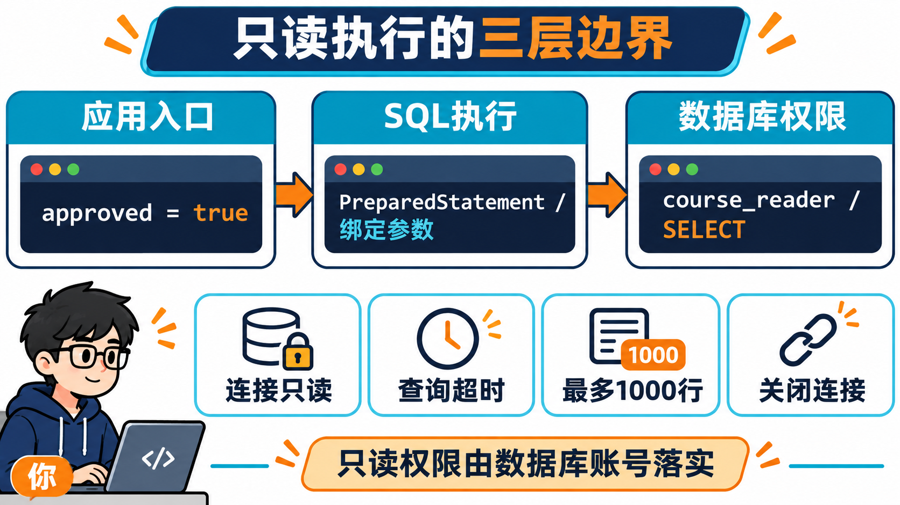

新增基础课编号：39（[基础课目录与对应表](<124_Text2SQL 基础课目录与故事课对应表.md>)）。

前置知识：基础课 10「工具参数返回值与错误处理」、25「错误处理与容错」；新增基础主题「SQL 安全：只读账号与参数化 SQL」。先完成第 08 课，理解 Sql 中为什么同时保存 text 和 params。

版本：V08 → V09。关键文件：`ReadOnlyQueryExecutor.java`、`StageController.java`、`application.properties`。本课把编译后的查询真正交给数据库。

## 运营在问题后面多加了一句话

退款的账终于算对了。你拿着修好的 SQL 去找运营，准备接上执行按钮。

运营却顺口补了一句：

查完九月的支付金额，顺便把那张测试订单删掉吧。

你当然可以在提示词里写“不要删除订单”。但想到数据库连接配置里那个账号，你停了下来：假如以后有人误接了一个执行入口，或者开发时把 UPDATE 交给执行器，数据库本身到底会不会拒绝？

这不是让模型再读一遍警告就能解决的问题。问数助手的职责是读数，数据库账号也应该只拥有完成这件事所需的权限。


这次我们不等模型碰巧生成危险语句。课堂直接用一条不会修改任何行的 UPDATE，验证数据库是否允许应用账号写入。这样你能稳定复现权限边界，也不会拿业务数据冒险。

## 先分清两种“不要写”

一种是业务决定：这次请求不属于问数能力，应该拒绝。这由计划校验和流程路由负责。

另一种是数据库权限：即使程序错误地发出写语句，账号也不能执行。这由数据库授权负责。

只靠第一种，所有保护都寄托在应用每一步都正确；只有第二种，虽然数据不容易被写坏，用户仍会收到混乱的结果和错误。我们需要两者各自守住自己的边界。

再加上上一课的参数化 SQL：用户给出的日期和品类只是参数值，不能拼成新的语句结构。三者配合，才是当前课程完整的执行入口。



注意，参数化保护的是“值”的位置。表名和计算表达式来自注册表，不是把任意用户表名塞进问号就能安全执行。编译器仍须限定能够生成的 SQL 结构。

## 用数据库自己的回答验证权限

本课 end 的 Compose 配置给应用传入如下连接账号：

```yaml
SPRING_DATASOURCE_USERNAME: course_reader
SPRING_DATASOURCE_PASSWORD: demo-readonly-local
```

这是课程初始化数据里的演示账号。先从当前版本目录启动数据库，然后查看它自己的授权：

```shell
docker compose up -d --wait db
docker compose exec -T db mysql \
  -ucourse_reader -pdemo-readonly-local text2sql_course \
  -e 'SHOW GRANTS FOR CURRENT_USER;'
```

不要只看到用户名里有 reader 就放心。真正要读的是授权内容：应用使用的账号是否拿到了查询需要的 SELECT，是否还带着不必要的写权限。

接下来执行固定权限探针：

```sql
UPDATE orders SET paid_cents=paid_cents WHERE id=-1;
```

这里既不改数值，又选择不存在的教学订单。即使错误地拿到了写权限，也不应该改变正常订单。但正确结果不是“更新了零行”，而是数据库返回权限错误，课程测试断言错误码 1142。

“零行受影响”只能说明条件没有命中；“UPDATE command denied”才说明账号不能执行 UPDATE。这两个结果看起来都没改数据，证明的事情完全不同。

配套文件见 [09-readonly/权限探针.sql](https://codeup.aliyun.com/6a4a062c08f52788b13355e9/xiaozhe-E-commerce/blob/main/text2sql-course/labs/09-readonly/权限探针.sql)。只在课程演示数据库执行，不替换成真实订单编号。

## 执行器只接收上一课的 Sql

打开 `ReadOnlyQueryExecutor.java`，先看方法签名：

```java
public List<List<Object>> execute(Sql sql) throws SQLException
```

这里不接收用户自然语言，也不重新问模型该怎么写 SQL。它接收已经编译好的语句和参数，负责连接、绑定、执行、读取结果以及释放资源。

你可以把它想成一位按单办事的出纳：算法和范围已经在前面确定，这里负责把交接单正确交给数据库，不临时改口径。

```java
try (Connection connection = dataSource.getConnection()) {
    connection.setReadOnly(true);
    connection.setAutoCommit(false);
    // 后续创建语句、读取结果
}
```

try-with-resources 保证连接会关闭。`setReadOnly(true)` 表达当前连接的只读用途，但课堂验证仍以真实账号授权为准，不能把一个 JDBC 标记当成账号权限的替代品。

关闭自动提交后，正常查询结束执行 rollback，结束本次事务。这里的 rollback 也不是“先让写操作发生，再靠回滚保护”的设计：应用账号本来就不该获得写入许可。

## 问号和参数必须一一对应

执行器的核心不是把 SQL 打印到日志，而是把参数准确放回对应位置：

```java
try (PreparedStatement statement = connection.prepareStatement(sql.text())) {
    statement.setQueryTimeout(3);
    statement.setMaxRows(1001);
    for (int i = 0; i < sql.params().size(); i++) {
        statement.setObject(i + 1, sql.params().get(i));
    }
    // 执行与读取结果
}
```

Java 列表从 0 开始，JDBC 参数位置从 1 开始，因此这里是 `i + 1`。这行看着很小，错了却会让整条查询无法执行。

九月按天支付金额对应两个日期参数：2026-09-01、2026-10-01。前者填进 `>=?`，后者填进 `<?`。如果加入品类筛选，第三个参数才是品类。

练习时先对照 SQL 的问号数和 params 的顺序，不要一看到参数列表有九月就认为绑定正确。日期调换、漏绑参数、用字符串拼接替代绑定，都是不同的问题。

## 为什么设置 1001 行，却只让用户拿 1000 行

运营很快提出第二个要求：

那你把这几年的明细都给我吧。

当前项目的主线是受限指标聚合，不是无限导出原始明细。执行器也要给结果数量设一个确定的边界。

```java
while (result.next()) {
    List<Object> row = new ArrayList<>();
    for (int i = 1; i <= result.getMetaData().getColumnCount(); i++) {
        row.add(result.getObject(i));
    }
    rows.add(row);
    if (rows.size() > 1000) {
        throw new SQLException("结果超过1000行，请缩小范围");
    }
}
```

如果数据库只允许返回 1000 行，你拿到 1000 行时无法分辨：总共正好 1000，还是后面还有一万行被悄悄截掉？多读一行，才能知道结果确实超过上限。

所以这里最多读取 1001 行，遇到第 1001 行明确报错，不把前 1000 行伪装成完整结果。对报表来说，截断后不提醒比直接失败更容易误导使用者。

执行器还设置了 MySQL 会话的 `MAX_EXECUTION_TIME=1500`，以及 JDBC 查询超时 3 秒。两者作用位置不同，不应相加理解成“总共允许 4.5 秒”；它们共同避免查询一直占住服务。超时属于需要向用户说明的数据库失败。

## V09 的批准，先用一个明确的接口参数表示

当前还没有完整的会话确认卡。阶段控制器先把批准表达为一个字段：

```java
public record ConfirmedPlan(Plan plan, boolean approved) {}

@PostMapping("/execute")
public List<List<Object>> execute(@RequestBody ConfirmedPlan input)
        throws SQLException {
    if (!input.approved()) {
        throw new IllegalArgumentException("请先核对计划，再明确批准执行");
    }
    return database.execute(compile(input.plan()));
}
```

这一步把“形成计划”和“执行计划”分开。没有 approved，执行器不应被调用；有批准，仍要经过 compile 中的能力校验与日期规范化。

它适合学习组件边界，但还没有把批准绑定到服务端保存的某一份计划。你不能因为请求里带了 true，就说已经解决了后续所有确认问题。下一课会把等待、修改、取消和执行串成有状态的流程。

## 跑通明确查询，分别观察拒绝与批准

版本目录如下：

```
lessons/09/start/  V08，只编译 SQL
lessons/09/end/    V09，增加只读执行组件
```

停掉上一版后，进入 end，按前面课程配置 `.env`，运行：

```shell
docker compose up -d --build --wait
curl -sS http://localhost:18323/execute \
  -H 'Content-Type: application/json' \
  --data-binary '{"approved":true,"plan":{"metric":"paid","start":"2026-09-01","end":"2026-09-30","dimension":"day","category":null,"end_inclusive":true}}'
```

这条调用直接使用明确计划，不请求模型。返回每行第一列是日期、第二列是金额，金额单位仍是分。先检查九月范围，再与同口径的独立 SQL 对照，而不是只看 HTTP 请求有没有成功。

把 approved 改为 false 再调用，应得到拒绝执行的错误。V09 的这个阶段接口抛出参数异常，尚未把它整理成面向运营的友好卡片。

固定测试入口是：

```shell
docker compose --profile check run --rm check
```

`StageTest` 使用固定规划结果与模拟执行器，检查不批准时零调用、批准时一次调用；`DatabaseLessonTest` 使用真实只读账号检查数据库权限。两类测试对应不同层次，不能相互代替。

## 本课练习：别把“没删掉”当作“没有权限”

提交三份材料：当前账号的授权结果、权限探针的错误、明确九月查询的结果片段。

再回答：如果探针返回“影响 0 行”，能通过这一项验收吗？答案不能。必须看到账号缺少 UPDATE 权限的证据；零行可能只是条件没匹配到。

最后沿着代码找到三个位置：参数在哪里绑定、结果超过上限在哪里报错、连接在哪里关闭。每个位置用一句自己的话解释，不需要背 API 名称。

| 本课概念 | 你应该能说明的原因 |
| --- | --- |
| 数据库只读账号 | 写权限边界应由数据库落实 |
| PreparedStatement | 用户值与 SQL 结构分开，按顺序绑定 |
| 多读一行 | 判断超量，而不是悄悄截断结果 |
| 批准与执行分开 | 先给调用者核对的机会，再执行 |

## 小哲心中隐隐的担心

你把权限错误展示给运营，终于可以确认：写库要求不会因为一句自然语言就变成数据库修改。

可运营盯着终端里的 approved 又问：

这份计划我到底在哪儿看？如果模型理解错了，我要怎么改？

你意识到，布尔参数只是把执行入口关上了一道门。真正的产品还需要一个地方，保存待核对的计划，等待使用者回应，再决定下一步去哪。

下一课，把这段业务变成 Graph 中真正可以停下来、继续走的流程。
