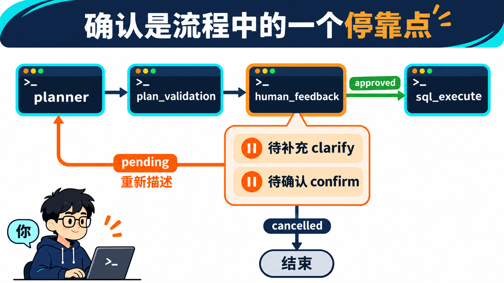

新增基础课编号：38（[基础课目录与对应表](<124_Text2SQL 基础课目录与故事课对应表.md>)）。

前置知识：基础课 20「为什么需要 LangGraph」、21「状态、节点和边」、24「Human-in-the-loop 与 Interrupt」；新增基础主题「Spring AI Alibaba Graph 与 LangGraph 概念对照」。本课在 Java 中使用 StateGraph。

版本：V09 → V10。重点文件：`Workflow.java`、`HumanFeedbackNode.java`、`SessionController.java`、`StateCodec.java`。程序校验通过后进入人工确认。

## 数字越快出来，误会可能传得越快

你给运营演示上一课的执行接口。输入日期、指标和分组，带上 approved，数据库很快返回一列数字。

运营却没有像你预想的那样高兴：

我只想先看看你理解成了什么。万一我问错口径，结果又被我复制进汇报，不就麻烦了？

这句话把产品的顺序说清楚了。用户不是每次提问都已经决定执行；模型形成计划之后，应该先给用户核对，再让用户批准这一份计划。


你开始在纸上画流程。规划、校验、等待确认、执行，每一步都有自己的输入与结果。而等待确认这一步，可能持续几秒，也可能跨过用户的一次刷新。

它不适合藏在某个长方法里的 while 循环，更不能让 HTTP 请求一直睡着等人点击。我们需要把“等待”保存成状态。

## 先把流程中的动词找出来

打开 `Workflow.java`，本版的节点名直接对应职责：

| 节点 | 它做什么 | 它不替谁做决定 |
| --- | --- | --- |
| planner | 读取业务目录，理解问题，形成 Decision | 不批准执行 |
| plan_validation | 检查能力、选表与用户依据 | 不猜缺失口径 |
| human_feedback | 在待补充或待确认时暂停 | 不把暂停当完成 |
| sql_execute | 编译并用只读账号查询 | 不重新解释问题 |

节点不是为了把五个函数换成五个框。关键是节点之间的去向由状态决定：不支持的请求结束，信息不足的请求等补充，已批准的计划才能去执行。



上图是正常规划与人工反馈的主链示意；plan_validation 发现缺项时直接去 human_feedback，拒绝和格式错误则结束。课程图中的英文节点名与代码一致。先用中文把每个职责说清，再去看框架 API，会比从 builder 链开始背更容易理解。

## 一份 Session，把一次对话的东西放在一起

计划在第 03 课已经是类型化对象。现在还需要保存这份计划属于谁、用户说了什么、进行到哪一步，以及执行结果。

Session 保存 messages、decision、stage、rows、executions 等业务信息。后面增加交互时，你会反复用到这份状态，而不是让每个接口都重新组装一套互不关联的数据。

图的状态字段使用一个名为 session 的槽位：

```java
var definition = new StateGraph(
        () -> Map.of("session", new ReplaceStrategy()));
```

ReplaceStrategy 表示节点交回新 session 时替换旧值。它不是自动把两份消息列表合并；业务对象里该保留哪些字段，仍由代码明确维护。

框架状态与业务对象之间的转换集中在 StateCodec：节点开始时 read，结束时 write。序列化细节不用散落到每一条业务判断里。你阅读节点时，应先关注 Session 发生了什么改变。

## planner 只负责形成一份可检查的决定

本版入口从临时 `/plan` 转为 `/sessions`。控制器创建 id、保存第一条问题，再调用 workflow.start。

```java
Session session = new Session();
session.id = UUID.randomUUID().toString();
session.messages.add(question);
workflow.start(session);
return workflow.get(session.id);
```

这里的 id 后面会用于找回同一段图执行。新问题创建新会话，补充或确认则在原会话中继续，两者不能混用。

planner 节点调用 interpret 后，把 stage 设置为 checking。若出现约定范围内的模型格式转换错误，形成可诊断的 error；其他未预期异常仍正常传播，方便定位程序缺陷。

从 planner 出来的条件边只允许 checking 进入计划校验。格式错误不应该带着一份残缺对象继续走到数据库。

## 程序校验通过，不等于用户已经批准

第 07 课已经用程序检查计划能力、用户口径与日期依据。QueryRules.check 返回 review 时，表示这些确定性的检查已经通过，是一个内部过渡标记。

本课的 Graph 直接把它转换为待确认：

```java
QueryRules.check(session);
if (session.stage.equals("review")) session.stage = "confirm";
```

规划模型提出候选计划，程序检查已定义约束，最后由用户核对业务含义。校验通过以后，流程直接来到确认卡，等待用户批准。

例如，程序发现“销售额”仍有口径歧义时，stage 是 clarify，不会走上面的转换。用户必须先补充；程序通过以后也只是 confirm，不能直接查库。

review 这个状态名保留，是为了让第 07–09 版的组件输出保持一致。不要把名字里的 review 理解成后台还有一次模型调用。实际的图节点只有 planner、plan_validation、human_feedback 和 sql_execute。

## human_feedback 让图真正停下来

`HumanFeedbackNode` 同时实现节点动作和中断接口。最值得看的只有这段判断：

```java
return Set.of("clarify", "confirm").contains(session.stage)
        ? Optional.of(InterruptionMetadata.builder(node, state)
            .addMetadata("stage", session.stage).build())
        : Optional.empty();
```

clarify 表示还缺信息，confirm 表示计划已经可以核对。它们都暂停，但页面以后要展示不同操作：前者补充，后者确认。

中断返回给调用方后，HTTP 请求可以结束，服务不必占住一个线程等人回复。本版用 MemorySaver 保存图状态；下一次请求通过相同的 threadId 找到它。

这也解释了为何“返回了一张确认卡”并不等于“查出了数据”。此时 rows 还没从数据库产生，executions 应保持 0。

## 用户回应之后，沿着哪条边继续

用户确认时，控制器把 stage 改成 approved；重新描述时改成 pending；取消时改成 cancelled。然后更新 human_feedback 所在的图状态，再调用恢复入口。

```java
var updated = graph.updateState(
        config(session.id), StateCodec.write(session), "human_feedback");
graph.invokeAndGetOutput((Map<String, Object>) null,
        RunnableConfig.builder(updated)
            .addMetadata(RunnableConfig.HUMAN_FEEDBACK_METADATA_KEY, "resume")
            .build());
```

这段框架代码可以作为固定写法理解：更新当前会话，再从中断处恢复。不要另起一个新会话，否则原计划、历史问题与等待位置就断开了。

human_feedback 后面的条件路由才决定下一步：approved 去执行；pending 回规划；cancelled 结束。选项补充的 chosen 路径在后续接入。

执行节点入口还有一道明确条件：stage 必须是 approved。这样即使以后修改边的逻辑，也不会把任意等待状态直接当成允许查询。

## 用固定响应，证明确认前没有查库

这一课最重要的观察点不是模型这次有没有答对，而是流程是否真的等了人。

在 `lessons/10/end/src/test/java/course/text2sql/StageTest.java` 中，规划器返回固定 paid/day 计划，数据库使用 mock。这是教学模拟，能够重复验证同一条流程。

```java
var initial = api.create(Map.of(
        "question", "2026年9月支付金额按天统计"));
assertEquals("confirm", initial.stage);
verifyNoInteractions(database);
```

如果只断言 stage 为 confirm，却不检查数据库有没有被调用，程序可能先查完再伪装成待确认。`verifyNoInteractions` 正是用来排除这种顺序错误。

接着提交确认，断言 stage 为 done，数据库恰好调用一次。再对完成状态重复确认，应被拒绝。本版已经有状态限制；“修改后旧卡仍能点击”的版本问题留到第 12 课处理。

## 通过接口看一遍真实状态变化

进入 `lessons/10/end` 启动本版。与上一课不同，创建会话会调用真实规划模型，因此真实体验需要自己的 `.env` 配置；固定测试不需要用调用额度复现失败。

```shell
docker compose up -d --build --wait
curl -sS http://localhost:18323/sessions \
  -H 'Content-Type: application/json' \
  --data-binary '{"question":"2026年9月支付金额按天统计"}'
```

记录返回的 id 和 stage。若为 clarify，先处理补充；只有 confirm 才执行下面的确认请求。把 SESSION_ID 替换为刚收到的会话 id：

```shell
curl -sS http://localhost:18323/sessions/SESSION_ID/respond \
  -H 'Content-Type: application/json' \
  --data-binary '{"revision":0,"action":"confirm"}'
```

V10 的 revision 尚未承担版本检查，后续版本会启用它。正常确认后检查 stage、rows、executions，而不是只盯着是否出现数字。

如果想验证取消，请新建另一份待确认会话，用 action=cancel。不要在已经 done 的会话上取消，再把状态冲突误判成取消功能坏了。

## 本课练习：沿状态画出三条路

画出明确查询、缺日期、用户取消三条路径，标出哪一步会调用数据库。查询路径里 human_feedback 必须出现在 sql_execute 前，缺日期和取消路径都不能执行 SQL。

再运行本版固定测试，找到三条断言：确认前零次、确认后一次、完成后不能再次确认。截图时同时保留测试名称与结果，不只截最后的 BUILD SUCCESS。

| 关键概念 | 本课要理解的关系 |
| --- | --- |
| Session | 保存业务状态与同一会话的上下文 |
| 条件边 | 根据状态选择下一步，而非所有节点顺序跑 |
| 中断恢复 | HTTP 可以结束，图等待用户下一次回应 |
| 程序检查与人批准 | 检查通过只进入 confirm，不等于 approved |
| 人工确认 | 用户批准之后，执行节点才可访问数据库 |

## 小哲心中隐隐的担心

你终于让程序停下来等运营。确认、取消、重新描述，都不再只是终端里一个 approved 字段。

可是当运营问“按品类列出支付金额”，系统追问日期；运营回答“九月”后，你又要让模型理解一次整段对话。

日期补上了，原来那个“按品类”会不会在重写计划时掉下去？

下一课，我们给有限的口径和日期一个更直接的交互：用户只补缺的字段，已经明确的条件由程序原样保留。
