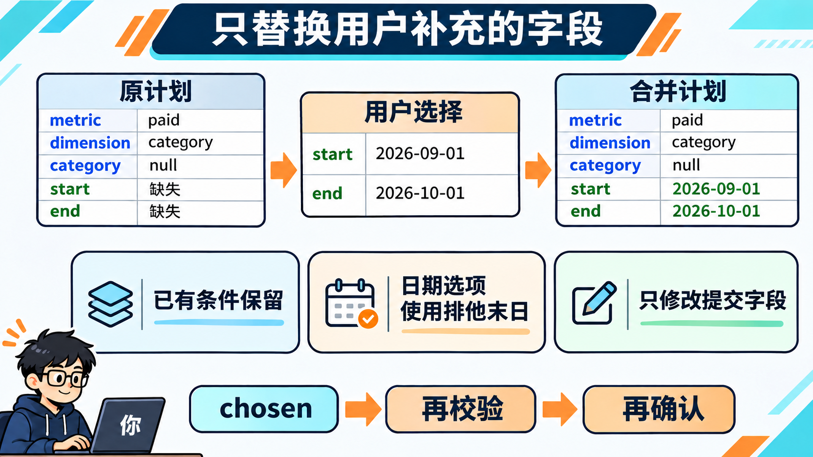

新增基础课编号：38（[基础课目录与对应表](<124_Text2SQL 基础课目录与故事课对应表.md>)）。

前置知识：基础课 21「状态、节点和边」、24「Human-in-the-loop 与 Interrupt」；第 07 课的依据校验、第 10 课的会话暂停与恢复。

版本：V10 → V11。重点看 `QueryRules.choose`、`SessionController.choices` 和 respond 的 choose 分支。网页点选控件在第 14 课接入，本课先通过接口理解数据怎么合并。

## 用户只补了两个字，你却重写了整张计划

运营的需求其实很明确：

按品类列出支付金额。

系统发现没有日期，追问时间范围。运营补充“九月”。你再把上下文交给模型，希望它补全计划。

这时有一种值得提前防住的错误：新计划写出了九月，却把 dimension 从 category 改成 none。页面最后显示一个合计数，看起来有结果，运营却拿不到原来想要的品类对比。

本课用固定计划对照展示这类问题，不依赖模型现场随机丢条件。错误样例明确标为教学模拟；修复则使用真实的 choose 合并逻辑。


你回头看用户的操作：用户只回答了系统问的缺项，并没有说不要分组。既然新增信息只是日期，为什么还要让整张计划从头生成？

## 两种回应，应该走两条不同的路

“请改成已发货订单数，我重新描述一下”是开放表达，需要重新理解。这仍然用 action=reply，保留消息历史后回 planner。

“我选择支付金额，日期是九月一日到九月三十日”是有限字段选择。系统已经知道指标有哪些、日期用什么格式，不需要再让模型猜一次用户点了哪个选项。这条路用 action=choose。

| 用户意图 | 接口动作 | 后续处理 |
| --- | --- | --- |
| 自由补充或改写问题 | reply | 进入消息历史，再规划 |
| 选择明确指标或日期 | choose | 程序合并字段，再校验 |
| 同意当前完整计划 | confirm | 批准后执行 |
| 放弃本次查询 | cancel | 结束，不执行 |

选择和确认不能混为一谈。选好日期只是形成一份新的完整计划，仍然要让用户核对。不能一点击日期就悄悄查库。

## 给有限口径一个稳定的标识

本版新增 `/choices`，给页面提供展示名称和提交值：

```java
return Map.of(
    "paid", "支付成功订单实付金额",
    "count", "支付成功订单数",
    "net", "实付减这些订单全部已完成退款（含跨月）",
    "shipped_orders", "已发货订单数",
    "stock_qty", "指定日期库存余额",
    "other", "都不是，重新描述");
```

界面显示中文含义，提交 paid、net 等标识。业务定义仍来自指标注册表，这个接口提供的是交互选项，不是又发明一套计算口径。

“都不是”也很重要。选项的作用是让已经支持的含义更容易表达，不是逼用户从错误选项里选一个。other 在网页里会引导用户重新描述，不把它当成一个可计算指标交给编译器。

你可以先用 curl 看返回值，理解展示文字和提交标识的区别：

```shell
curl -sS http://localhost:18323/choices
```

## 只替换收到的字段，其余从旧计划拿

`Choice` 只包含 metric、start、end。它没有 dimension 和 category，意味着本次选择动作不会修改原有分组和品类筛选。

```java
String metric = choice.metric() == null ? old.metric() : choice.metric();
String start = choice.start() == null ? old.start() : choice.start();
String end = choice.end() == null ? old.end() : choice.end();
Plan plan = new Plan(metric, start, end,
        old.dimension(), old.category(),
        choice.start() == null ? old.end_inclusive() : false);
```

读这段代码时可以用手盖住日期行：指标没提交就沿用，分组和品类总是从旧计划保留。用户这次只补日期，程序没有机会顺手把 category 改成 none。

再看最后一个字段。选项日期使用统一的左闭右开约定，提交 end=2026-10-01 表示九月全月、不包含十月一日，所以 end_inclusive 设为 false。网页会把用户选择的包含末日转换过来。



这不是一个任意对象合并器。它只处理本课程承诺的少数业务字段，规则写得直接，便于你说明哪些条件保留、哪些条件允许修改。

## 点了选项，也不能绕过能力检查

如果用户原来要按品类查询，后来选择了净额，原有 dimension=category 会被保留。而本课程不支持 net/category。

此时正确做法不是偷偷把分组降为 none，而是让计划重新经过能力检查，说明这个组合不支持。条件保留与能力校验必须同时存在：前者尊重用户已有条件，后者保证组合真的能算。

选择方法先检查指标是否在目录中、开始与结束日期是否成对提供，再合并计划。它还更新 session.choice，记录用户通过选项明确给出的值。

为什么要记录 choice？因为用户点击的值不是 messages 里的某段原话。后面的依据检查需要区分“模型声称用户说了”和“用户通过结构化选项直接选了”。明确选项的 metric 或 date 不需要伪造一段原话引用来证明。

分组等未通过本次选项更改的字段，仍使用原来的依据。选择日期不应把整份计划自动盖章成可信。

## missing_fields 逐项消除，而不是一键清空

假设系统同时缺指标和日期，用户这次只选了 paid。missing_fields 中只能移除 metric，date 仍然要保留。

```java
List<String> missing = new ArrayList<>(session.decision.missing_fields());
if (choice.metric() != null) missing.remove("metric");
if (choice.start() != null) missing.remove("date");
```

剩余缺项决定 decision 仍是 clarify，还是可以成为 query。方法末尾把 stage 设为 chosen，恢复后走 plan_validation。

因此 chosen 不是给用户看的最终成功状态，它只是图中“用户已经做了选择，接下来重新检查”的路由标记。通过程序检查后才进入 confirm。

如果你只在网页里把提示文字从“待补充”改成“已完成”，后端根本不知道条件是否补齐。页面状态必须来自服务端返回的 Session。

## 先用固定计划验证，不赌现场模型

打开第 11 课 end 的 `StageTest`。其中构造一份缺日期的 paid/day 计划，调用 choose，检查分组未变化、stage 变成 chosen。

为了看清“按品类”的业务场景，文档包另附 [条件保留对照.json](https://codeup.aliyun.com/6a4a062c08f52788b13355e9/xiaozhe-E-commerce/blob/main/text2sql-course/labs/10-13-sessions/条件保留对照.json)。里面给出同一份部分计划、错误重写样例和正确合并结果。错误重写是教学模拟，不能作为一次真实模型失败计分。

课堂操作顺序是：先圈出用户已经说过的字段，再比较错误计划，最后定位上面的 old.dimension() 和 old.category()。不要只把两个 JSON 并排放着说“模型不稳定”；要让学员看到这类有限补充为什么可以由程序确定性完成。

到第 13 课的 WorkflowTest，按品类缺日期的这条完整链路还会经过 Redis、真实只读数据库与确认流程。当前先把字段合并这一小步理解扎实。

## 接口演示：只补日期，不提交一整份新计划

进入 `lessons/11/end`，按前课方式启动。真实创建会话需要模型账号；固定测试没有付费调用。

```shell
curl -sS http://localhost:18323/sessions \
  -H 'Content-Type: application/json' \
  --data-binary '{"question":"按品类列出支付金额"}'
```

当返回 clarify、缺 date，且部分计划保留 paid/category 后，再提交日期。实际录课若要稳定演示字段合并，使用固定测试；不要反复重试真实模型直到出现期待状态。

```shell
curl -sS http://localhost:18323/sessions/SESSION_ID/respond \
  -H 'Content-Type: application/json' \
  --data-binary '{"revision":0,"action":"choose","choice":{"start":"2026-09-01","end":"2026-10-01"}}'
```

返回后查看 plan.dimension 仍为 category，时间范围是九月，category 筛选仍为原值。若进入 confirm，此时 executions 仍是 0；接着核对再确认。

选择未知指标不应该变成一个默认 paid。日期只给一端也不该被程序随便补齐。错误输入属于边界测试，和正常用户的明确问法分开演示。

## 自由回复为什么仍然保留

你不能把所有用户表达都塞进下拉框。用户想改分组、描述别的业务问题，仍需要回复入口。

respond 的 reply 分支会保留之前明确选择的口径和日期作为上下文，再追加用户新话，清理本轮 choice 标记，并回到 pending。这样重新规划时有上下文可读，不会只看到最后一句话。

但“保留上下文”与“保证所有自由表述都正确理解”是两回事。本课常规练习仍使用单指标、单维度、明确日期。有限选项是我们对常见补充路径的产品设计，复杂表达仍需重新核对确认卡。

## 本课练习：逐项证明没丢条件

用固定部分计划 paid/category、无日期、无品类筛选，补齐九月。提交合并前后 JSON，并说明哪两个字段改变、哪些字段必须不变。

再做一道思考题：如果原计划已有品类筛选，补日期时能否把筛选清空？不能。代码保留 old.category()，本次用户没有请求修改它。

最后解释“都不是”该怎么处理：引导重新描述，而不是把 other 传入计算目录。验收时检查值与交互去向，不只检查页面上是否有一个下拉框。

| 检查项 | 正确结果 |
| --- | --- |
| 只补日期 | 指标、分组、品类筛选保留 |
| 指标仍缺失 | 继续追问，不默认 paid |
| 日期选项 | end 使用排他边界 |
| 补充完成 | 再校验、再确认，未批准前不查询 |

## 小哲心中隐隐的担心

运营这次点了九月，原来的品类分组终于稳稳留在卡片上。

你刚松口气，就看到运营开着两个浏览器标签页：一个停在旧卡片，另一个已经改过日期。运营顺手在旧页上点了确认。

数据库究竟会执行哪份计划？更要命的是，用户看到的与批准的还是同一份吗？

下一课，我们给每张确认卡加上版本号，让一次批准只能对应它实际展示的那份计划。
