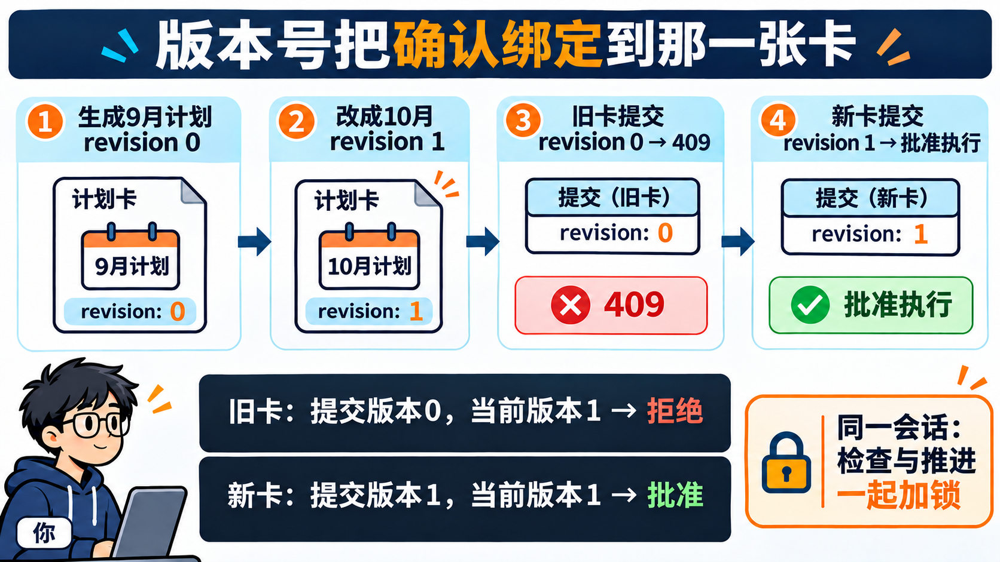

新增基础课编号：38、39（[基础课目录与对应表](<124_Text2SQL 基础课目录与故事课对应表.md>)）。

前置知识：第 10 课的 Session 与中断恢复，第 11 课的选择补充；基础课 25「错误处理与容错」。本课新增概念是版本检查与同一会话的最小并发保护。

版本：V11 → V12。业务修改集中在 `SessionController.respond`：比较 revision，接受回应后递增 revision。测试验证旧版本被拒绝。

## 两个标签页，只有一个人的记忆

运营打开九月支付金额的确认卡，还没点击，就接到老板电话：“改看十月。”

运营在另一个标签页修改问题，新卡片显示十月。过了一会儿，回到旧页面，看到熟悉的确认按钮，顺手点了下去。

你看了服务器上的会话：它已经保存十月计划。旧页面发来的只是 action=confirm 和会话 id，服务器没有办法知道用户眼前还是九月那张卡。


这里最准确的问题不是“数据库一定执行了旧 SQL”。在当前按会话读取最新状态的结构中，旧按钮反而可能批准新的计划。真正错的是：用户以为自己批准九月，系统却按十月执行。

计划本身可能合法，SQL 也可能算得正确，但批准对象已经错位。

## 为什么检查 stage=confirm 还不够

上一版 respond 已经要求会话处于 confirm 或 clarify。查询完成后再次确认会被拒绝，这解决了“对完成状态反复执行”的问题。

可是修改计划后，服务器又回到了 confirm。旧卡和新卡都看到同一个阶段名称，所以单靠 stage 无法分辨它们。

你需要再问一句：这次操作对应的是当前第几版卡片？

最简单的办法是在 Session 中保存 revision，并让页面每次回应都带回自己展示的 revision。id 定位哪个会话，revision 定位会话中的哪一个交互版本，两者职责不同。

## 先把时序写成四步

| 时刻 | 服务端状态 | 客户端拿着什么 |
| --- | --- | --- |
| 创建九月计划 | confirm，revision=0 | 九月卡片，版本0 |
| 用户改成十月 | confirm，revision=1 | 新页面拿到版本1，旧页仍是0 |
| 旧页确认 | 当前版本1 | 提交版本0，应拒绝 |
| 新页确认 | 当前版本1 | 提交版本1，允许推进 |



你会发现，它没有比较 SQL 字符串，也不必把旧计划再发回服务端。只要修改或补充会推进版本，旧操作就失去了批准当前状态的资格。

版本号表示交互修订，不是模型置信度，也不是查询次数。一次回复可能没有执行 SQL，却已经产生了新卡片。

## 真正的代码变化只有一个条件和一次递增

打开第 12 课的 changes.patch，先看新增条件：

```java
if (session.revision != reply.revision()
        || !Set.of("confirm", "clarify").contains(session.stage)) {
    throw new ResponseStatusException(HttpStatus.CONFLICT);
}
```

两部分都要满足：版本是当前版本，且当前仍在可回应状态。版本对但查询早已完成，也不能执行；状态对但版本旧，同样不能执行。

这里使用 HTTP 409 Conflict，告诉客户端“你的操作和当前状态冲突”。它不是网络超时，也不是模型输出失败，不应让页面自动重新发送同一个确认。

动作被接受后，控制器递增版本，再恢复图：

```java
session.revision++;
workflow.resume(session);
return workflow.get(id);
```

无论用户选择日期、重新描述还是确认，客户端都应使用返回状态里的新版本，不自行猜测下次版本是什么。

## 两次确认同时进来怎么办

你可能已经想到：两个请求几乎同时到达，都读到 revision=1，会不会都通过检查？

如果比较与推进是分开的，就有这个风险。当前控制器把同一会话的读取、检查、动作修改与 workflow.resume 放进同一段同步区域：

```java
synchronized (locks[Math.floorMod(id.hashCode(), locks.length)]) {
    Session session = workflow.get(id);
    // 版本与阶段检查
    // 修改状态，递增 revision，恢复图
}
```

32 个锁槽按会话 id 分配。同一会话始终落到同一个槽，所以两个确认不会交错通过；不同会话偶尔碰到同一锁槽，只会串行等待。

这里保留锁有明确业务原因：要把“判断能否确认”和“推进确认”作为一组动作。不是为了让每个方法看起来都安全就统一 synchronized。

本课使用单个应用实例。你先把一个进程里的并发批准讲清楚，后续部署范围由项目 README 说明，不把这一段锁解释成跨服务器的协调机制。

## 用固定规划器稳定复现旧卡问题

第 12 课固定测试不依赖模型真的把九月改成十月。规划器返回同一份明确计划，用户重新提交同一句话也会让版本增加。

为什么这样的测试成立？我们验证的是旧操作是否失效，不是自然语言日期理解。只要会话经历一次有效回复，旧 revision 就不能继续批准。

```java
var revised = api.respond(initial.id,
        new Reply(0, "reply", "2026年9月支付金额按天统计", null));
assertEquals(1, revised.revision);
assertThrows(ResponseStatusException.class,
        () -> api.respond(initial.id, new Reply(0, "confirm", null, null)));
```

随后用 revision=1 确认，断言完成，并检查执行器只调用一次。这样错误路径和成功路径都被覆盖：不是把所有确认一概禁止就算修好了。

对照 start 的 V11，你能看到阶段检查已经存在，缺少的正是版本条件与递增。课堂先打开差异，再去读完整控制器，比在长文件里找两行更直观。

## 接口演示：保存旧版本，再主动让它过期

启动 `lessons/12/end` 后创建明确查询，保存返回 id 与 revision。用 reply 提交明确的改期请求；如果返回日期追问，就通过日期选项提交十月范围，取得新确认卡，再保留新 revision。

下面仅表示请求结构，SESSION_ID 和版本以实际响应为准：

```shell
curl -i http://localhost:18323/sessions/SESSION_ID/respond \
  -H 'Content-Type: application/json' \
  --data-binary '{"revision":0,"action":"reply","text":"修改上一条查询：不要九月，只统计2026年10月1日至10月31日支付成功订单实付金额，按天汇总。"}'
```

如果此时stage为clarify，先使用实际返回的revision补齐日期。录屏沿日期选项完成这一步：

```json
{"revision":1,"action":"choose","choice":{"start":"2026-10-01","end":"2026-11-01"}}
```

提交到同一respond地址。选择后核对日期为十月、分组为day、executions仍为0。这里的end为不包含的上界；revision以实际响应为准。新卡进入confirm后，故意用最初的旧revision=0发送confirm：

```shell
curl -i http://localhost:18323/sessions/SESSION_ID/respond \
  -H 'Content-Type: application/json' \
  --data-binary '{"revision":0,"action":"confirm"}'
```

预期是 409，executions 仍为 0。然后 GET 同一个会话，核对最新卡片，再用实际的新 revision 确认。

如果真实规划结果是 clarify，不要跳过补充直接点确认。用固定 StageTest 可以不经过付费模型，稳定复现本课版本行为。

## 客户端收到 409 后，应该做什么

运营不需要知道 revision 的实现，但需要知道刚才那张卡过期了。

后面的网页会提示“这张确认卡已失效，已刷新最新状态”，随后 GET 当前会话重新渲染。用户必须看过新的日期与口径，再主动点击确认。

不要收到 409 就把本地版本号加一、自动重试确认。那相当于替用户批准一张尚未看过的卡，绕回了本课最初的问题。

同样，不应把旧页面的 plan 再写回服务端覆盖最新计划来“让确认成功”。冲突意味着需要同步状态，不是需要找办法强行执行。

## 把验收分成四种情况

| 请求 | 正确行为 | 数据库调用 |
| --- | --- | --- |
| 当前版本、待确认 | 可以批准 | 执行一次 |
| 旧版本、待确认 | 409 | 不新增 |
| 当前版本、已完成 | 409 | 不新增 |
| 两个同版本确认并发 | 一个成功，另一个冲突 | 总共一次 |

第 12 课 StageTest 覆盖修改与旧卡路径；第 13 课的 WorkflowTest 还会用两个并发调用检查总执行次数。读测试时把条件和结果对应起来，不要把“有并发线程”当成已经验证了一致性。

本课的固定材料入口与各版本命令整理在 [会话实验说明](https://codeup.aliyun.com/6a4a062c08f52788b13355e9/xiaozhe-E-commerce/blob/main/text2sql-course/labs/10-13-sessions/README.md)。

## 本课练习：一张卡到底批准什么

画两张卡，分别写上 9 月/版本0、10 月/版本1，解释旧按钮为什么不能批准新计划。回答中必须出现“用户实际看见的内容”，而不只是“版本不一样”。

再运行固定测试，保留旧版本异常与最终一次执行的断言位置。尝试把版本检查在脑中去掉，说明哪个断言会失去保障；不需要修改冻结代码。

最后设计网页提示语：应让用户知道要核对最新计划，不能把 409 显示成“请一直重试”。这句话就是下一阶段页面交付的一部分。

## 小哲心中隐隐的担心

两个标签页终于不再能悄悄批准彼此的计划。运营看过哪张卡，服务器就只接受对应版本的回应。

你准备重启服务更新页面，却想起那些还在等待确认的会话都放在内存里。

服务回来以后，运营点击刷新，刚才的卡片还找得到吗？

下一课，把 Graph 的检查点保存到 Redis，让会话的等待位置不再依赖当前 Java 进程一直活着。
