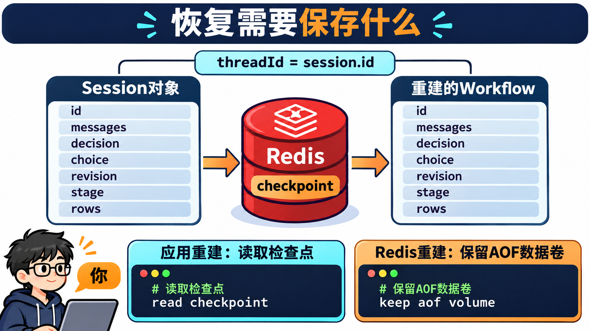

新增基础课编号：38（[基础课目录与对应表](<124_Text2SQL 基础课目录与故事课对应表.md>)）。

前置知识：基础课 23「持久化、恢复与时间旅行」、24「Human-in-the-loop 与 Interrupt」；新增基础主题「Spring AI Alibaba 的 checkpoint 与 RedisSaver」。先理解第 12 课 revision 的作用。

版本：V12 → V13。关键变化：`AiConfiguration` 创建 RedissonClient，`Workflow` 从 MemorySaver 换为 RedisSaver。业务节点职责保持原样。

## 一次普通重启，把运营的卡片弄丢了

你准备更新服务，提前告诉运营“几秒就好”。运营正在核对九月按品类支付金额，暂时没有点确认。

服务重新启动，健康检查显示正常。可运营刷新页面后，原来的会话却找不到了。

问题不是数据库订单丢了。订单还在 MySQL，丢的是这次问数进行到哪一步：用户说过什么、补过什么、准备批准哪张卡。


上一版的 MemorySaver 把检查点放在当前进程内。只要 Java 进程结束，内存也结束。服务能重新启动，并不意味着对话能从原位置恢复。

你需要把会话的检查点放到一个独立于应用进程的存储里。

## 恢复的不是一段聊天文字

最容易写出的方案是只保存 messages，然后重启后重新问一次模型。但模型重新规划不一定形成原来的计划，用户之前做过的选择和卡片版本也可能发生变化。

待确认会话需要恢复的是完整业务状态。我们至少要保留：

| 字段 | 恢复时为什么需要 |
| --- | --- |
| id | 找回同一个会话 |
| messages | 保留原问题与后续补充 |
| decision | 保留当时形成的计划、依据与缺项 |
| choice | 保留用户通过选项明确给出的口径和日期 |
| revision | 继续拒绝过期卡片 |
| stage | 知道是在等补充、等确认，还是已完成 |
| rows、executions | 已完成会话展示结果，区分是否执行过 |

如果只恢复计划，没有 revision，旧卡保护可能失效；只恢复 messages，没有 choice，就又把明确选择交回模型猜测。检查点的意义在于业务状态能接着走，而不是重头讲一遍故事。



## 把会话 id 用作图的 threadId

`Workflow` 已经用一个小方法构造图配置：

```java
private RunnableConfig config(String id) {
    return RunnableConfig.builder().threadId(id).build();
}
```

start、get 和 resume 都围绕同一个 id。这个对应关系不能随意改变：如果恢复时生成新 UUID，Redis 里即使保存了旧检查点，也不会被这次请求找到。

浏览器未来只需记住这个会话 id，刷新后向后端查询最新状态。浏览器不是检查点数据库，也不需要把完整计划当成权威状态缓存下来。

本课先通过 GET 接口验证恢复；网页的自动恢复入口在后面两课讲。

## Redis 客户端的生命周期跟着应用走

打开 `AiConfiguration.java`，本版新增：

```java
@Bean(destroyMethod = "shutdown")
public RedissonClient redisClient() {
    Config config = new Config();
    config.useSingleServer().setAddress(
        System.getenv().getOrDefault("REDIS_URL", "redis://redis:6379"));
    return Redisson.create(config);
}
```

默认地址 redis 是 Compose 中的服务名，应用容器在同一网络里通过这个名字访问 Redis。它不是浏览器里的 localhost，也不需要为教学页面暴露 Redis 端口。

客户端作为 Bean 注入 Workflow，不在每次用户提问时创建一个连接客户端。应用关闭时调用 shutdown，把连接和相关线程正常释放。

本课使用已经锁定的依赖组合，按工程中的构造方式接入。看框架文档时要对照 pom.xml，不能把另一个版本的 RedisSaver 示例直接复制进来，再把编译失败误以为业务设计错误。

## 改存储，不改审批路线

上一版的图编译时注册 MemorySaver。本版替换为：

```java
graph = definition.compile(
    CompileConfig.builder()
        .saverConfig(SaverConfig.builder()
            .register(RedisSaver.builder().redisson(redis).build())
            .build())
        .build());
```

planner、校验、human_feedback 与执行节点的路由不需要重写。这正是把状态存储放在框架边界的好处：业务流程描述“何时等人”，Saver 负责“等人的状态放在哪里”。

不要为了接入 Redis，再另做一份 SessionMap，与框架检查点并排维护。两套状态一旦不同步，页面可能读到一份，图却恢复另一份，问题会比丢会话更难定位。

## JSON 只出现在一个转换边界

本课程没有把所有节点改成手工拼接 JSON。节点仍拿到 Session，集中通过 StateCodec 与框架状态转换：

```java
static Session read(OverAllState state) {
    return Json.read(state.value("session").orElseThrow().toString(), Session.class);
}
static Map<String, Object> write(Session session) {
    return Map.of("session", Json.write(session));
}
```

checkpoint 内保存一种确定表示，节点每次读成独立的业务对象。这样你在调试条件保留时主要看 Choice 和 Plan，而不是不断追踪某个字段什么时候被转成字符串。

但序列化代码能编译还不够。列表、记录类型、空值、用户选项、消息历史，必须经过真实 Redis 保存再取回，才能知道恢复的是完整对象。

测试中比较 decision 和 choice 的值，就是在检查业务内容没有在这条边界上丢失。

## Redis 自己重建时，数据放在哪里

独立 Redis 解决应用进程重启的问题。如果 Redis 容器也被删除重建，还需要保留它的数据目录。

课程 Compose 已配置：

```yaml
redis:
  image: redis:7.4-alpine
  command: ["redis-server", "--appendonly", "yes"]
  volumes: ["redisdata:/data"]
```

AOF 把写入记录保存到 Redis 的数据目录；命名卷让目录不随普通容器重建一起消失。

因此两项验证要分开：重建 app，检查 Redis 中的会话仍可读；重建 redis，保留 redisdata，检查加载后仍可恢复。单纯创建一个新 Workflow 对象，不能代替完整容器重建测试。

平时停止课程用 `docker compose down`，它保留命名卷。`down -v` 会删除卷，属于主动清空数据，不应用它来证明持久化失效。

## 先验证一条最能看出问题的会话

完整恢复用例选“按品类列出支付金额”。先进入 clarify，再用结构化日期补齐九月，进入 confirm。

此时同时有原消息、选项日期、category 分组、确认版本和等待状态。如果恢复只保留了其中一部分，很容易在后续检查中看出来。

第 13 课 `WorkflowTest` 使用固定规划器，连接真实 Redis 与只读数据库。它检查：补日期之后仍按品类；创建新 Workflow 后 choice 与 decision 相等；旧 revision 被拒绝；两个当前版本确认并发时只有一个成功；最终 executions 为 1。

这是教学模拟规划 + 真实存储/数据库的组合。固定响应让你集中检查恢复链路，不需要每次调用模型才能重现相同等待状态。

## 再做一次实际容器重建观察

在 `lessons/13/end` 启动服务，建立一份待确认会话，记录 id、revision、plan 和 executions。真实提问会请求模型，已有固定测试则不调用模型。

```shell
curl -sS http://localhost:18323/sessions/SESSION_ID

docker compose up -d --no-deps --force-recreate app
curl -sS http://localhost:18323/health
curl -sS http://localhost:18323/sessions/SESSION_ID
```

应用启动需要时间，先等 health 正常，再查询会话。不要把启动期间的连接失败当作检查点丢失。

恢复后核对四件事：同一个计划、同一个版本、仍然待确认、没有新增执行。状态应该停在哪里，就仍停在哪里；重启不意味着替用户自动确认。

要测试 Redis 容器重建，保持命名卷，重建服务后等 Redis health 恢复：

```shell
docker compose up -d --no-deps --force-recreate redis
docker compose ps
```

然后查询同一会话。若应用正在重新建立连接，等服务可用后再读；最后主动确认，核对一次执行。不要在查询执行一半时强杀服务作为本课演示，我们当前验证的是待确认检查点恢复。

## 找不到会话时，先沿这四个问题排查

先看 id 是否还是原来的，别在页面刷新时顺手新建了会话。再看当前应用连的是不是原来的 Redis 地址，而不是另一个测试实例。

第三看命名卷是否保留，Compose 项目名是否变化导致挂到了新的空卷。最后看业务状态是否完整序列化：原消息、计划、选项和版本都在吗？

只有消息文字还在，不算恢复成功。能 GET 到某个对象，也不算完整验收；必须确认能从等待位置正确继续，而且旧卡保护仍然有效。

## 本课练习：交一份重建前后对照

保存待确认会话的两份 JSON：重建前、重建后。标出 id、stage、revision、decision、choice、executions，并说明为什么它们应当保持一致。

再确认一次，保存 done 结果。验收不是“Redis 容器亮着绿灯”，而是同一条业务从暂停到恢复再到执行走通。

| 本课带走的概念 | 对应业务意义 |
| --- | --- |
| threadId | 找回同一次问数 |
| RedisSaver | 等待位置与状态独立于应用进程 |
| StateCodec | 集中处理框架与业务对象的转换 |
| AOF 与命名卷 | Redis 正常重建后能重新加载数据 |
| 恢复后仍待确认 | 持久化不能越过用户批准 |

## 小哲心中隐隐的担心

你重建应用，运营的卡片还在；点确认，结果也正常出来了。

运营却把电脑转向你：“这些 curl 我还是不会用。下次我总不能每查一个数，都让你帮我复制会话 id 吧？”

后端的流程已经有了，使用者还缺一个能看懂、会操作的入口。

下一课，把问题输入、缺项选择、确认和取消搬到网页上，让运营沿着业务步骤操作，而不是沿着接口文档操作。
