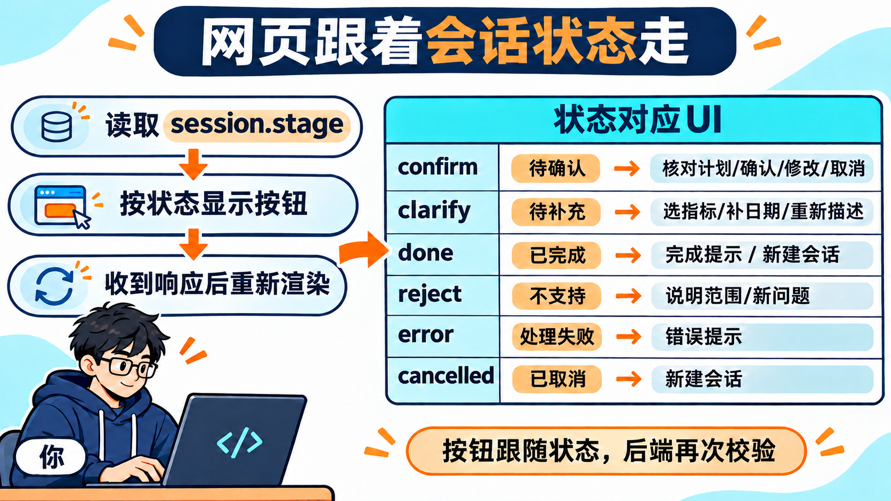
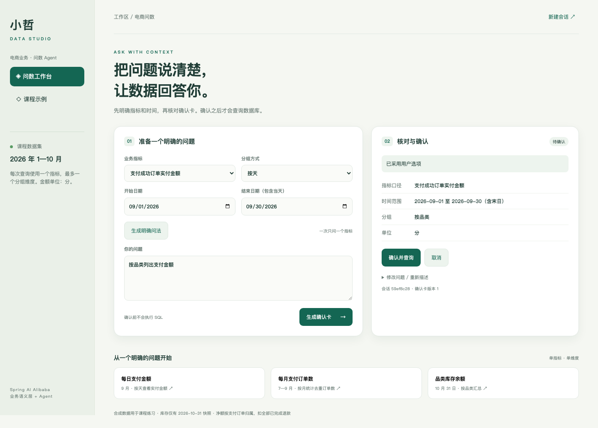

新增基础课编号：38、39（[基础课目录与对应表](<124_Text2SQL 基础课目录与故事课对应表.md>)）。

前置知识：第 10–13 课的会话、澄清、确认、版本与恢复；基础的 HTML 表单、fetch 和 DOM 操作。不会复杂前端框架也能跟上，本课使用原生 JavaScript。

版本：V13 → V14。代码入口为 `lessons/14/end/src/main/resources/static/`，后端沿用 V13。本版新增输入、澄清、确认与完成提示，不包含结果表或导出代码；V15在本版基础上增加结果与CSV。所有 bad case 已放回所属课次。

## 你交付了接口，运营还得来找你

会话已经能恢复，旧卡也会失效。你把接口地址和请求示例发给运营，觉得这次应该可以独立用了。

十分钟后，运营又来敲门：

这个 SESSION_ID 要填哪里？我只是想看九月每天的支付金额。

你打开终端，熟练地复制 id、填 revision、发送确认。动作没有技术障碍，但你忽然意识到：运营仍然离不开开发，只是从“找你写 SQL”变成“找你调接口”。


这一课不再新增模型能力。你要把已经存在的业务流程翻译成界面，让用户看得懂当前在做什么，知道下一步可以点哪里。

## 页面先按使用者的三件事划分

打开 index.html，本版主体分为问题准备、核对确认两个区域，查询完成时显示完成提示。下一课再增加结果区域。

左侧让用户说明指标、日期和分组，生成一条明确问法；右侧展示服务端实际理解出的计划。用户核对后才能确认，不是左侧表单选好就直接执行。

为什么需要左右两份内容？左侧表达用户想问什么，右侧显示系统准备执行什么。即使大部分时候相同，这个对照位置仍然有意义：用户可以发现日期、分组或口径是否偏离了自己的意图。

数据库连接、模型名称、内部节点路由不放进操作步骤。它们属于代码讲解内容，运营做一次查询不需要先读完技术架构。

## 用表单帮助用户写清楚，而不是偷偷替用户作答

页面提供指标、分组和日期选择器，`buildQuestion()` 把这些值写成自然语言问题。

```javascript
const period = start === end
  ? cnDate(start)
  : `${cnDate(start)}至${cnDate(end)}`;
$('question').value = `${period}，${group === 'none'
  ? '汇总' : dimensions[group] + '统计'}${phrasing[metric]}。`;
```

用户仍能看见并修改最终问题。生成明确问法的按钮不会查询数据库，它只是把“支付金额、九月、按天”组织成一句完整表达。

对于退款后净额，phrasing 会写清楚扣除这些支付订单的全部已完成退款，包含跨月、不限制退款时间。长一点的业务描述在这里是有用的：用户点击的是完整口径，而不是一个看似大家都懂的“净额”。

库存则显示课程明确支持的快照日期 2026-10-31。日期在界面上可见，用户选择后再生成问题，与模型从“库存余额”四个字偷偷默认今天是两回事。

## 分组选项跟着指标能力走

前端维护 allowed 映射，用来控制分组下拉框：

```javascript
const allowed = {
  paid: ['none', 'day', 'month', 'category'],
  count: ['none', 'day', 'month'],
  net: ['none', 'day', 'month'],
  shipped_orders: ['none', 'day', 'month'],
  stock_qty: ['none', 'category']
};
```

用户选 net 时，看不到按品类分组选项。这是减少无效操作的交互设计，后端 PlanContract 仍然必须校验，不能因为页面没有那个选项就认为请求永远不会出现。

这里的前端映射负责可选项展示，指标计算口径继续放在后端注册表。将来业务能力变更，需要同时核对界面与后端支持矩阵；不能只改下拉框就宣称增加了计算能力。

本课先保持课程的单指标、单维度范围。少而明确的选择，会比一个声称什么都能问的大输入框更容易交付给运营。

## 发送问题后，保存服务端返回的 Session

提交表单时，页面调用 `/sessions`：

```javascript
session = await request('/sessions', { question });
render();
```

浏览器保存完整响应以渲染，但权威状态在服务端。页面不自己把 stage 改成 confirm，也不根据“模型返回了一份 plan”就显示成功结果。

request 根据 HTTP 状态处理失败；perform 负责统一进入忙碌状态、展示错误、最后恢复按钮。忙碌期间不能不断重复点提交，否则用户可能开出多个自己都分不清的会话。

前端按钮禁用只是使用体验，真正的重复确认保护仍在后端版本与锁上。即使有人绕过按钮直接调用接口，业务约束仍应成立。

## 不同 stage，显示不同操作

`render()` 的第一项职责是把当前状态翻译成界面：



| 服务端 stage | 用户看到什么 | 下一步 |
| --- | --- | --- |
| confirm | 完整确认卡 | 确认、修改或取消 |
| clarify | 缺项原因和补充控件 | 点选或重新描述 |
| done | 查询完成提示 | 新建会话；下一课增加结果与导出 |
| reject | 当前范围不支持的原因 | 调整需求或新建 |
| error | 处理失败提示 | 查看原因后处理 |
| cancelled | 本次已取消 | 新建会话 |

不要在 clarify 时露出“确认并查询”。用户还没有补齐信息，把按钮留着只会造成误操作。

代码通过 hidden 控制不同区域：confirm-actions 在 confirm/clarify 可见，confirm 按钮仅在 confirm 可见，clarify-form 仅在 clarify 可见。取消仍可用于放弃等待中的会话。

## 确认卡展示业务含义，不展示内部缩写

paid、day 是程序里的标识，对运营来说应该显示“支付成功订单实付金额”和“按天”。

```javascript
card.append(
  entry('指标口径', labels[plan.metric] || '待选择'),
  entry('时间范围', `${plan.start} 至 ${end}（含末日）`),
  entry('分组', dimensions[plan.dimension] || '待补充')
);
```

正文这里摘取的是已补齐日期时的展示分支，完整代码还处理缺日期。缺项时显示“待补充”，不能拼出 undefined 日期让用户猜。

数据库用排他末日，例如 2026-10-01；确认卡给人看的是包含末日的 2026-09-30。因此渲染前根据 end_inclusive 判断是否减一天。用户看到的业务区间与 SQL 的技术边界表达不同，但覆盖的是同一批日期。

品类筛选存在时也必须展示。用户不应在确认卡上只看到“按天支付金额”，却不知道后台还限制了键盘品类。

## 澄清控件只显示当前缺少的字段

render 读取 decision.missing_fields。缺 metric 才显示指标选项；缺 date 才要求填日期。

日期提交给后端前，页面把用户选择的包含末日转换为排他末日：

```javascript
choice.start = start;
choice.end = dayOffset(end, 1);
await respond({ action: 'choose', choice });
```

这正好对应第 11 课 choose 的日期约定。不能页面加一天后，后端又按包含末日再加一次；所以 Choice 进入新计划时使用 end_inclusive=false。

“都不是”会展开重新描述区域，把焦点移过去。未知的口径不应被页面用 paid 代替，用户没有找到合适选项时应有一条明确退路。

## 每次回应都带上当前卡片版本

前端用 respond 统一提交确认、取消、选择和自由回复：

```javascript
const snapshot = session;
session = await request('/sessions/' + encodeURIComponent(snapshot.id)
  + '/respond', { revision: snapshot.revision, ...payload });
render();
```

先保存 snapshot，表示这次点击针对用户眼前那份状态。请求返回后再替换 session，并重新渲染。

如果收到 409，perform 会 GET 最新会话，刷新卡片并提示失效。它不会自动再确认。这是第 12 课在界面上的最后一环：后端拒绝旧操作，前端让用户重新看见正确内容。

取消按钮也复用同样路径，确保取消的确是当前正在看的会话版本，而不是过期页面发出的无条件指令。

## 用实际页面核对一次操作闭环

本课启动网页快照 `lessons/14/end`，观察输入、选择、确认与完成提示。进入目录按前课配置后运行：

```shell
docker compose up -d --build --wait
```

打开 `http://localhost:18323`。先用“每日支付金额”示例，检查它填入九月与按天，再点击生成确认卡。真实提交会调用模型。

核对右侧指标、日期、分组与单位。此时结果区域应该仍隐藏；修改或取消的入口应可见。确认以后显示“查询已完成”，本版不显示结果表；下一课再接上结果展示。

如果要稳定演示 clarify 或旧卡冲突，使用前面课次的固定测试/材料讲清业务原因，再观察本课相应渲染分支，不需要付费反复制造模型错误。

已有成品的确认卡画面可对照：



这张截图来自本轮 Worker2 的 V14 实际网页。规划器使用固定教学响应，Graph、MySQL 与 Redis 实际运行。确认前执行次数为 0。

## 本课练习：把页面当成一个状态机检查

列出 confirm、clarify、done 三种状态下能出现的按钮。说明为什么 clarify 不能直接确认，为什么 done 不应继续保留同一张卡的确认按钮。

再检查一条九月计划：数据库 end 为十月一日不含，页面必须显示九月三十日含。提交截图和转换前后的两个值，不能只说“日期看着正常”。

最后写一条 409 提示语，要求使用者重新核对最新卡片。不要出现“自动帮你重试成功”之类会越过确认的行为。

## 小哲心中隐隐的担心

运营终于自己生成了明确问题，也看懂了确认卡，整个过程不再需要你帮忙复制 id。

点确认以后，页面出现了数字。财务走过来问：“这个 10000 是元还是分？我下载以后还能知道它是哪一天的吗？”

你已经让运营走完提问和确认，但屏幕上还只有完成提示。数据需要被清楚地展示出来，才能交到财务手里。

下一课，把单位、表头、空结果与 CSV 一起讲清楚，让数字离开开发者终端之后仍然有明确含义。
