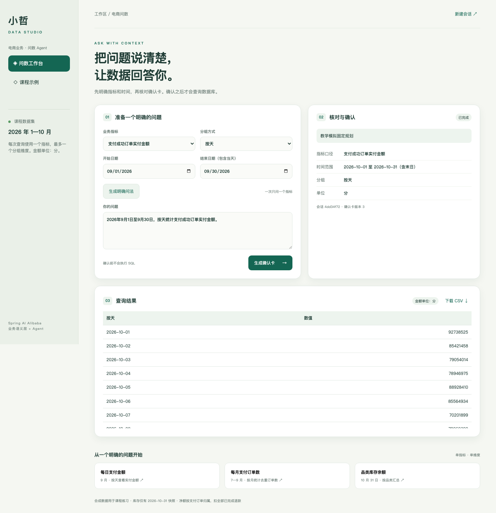

新增基础课编号：35、38、39（[基础课目录与对应表](<124_Text2SQL 基础课目录与故事课对应表.md>)）。

前置知识：第 14 课的页面状态与确认卡，第 08–09 课的结果结构和金额单位；基本 DOM 操作与 CSV 格式。

代码：继续阅读 `lessons/15/end/src/main/resources/static/app.js` 的 renderResults、CSV 下载和启动恢复逻辑。后端不新增查询能力。

## 一个没有单位的数字，够不够拿去汇报

运营终于自己点了“确认并查询”。你看到页面出现 10000，正准备宣布交付，财务却问：

一万块？怎么这么少？

你赶紧解释，数据库金额单位是分，这里代表一百元。

数字没有算错，但页面少了一句关键说明，就足以让使用者理解错一百倍。更何况导出以后，文件还会离开原来的界面。


本课的目标是把“数据库返回的二维数组”变成可读、可核对、可带走的结果。我们不增加花哨图表，先把口径、日期、单位与空结果讲清楚。

## 结果必须等到 done 才出现

render 开始会隐藏 result-panel，最后只有 stage=done 才调用 renderResults。

这样用户修改问题、生成新卡时，不会把上一份结果误认为新问题的答案。界面上的旧数字越像还有效，越容易在操作切换时造成误解。

```javascript
$('result-panel').hidden = true;
// 其他状态与确认卡渲染
if (session.stage === 'done') renderResults();
```

这不是后端批准约束的替代品；它解决的是页面信息的新旧关系。后端负责确认前不查，前端负责未完成时不把结果区摆出来冒充新答案。

当 stage=error，也应先显示失败原因，而不是继续让上一张表占据视觉中心。用户要能分清“新查询失败”和“旧查询结果还在”。

## 数据库返回的行，为什么有时一列、有时两列

上一课编译器在无分组时只返回 value，有分组时返回 dimension、value。执行器按照 ResultSet 列顺序读成 `List<List<Object>>`。

因此前端先判断：

```javascript
const grouped = plan.dimension !== 'none';
const headings = grouped
  ? [dimensions[plan.dimension], '数值']
  : ['数值'];
```

按天查询显示日期与数值；合计查询只有数值。不能永远把第一列叫“日期”，否则按品类查询时，键盘就会被放在日期列里。

计划与结果必须配套解释。二维数组本身没有足够业务语义，页面要结合已确认的 plan 才知道每列是什么。


## 先写单位，再让用户看数字

本版沿用数据库单位，paid/net 为分，stock_qty 为件，其他计数为单：

```javascript
$('result-unit').textContent = ['paid', 'net'].includes(plan.metric)
  ? '金额单位：分'
  : plan.metric === 'stock_qty' ? '数量单位：件' : '数量单位：单';
```

选择不换算是为了让课堂里的数据库值、Java 返回值、页面值和 CSV 值能直接核对。若未来产品改成元，需要同时考虑展示精度、导出格式和验收答案，不能只在页面某一处除以 100。

本课示意图里的 10000 分等于 100 元，用来解释单位，不是课程全量数据库的九月真实合计。正式演示的数字以当时查询结果为准。

确认卡仍在结果上方，用户能回看指标和日期。财务询问“这个数怎么算的”时，不需要重新猜本次查询选了哪个口径。

## 空列表和零值，不是一回事

有分组查询没有匹配记录时，可能得到空列表 `[]`。页面显示“这个时间范围内没有记录”。

无分组汇总通过 COALESCE 可能返回 `[[0]]`。这是一行值为 0 的汇总结果，应该显示 0，而不是说页面没加载出来。

```javascript
if (!rows.length) {
  const p = document.createElement('p');
  p.textContent = '这个时间范围内没有记录。';
  host.append(p);
  return;
}
```

这段判断检查行数，而不是检查第一格是否为真。若写成 `if (!rows[0][0])`，0 会被当成没有数据，错误地抹掉一个有效结果。

编译器不会自动给缺失日期补零行，因此按天结果中没有某一天，并不意味着前端可以自行添加那天。是否补齐日历属于另一项报表规则，本课保持数据库返回的真实行集合。

## 用文本节点把值放进表格

创建行时使用 textContent：

```javascript
for (const row of rows) {
  const tr = document.createElement('tr');
  for (const value of row) {
    const td = document.createElement('td');
    td.textContent = value === null ? '—' : String(value);
    tr.append(td);
  }
  body.append(tr);
}
```

null 显示横线，0 显示 0，两者仍然区分。每个单元格作为文本写入，不把品类名或数据库字符串拼成 HTML。

这段代码没有重新做聚合。统计粒度已经由 SQL 决定，前端的工作是忠实展示。若页面再求一次合计、再按日期分组，很容易产生第二套算法，也让排错时不知道该查哪一层。

已有结果页面可帮助你定位表格、单位与下载入口：



截图来自本轮 Worker2 的 V15 实际网页。规划器使用固定教学响应，结果由真实 MySQL 查询返回；图中是旧卡实验将九月改为十月后的结果，左侧输入准备区未提交的内容不代表当前确认计划。对应 CSV 与执行记录保存在 labs/worker-validation/evidence。

## CSV 不是把数组直接 join 一下就结束

财务要把结果放进表格软件，所以页面提供 CSV 下载。CSV 的列用逗号分隔，但值自己也可能有逗号、双引号或者换行。

当前 escape 会把每个单元格放进双引号，并把内部双引号翻倍：

```javascript
const escape = value => '"' + String(value ?? '')
  .replace(/^[=+@-]/, "'$&")
  .replaceAll('"', '""') + '"';
```

前面的处理针对以公式符号开头的文本，减少把文本当成公式执行的风险。本课理解这段现有行为，不把它扩大成一门通用 CSV 安全框架课。

生成文件时加入 UTF-8 BOM，并用 CRLF 分行：

```javascript
const csv = '\ufeff' + [headings, ...session.rows]
  .map(row => row.map(escape).join(','))
  .join('\r\n');
```

下载时创建 Blob 的临时 URL，触发链接后释放 URL，避免页面长期保留不再需要的对象地址。这是一次下载的生命周期，不涉及后端再次查询。

## 当前 CSV 带走了哪些信息

当前导出表头是“分组、数值”或“数值”，数据来自当前 session.rows。它保留结果行，但不会自动把确认卡的完整口径、日期与单位写入 CSV。

所以本课交付练习要求同时提交 CSV 与确认卡截图，或者附一份口径说明。用户离开页面以后，文件名“小哲问数结果.csv”本身不足以说明这是哪一次查询。

你可以把“导出增加口径说明”列为后续交付练习的设计题，但当前课程实现保持冻结，不把未实现的元数据功能写成已经存在。

验收要核对 CSV 的行数、列数、金额单位和排序是否与页面一致。只看到浏览器下载成功，不能说明内容正确。

## 刷新页面，为什么还能找到刚才的会话

render 会把当前会话 id 写入 localStorage：

```javascript
localStorage.setItem('xiaozhe.session', session.id);
```

页面启动时读这个 id，再调用 GET `/sessions/{id}` 取最新 Session。浏览器只记住入口，真正的业务状态由第 13 课 Redis 检查点保存。

两者少一个都不完整：只有 localStorage、后端内存丢失，id 也找不到状态；只有 Redis、页面不知道原 id，就需要用户手工提供才能继续。

“新建会话”会清除本地记录并重置页面，不删除所有历史会话，也不清空数据库。页面恢复失败时提示用户检查后端或新建，不能自动把失败会话当成新问题再次查库。

## 亲自完成一次离开页面的交付

先停止第 14 课服务，再进入 `lessons/15/end` 启动 V15 完整网页。选择九月支付金额、按天，生成明确问法，核对后确认。

第一步核对页面：日期列合理，金额单位为分，确认卡仍是九月。第二步下载 CSV，用文本编辑器先看编码、表头和原始值，再用表格软件打开。

第三步对比数据：除表头外行数相同，每个分组对应的数值相同。不要因为表格软件自动隐藏前导零或转换日期显示，就只按屏幕样子判断。

第四步刷新页面，确认会话 id 没变、状态仍 done、结果仍能展示。刷新本身不该新增 executions。再点新建，页面应该回到等待提问，而不是把旧结果留在新问题下。

这些操作不需要制造新的坏计划，它们验证的是交付链路能否把已经正确的查询结果完整呈现出来。

## 本课练习：一份财务能理解的结果包

提交四项：明确问题、确认卡截图、结果截图、CSV 文件。另写一句口径说明，包含支付日归属、九月范围、按天、金额单位分。

回答两个问题：`[]` 与 `[[0]]` 应如何显示？CSV 为什么还需要附确认卡或口径说明？答案应指出当前导出只带表头与结果行，不带完整业务上下文。

| 验收内容 | 检查方式 |
| --- | --- |
| 结果出现时机 | 只在 done 展示 |
| 表头 | 与 plan.dimension 一致 |
| 单位 | paid/net 分，库存件，订单计数单 |
| 空与零 | 空列表提示无记录，零值正常展示 |
| 导出 | 行列和值与页面一致 |
| 刷新 | 同会话恢复，不新增执行 |

## 小哲心中隐隐的担心

财务拿着 CSV 和口径说明离开，运营也能自己完成一轮查询。这个项目终于从接口变成了可以使用的工作台。

老板看完演示，最后问了一句：

你今天挑的例子都对，明天别人换个日期，怎么证明它还是对的？

你知道，下一步不是再挑一个漂亮问题，而是把“怎么算对”写成任何人都能重复检查的验收方式。

最后一课，用独立答案、固定数据和完整交付清单，把这件事收尾。
