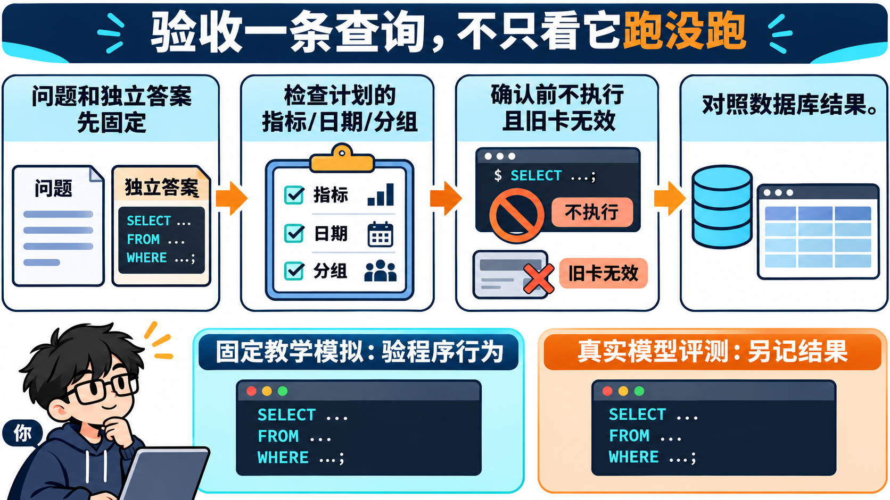

新增基础课编号：40（[基础课目录与对应表](<124_Text2SQL 基础课目录与故事课对应表.md>)）。

前置知识：基础课 27「评估与测试」；第 02、08 课的统计粒度，第 09–13 课的执行与确认边界，第 14–15 课的网页交付。

版本：V15 → V16。业务代码沿用 V15，本课新增的是验收方法与交付材料。代码目录 `lessons/16/end`；本地图文包补充材料在 `labs/16-acceptance/`。

## 演示顺利，不代表验收已经完成

你在老板面前输入九月支付金额，确认卡清楚，结果正常，CSV 也能下载。演示进行得很顺。

老板却没有只说一句“不错”：

这个数字是你看着像对，还是你有一个独立答案能对上？

你打开编译器，想解释 SQL 的来源，马上又停住了。如果标准答案也调用同一个编译器，那么编译器算错时，两个地方会一起错。

本课不再增加新功能。你要把“我知道它能跑”变成“别人按同一套步骤能检查它做得对不对”。


## 一次查询，至少要过四层检查

第一层是需求：用户明确选择什么指标、什么日期、什么分组。第二层是计划：系统是否保留这些条件。第三层是流程：是否先确认，旧卡能否被拒绝。第四层才是数据结果：SQL 算出的行和值是否正确。



如果只验结果，有些错误恰好被数据掩盖；只验计划，编译器仍可能把退款关联错；只看页面绿灯，更无法知道确认之前有没有访问数据库。

你可以把一次验收想成核对一张物流单：收件人正确、地址正确、发货顺序正确、实际收到的东西正确，缺一项都不能只凭“车已经开走了”算完成。

## 先定题目和答案，再开始运行

本课正常验收题保持单指标、单维度、明确日期。选有数据的区间，避免所有查询都得到空结果，让不同算法碰巧相等。

文档包提供三道明确题和独立 SQL：

| 编号 | 明确问题 | 应核对的计划 |
| --- | --- | --- |
| A01 | 2026年9月支付金额按天统计 | paid、day、9月1日至10月1日不含 |
| A02 | 2026年7月至9月，按月统计支付成功订单数 | count、month、7月1日至10月1日不含 |
| A03 | 2026年10月31日库存余额按品类汇总 | stock_qty、category、10月31日至11月1日不含 |

这些是公开的课程验收练习，不是新的盲测题。学员事先知道标准，目的是理解检查方法与交付要求。

标准答案的 SQL 不调用 SemanticSqlCompiler，而是按业务含义独立编写。它们保存在 [独立标准.sql](https://codeup.aliyun.com/6a4a062c08f52788b13355e9/xiaozhe-E-commerce/blob/main/text2sql-course/labs/16-acceptance/独立标准.sql)，可以先用只读账号运行并保存输出，再运行应用作比较。

## 金标准不是复制一份同样的代码

A01 的标准 SQL 从订单事实直接按支付日期聚合：

```sql
SELECT DATE(paid_at) AS dimension,
       SUM(paid_cents) AS value
FROM orders
WHERE status='paid'
  AND paid_at >= '2026-09-01'
  AND paid_at < '2026-10-01'
GROUP BY DATE(paid_at)
ORDER BY dimension;
```

这一题不需要商品明细，也不需要支付尝试流水。SQL 很短，重点是能从业务口径逐项解释它：成功支付、支付日期、订单实付、按天。

它和编译器使用的日期格式函数未必逐字相同，但对应日期键与金额值应一致。验收比较的是业务结果，不要求 SQL 字符串完全一样。

对 A02，按月份统计订单数；对 A03，用库存快照关联商品品类，按 on_hand 求和。独立答案也需要检查，不能因为文件名叫 gold 就自动相信它。

## 用能区分错误的数据检查算法

你在第 02 课见过：两个订单金额恰好相同，SUM(DISTINCT 金额) 就会露馅。第 08 课一单两笔退款，直接相减得到 17000，预聚合后才是 7000。

这类小数据之所以有价值，是因为正确与错误写法会得到不同结果。若每个订单都只有一条明细、一笔退款，错误 JOIN 也可能看起来完全正确。

同样，检查日期边界时，要确保边界附近有数据；检查无退款订单是否保留时，要放一张真的没有退款的订单。数据设计围绕要区分的错误，而不是只追求“有十万行看起来很大”。

本课重用前面已有的固定修复样本，不再现场创造新的随机失败。学员应能说出每组样本专门揭示哪一个错误。

## 结果对比之前，先统一比较规则

金额以分比较，不先转成浮点元。日期统一成 YYYY-MM-DD，月份统一成 YYYY-MM；按分组键比较，不被不同客户端的显示格式带偏。

| 数据形态 | 比较方法 |
| --- | --- |
| 合计 | 比较一行数值及单位 |
| 按天、按月 | 按日期键对齐，比较完整键集合与每个值 |
| 按品类 | 按品类名对齐，不只比较总和 |
| 空列表 | 明确检查为空，不把异常当空结果 |
| 零值汇总 | 保留这一行，与没有结果区分 |

如果两个分组结果总和一样，但键对应的值交换了，仍然算错。只比较最终合计会漏掉分组错误。

JSON 中的 100 与数据库客户端显示的 100.00 可能是同一个精确数值，但字符串、日期、null 不能一概转为 0。比较规则在跑之前写清楚，避免看到结果后临时放宽。

## 固定教学模拟，验证的是哪些行为

本课程的固定模型响应让程序错误可以稳定演示，不需要重复付费“碰”一次失败。它们必须明确标注教学模拟。

| 测试材料 | 要验证的行为 |
| --- | --- |
| 第03课空值与代码块响应 | 转换器与显式 Schema 的修复路径 |
| 第06课不支持组合 | 能力校验拒绝，不悄悄改变分组 |
| 第07课歧义与日期依据 | 缺少依据时追问，明确输入继续 |
| 第10–12课固定规划器 | 确认前不执行、条件保留、旧卡失效 |
| 第13课固定规划器与真实Redis/MySQL | 检查点恢复、并发确认只执行一次 |

这里没有把固定响应算成模型理解题。模型评测要记录真实输入、真实输出与独立评分；程序回归则关注在给定输入下行为是否正确。它们回答不同问题，不能混在一个通过率里。

本课不启动新一轮模型效果实验。你学习的是如何解释已有证据、为当前交付写出可重复的功能验收。

## 给确认流程一张独立验收表

数据题之外，还需要检查操作顺序。

1. 创建明确问题，进入待确认时 executions=0。
2. 取消会话，数据库没有新增执行。
3. 补日期后，原分组和筛选保持不变，再次核对。
4. 修改后提交旧 revision，得到 409，不能执行。
5. 用当前版本确认，完成一次查询；重复确认不能再次执行。
6. 待确认时重建应用，恢复同一计划、版本与状态。
7. 用只读账号发权限探针，数据库拒绝 UPDATE。

每一项都保存对应证据：JSON、测试断言或数据库错误。不要把“页面上的确认按钮已经禁用”当成“后端不能重复执行”的证据，两层都要各自看清楚。

本课给出 [验收记录模板.csv](https://codeup.aliyun.com/6a4a062c08f52788b13355e9/xiaozhe-E-commerce/blob/main/text2sql-course/labs/16-acceptance/验收记录模板.csv)，用于填写预期、实际与证据位置。模板中的状态初始是“待填写”，不是预先写好的全部通过。

## 从干净的交付目录启动

完整课程包保留根目录 data、labs 和 lessons，不只复制某一版的 Java 文件。各版 Compose 引用了共享课程数据，缺少这些目录会导致初始化或测试失败。

进入 `lessons/16/end`，复制 `.env.example` 为 `.env`，填写自己的账号配置。密钥只供后端使用，不放进网页、不发到交作业的压缩包。

```shell
docker compose up -d --build --wait
docker compose ps
curl -sS http://localhost:18323/health
```

首次启动包含下载依赖、编译与导入教学数据，耗时可能比后续启动长。健康检查没通过时先看日志，不要不断新建会话掩盖启动失败。

固定测试入口：

```shell
docker compose --profile check run --rm check
```

本版 CourseTest 检查格式与规则，WorkflowTest 检查带 Redis 的流程，DatabaseLessonTest 检查聚合与权限。固定规划器不发送真实模型请求，数据库与 Redis 则需要按 Compose 启动。

启动成功、测试通过、网页可用、作业结果正确，是四项不同的交付检查，不要用一个 BUILD SUCCESS 覆盖全部。

## 一个真正可以提交的结课项目

项目名称是“小哲电商问数工作台”。目标不是支持任意数据库和任意问题，而是把已经定义的电商指标，通过目录、计划、校验、确认、编译与只读执行交给运营使用。

提交物包括：

- 可启动的工程或明确对应的课程版本，保留运行说明，不包含个人密钥。
- A01–A03 的确认卡、结果与独立 SQL 对照；金额标明分。
- 一组有修复闭环的教学案例，标明固定模拟或 SQL 小样本，展示出错、原因、修复、验证。
- 一组交互证据：确认前零执行、旧卡冲突、恢复后继续确认。
- CSV 与口径说明，以及填好的验收记录。

不要求新增多指标、多维度或任意 Schema 功能。你应把受限能力讲清楚，并把已承诺的路径交付完整。产品范围写进 README，不能藏到用户撞错以后才解释。

## 教师怎样判断学员真的理解了

一份漂亮截图只能说明页面看起来完成。讲解时再问三个“为什么”：

为什么退款先按订单聚合？为什么补日期不重新生成整个计划？为什么旧卡不能用当前版本自动重试？

能够把数据粒度、用户条件和批准对象分别说明白，才算理解了这门课的核心。只记住类名或一串框架 API，不足以独立完成下一次类似业务。

评分建议分成业务口径、流程约束、结果核对、交付说明四部分。任何确认前执行、只读账号可写或旧卡放行，都不能被页面美观抵消。

参考答案与逐课练习检查点见 [实验与验证说明](https://codeup.aliyun.com/6a4a062c08f52788b13355e9/xiaozhe-E-commerce/blob/main/text2sql-course/labs/README.md)。教师可以按材料核验，而不是靠临场印象评分。

## 用完课程环境，记得收尾

普通停止使用 `docker compose down`，保留数据库和 Redis 数据卷，方便下次继续。只有确定要清空自己的教学数据时，才考虑删除卷。

交付包里保留必要的源码、说明、样例与验收记录，不打包本机 `.env`、临时缓存和容器运行产物。别人拿到包后，应该按说明启动，而不是依赖你机器上恰好存在的某个目录。

这一点也属于工程交付：把使用方法和结果证据一起留下，项目才能离开作者的电脑。

## 小哲心中隐隐的担心

老板看完独立 SQL、确认流程和导出文件，终于不是只对一段演示点头，而是能说出这套系统承诺做什么、依据什么验收。

你回想最开始，运营每次换个日期都要找开发。现在用户能表达明确需求、核对计划，再拿到带口径说明的结果。

小哲心中仍有一个问题：如果以后增加新指标，应该先改提示词，还是先定义口径、支持维度和验收数据？

你已经有了答案。先把业务定义清楚，让数据和独立答案站得住，再接入计划与交互。模型负责理解，程序负责约束，用户保留批准权。

这门课到这里结束。下一次扩展从一份明确的新需求开始，不从一句“让模型再聪明一点”开始。
