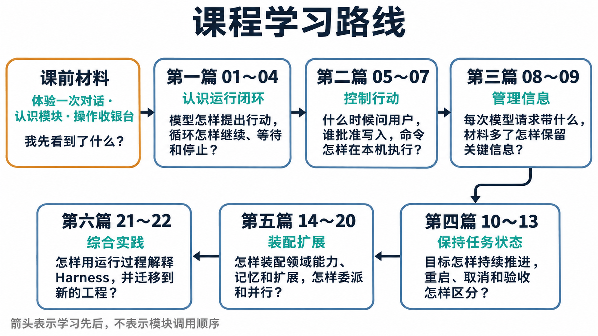

**这份指南告诉你这门课学什么、按什么顺序读、每课留下什么。**

你给 Agent 一项任务，它怎样读到材料、调用工具，再根据结果继续工作？这门课就从这些看得见的动作出发，逐步认识背后的 Agent Harness。我们会用 Python 项目 MyBuddy，把组织工具、推进任务和保存记录的机制拆开来看。

学完这门课，希望你既能讲清 Agent Harness 的功能和实现，也能用它完成实际工程任务。我们主要用 MyBuddy 观察内部机制，同时比较 Claude Code、Codex、Gemini CLI、OpenCode 等产品的用法。你会逐渐知道什么时候先问清需求、什么时候可以修改，以及怎样检查结果；换产品时，再核对它自己的命令和权限含义。

## 为什么课程安排了两种 Buddy？

**两种 Buddy 让你看清：同一套 Harness 换一份预设，就能做另一类工作。**

MyBuddy 中的 **Buddy** 可以先理解为“为一类任务配好指令和工具的助手”。课程特意安排了两种 Buddy，帮助你看清同一套 Harness 怎样用于不同工作：

| Buddy | 课程里用它做什么 | 你重点观察什么 |
| --- | --- | --- |
| **DeveloperBuddy（开发助手）** | 阅读代码、修改程序、运行检查 | 模型怎样通过工具操作项目，再根据结果继续工作 |
| **ResearchBuddy（研究助手）** | 研究一个领域：阅读本地资料、比较信息，把注明出处和未知之处的研究报告写到 `reports/` | 换了任务，怎样调整指令和工具 |

前半程先跟着开发助手，把模型调用、工具、循环、上下文和会话这些基础讲清楚。到了第 14 课，我们再换成研究助手：原来的 Agent Loop 照常使用，变的主要是预设里给模型的说明文字和可用的工具名单。预设也能指定默认权限模式，不过这两份都用 `default`。之后再和 Skill、MCP、委派组合起来。

**这是为教学特意设计的一次任务转换。** 你先理解一套 Harness 怎样工作，再亲眼看它怎样适应另一类任务。以后想做自己的助手，就能先分析任务需要什么，再决定复用哪些机制、补充哪些能力。研究助手先用一批本地资料做小型领域研究；另有一份联网版预设，多了 `web_search` 和 `web_fetch` 两个工具，作为可选加做。具体配置和操作在第 14 课展开。

## 先建立地图，再进入机制

**先读完五份课前材料，再进第 1 课。**

先按顺序读五份课前材料：本指南、《课前-获取API密钥》、《课前-MyBuddy使用导读》、《课前-MyBuddy工程设计说明》、《课前-麦当当收银台介绍》。先办好密钥、完成一次对话，认识主要模块，再亲手操作收银台。有了这些直观体验，就可以进入第 1 课。

第一次看工程设计说明，可以先把它当成一张地图，记住入口、循环、工具和会话大致在哪里。第 1 课会沿一次任务解释它们为什么需要配合，后面再逐项展开。现在不必急着记住全部类名。

看完这张图，你要能：说明六篇课程的前置关系，并指出各篇要回答的核心问题。

| 篇 | 学习后应该能回答的问题 |
| --- | --- |
| 第一篇，01～04 | 模型怎样提出行动，循环怎样继续、等待和停止？ |
| 第二篇，05～07 | 什么时候问用户，谁批准写入，命令怎样在本机执行？ |
| 第三篇，08～09 | 每次模型请求带什么，材料多了怎样保留关键信息？ |
| 第四篇，10～13 | 目标怎样持续推进，重启、取消和验收怎样区分？ |
| 第五篇，14～20 | 怎样装配领域能力、记忆和扩展，怎样委派和并行？ |
| 第六篇，21～22 | 怎样用运行过程解释 Harness，并迁移到新的工程？ |

## 正文与代码怎样配合

**先读正文弄懂机制，再看源码核对实际行为，最后动手实践。** 第一遍按顺序读，之后需要回查时，可以单独打开某一课或工程设计说明。

下面的运行命令使用 MyBuddy 源码仓库：`src/mybuddy/` 是 Python 实现，`demo-project/` 是业务样例，`demo-project/exercises/` 是作业材料。`demo-project/cards/` 是能力卡：一张卡试一项能力，一页纸写明准备命令、要发的话、去哪里看结果，以及课程用真实模型跑出的结果；第 3 到 20 课里讲能力的课各有对应的卡，课内“使用小妙招”前有入口。准备和启动命令都在仓库根目录（有 `pyproject.toml` 的那一层）执行，具体步骤见《实践准备》。不需要逐课切换源码版本，也不需要运行 MyBuddy 自己的测试。

从源码运行时，默认配置文件是仓库里的 `config/config.toml`，改完下次启动才生效。运行 `uv run python -m mybuddy` 时，`--workspace` 指定业务样例目录，`--config` 指定单独的配置文件；完整命令见使用导读。

每课可以按这个顺序学习：先读问题和例子，弄清我们要解决什么；再看对应源码，确认程序怎样做；最后用实践检验理解。正文会把机制讲清楚，源码帮助你核对实际行为。运费和收银台自带的测试也可以运行，它们检查的是业务结果。

读代码时使用《MyBuddy源码目录与文件索引》：先看目录划分逻辑，再选“普通请求、文件修改、会话恢复、上下文压缩”中的一条路线。索引列出当前全部 Python 源文件的职责，遇到陌生文件时可以回查。

## 每课留什么学习成果

**每课学完，你要能做出一个具体判断，并留下一份简短的实践记录。**

每课都包含机制讲解、实际能力边界、使用小妙招和 Q&A。学完上下文压缩，你要能在模型请求的输入接近上限时判断继续、压缩或新开会话；学完 Git Worktree（同一仓库的多个独立工作目录），你要能安排各任务的目录、检查环境与集成后的验证。

第 1 到 21 课各有一份独立的“源码解析”文件，与课程正文互相链接；第 22 课用配套练习材料代替。先读正文理解概念，再打开源码解析：从本课问题找到入口和核心对象，阅读关键代码，再沿调用链分析数据变化、失败分支与实现取舍，最后做一个读码练习。代码节选来自当前实现，读的时候最好打开原函数对照。综合实践部分会解析案例或检查器，不提前给完整作业答案。

每次实践保留四项即可：接受的目标、实际操作、可核对结果、尚未覆盖的范围。执行轨迹（Trace）用来查看每轮里模型和工具做了什么，帮你定位问题。MyBuddy 的 `/trace` 显示最近一轮的简要摘要，不能代替业务验收，也不会展示模型内部推理过程。

## 案例与作业怎样使用

**原始案例不动，所有修改都在自己的练习副本里做。**

运费用于观察小范围修复；麦当当用于跨模块任务；课前材料帮助你读懂麦当当，第 21 课独立完成按支付方式汇总的营业报表，第 22 课把方法迁移到新的本地文档检索 CLI，练习 Claude Code 的开发与反馈方式。原始案例保留，修改在独立练习副本里进行，做法见《实践准备》。作业给任务、实现提示、预期与用例，不给完整实现答案。

自动检查会逐个用例报告通过、失败和差异；界面体验另按几步人工操作观察。某项检查通过，只说明它检查的那部分没问题。

## 使用小妙招

### 先选一个贯穿任务

**用同一个小任务贯穿前几篇，注意力就能留给 Harness 本身。** 第一次学习可以一直用“普通地区恰好达到门槛时免邮”。业务熟了，就能专心看工具、审批、上下文和证据怎样配合。综合实践再换成收银台报表，检查方法是否能够迁移。

## Q&A：常见追问

### Q1：文档中的命令与当前程序不一致时，怎样核实 Agent 的实际能力？

以当前程序为准，先查它提供的帮助，再看对应源码，用一次实际运行核对行为。以 MyBuddy 为例，输入 `/help` 可以看到当前可用的命令。命令是否存在与它实际能做什么，都要核对。

### Q2：为 Agent 选择扩展时，应该怎样判断是否值得引入？

看它解决什么问题、增加什么成本，什么时候值得用、什么时候可以省略。根据具体任务决定复用哪些机制、补充哪些能力，再用实际结果核对判断。
