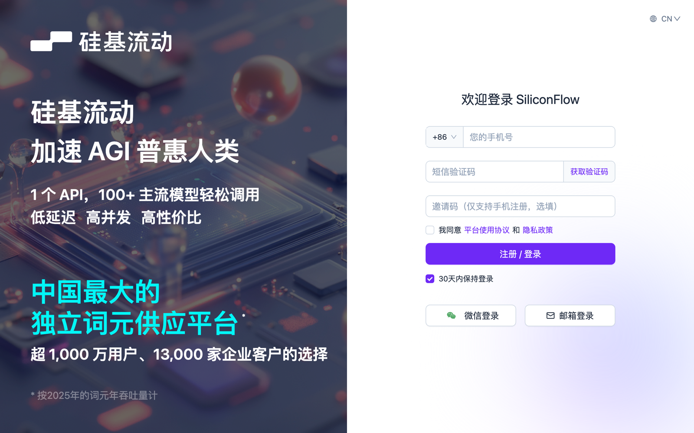
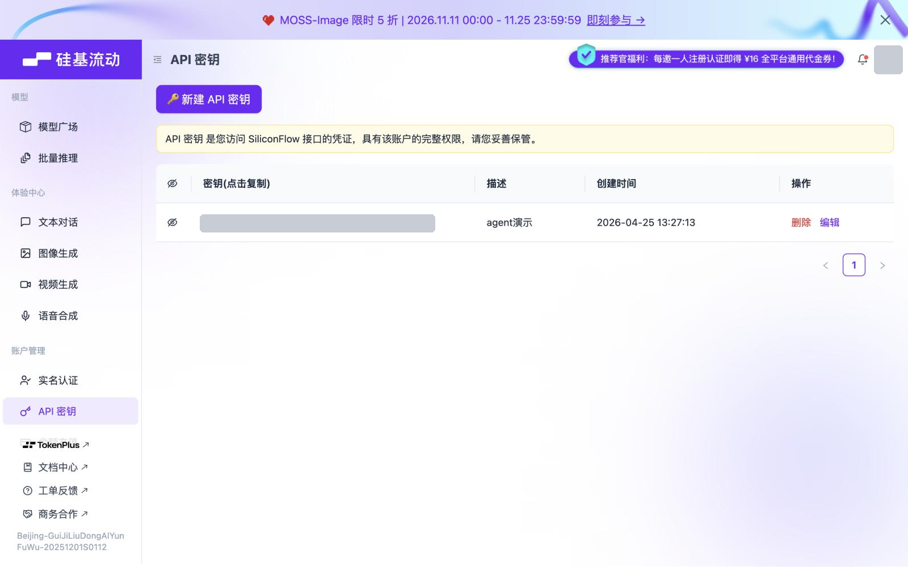
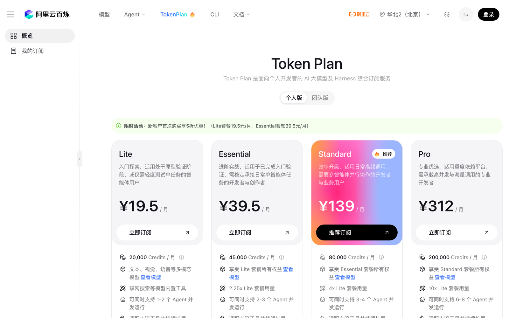
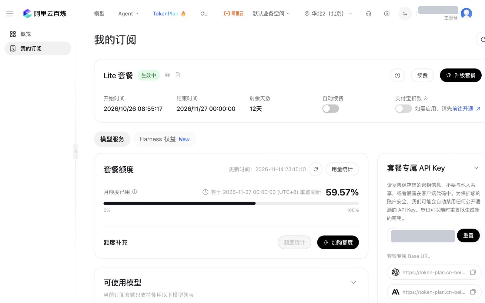
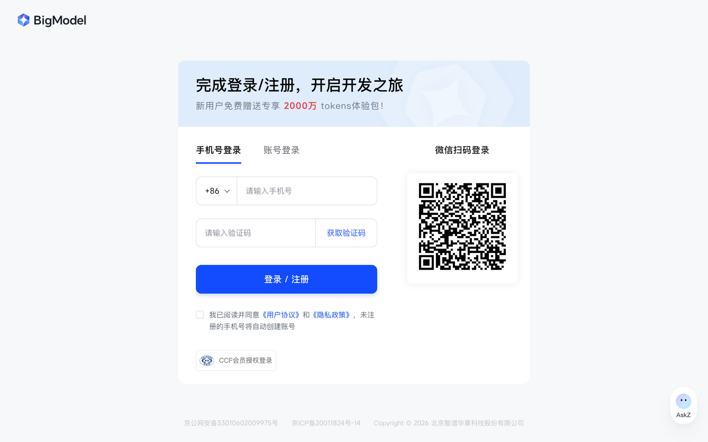
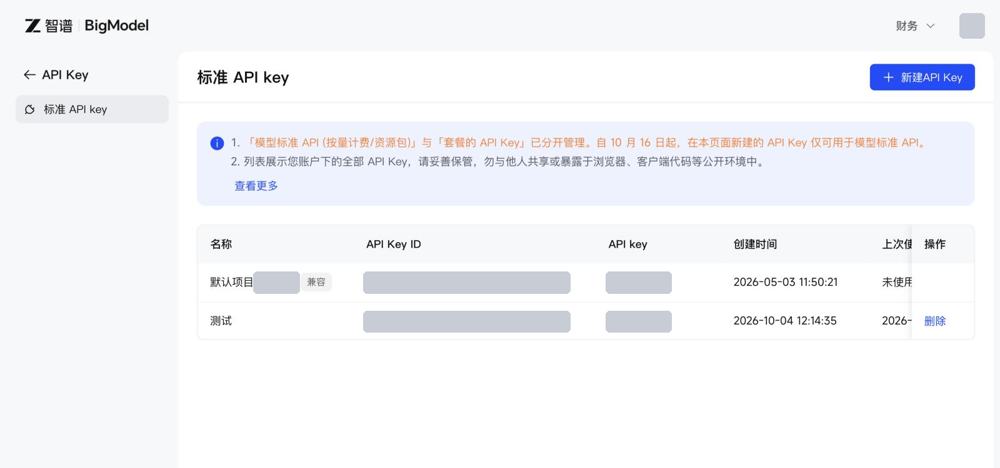

全套阅读入口见课程目录《MyBuddy 课程：六篇 22 课》。

## 本篇导览

**读完这份材料，你手里会有课程用到的 API 密钥，并知道每一个填在配置文件的哪里。**

MyBuddy 自己不带模型。它把你的问题发给模型服务，再把回答拿回来；模型服务按账号计费，靠 API 密钥认出是谁在调用。所以启动 MyBuddy 之前，要先去服务商那里申请密钥。

课程用到三家服务，按这个顺序办：

- **硅基流动**：必办。课程默认的模型在这里。
- **百炼 Token Plan**：选办。想用千问模型时再办，买最便宜的一档就够。
- **智谱**：选办。第 14 课的联网搜索用它。

下面的页面地址、价格和活动都是 2026 年 11 月核对的。服务商的页面会改版，对不上时以官网当时显示的为准。

## 三个密钥各管什么

**只有硅基流动的密钥是必需的；另外两个到用的时候再办也来得及。**

| 服务 | 课程里用来做什么 | 什么时候需要 | 花费 |
| --- | --- | --- | --- |
| 硅基流动 | 默认模型 DeepSeek-V4-Flash，`low`、`medium`、`high` 三档都指向它 | 课前导读的第一次对话起，全程都用 | 按用量扣余额，用多少扣多少 |
| 百炼 Token Plan | 千问模型 `qwen3.8-flash`、`qwen3.8-max`，可以换到 `medium`、`high` 档 | 想对比不同模型，或想让子任务用更强的模型时 | 包月，个人版 Lite 档 39 元/月 |
| 智谱 | `web_search` 联网搜索工具 | 第 14 课研究助手的联网版加做 | 按次计费，标准版 0.01 元/次 |

三家的密钥互不通用：硅基流动的密钥只能调硅基流动的地址，百炼和智谱也一样。填错位置时，服务商会返回 401（密钥无效）。

三家的密钥都是一长串字符。它等于你账号的付款凭证：谁拿到，谁就能花你的余额。申请时注意三件事：

- 创建后马上复制，存到密码管理器或本机的私密笔记里。有的页面只完整显示一次。
- 不要贴进聊天群、截图、提问帖子，也不要提交到 Git。
- 怀疑泄露了，回到密钥页面把它删掉，再建一个新的。

## 硅基流动：课程默认的模型

**注册、充一点余额、新建密钥，三步办完。**

1. 打开 [硅基流动控制台](https://cloud.siliconflow.cn/)，用手机号或邮箱注册并登录。没注册过的手机号，在这个页面填验证码后会直接建好账号。
2. 页面提示实名认证时，按提示完成。认证用支付宝扫码刷脸，一两分钟就好。
3. 在控制台的充值页面充一点余额。先充 10 元就够试用：课程里最大的一次综合任务，用默认模型跑完大约花 4 元，平时的小练习每次只有几分钱。
4. 打开 [API 密钥页面](https://cloud.siliconflow.cn/account/ak)，点“新建 API 密钥”，名称随便填，例如 `mybuddy`。
5. 点密钥把它复制下来。它以 `sk-` 开头。左侧菜单的“账户管理”下面有“实名认证”和“API 密钥”两项。图里灰色色块盖住的位置就是密钥。

这个密钥填在 `config/config.toml` 的 `[providers.siliconflow]` 下面：

```toml
[providers.siliconflow]
protocol = "openai"
base_url = "https://api.siliconflow.cn/v1"
extra_body = { enable_thinking = false }
api_key = "sk-你的硅基流动密钥"
```

配置示例里另有一段注释着的 `[providers.siliconflow_messages]`，是同一家服务的另一种接口。要启用它时，填的是同一个密钥。

## 百炼 Token Plan：买最便宜的一档

**Token Plan 是包月套餐：先订阅，再在订阅页面生成专属密钥。它和百炼的按量计费密钥不是同一个。**

阿里云百炼有三种密钥，地址和密钥必须配套使用：

| 类型 | 密钥开头 | 配套地址 |
| --- | --- | --- |
| Token Plan（课程用这个） | `sk-sp-` | `https://token-plan.cn-beijing.maas.aliyuncs.com/compatible-mode/v1` |
| 按量计费 | `sk-` | `https://dashscope.aliyuncs.com/...` |
| Coding Plan | 另一种专属密钥 | 另一个专属地址 |

课程的配置示例写的是 Token Plan 的地址，所以要用 `sk-sp-` 开头的密钥。把按量计费的密钥填进来，会得到 401。

办理步骤：

1. 注册并登录 [阿里云](https://www.aliyun.com/)，按提示完成实名认证。
2. 打开 [百炼订阅页面](https://bailian.console.aliyun.com/cn-beijing/subscription/overview)，选 **Token Plan 个人版**。
3. 选最便宜的 **Lite** 档，按月购买。

| 档位 | 月价 | 每月额度 |
| --- | --- | --- |
| Lite | 39 元 | 20,000 Credits |
| Essential | 79 元 | 45,000 Credits |
| Standard | 139 元 | 80,000 Credits |
| Pro | 312 元 | 200,000 Credits |

3. 没买过个人版的账号，Lite 首月有新用户价（核对时是 19.5 元）；活动有期限，以官网当时显示的为准。课程练习用不完 Lite 的额度，不用买更高的档。截图是活动期间的页面，Lite 和 Essential 显示的是新用户价。选最左边的 Lite，点“立即订阅”。买完后，密钥在左侧“我的订阅”里生成。
4. 付款时留意“自动续费”。只想用一个月，就在百炼控制台 Token Plan 页面的订阅管理里把它关掉。
5. 打开 [个人版订阅页面](https://bailian.console.aliyun.com/cn-beijing/subscription/token-plan/personal)（左侧“我的订阅”），在右边的“套餐专属 API Key”里复制 `sk-sp-` 开头的密钥。它下面的“套餐专属 Base URL”就是配置里要用的地址。这个页面也能看到套餐的到期时间、自动续费开关和当月额度用了多少。图里灰色色块盖住的是账号和密钥。

买之前先知道四条规则：

- **不能退订，也不能降档。** 所以先买一个月的 Lite，不够再升。
- **额度用完就停，不会转成按量扣费。** 这时调用返回 `429 insufficient_quota`，等下个订阅月重置，或者加购用量包。
- **到期后密钥失效**，续订成功后自动恢复，不用重新生成。
- **个人版只给本人交互式使用**，不能多人共用一个密钥，也不能拿去跑批量脚本或定时任务。服务条款对允许的使用方式有具体规定，购买前请自己读一遍当时的条款。

这个密钥填在 `[providers.bailian]` 下面。示例里 `api_key` 这一行是注释着的，去掉开头的 `# ` 再填：

```toml
[providers.bailian]
protocol = "openai"
base_url = "https://token-plan.cn-beijing.maas.aliyuncs.com/compatible-mode/v1"
api_key = "sk-sp-你的百炼密钥"
extra_body = { enable_thinking = false }
```

填好后，配置示例里的 `bailian_flash` 和 `bailian_max` 两个模型就能用了。在 MyBuddy 里输入 `/model bailian_flash` 可以临时切过去；想让某一档固定用它，改 `[presets]`：

```toml
[presets]
low = "siliconflow_deepseek_flash"
medium = "bailian_flash"
high = "bailian_max"
```

## 智谱：联网搜索用的密钥

**智谱的密钥只给** `web_search` **工具用，第 14 课之前可以不办。**

1. 打开 [智谱开放平台](https://bigmodel.cn/)，注册并登录，按提示完成实名认证。
2. 打开 [API Keys 页面](https://bigmodel.cn/usercenter/proj-mgmt/apikeys)，在“标准 API key”页面点右上角的“新建 API Key”，名称随便填。智谱把按量计费的标准密钥和套餐密钥分开管理，课程用的是标准密钥。
3. 复制生成的密钥。要填进配置的是“API key”这一列，不是“API Key ID”。图里灰色色块盖住的是密钥等账号信息。
4. 搜索按次计费：标准版 `search_std` 每次 0.01 元，专业版 `search_pro` 每次 0.03 元。账户里没有余额或赠送额度时，先充几元。课程用标准版就够。

这个密钥不填在 `[providers.*]` 里，而是填在搜索工具自己的配置里。把示例中 `[tools.web_search]` 这一段每行开头的 `# ` 去掉，再填密钥：

```toml
[tools.web_search]
enabled = true
api_key = "你的智谱密钥"
base_url = "https://open.bigmodel.cn/api/paas/v4"
search_engine = "search_std"
```

MyBuddy 每一轮最多搜索 10 次（`max_calls_per_turn`），所以一次提问的搜索花费最多一毛钱。

## 把密钥填进配置文件

**三个密钥都填在仓库根目录的** `config/config.toml`**，各有各的位置。**

第一次使用时，先在 MyBuddy 仓库根目录复制配置示例：

```shell
cp config/config.example.toml config/config.toml
```

然后用编辑器打开 `config/config.toml`，按下表填：

| 密钥 | 填在哪一段 | 示例里的状态 |
| --- | --- | --- |
| 硅基流动 | `[providers.siliconflow]` 的 `api_key` | 是占位符 `<YOUR_API_KEY>`，直接替换 |
| 百炼 Token Plan | `[providers.bailian]` 的 `api_key` | 注释着，去掉 `# ` 再填 |
| 智谱 | `[tools.web_search]` 的 `api_key` | 整段注释着，逐行去掉 `# ` 再填 |

`config/config.toml` 已被 Git 忽略，密钥留在本机，不会跟着提交出去。`config/config.example.toml` 是会提交的示例文件，不要把真实密钥写进它。

不想把密钥写进文件，也可以放在环境变量里：把 `api_key` 换成 `api_key_env = "SILICONFLOW_API_KEY"`，值是环境变量的**名称**，不是密钥本身。两个都写时，`api_key` 优先。

填好硅基流动的密钥，就可以读下一份《课前导读：认识并使用 MyBuddy》，在那里启动并完成第一次对话。能正常收到回答，说明密钥有效。

## 密钥不能用时怎样排查

**先看报错里的状态码，它能告诉你问题在密钥、余额还是模型。**

| 现象 | 多半的原因 | 处理 |
| --- | --- | --- |
| 提示“没有配置 api_key” | 当前模型所属的服务没填密钥，或那一行还注释着 | 用 `/model` 看当前模型属于哪家，再去对应的段落填 |
| 401 | 密钥错了、复制不完整，或填到了别家的段落；百炼最常见的是填了按量计费的密钥 | 重新复制；核对密钥开头和 `base_url` 是不是一家的 |
| 提示余额不足 | 硅基流动或智谱的账户没有余额 | 充值 |
| 429 `insufficient_quota` | 百炼 Token Plan 当月额度用完 | 等下个订阅月，或换回硅基流动的模型 |
| 403 `AccessDenied.Unpurchased` | 调用了个人版套餐不包含的百炼模型 | 换成 `qwen3.8-flash` 或 `qwen3.8-max` |
| 等了很久没有回答 | 网络不通，或模型当时很慢 | 检查网络；模型慢时在对应服务的段落里调大 `timeout_seconds` |

## 使用小妙招

### 一个用途建一个密钥

三家都允许建多个密钥。给课程单独建一个，起名 `mybuddy`。课程结束后，或者怀疑它泄露了，把这一个删掉就行，不影响你在别处用的密钥。

### 先充小额，看着账单用

硅基流动和智谱都是用多少扣多少。先充 10 元，跑几次练习后去控制台的账单页面看实际花了多少，再决定要不要多充。百炼 Token Plan 的额度可以在订阅页面看剩余量。

## Q&A：常见追问

### Q1：为什么 Agent 工具不自带模型，而要用户自己填 API 密钥？

Harness 和模型是分开的两层。Harness 负责组织消息、执行工具和保存会话；模型在服务商那里运行，按用量收费。把密钥交给用户配置，有三个好处：费用记在用户自己的账号上；用户可以在不同服务商和模型之间切换，Harness 的代码不用改；密钥只留在本机，不经过第三方。MyBuddy 里换模型只改 `config.toml` 的 Provider 和模型段落，就是这种分层的结果。

### Q2：按量计费和包月套餐，应该怎样选？

看用量是否稳定。用量小或不确定时，按量计费更划算，花多少算多少。每天都大量使用时，包月套餐的单价更低，花费也有上限。课程默认用按量计费的硅基流动，是因为练习的用量小；百炼 Token Plan 是包月，额度用完会直接停止调用，不会多扣钱，适合想控制花费上限的人。

### Q3：API 密钥应该怎样保管？

把它当密码对待。不写进会提交的文件，不贴进聊天和截图；放在被 Git 忽略的配置文件或环境变量里；一个用途建一个密钥，方便单独删除；发现泄露立刻删掉重建。MyBuddy 也在自己这一侧做了保护：模型密钥不会写进会话记录。
