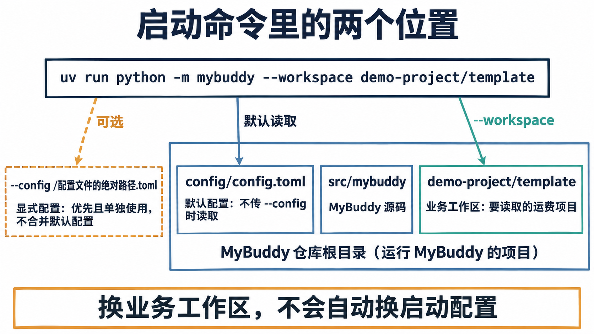
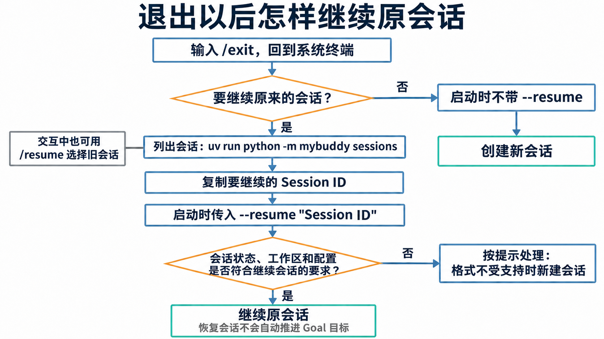

全套阅读入口见课程目录《MyBuddy 课程：六篇 22 课》。

## 本篇导览

**读完这份导读，你能自己启动 MyBuddy，完成第一次对话，退出后再找回会话。**

按操作顺序，先看它能做什么，再安装、启动、学常用命令，最后动手走一遍入门体验。原理从第 1 课开始讲，这里只管“会用”。

## MyBuddy 可以帮你做什么

**MyBuddy 是一个会用工具的任务助手：你提问，它读材料、做分析，需要时提出修改等你批准。**

你在终端里提出问题。模型判断要查哪些材料，MyBuddy 按规则去读取或搜索，再把结果交回模型继续分析。打开相应能力后，它还能提出修改、等你批准，再运行检查。

MyBuddy 会按任务配置不同的 Buddy，也就是为这类工作配好指令和工具的助手。**DeveloperBuddy**（开发助手）用于读代码、修改和检查；**ResearchBuddy**（研究助手）用于研究一个领域：阅读本地或网上的资料、比较信息，写出注明来源的研究报告。两者使用同一套 MyBuddy 运行机制。

这份导读先带你用开发助手：选项目目录，提问题，看它怎样取信息，再核对回答的依据。研究助手在第 14 课登场，那时你会学怎样为新任务配一个自己的 Buddy；为什么安排两种助手，见《课程学习指南》“为什么课程安排了两种 Buddy？”。

先记住三个名称：

- **工作目录**：文件工具找文件、命令开始执行的位置。
- **Session（会话）**：你和 MyBuddy 的多次来回，都存在同一个会话里。
- **Turn 和 Step**：你提一次请求就是一个 Turn。模型每做一次决定（要不要调用工具）就是一个 Step。一个 Turn 可以有很多个 Step。

课程有两个练习项目。运费模板很小，适合第一次只读提问，下面就用它。麦当当收银台有点餐、收款、送厨和取餐一整套流程。想先看看业务，可以按《综合实践-麦当当收银台》“1. 先体验已有业务，再提出开发任务”打开中文操作台，再建自己的开发副本。运行收银台本身不需要模型。后面的课会用它练习阅读、规划和验证。

## 启动并完成第一次对话

**装好依赖、复制配置示例并填好密钥，就能用一条命令开始第一次对话。**

你需要 macOS 或 Linux、Python 3.11～3.13、`uv`，以及一个硅基流动（SiliconFlow）的 API 密钥；还没有密钥的，先按《课前-获取API密钥》申请。示例配置默认用硅基流动的 DeepSeek-V4-Flash，百炼 Token Plan 和 Anthropic 都是可选的。下面的命令都在 MyBuddy 仓库根目录执行。

**用 Windows 的话，先装 WSL2（不是 WSL1），在里面的 Ubuntu 运行 MyBuddy；直接在 Windows 上启动会被拒绝，并提示改用 WSL2。**

1. 用管理员身份打开 PowerShell，运行 `wsl --install`，装完重启电脑。
2. 从开始菜单打开 Ubuntu，按提示设置 Linux 用户名和密码。后面所有命令都在这个 Ubuntu 终端里执行。
3. 在 Ubuntu 里装好 Git、`uv` 和 Python：

```shell
sudo apt update
sudo apt install -y git curl
curl -LsSf https://astral.sh/uv/install.sh | sh
source ~/.local/bin/env
uv python install 3.12
```

4. 把 MyBuddy 仓库放在 Linux 自己的目录里，例如 `~/mybuddy`，再 `cd ~/mybuddy`。不要放在 `/mnt/c/...`：那里是 Windows 的磁盘，读写很慢，文件权限也对不上。
5. 可选：想用第 7 课讲的系统沙箱，再运行 `sudo apt install -y bubblewrap`。

Ubuntu 里的步骤在 Ubuntu 24.04 上验证过；Windows 一侧的安装界面如有出入，以微软的 WSL 官方说明为准。

准备好后，先安装锁定的依赖：

```shell
uv sync --locked
```

这一步把终端和网页界面要用的库一次装齐，以后不用再装。

源码启动时，MyBuddy 默认读取**仓库根目录的** `config/config.toml`。这个位置是固定的，不随终端目录或 `--workspace` 变化。第一次使用时，复制模型配置示例：

```shell
cp config/config.example.toml config/config.toml
```

打开 `config/config.toml`，把 `[providers.siliconflow]` 下 `api_key` 的占位符换成自己的硅基流动密钥，只填这一个就能用。百炼和 Anthropic 的 `api_key` 默认注释着，有密钥时再取消注释填上。这个文件已被 Git 忽略，密钥留在本机。不用的 Provider 和对应模型可以删掉。也可以用 `--config /绝对路径/自己的配置.toml` 指定其他文件。然后启动：

```shell
uv run python -m mybuddy \
  --workspace demo-project/template \
  --name "课程初次体验"
```

`--workspace` 选要处理的业务项目，`--name` 给会话起个好认的名字。

**同一套 MyBuddy 有两种启动方式：终端和网页，按习惯选一种。**

| 启动方式 | 命令 | 打开后 |
| --- | --- | --- |
| 终端 | `uv run python -m mybuddy --workspace demo-project/template` | 直接在终端里输入 |
| 网页 | `uv run python -m mybuddy.web --workspace demo-project/template` | 用浏览器打开终端提示的地址，默认 `http://127.0.0.1:8765` |

两种方式读同一份配置，会话记录也保存在同一个地方。网页只在本机打开，端口被占用时加 `--port` 换一个。本导读下面的操作都以终端为例，斜杠命令在网页的输入框里同样能用。

这里有两个位置，要分清：`config/config.toml` 属于**运行 MyBuddy 的项目**；`demo-project/template` 是它要处理的**业务工作区**。换一个业务工作区，不会自动换配置。



看完这张图，你要能：区分运行MyBuddy的源码项目、默认配置与业务工作区的位置。

想为某次练习换一份配置，加 `--config /配置文件的绝对路径.toml`。指定的文件单独使用，不和默认配置合并。

进入输入提示后，先输入 `/help` 看有哪些命令，再输入 `/status` 核对工作目录。然后直接发送下面的只读问题，不加 `/plan`：

请读取配送规则和运费实现，解释普通地区与偏远地区分别怎样计算运费，并给出依据。只读取和解释，不修改文件、不运行测试。

按键：Enter 提交；Ctrl+J 或 Esc 再 Enter 换行；Tab 补全命令。运行时屏幕上会出现工具开始、结束的活动行。回答回来后可以接着追问，同一会话会带着前面的对话。你的回答措辞、读取顺序可能和别人不同。不必比字句，重点看它有没有读到规则和实现，解释能不能和这些内容对上。

这个运费案例故意留了一个缺陷，后面的课会让你修。想把它恢复原样，在仓库根目录运行 `uv run python demo-project/reset_demo.py`。它会先把改动备份到 `demo-project/practice/template-backup-<时间>/`，再恢复。只想看改了什么，加 `--check`。

容易误会的地方：

- `uv run ...` 在系统终端里输入；`/help` 这类命令在 MyBuddy 的输入提示里输入。两边不能混用。
- `ls`、`git status` 等通过只读白名单的命令自动放行，规划时也能运行；测试和脚本不在白名单里，规划时不能运行，普通模式下按权限审批。
- 修改默认要你批准，不是“没有写入能力”。修改练习要在独立副本里做，见《实践准备》。

## `/` 命令怎样使用

**自然语言用来提任务，**`/` **命令用来直接操作会话。**

方括号表示参数可省略，输入时不用写方括号。

| 命令 | 作用 |
| --- | --- |
| `/help` | 显示当前可用的命令 |
| `/status [--verbose]` | 查看会话、工作目录和可用能力 |
| `/plan [需求]` | 进入只读规划；带需求时直接开始规划。按 Shift+Tab 离开规划 |
| `/trace` | 回看最近一轮经过了哪些步骤、为什么停下 |
| `/diff [相对文件路径]` | 查看工作区里还没提交的修改 |
| `/rename 名称` | 给会话改名，最多 80 个字符 |
| `/model [low\|medium\|high\|模型标识]` | 查看或切换后续请求用的模型 |
| `/permissions [default\|accept_edits\|bypass\|clear]` | 查看或切换审批模式：default 允许读取和白名单只读命令，其余普通操作按需询问；accept_edits 还自动接受文本编辑；bypass 跳过普通审批。审批时可选“本次会话都允许”，clear 清空本次会话放行名单。 |
| `/new` 或 `/clear` | 开一个新会话，不带旧对话；旧会话保留，可以用 `/resume` 回去。`/clear` 是为习惯 Claude Code 的人准备的别名 |
| `/resume [会话ID或关键词]` | 选择并继续一个旧会话 |
| `/exit` | 正常退出 |

其他命令后面的课再学：`/context`、`/compact`（第 8、9 课），`/goal`（第 10 课），`/rewind`（第 11 课），`/init`（第 6 课），`/memory`（第 15 课），`/mcp`（第 17 课），`/agent`、`/team`（第 19、20 课，需要在配置里打开 `[subagents]`）。Hook 没有斜杠命令，在配置文件里设置，见第 18 课。

回答结束后，可以依次试试 `/status`、`/trace`、`/model` 和 `/rename 运费规则排查`，这些命令不会调用模型。运行中按 Ctrl-C，可以停止当前这一轮。已经做了的修改不会自动撤销。

容易误会的地方：

- 配置模板里 `low`、`medium`、`high` 三个档位都指向同一个模型，三个档位都要写，缺一个启动就会报错。想让不同档位用不同模型，按 `config/config.example.toml` 的写法增加 `providers` 和 `models`，再改 `presets`，重启后用 `/model` 查看。
- 命令打错或参数不对，会直接报错，不会当成问题发给模型。

## 退出后怎样找到会话

**退出后，用** `sessions` **列出会话，再用** `--resume` **接着聊。**

输入 `/exit` 回到系统终端，列出保存的会话：

```shell
uv run python -m mybuddy sessions
```

从列表里复制 Session ID，替换下面引号里的文字：

```shell
uv run python -m mybuddy \
  --workspace demo-project/template \
  --resume "替换为列表中的Session-ID"
```

启动时不带 `--resume`，就会新建会话。在会话里也可以用 `/resume` 选旧会话。更新工具或配置后，正常关闭的旧会话也可以继续，界面会提示按新规则继续，`/status --verbose` 列出变化项名。工作区不同、结果未知、审批或子任务未结束时仍不能恢复；项目说明仍用创建时冻结的副本，修改 `AGENTS.md` 要新建会话才生效。



看完这张图，你要能：选择列出旧会话、继续原会话或新建会话的正确入口。

容易误会的地方：

- 没有 `/sessions` 命令。列出会话要在系统终端用 `sessions` 子命令。
- 继续会话时会采用当前工具和配置；工作区或 Buddy 身份不同、必需记录缺失，或还有未完成工作时会拒绝继续。列出和继续会话时，配置中的状态目录要指向原会话数据所在位置，不要求使用同一个配置文件。

## 启动命令与配置速查

**启动选项管“怎么启动”，TOML 配置管“有哪些能力、数据放哪里”。**

| 选项 | 用途 |
| --- | --- |
| `--help` / `-h` | 查看帮助后退出 |
| `--config 路径` | 换一份配置文件；省略时读仓库根目录的 `config/config.toml` |
| `--workspace 目录` | 选择业务项目；交互时省略就用当前目录，`--prompt` 时必须写 |
| `--prompt 问题` | 处理一个问题后退出 |
| `--name 名称` | 给新会话起名 |
| `--resume 会话ID` | 继续一个旧会话 |
| `--buddy 预设ID` | 选择 Buddy，例如 `buddy.research`；要先在配置的 `[buddy]` 里写好 `catalog`，不能和 `--resume` 一起用，详见第 14 课 |

只提一个问题、答完就退出，以及用 `sessions`、`history` 子命令查看历史（不调用模型）：

```shell
uv run python -m mybuddy --workspace demo-project/template --prompt "请解释普通地区的免邮规则，并给出依据。"
uv run python -m mybuddy sessions --cursor "上一页游标"
uv run python -m mybuddy history "替换为Session-ID"
uv run python -m mybuddy history "替换为Session-ID" --show-messages
```

一页显示不完时，输出里会给出游标（标记下一页从哪里开始的一串字符），原样复制给 `--cursor` 就能看下一页。`--show-messages` 会显示对话正文，分享截图前留意有没有私密内容。不要的会话可以用 `sessions delete "会话ID"` 移进回收站，第 11 课会讲。

### TOML 常用字段

**入门只需要知道下面几个字段；拼错或写了不认识的字段，启动会报错。**

| TOML 字段 | 作用 |
| --- | --- |
| `[providers.<名称>].api_key` | 这个 Provider 的密钥；也可以用 `api_key_env` 填环境变量名。`config/config.toml` 已被 Git 忽略 |
| `[credentials].use_bailian_config` | 可选，设为 `true` 后，匹配的百炼 Token Plan 地址可读取本机百炼配置作为凭据后备。读取顺序是 Provider 的 `api_key`、`api_key_env` 指定且存在的环境变量，最后才是本机百炼配置。 |
| `[storage].state_dir` | 会话数据放在哪里，要写绝对路径；源码运行默认是 `output/mvp` |
| `[permissions].default_mode` | 新会话的审批模式：`default`、`accept_edits` 或 `bypass` |
| `[experimental].long_tool_results` | 默认开启，把很长的工具结果存起来让模型分页读；设为 `false` 关闭 |
| `[query].page_size` | `sessions`、`history` 每页显示多少条，默认 20，范围 1～100 |

Skill 放入项目 `.mybuddy/skills/`、用户 `~/.mybuddy/skills/` 就会在新建会话时发现，程序还自带内置 Skill；通常不用写配置。需要停用时才写 `[skills] disabled = ["名字"]`，详细用法见第 16 课。MCP、Hook、Buddy 的配置在对应课里讲，字段可以对照 `config/config.example.toml`。

## 简单理解 Harness 与 Agent Loop

**模型负责想，Harness 负责把工具、会话和权限组织起来，Agent Loop 让任务一步步往前走。**

模型理解你的任务，决定要什么信息，最后给出回答。MyBuddy 负责其余的事：管理工具、会话和权限。这一层运行机制叫 **Harness**。比如模型提出要改文件，MyBuddy 按规则决定要不要先问你，再交给工具执行。

**Agent Loop** 是任务推进的循环：模型决定下一步；需要工具时提出调用；MyBuddy 执行并把结果交回模型；模型再决定。一直到给出回答，或者因为限制、取消、出错而停下。比如查运费规则时，它可能先读规则，再读代码，最后告诉你两者是否一致。用的时候，看活动行了解进度，用 `/trace` 回看刚才的步骤。工具成功了、回答结束了，任务是否真的做对，还要你看实际结果。

## 完成一次入门体验

**照下面 5 步走一遍，就掌握了基本用法。**

1. 启动 MyBuddy，用 `/status` 确认工作目录是 `demo-project/template`。
2. 直接发送一个运费规则问题，写明只读取和解释、不修改文件，读完回答再追问一次。
3. 用 `/trace` 看这一轮：有没有读取规则或代码的工具调用，为什么停下。再用 `/rename 运费规则排查` 给会话起名。
4. 用 `/exit` 退出，在终端用 `sessions` 找到名为“运费规则排查”的会话。
5. 用 `--resume` 继续这个会话。

## 使用小妙招

**先确认在哪里，再提任务；回答对不上，先看工具记录。**

### 先确认“在哪里”，再提出任务

**每次新建或继续会话，先用** `/status` **看工作目录，再用** `/help` **看能用哪些命令**。给会话起一个带问题的名字，比如“普通地区 100 元免邮排查”，下次好找。换用其他 Harness 时，也先找工作区、会话和帮助入口。同名命令在不同工具里含义可能不同，看命令表比凭印象可靠。MyBuddy 的命令都登记在 `src/mybuddy/platform/application/command_registry.py` 里。

### 回答对不上时，展开工具记录

**先看它实际读了什么，再告诉它缺什么**。Claude Code CLI 可以按 `Ctrl+O` 展开工具细节；MyBuddy 先用 `/trace` 回看最近一轮。找到它漏读的材料，再要求补查，比只说“再认真检查”有用得多。比如回答说“已检查测试”，就去找对应的工具调用和结果。找不到，就追问它的依据。Trace 的详细读法在第 4 课。

## Q&A：常见追问

### Q1：为什么 Coding Agent 要区分启动参数和会话内的控制命令？

两者处理的事情不同：启动时选择运行条件，会话内控制当前工作。以 MyBuddy 为例，启动参数在系统终端输入，用来选工作区、配置和启动方式；斜杠命令在 MyBuddy 的输入提示里输入，用来操作当前会话。遇到“参数不认识”，先看自己在哪个输入位置，再查那边的帮助。

### Q2：为什么选定工作区，不等于 Agent 已经了解项目？

选定工作区只确定工具从哪里找文件，不会把整个项目自动送进模型。MyBuddy 创建会话时会读取用户级 `~/.mybuddy/AGENTS.md`、Git 仓库根到工作区每一级的 `AGENTS.md`，最后读工作区的 `AGENTS.local.md`，并展开这些文件中的 `@` 引用；后加载的约定优先。不在 Git 仓库里时，项目级只看工作区本身，不扫描子目录。个人补充 `AGENTS.local.md` 建议加入 `.gitignore`。

用 `/status --verbose` 查看来源和诊断；改动要 `/new` 才加载，恢复会话和子任务沿用保存内容。具体源码和没有被引用的业务规则仍要按需读取。例如定位运费问题，要找到并读取 `shipping_fee` 及其门槛规则，不能凭目录名判断原因。已读材料后来被压缩，也可能要重新读取关键细节。

### Q3：Agent 没有执行预期的修改时，应该怎样区分权限限制和执行失败？

要看动作停在哪一层，不能只凭“没改文件”判断。MyBuddy 可以用 `/status --verbose` 看模式和已启用工具，用 `/permissions` 看审批模式，再用最近一轮的 `/trace` 查调用和结果；工具能否用于本次请求，还要核对 Buddy 预设和规划模式等范围限制。没有提出编辑调用，可能是任务理解或材料不足；规划模式下业务写入被禁止；等待批准、执行前拒绝和执行后失败，又是不同情况。需要复现时，用 `demo-project/prepare_shipping_demo.py` 生成 `demo-project/practice/` 下自带 Git 基线的副本，再核对一次修改的实际结果。

完成这次体验后，进入第 1 课《从一次任务认识 Agent Harness》，理解刚才的操作由哪些部分共同完成。
