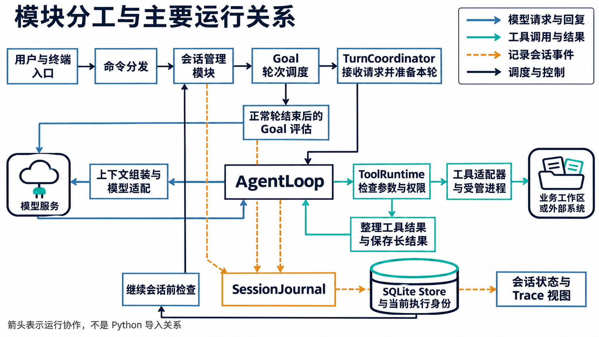
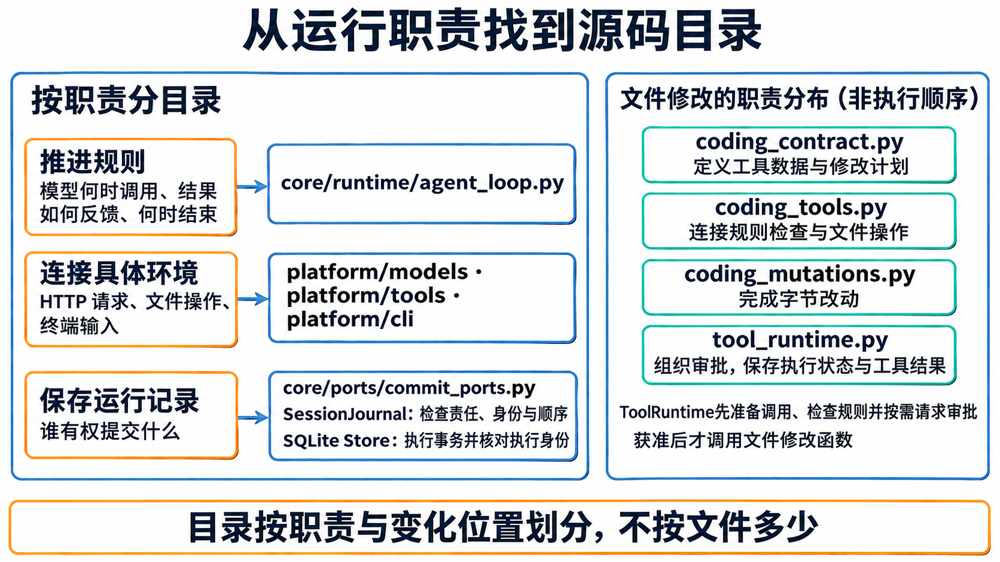

**这份说明是读源码用的地图：先看模块分工，再看它们怎样协作，最后对应到目录。**

你在终端提交一项任务，随后看到读取、审批、修改和回答。这个过程跨越多个模块。本说明先提供一张可以回查的地图；第 1 课再沿运费任务解释一次运行，后续课程展开细节。

## 本篇导览

**本篇分三层：模块职责、运行关系、目录与装配。**

- **模块职责**：命令行交互、会话管理、运行循环、模型接入、工具治理与记录保存各负责什么。
- **运行关系**：一次任务怎样在模块之间传递，哪些边界负责执行、批准与事实写入。
- **目录与装配**：为什么按这些职责划分代码，主要目录和文件怎样对应模块，扩展从哪里接入。

读完后，你应能为一个运行动作找到源码入口。第 1 课解释完整 Agent 的概念，后续源码解析再沿各课的主流程追踪具体实现。

## 系统要解决什么问题

**模型负责提出回答或行动，Harness 负责其余的准备、执行和记录。** 模型根据收到的材料提出回答或行动，Harness 则准备材料、安排执行、接收反馈并保存记录。MyBuddy 用 Python 实现这些职责：核心循环通过接口调用模型和工具，具体模块负责连接模型服务、操作文件和使用 SQLite 保存会话。先看清这几项分工，再沿一次调用找它们怎样配合。

业务项目位于 Harness 管理的工作目录，既可能是运费代码，也可能是收银台。业务程序的订单状态与 MyBuddy 的会话状态属于两个系统：恢复会话不会恢复收银台的内存订单。

读模块图时，还可以带着一个问题：把 DeveloperBuddy 换成 ResearchBuddy（研究一个领域，把研究报告写到工作区的 `reports/`），哪些部分会变化？两种 Buddy 复用 AgentLoop、工具治理、上下文和会话机制，差异放在一份静态预设里：说明正文、可用工具名单（`tool_names`）和默认权限模式（`default_permission_mode`）。这两份预设的权限模式都是 `default`，真正不同的是说明和工具名单：ResearchBuddy 不带 Bash。预设不会改变程序判断结果的方法，结果仍要你按任务去核对。课程用这组对照帮助你找出扩展入口，第 14 课再沿实例展开。

## 命令行交互与会话管理怎样配合

**命令行管输入输出，会话管理管这份会话现在能不能做事，AgentLoop 管一轮任务内部怎样推进。**

你与 MyBuddy 的多次交互属于一个 **Session（会话）**。程序需要记住当前使用哪个工作目录和配置、是否正在执行任务，并协调启动、取消、关闭和继续。这部分职责在课程中统一称为**会话管理**。

一次已接受的用户请求及其后续处理叫 **Turn（用户请求轮次）**；其中一次模型决策及其触发的工具处理叫 **Step（决策周期）**。模型看完工具结果后再次决策，就进入下一 Step，一个 Turn 可以有多个 Step。

先把三个相邻的职责分开：

| 部分 | 你可以怎样理解 | 例子 |
| --- | --- | --- |
| 命令行交互（CLI） | 接收输入，显示提示和结果 | 识别普通问题与 `/` 命令，接收取消操作 |
| 会话管理 | 管理这份会话现在怎样运行 | 判断能否接收新任务，协调取消和关闭，检查是否可以继续 |
| AgentLoop | 推进当前这一轮任务 | 调用模型，处理工具结果，再决定下一步 |

对应源码，会话管理主要由 `MyBuddySession`（`src/mybuddy/platform/application/application_session.py`）和它继承的 `AgentSession`（`src/mybuddy/platform/sessions/agent_session.py`）承担。前者连接当前任务与应用配置，后者管理会话激活、受管工作和退出清理。“会话管理”是职责名称，读代码时按这两个实际类名定位即可。

用一次运费问答理解它与其他模块的分工：

1. **你提交问题时**，命令入口识别输入，`MyBuddySession.ask` 进入目标调度；本轮由 `TurnCoordinator` 检查并接纳输入、准备运行条件，再启动 AgentLoop。没有活动 Goal 时，也沿这条入口执行普通请求。
2. **任务进行中**，AgentLoop 组织模型与工具交替；会话管理模块维护会话的运行状态，避免同一会话中两轮执行或不兼容的状态修改互相干扰。上下文正在整理、会话正在关闭等状态，也会影响哪些操作可用。
3. **你按下取消时**，交互入口把取消信号交给当前执行链。会话管理模块结合取消结果与已保存状态，判断能否再次接收请求；如果无法确认当前操作已经停止，或者执行结果还没有确定并写入记录，它可能暂时不允许继续。
4. **你退出后再继续时**，程序创建新的运行对象，读取原会话历史并检查继续资格。磁盘上的会话记录可以保留，内存中的管理器对象不会一直存在。

因此，Session 表达“这份会话及其历史”，会话管理模块负责“现在怎样运行它”，AgentLoop 负责“一个 Turn 内部怎样推进”。管理器协调运行，不代替 ToolRuntime 的权限检查，也不代替 Journal 与 Store 保存会话记录。

后面还会看到“当前执行身份”：程序再次打开同一份会话时，需要区分这次运行与上次运行，防止旧实例把迟到结果写进来。本地锁和执行身份共同维护这项约束，具体机制留到第 11 课。

## 先看模块之间怎样协作

**模型请求从 AgentLoop 发出，工具调用经 ToolRuntime 执行，所有事实都经 SessionJournal 保存。**



看完这张图，你要能：跟着一次任务指出各模块的分工，以及模型请求、工具结果和保存记录各往哪个方向走。

图中箭头表示主要协作与事实流向，不是 Python import 图，也不意味着每个模块都能任意写入存储。业务项目内部的依赖图见下一份收银台介绍。

图里的 Goal 是你显式设置的一个目标条件。一轮正常结束后，程序让模型判断它是否达成，再决定要不要接着做。这个判断不能代替你检查实际成果，普通问答也不需要设置 Goal。什么时候继续、什么时候停，第 10 课展开。

## 每个模块负责什么

**每个模块只做自己那件事，也明确不做哪些事。** 先看各模块在做什么，英文名用来帮你定位源码，不必一次背下来。AgentLoop 组织智能体循环，ToolRuntime 管理工具执行，Journal 接收会话记录的提交，Store 负责持久化；长结果交给 Artifact，执行经过通过 Trace 查看。图里还会出现“投影”，你可以把它理解为根据已有记录整理出来的视图。

| 模块 | 负责的判断或动作 | 不应承担的责任 | 源码入口 |
| --- | --- | --- | --- |
| 命令行交互与命令分发（CLI） | 识别普通请求和斜杠命令，检查参数并交给对应入口 | 仅凭文字输入授予工具权限 | `cli.py`、`platform/application/command_registry.py` |
| 会话管理 | 管理当前会话的运行状态，协调请求启动、取消、关闭与继续资格 | 直接把任意工具建议当作授权，或绕过 Journal 写入事实 | `platform/application/application_session.py` 中的 `MyBuddySession` |
| Goal 目标管理 | 查看、设置和清除活动条件；设置后启动一轮 | 把目标存在当作已经完成 | `platform/application/goal_commands.py`、`platform/application/application_session.py` |
| 用户交互 | 整理澄清问题与回答，处理方案和审批交互 | 把业务回答当作工具批准 | `platform/application/questions.py`、`platform/cli/cli_planning.py` |
| AgentLoop | 模型决策、工具调用与继续/结束的编排 | 自己实现每个业务工具或绕开提交边界 | `core/runtime/agent_loop.py` |
| 上下文治理 | 选择和组装指令、历史与结果；计量和压缩 | 删除原始历史来伪造更短会话 | `platform/context/governance.py`、`platform/context/compaction/service.py` |
| ToolRuntime | 校验、策略、审批、执行、保存结果并完成状态收尾 | 相信模型自行声明的权限 | `platform/tools/tool_runtime.py` |
| 工具适配器 | 在指定范围中读取、修改或执行进程 | 擅自接管整个 Session | `platform/tools/coding_tools.py`、`platform/tools/coding_bash.py` |
| Artifact | 保存长结果并提供受限读取 | 自动把截断部分当作已经读过 | `platform/artifacts/artifact_store.py` |
| Goal 轮末评估 | 用可见对话判断 met、not_met 或 impossible，保存原因后决定是否继续 | 把模型判定当作测试认证或人工验收 | `platform/application/goal.py`、`platform/sessions/state/goal.py` |
| Journal 与 Store | 按提交责任持久化，检查当前写入所有权 | 替代工具执行，猜测外部副作用 | `platform/sessions/session_journal.py`、`platform/sessions/sqlite_session_store.py` |
| 续接检查 | 根据历史判断能否继续 | 补写未闭合历史或重做未知动作 | `platform/sessions/continuation_checks.py` |
| 状态与 Trace | 根据已记录事件整理当前状态与执行经过，供你查看 | 泄露凭据或展示模型内部推理过程 | `platform/cli/cli_trace.py` |

表中路径以 `src/mybuddy/` 为根。第一次阅读可以从 `AgentLoop`（`src/mybuddy/core/runtime/agent_loop.py`）、`ToolRuntime`（`src/mybuddy/platform/tools/tool_runtime.py`）和 `SessionJournal`（`src/mybuddy/platform/sessions/session_journal.py`）串起一条调用：调用从哪里产生，经过哪些校验，结果最后保存在哪里。沿这条线再打开相关文件，各个模块的职责就有了具体位置。

## 一次任务经过哪些边界

**模块之间交接的是明确的东西：任务、请求、工具调用和工具结果。** 再沿“修改免邮条件”走一遍图，这次只关注各模块之间交接什么：

| 交接 | 交出去的是什么 |
| --- | --- |
| 入口 → 会话管理 → AgentLoop | 已接受的任务及当前执行条件 |
| 上下文组装 → 模型服务 | 本次指令、历史与工具说明 |
| 模型 → ToolRuntime | 工具名称与参数，还不是已执行结果 |
| ToolRuntime → 会话记录 → 下一次模型请求 | 工具实际取得的内容或失败信息 |

例如模型提出读取运费文件，工具取得代码并保存结果后，下一次模型调用才能据此分析。下面各课会沿这些交接展开，不必现在记住所有内部记录。

本轮停止时，先看它为什么停止，再看已经取得了什么结果。你可以查看 Trace 判断有没有真的读取与修改，再用业务场景核对金额行为。需要跨多个 Turn 持续管理目标时，可以显式使用 Goal 保存条件，并在正常轮结束后评估是否继续；具体停止条件会在第 10 课展开。

取消时，程序先停止受管工作；已经开始的外部操作可能无法确认结果。继续会话时，程序读取记录，检查身份、事件格式和顺序，并还原状态；遇到未解决的交互或未知结果，不会猜测成功，也不会盲目重做。重新启动本身不代表授权重复执行。

## 为什么要这样拆分

**拆开以后，出了问题能沿边界一段段查。** 为什么要分出这么多模块？试着沿一次问题往回查就容易理解了：工具没出现，先看能力装配；文件读错，查工作目录和上下文；修改被拒绝，查策略与审批；模型说完成却还没验收，就看条件与证据。分工给排查提供了入口，也带来了显式传递身份、版本和结果的成本，不能在任意位置直接写数据库来省略这些交接。

Journal 保存的历史、模型当前的工作上下文和长期 Memory 也各有用途：历史用于追溯，工作上下文服务下一次决策，Memory 服务以后的相关任务。上下文太长时，压缩只整理发给模型的那一份，Journal 里的原始记录仍然保留（第 9 课）。Memory 是跨会话共享的 Markdown 文件，模型只提出读写建议，由受管工具执行（第 15 课）。

## 模块怎样落到目录和文件

`core/` **放推进规则和接口，**`platform/` **放各项具体能力。** 运行图告诉你组件怎样协作，目录则告诉你去哪里找实现。当前源码位于 `src/mybuddy/`，可以先按下面这张地图阅读：

```latex
src/mybuddy/
├── __main__.py            python -m mybuddy 启动入口
├── mybuddy.py             终端启动入口
├── cli.py                 命令行交互与命令流程
├── resources.py           运行资源与默认状态目录定位
├── frontmatter.py         Markdown 开头 YAML 字段的解析（Buddy 预设与 Skill 共用）
├── api/                   给其他 Python 程序用的会话入口
├── spi/                   模型适配器等可信扩展接口
├── features/              从一份 Markdown 文件读取全部 Buddy 预设
├── web/                   可选的本机 Web 界面，复用同一套会话流程
├── core/
│   ├── protocol/          数据契约、不可变值与版本校验
│   ├── ports/             按责任划分的提交接口
│   └── runtime/           AgentLoop 与模型、工具等依赖接口
└── platform/
    ├── application/       会话管理、启动配置与组件装配
    ├── cli/               命令分发、输入与终端展示
    ├── models/            模型目录、供应商适配与请求派发
    ├── context/           上下文计量、选择与压缩
    ├── sessions/          会话激活、记录、存储与恢复
    ├── tools/             工具策略、审批、文件和进程执行
    ├── sandbox/           Bash 可选的系统沙箱启动计划（Seatbelt / bubblewrap）
    ├── buddy/             Buddy 预设的启动检查与装配
    ├── memory/            共享记忆与受管写入
    ├── hooks/             七种事件共用的 Hook 命令
    ├── instructions/      会话创建时的项目指令副本与行为指导
    ├── artifacts/         长结果保存与分页读取
    ├── skills/            本地 Skill 目录与按需加载
    ├── mcp_stdio/         MCP stdio／HTTP 服务接入
    ├── subagents/         子任务、团队协作与受管工作树
    └── worktrees/         编码副本隔离与差异查看
```

图中按功能列出主要包，`platform/` 下几个零散的辅助文件没有列出；Goal 命令和轮末评估位于 `application/`，目标状态位于 `sessions/state/goal.py`。各包的 `__init__.py` 负责包入口或导出，`py.typed` 是类型信息标记；完整清单见《MyBuddy源码目录与文件索引》。

### 按什么逻辑划分

**划分依据有三条：规则与环境分开、按权责分开、易变部分分开。**



看完这张图，你要能：根据职责与变化位置找到对应源码目录及文件。

第一条是**把推进规则与具体环境分开**。`core/runtime/agent_loop.py` 关心模型何时调用、工具结果如何反馈、何时结束；它通过接口使用模型和工具。HTTP 请求、文件操作、终端输入与 SQLite 保存由具体实现承担，应用入口负责把它们接起来。更换一种工具实现，不应要求循环认识其全部执行细节。

第二条是**按谁有权做什么来划分**。`core/ports/commit_ports.py` 定义不同责任方可使用的提交方法；Journal 核对提交请求的责任、身份和顺序，Store 落实事务与当前执行身份检查。工具执行集中在 ToolRuntime 的路径中。状态与 Trace 文件只从已记录事实生成展示，不因看得到记录就获得执行权限。

第三条是**把容易独立变化的部分分开**。以文件修改为例，`coding_contract.py` 定义工具数据和计划，`coding_tools.py` 连接策略与执行，`coding_mutations.py` 完成字节改动，`tool_runtime.py` 组织审批，并保存执行结算与模型可见的工具结果。修改参数规则、改变文件操作或调整显示，分别有可定位的入口。

这不是“Core 全是算法，Platform 全是 I/O”的绝对切分。Platform 中也有大量纯计算：比如从历史生成请求、判断预算、生成状态视图。它们服务于具体能力，放在对应能力附近；这样划分的重点是让状态修改与外部动作有明确入口。

| 职责 | 主要位置 |
| --- | --- |
| 推进规则 | `core/runtime/agent_loop.py` |
| 具体适配 | `platform/models`、`platform/tools`、`platform/cli` 等能力包 |
| 事实提交 | `core/ports/commit_ports.py` → SessionJournal → SQLite Store |
| 一次文件修改 | `coding_contract.py` 定义数据与计划；`coding_tools.py` 连接策略与执行；`tool_runtime.py` 先检查策略并取得必要审批，再调用 `coding_mutations.py` 改动文件，最后保存结果。 |

### 为什么一个功能有这么多文件

**先找串起过程的那个文件，其他文件遇到问题再打开。** 第一次打开压缩目录，可以先找负责串起过程的 `context/compaction/service.py`：选择前缀、调用一次摘要模型、检查完整业务请求的预算与压缩收益，最后保存并采用。遇到想弄清的步骤，再打开对应辅助文件。例如“摘要生成了却没有采用”，就沿候选检查与保存继续查。职责需要清楚，文件数量则取决于规模与可读性，并不要求每一步单独拆一个文件。

文件名中的 `source`、`events`、`projection` 经常分别涉及材料来源、事件记录和视图生成，具体含义要结合调用处理解。先跟输入、处理和返回结果，再借文件名定位，会比仅凭名称猜职责更稳妥。

### 第一遍怎样读源码

**第一遍只沿一轮普通请求走到底，第二遍再挑一个问题深入。**

先沿一轮普通请求：从 `__main__.py` 到 `mybuddy.py` 的 `main`，再看 `cli.py` 的 `run_cli`，沿 `startup_config.py` → `session_startup.py` 的 `create_configured_session` → `session_construction.py` 找到 `application_session.py` 的 `MyBuddySession`。会话启动和初始化后，`ask` 经 `application/goal.py` 的 `run_goal_turns` 调用 `_ask_turn`；后者占用入口，再交给 `application/turn.py` 的 `TurnCoordinator.run` 接纳输入、准备本轮、运行 `AgentLoop` 并整理结果。子任务通过 `subagents/ports.py` 中的接口访问父会话，受限子会话由 `create_restricted_child` 装配，仍使用同一套会话执行入口。遇到模型调用，转到请求组装与 `model_gateway.py`；遇到工具调用，转到 `tool_runtime.py`；遇到事实提交，再看 `session_journal.py` 和 `sqlite_session_store.py`。

继续会话前，可以从 `application/resume_checks.py` 看身份、配置和继续资格的检查。如果会话格式不受支持，需要新建会话。模型与权限等配置更新通过 `_save_configuration` 确认保存后才生效；保存结果无法确认时，会话会阻止后续请求。

工具装配按 `tool_composition.py` → `tool_scope.py` → `tool_registry.py` → 领域 Policy/Provider 阅读：先算出本会话允许的工具范围，再按名称精确选中处理器，ToolRuntime 仍是唯一执行入口。`tool_catalog.py` 管理模型可见说明；路由表选择处理器，Coding 等计划注册表绑定单次调用与计划，三者职责不同。

第二遍选一个问题深入：本地命令看 `tools`，重启继续看 `sessions`，上下文超限看 `context`；研究报告的引用要你对照实际读到的资料核对，业务检查看对应项目的测试，Goal 评估看 `application/goal.py` 与 `sessions/state/goal.py`。《MyBuddy源码目录与文件索引》提供完整阅读路线与文件职责，可以随时回查。

## 装配与扩展放在哪里

**Buddy、Skill、MCP、Hook、SubAgent 都接在同一条运行链路上，工具照样经过统一治理。** Buddy 是一份助手配置，选择领域指令、工具能力与权限策略；本次任务具体做到什么程度，由用户要求和 Goal 目标说明。Skill 是按需加载的方法说明；MCP 接入外部工具；Hook 在会话、轮次、工具前后和压缩保存后的七种时机运行可信配置命令；SubAgent 通过 `delegate_tasks` 启动受管子会话，调查或在独立代码副本中完成子任务。工具仍经过统一治理；Hook 命令由配置授权，复用 Bash 的沙箱与进程管理，工具事件的反馈随原调用保存，其余事件只通知界面，不另行审批。

前面各模块已经有对应实现，使用时再看启用条件：配置化主会话固定提供共享 Memory 读写，允许不选择 Buddy；自动 Memory 默认关闭，可用 TOML 的 `[memory] automatic = true` 启用；Hook 默认关闭，可用 `[[hooks.pre_tool_use]]` 配置事前检查、`[[hooks.post_tool_use]]` 配置事后反馈，也可配置会话、轮次和压缩事件；Bash 的可选系统沙箱（macOS Seatbelt / Linux bubblewrap）默认关闭。子任务、受管工作树以及 Team 的共享任务和消息入口见第 19、20 课，后台运行通过 `/agent list|wait|stop` 管理，Team 的待处理消息通过 `/team resume` 恢复。

## 使用小妙招

### 把异常定位到一条边界

**一次只查一个环节、只改一个条件。** 如果模型回答了，却没有改文件，可以顺着链路逐项看：有没有提出工具调用，运行时有没有接受，审批是否通过，结果有没有提交。找到卡住的环节，再改对应条件。若同时换模型、提示词和权限，即使下一次成功，也很难知道究竟是哪项调整起了作用。

## Q&A：常见追问

### Q1：为什么 Harness 要把会话管理、Agent Loop、工具执行和记录保存分开？

它们回答不同的问题：会话现在能否接收任务、一轮任务怎样推进、动作能否执行、执行后保存什么记录。分开这些职责，循环就不必自己做权限检查或直接写数据库。

### Q2：排查跨模块故障时，怎样沿调用链找到负责的位置？

先找到组织这次操作的入口，再跟着输入、执行和结果往下查。例如编辑没生效，先看 AgentLoop 是否收到了编辑调用，再看 ToolRuntime 是否拒绝、是否真正执行，以及 SessionJournal 是否保存了确定结果。不要只按文件名猜模块职责；真正要弄清的是谁调用谁、哪里产生副作用、失败由谁处理，这样才能判断该改哪一层。
