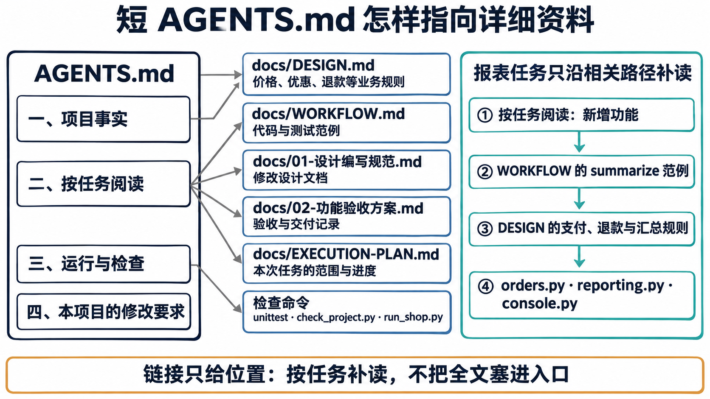
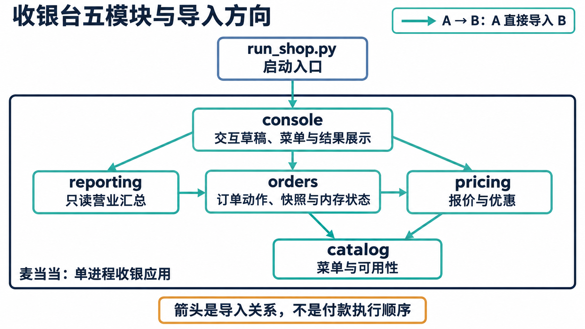
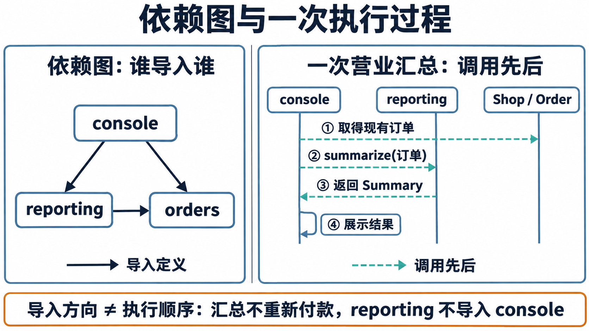

课前阅读。用一个小收银台项目，看看怎样组织需求、资料、代码和检查；再用 MyBuddy 做一次只读接手。功能修改放到第 21 课。

麦当当收银台是课程随附的业务样例，在仓库的 `demo-project/mini-shop/`。下文说的“收银台项目根目录”，就是包含 `run_shop.py`、`src/` 和 `tests/` 的那个目录。

它有两个用途：让你看见 Harness 怎样参与一项工程工作；给你一份能运行、能读懂、能修改的业务代码。MyBuddy 是接手任务的 Harness，收银台是被修改的应用。两者各有自己的代码、进程和状态。

## 本篇导览

**这一篇用收银台演示：怎样把一个项目准备成 Agent 找得到、跑得起来、查得清楚的样子。**

- **需求与资料**：业务故事怎样变成验收要求；短 AGENTS.md 怎样指向设计、约定和执行计划。
- **设计与模块**：常见分层各管什么；收银台为什么分成五个模块。
- **检查与维护**：依赖检查、固定场景和人工操作怎样配合；资料怎样跟着功能更新。
- **MyBuddy 接手**：在独立副本里读懂现有实现，并检查它的解释。

读完后，你应能说清样例为什么这样组织，并完成一次只读接手。报表开发在第 21 课。用 Claude Code 建设新工程在第 22 课。

## 先操作一次，再看它怎样建成

**先亲手点一单，后面的设计和检查才有具体对象。**

在收银台项目根目录执行：

```shell
uv sync --locked
uv run python run_shop.py
```

需要 Python 3.11～3.13 和 uv。只运行收银台不需要模型登录或 API 密钥。

先体验一份 29 元套餐：选餐、扫码付款、进入厨房、开始制作、制作完成后取餐。付款时选“2 模拟扫码”，支付结果先选“2 失败”。回到主菜单，用“2 继续支付”选同一订单，再选扫码和“1 成功”。这时会出现收款记录、取餐号和厨房任务。再分别试一次制作前撤单、制作后登记售后。

想先看完整的三位顾客故事，可以运行 `uv run python run_shop.py --story`。菜单、价格和逐步操作表见收银台 README（`demo-project/mini-shop/README.md`）。

支付、退款和厨房都是本地模拟，订单只存在内存里，退出就没了。价格、套餐和满减是教学规则。

## 一个小项目怎样清楚地做出来

**规模小也要讲顺序：先定规则，再按职责分模块，最后对照业务结果检查。**

收银台的主流程是：

```latex
编辑点餐 → 结算 → 模拟支付成功 → 送厨
         → 开始制作 → 制作完成并叫号 → 顾客取餐
```

写代码前，先确认三条业务规则：

- 付款失败，订单保持待支付。重试成功前，要再检查一次餐品是否可售。
- 付款后、开始制作前可以撤单，退回实收金额。开始制作后只能登记售后，等人工处理。
- 用售罄开关表示能不能卖，不维护原料库存，退款时也不“恢复库存”。

然后按五步组织工作：

1. **写清业务故事。** 用几笔具体订单定下金额、状态和操作顺序。
2. **准备简短的项目入口。** 让 Agent 找得到规则、运行方式和检查命令。
3. **按业务职责组织代码。** 菜单、计价、订单、汇总和交互各有位置。
4. **分段完成可运行的功能。** 先做点餐和付款，再接厨房、退款、汇总和操作台。
5. **对照业务结果检查。** 金额、订单状态和界面显示都要一一看过，再补齐使用说明。

现有实现里有几处分工值得留意：菜单展示、报价和付款前复查，共用 Catalog 的可售判断；订单保存实收和退款；报表只读这些金额做汇总。读懂这些，再加支付方式报表就知道该改哪里。

## 从一句需求变成可以验收的业务故事

**“做一个收银台”太宽；写出几笔具体订单，Agent 才有组织代码和检查结果的依据。**

| 故事 | 必须出现 | 必须避免 |
| --- | --- | --- |
| 套餐扫码失败后成功 | 成功时收 29 元，生成取餐号并送厨 | 失败时收款；重试时重复编号 |
| 两个汉堡付款后、制作前撤单 | 满减后收 31 元，撤单退 31 元 | 按原价 36 元多退 |
| 汉堡加可乐开始制作后申请售后 | 保留制作状态，记录待处理原因 | 自动退款，或退回未制作 |
| 可乐售罄 | 含可乐的套餐也不能买 | 单品禁售了，套餐仍能付款 |

开始编码前，可以这样提任务：

先整理这四个故事的输入、金额、状态变化和禁止动作。对照已有资料，列出仍不明确的规则；先不要写业务代码。把“当前规则已经说明”和“需要我决定”的问题分开。

模型帮你整理、找缺口，业务取舍由你确认。规则要写进文件，后续会话才能重新找到，不能只靠某次聊天里的一句话。

## 给 Agent 准备可以找到、运行和检查的项目

**入口文件写短，详细规则、执行计划和检查命令各放在自己的位置。**

### AGENTS.md 为什么要这样写

**AGENTS.md 只放高频、稳定、能指导下一步的信息；详细规则放到能找到的地方。**

`AGENTS.md` 通常是 Agent 接手项目时最先读到的材料。保持它简短有几个好处：

1. **给本次任务留出上下文。** 入口文本每次请求都要带上；写短了，空间就留给相关代码和工具结果。
2. **关键要求更醒目。** 报表任务能很快找到金额来源、修改范围和检查入口。
3. **业务规则只维护一份。** 优惠规则写在设计里，各个入口都指向它，改的时候只有一处。
4. **资料各有用途。** 长期约定、业务规则和临时进度分开放，查和改都方便。

打开收银台的实际文件 `demo-project/mini-shop/AGENTS.md`，可以分成四部分：

| 组成部分 | 当前写了什么 | 作用 |
| --- | --- | --- |
| **一、项目事实** | 金额用 `Decimal`；五个模块的单向依赖；业务规则只在设计里维护 | 写下每次都用得到、Agent 自己猜不对的事实 |
| **二、按任务阅读** | 一张表：回答问题读设计，加功能读 WORKFLOW 的范例，改设计读编写规范，验收读验收方案 | 不同任务只沿相关路径补读 |
| **三、运行与检查** | 测试、总检查和故事演示三条命令；说明没有 lint、类型检查和 CI | 让 Agent 用项目实际有的工具 |
| **四、本项目的修改要求** | 同步设计与测试；不 Mock 计价；改断言要说理由；如实汇报测试数量 | 只写本项目特有的要求 |

写自己的入口时，先回答四个问题：**哪些事实 Agent 自己猜不对？这类任务去哪里查？在哪里运行哪些命令？本项目有什么特别的修改要求？** 每个回答都应指向已有文件、可执行命令或明确的交付要求。



看完这张图，你要能：通过一份简短的入口文件，找到当前任务需要的资料、命令和交付要求。

第二部分的表，每一行都是“条件 → 去哪里读”：

```latex
| 要做什么 | 先读 |
|---|---|
| 回答业务问题、解释流程 | 设计中相关章节，再对照源码和测试 |
| 新增或修改功能 | 开发约定的“代码与测试范例”，先找相似实现 |
```

要加支付方式报表，Agent 按“新增功能”一行去 WORKFLOW 找 `summarize` 的范例，再读设计里的支付、退款和汇总规则，最后定位 `orders.py`、`reporting.py` 和 `console.py`。如果只是问“失败支付会不会收款”，读设计和 `Shop.pay` 就够了。

“满 30 减 5”“制作前退实收”这些规则，只在 `demo-project/mini-shop/docs/DESIGN.md` 里写一份。代码实现规则，测试核对结果。调整优惠时，说明、实现、检查三处一起改。

### 写了文件之后，它怎样进入上下文

**文件放在项目里，不等于已经进了模型请求；链接也不会自动展开目标文件。**

```latex
Harness 发现入口文件
    → 把入口内容加入模型请求
    → 模型提出读取相关资料
    → Harness 按权限模式执行工具
    → 工具结果进入下一次模型请求
```

入口存在、入口已加载、目标资料已读取，是三件要分别确认的事。

MyBuddy 创建会话时按用户级、Git 仓库根到工作区逐级、本地级的顺序读取说明，并展开 `@` 引用；恢复会话和子任务继续用保存的那份。改了说明或引用，要用 `/new` 开新会话才会生效。这些文字只是工作约定，不会给工具授权。`/status --verbose` 会显示加载了哪些文件、各有多少字，以及跳过或截断的原因。第 3 课“项目说明文件和配置文件”会细讲。

收银台还有一份 `demo-project/mini-shop/CLAUDE.md`。它只有一行 `@AGENTS.md`，让 Claude Code 也加载同一份说明，不再另写一套。

### 为什么要区分操作入口与检查命令

**入口写清已有的检查命令和各自范围；写在 Markdown 里的命令不会自己运行。**

在收银台项目根目录执行：

| 命令 | 用途 |
| --- | --- |
| `uv sync --locked` | 按锁文件准备环境 |
| `uv run python -m unittest discover -s tests -v` | 运行业务与操作台测试 |
| `uv run python scripts/check_project.py` | 总检查：文档链接、模块依赖、业务测试和固定场景 |
| `uv run python run_shop.py` | 打开中文操作台，亲手走一遍业务 |

项目只用标准库，AGENTS.md 里直接写 `python3`；用 `uv run python` 结果相同。第 7 课“在收银台任务中怎么用”会讲为什么沙箱里更适合 `python3`。项目没有 lint、类型检查器和 CI，入口就照实写，Agent 不会去找不存在的工具。

### 为什么另外保留 WORKFLOW 和执行计划

**长期约定放 WORKFLOW，当次任务的进度放执行计划，都不堆进 AGENTS.md。**

WORKFLOW（`demo-project/mini-shop/docs/WORKFLOW.md`）放多次任务共用的约定：开发规则、工作顺序、模块约束、代码与测试范例、完成记录模板。

EXECUTION-PLAN（`demo-project/mini-shop/docs/EXECUTION-PLAN.md`）是当次工作的模板。报表任务可以这样填：

```latex
目标：增加现金、扫码各自的收款、退款和净收款，保留总计。
输入：填写实际提交、工作目录及已有未提交差异。
已确认：退款归原支付方式；支付失败和售后登记不产生收入或退款。
待定：分组显示顺序、没有订单的支付方式是否显示零值。
拟改范围：reporting、console、相关测试及使用说明；订单模型先核对再决定。
验收金额按“收款/退款/净收款”读：现金 31/31/0，扫码 54/0/54，总计 85/31/54。
当前状态：尚未修改，尚未执行验证。
下一步：阅读 Order 的支付方式和退款字段，确认现有接口。
```

预期和实际要分开写。做完一部分，再追加真实的修改、命令和结果。下一次会话先和磁盘状态对照，不能凭旧文档里的“已通过”继续交付。

### 怎样判断这套项目资料真的有用

**交给 Agent 一个小任务，看它能不能自己找到下面四样东西。**

1. 运行和检查的命令，以及正确的工作目录。
2. 付款失败、退款和售后的已确认规则，以及还没决定的问题。
3. 要改哪些模块、允许依赖谁、哪些文件暂时不用读。
4. 每个完成条件怎样检查，哪些还没验证。

找不到的，就是资料要补的地方。

## 这些做法分别用到了 Harness 的什么能力

**每个工程动作背后，都有一项后面会单独讲的 Harness 机制。**

| 工程动作 | Harness 怎样参与 | 后续课程 |
| --- | --- | --- |
| 读取业务规则、定位订单与报表 | 用读取和搜索工具取得材料，放进模型输入 | 第 3 课、第 8 课 |
| 发现支付或退款规则不明确 | 向你追问，拿到回答后更新任务条件 | 第 5 课 |
| 提议修改、申请执行检查 | 把模型提出的动作交给权限与执行机制 | 第 6 课、第 7 课 |
| 依据运行结果继续下一步 | 把工具结果放进下一次请求，或按停止条件收尾 | 第 4 课、第 13 课 |
| 跨会话继续没做完的报表 | 恢复会话，再对照交接记录检查工作区 | 第 9 课、第 11 课 |
| 把领域和操作台任务交给不同角色 | 传递任务范围与结果，由集成者检查 | 第 19 课 |

比如你给出“付款成功后才记录收入”的规则，模型提出读取、修改和检查，Harness 按权限模式执行，再把业务结果交给你确认。

## 业务设计文档怎样组织，模块为什么这样划分

**AGENTS.md 帮 Agent 找到设计；设计要回答：功能归哪个模块，数据怎样传，改的时候要保留什么。**

收银台在单个进程里运行。订单由 `Shop` 保存在内存里，没有单独的数据访问模块。计价不改订单，订单动作统一管状态，汇总只读金额，操作台负责输入和展示。

### 项目分层：UI、Runtime、Service 与 Repo 怎样配合

**分层给规则、数据和交互划边界，并规定谁可以依赖谁。**

一种常见的应用分层是 `Types → Config → Repo → Service → Runtime → UI`。用收银业务来理解各层：

| 名称 | 回答什么问题 | 收银业务里的例子 |
| --- | --- | --- |
| Types：类型与数据契约 | 各模块交换什么结构的数据？ | 订单、金额、报价和汇总结果的字段 |
| Config：配置 | 运行设置怎样提供和校验？ | 读取并校验门店设置 |
| Repo：数据访问 | 业务数据怎样读取、保存？ | 通过约定接口存取订单，背后可以是内存或数据库 |
| Service：业务服务 | 一项业务动作遵守什么规则？ | 能不能撤单、退款退多少 |
| Runtime：运行组织 | 组件怎样装配，工作怎样启动和结束？ | 创建一次运行需要的对象，管理资源 |
| UI：交互界面 | 用户怎样发起动作、看懂结果？ | 接收菜单选择，显示订单、小票和错误 |

Repo 指数据访问，不是 Git 仓库。Service 可以只是一个 Python 类或函数，不一定是网络服务。

多个层都要用的能力（如认证、遥测），可以由外部显式传进来，测试时换成受控实现。只传对方需要的接口：报表只需要读订单，就不把收款方法一起交给它。

### 麦当当的 DESIGN 怎样用五个视图展开

**同一个收银台，用五个视图分别讲操作、规则、数据、职责和代码。**

业务设计文档 `demo-project/mini-shop/docs/DESIGN.md` 的五个视图：

| 设计视图 | 说明什么 | 评审时查什么 |
| --- | --- | --- |
| 工作流 | 顾客、收银员、厨房与出餐口怎样操作和交接 | 入口找不找得到，出错后谁接着处理 |
| 业务流 | 菜单与满减、支付、履约、撤单和售后的规则 | 状态变化、失败和重复操作是否明确 |
| 数据流 | 草稿、报价、订单、支付事实与汇总怎样传递和保存 | 每次操作读写什么，失败保留什么，退出丢什么 |
| 逻辑视图 | 交互、可售校验、计价、订单处理与汇总的职责和接口 | 每条规则有没有负责方 |
| 实现视图 | Python 模块、依赖、调用链、运行方式和测试入口 | 设计能不能对上真实代码 |

以“付款成功才送厨”为例：工作流说收银员收款成功后交给厨房；业务流规定失败仍是待付款；数据流说明失败不写收款和取餐号；逻辑视图交给订单处理；实现视图落到 `Shop.pay()` 和相关测试。

写设计时，每项重要决策写清“为什么、谁负责、什么条件下适用、怎样验证”。比如“撤单退实收”：因为优惠已经算进订单；由订单动作负责；只在开始制作前适用；验证时比较退款和订单实收。

### 从业务责任推导五个模块

**判断标准是：哪些规则要在一处保持一致，哪些变化要能单独处理。**

| 模块 | 输入与输出 | 负责的规则或状态 | 为什么单独分开 |
| --- | --- | --- | --- |
| `catalog` | 餐品与数量 → 可售校验；保存商品与售罄 | 菜单、套餐组件、售罄、数量限制 | 报价、付款前复查和菜单展示共用同一个判断 |
| `pricing` | Catalog 与商品数量 → Quote | 原价、优惠、应付金额 | 改优惠只动一处；算报价不会触发收款 |
| `orders` | 下单、付款、制作、撤单等动作 → Order 快照 | Shop 保存订单和取餐号，执行合法的状态变化 | 金额和履约规则在同一个动作里检查 |
| `reporting` | 一组 Order → Summary | 读实收、退款和状态，生成汇总 | 查多少次都不改订单、不重复记账 |
| `console` | 用户输入与业务结果 → 菜单动作、提示和小票 | 交互草稿、输入和展示 | 改界面不需要让业务模块依赖终端 |

比如“能不能退款”放在 `orders`，因为它取决于订单状态和实收；“退款怎样显示”放在 `console`；“退款怎样进汇总”放在 `reporting`。三者处理同一件事的不同部分，不能各写一套退款判断。

下图按当前源码画。**箭头 A → B 表示 A 直接导入 B**，不是运行顺序。



看完这张图，你要能：解释收银台五模块的职责与实际导入方向。

可以从启动入口 `demo-project/mini-shop/run_shop.py` 和操作台源码 `demo-project/mini-shop/src/console.py` 开始查。`reporting → orders` 是因为汇总要用 `Order` 的定义，不会再执行付款。`console` 能通过 `Shop` 用到 Catalog，但没有直接导入 `catalog`。

依赖检查器写的是“允许哪些关系”，这张图画的是“现在实际有哪些导入”。允许表里有的关系，源码不一定要用。

### 依赖图与一次执行过程有何不同

**依赖图说谁引用谁；一次操作按什么顺序经过谁，要看调用过程。**

一次营业汇总的过程是：操作台取出订单，交给 reporting 计算，再把结果显示出来。结果回到界面，不需要 reporting 反过来导入 console。



看完这张图，你要能：分清模块之间“允许谁依赖谁”和一次操作里“先调用谁”是两回事。

### 哪些职责目前合在一起，为什么

**收银台够小，有几层先合在一起；等真有需要再拆。**

- **类型跟着业务模块走。** `Product` 在 catalog，`Quote` 在 pricing，`Order` 在 orders，`Summary` 在 reporting。
- **订单管理和内存保存都在 Shop。** 只有一个进程、一种存储。要支持重启后恢复，再拆出持久化接口。
- **优惠参数是 pricing 里的常量。** 要支持不同门店配置时，再考虑独立的 Config。
- **没有单独的 Runtime。** `run_shop.py` 直接进入 console，console 创建 Shop。
- **支付结果是模拟输入。** 接真实支付要处理超时、结果未知和对账，不只是把一个布尔参数换成网络请求。

### 用一次状态变化检查设计是否连贯

**沿一笔撤单走一遍，看清谁判断、谁保存、谁读取。**

以两个汉堡付款后撤单为例：

1. `pricing.quote()` 算出原价 36 元、优惠 5 元、应付 31 元。
2. `Shop.place()` 保存订单内容和报价，返回待付款快照。
3. `Shop.pay()` 成功后记录实收 31 元、取餐号，状态变为待制作。
4. `Shop.cancel()` 检查状态允许后，记录退款 31 元，状态变为已取消。
5. `reporting.summarize()` 读这些金额，得到收款 31、退款 31、净收款 0。
6. `console` 显示结果；重复查询，金额不变。

`Quote` 和 `Order` 是创建后不能改字段的数据对象（`frozen` dataclass），状态变化靠换一个新快照表示。金额用 `Decimal`，不用浮点数。

### 需求变化时，先判断改动该落在哪里

**新需求先找负责的模块，再确认哪些边界不能破。**

| 新需求 | 先查哪个职责 | 要保留的边界 |
| --- | --- | --- |
| 现金、扫码分别汇总 | orders 有没有支付方式和退款；reporting 分组，console 展示 | 汇总不重新付款，不改履约状态 |
| 只改小票排版 | console 的格式与输出 | 不动计价和退款规则 |
| 套餐允许换饮料 | catalog 的组件、pricing 的报价、orders 的快照、console 的选择流程 | 选择要进订单，不能只改显示文字 |
| 退出后还能看订单 | Shop 的保存方式和启动过程 | 先设计持久化和失败行为，再拆数据访问接口 |

让 MyBuddy 动手前，可以先问：

按“业务规则、输入输出、状态归属、依赖、适用条件、验收”整理这次变更。说明现有模块怎样承担新功能，列出拟改文件与接口，以及需要确认的业务选择。

如果要把领域计算和操作台分给两个 Agent 并行做，先约定数据结构、方法名和各自能改的文件。第 19 课和第 20 课会讲委派与工作树。

## 用三类检查确认项目已经做好

**单元测试、总检查、人工操作，三类检查各看一层。**

在收银台项目根目录执行：

```shell
uv run python -m unittest discover -s tests -p 'test_*.py' -v
uv run python scripts/check_project.py
uv run python run_shop.py
```

第一条只跑业务和操作台测试。第二条是总检查，还会检查文档链接、模块依赖和固定场景；一个测试都没发现时，它会报失败。第三条由你亲手点餐、付款、操作厨房、看汇总，检查用户流程和界面反馈。

第一条单元测试，现实项目里也会有，就是回归测试和测试用例。第二条总检查是为教学准备的：收银台是教学项目，所以我们事先设置了一种一条命令就能判定的方式。现实项目一般没有这样现成的脚本。

在同一次运行里亲手完成三笔订单：29 元套餐扫码失败后重试成功并取餐；两个汉堡现金付款 31 元后、制作前撤单；汉堡加可乐扫码付款 25 元后开始制作，再登记售后。汇总应是收款 85 元、退款 31 元、净收款 54 元。状态也要对：一笔已交餐，一笔已取消，一笔制作中且有售后记录。只看净额对，可能漏掉错误的状态变化。

### 把一条约定追到实际检查代码

**WORKFLOW 里的依赖约定，在 check_project.py 里有一张对应的允许表。**

比如 `reporting` 只能依赖 `orders`，`orders` 可以依赖 `catalog` 和 `pricing`。`demo-project/mini-shop/scripts/check_project.py` 里对应两项：

```python
'orders': {'catalog', 'pricing'},
'reporting': {'orders'},
```

检查器用 `ast` 解析每个源文件的 `import`，和允许表比较；标准库放行，出现新模块或越界导入就报出文件和行号。第 18 课“架构检查怎样识别越界依赖”会细讲，也会讲怎样让它自动触发。

### 为什么总检查还需要固定业务场景

**测试过了，总检查还要按固定输入跑一遍完整故事，金额和状态一起对。**

业务测试通过后，总检查接着运行 `demo-project/mini-shop/scripts/check_scenarios.py`。它从业务结果读出三个金额，和事先写定的预期比较：

```python
check(amounts, ['85.00', '31.00', '54.00'], 'story totals')
```

85、31、54 是按已确认规则手算出来的，不是从程序输出抄的。脚本还会检查支付失败、重复付款、制作后不能撤单和售罄时不能付款。

### 文档也需要随功能迭代维护

**功能改了，说明、设计和执行计划要一起改。**

总检查只确认必要文件和本地链接存在，内容对不对要另外看。报表做完后，同步更新操作说明、新规则和执行计划。样例的项目巡检设计 `demo-project/mini-shop/docs/MAINTENANCE.md` 写了一次手动巡检怎么做，可以交给 MyBuddy 练习。

## 用 MyBuddy 只读接手现有样例

**先让 MyBuddy 读懂已有实现，你来核对它的解释；这次不改代码。**

### 建立独立副本并核对能力

**用准备脚本生成独立副本，随课原件保持不动。**

在 MyBuddy 仓库根目录运行：

```shell
uv run python demo-project/prepare_shop_demo.py
```

打开输出的 `START-HERE.md`。用 `play-shop.command` 打开副本的操作台，用 `test-shop.command` 跑测试，用 `start-mybuddy.command` 启动 MyBuddy。启动后确认工作区是生成的 `project/`。脚本生成的目录内容、权限模式和凭据来源，见《综合实践-麦当当收银台》“2. 为自己的练习建立独立副本”。

MyBuddy 在 macOS 和 Linux 上运行，Windows 请在 WSL2 里运行。`.command` 双击被拒绝或在 Linux 上时，在终端用 `sh` 加脚本路径运行。

### 先让它读懂已有实现

**提一个只读问题，要求它指出文件和符号。**

请阅读业务说明、订单、报表和操作台代码，解释支付方式何时写入、退款金额从哪里来、当前总营业汇总怎样生成。指出文件与符号，先不要修改，也不要把售后登记当作退款。

读完回答，打开它提到的文件，看解释能不能对上代码。有没查清的地方，就让它继续补读。

### 核对它是否真正读懂项目

**沿“规则 → 源码 → 实际结果”核对一个已有操作。**

比如两个汉堡实收 31 元，制作前撤单退 31 元：`pricing` 算应付，`orders` 保存付款和退款，`reporting` 汇总，`console` 显示。你回到操作台复现一遍。重点看两点：它读到的规则对不对；有没有把售后登记当成退款。`/trace` 可以看最近一轮的摘要。

到这里，你已经知道下一项需求该交给哪些模块。第 21 课会独立完成按支付方式汇总的报表。金额和验收用例见《综合实践-麦当当收银台》“5. 课后任务 A：按支付方式汇总营业情况”。

## 想自己重做一遍，可以从空白练习包开始

**空白包只有规格和检查器，业务代码和测试由你一步步写。**

它练的是“规格已经明确、实现还没有”时怎样拆任务，和本篇的只读接手起点不同。准备命令、七个阶段和完成条件见《从空白包建设麦当当收银台》（[《第 22 课配套：从空白包建设麦当当收银台》](<211_第 22 课配套：从空白包建设麦当当收银台.md>)）。读过完整参考实现的部分，要如实记下来。

## 本课交付什么

**留下一张项目说明和一份只读接手记录。**

1. 项目说明：入口资料、五个模块、状态归属和依赖方向；用一次付款或退款说明它们怎样配合。
2. 只读接手记录：MyBuddy 实际读了什么，解释对应哪些源码，你用什么操作核对了结果。

## 使用小妙招

### 第一次接手，先让 Agent 画出它要走的路

**让 Agent 沿一笔付款列出规则、函数和结果，你逐处打开源码核对。**

比如从操作台输入追到 `Shop.pay()`，再找到金额怎样进入汇总。这条路线后面就是修改需求的阅读起点。

### 接续开发时，带一份小而可核对的交接

**交接只写五样：已接受的需求、当前版本、改过的文件、实际检查结果、下一步。**

下一个会话先和磁盘上的实际状态对一遍，再继续。开发会话可以继续，但收银台退出后内存订单不会回来，复验要重新下单。

### 修改前先说明职责与依赖

**先让 Agent 说清新逻辑放哪、谁提供数据、哪些模块不该新增依赖，再动手。**

要求它按源码核对，不能只看文件名猜。做完后拿这份说明对照 diff：如果汇总功能改了付款状态流转，就要它解释原因。

## Q&A：常见追问

### Q1：是不是把规则写进 AGENTS.md，就完成了 Harness 工程？

没有。AGENTS.md 只是让模型知道项目约定，不能代替权限检查、实际执行和结果验证。以收银台为例，WORKFLOW 说明开发顺序和依赖要求，`check_project.py` 这个教学检查脚本检查相应规则、业务测试和固定场景，人工操作再确认金额和显示。只有约定真正影响了执行、检查又能暴露错误，才能说明这套流程起了作用；放了一份说明文件本身证明不了这些。

### Q2：评估 Coding Agent 时，为什么要区分接手已有代码和从规格开始实现？

两种起点检验的能力不同。接手已有代码，要理解和修改现有系统；从规格开始，要把要求一步步变成实现。以收银台为例，参考副本和空白包分别提供这两种起点。分别记下起点、用过的材料和结果，才能判断验证了什么。

### Q3：为 Coding Agent 准备项目时，是否必须采用固定的分层结构？

不需要固定采用 Types、Config、Repo 等六层。要不要分层，看有没有独立的职责、变化压力和可验证的边界。收银台只有五个业务模块，没有数据库，先把依赖和修改责任理清就够了。以后加持久化，数据存取成了独立职责，再考虑数据访问接口。
