你提出一个问题以后，Agent 是怎样找到代码、分析原因，再把结果告诉你的？我们从一次运费排查开始。

课前导读里，你已经试过让 MyBuddy 处理任务。现在，我们把它拆开看看：你在输入框里写了一句话，为什么它就能去读项目里的文件？读完之后，又是谁决定继续查，还是给出回答？

这一课，我们一起排查一个很小的问题：普通地区的商品小计刚好 100 元，按规则应该免运费，程序却收了 12 元。顺着这件事，我们来认识模型周围的那套程序——Harness。

## 本课导览

我们按五步走：先认清 Agent、LLM 和 Harness 的组成；再比较直接调用模型和让 Harness 组织排查的差别，并搭一个最小 Harness；接着跟着 MyBuddy 查清 100 元仍收运费的原因；然后分清模型、工具和 Harness 的职责；最后看怎样学和用。

学完后，再看到 Agent 搜索文件、运行命令，你应该能解释：它为什么需要这一步，谁在执行，以及执行结果怎样帮助它继续工作。

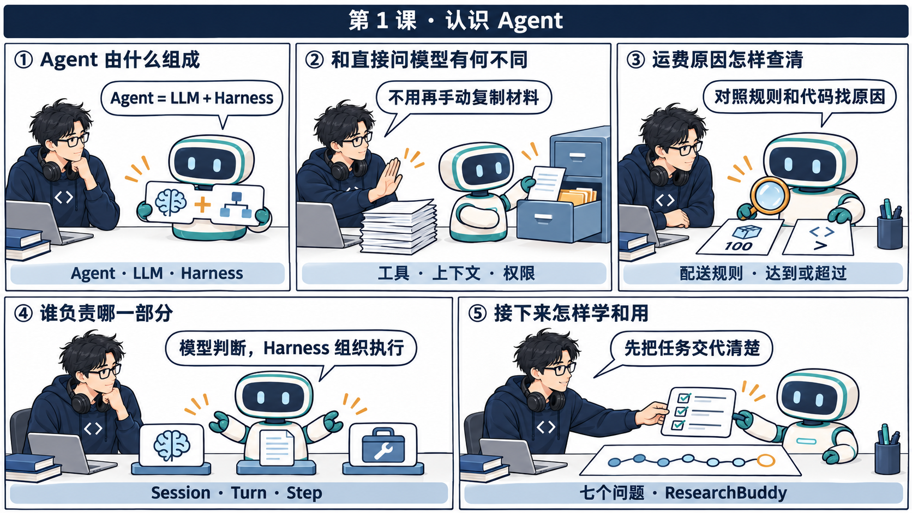

## 一、Agent 与 Harness 是什么关系？

**Agent 由模型和 Harness 组成：模型负责想，Harness 负责把想法变成受控的行动。**

你把“查清运费为什么算错了”交给一个编码 Agent。它可能先找文件，再读规则和代码，最后向你解释原因。看起来，整个过程都是“AI 在干活”。其实，理解代码和打开本地文件，是由不同部分完成的。

先记住一个关系，后面再用运费任务把这个关系讲具体：

**Agent = LLM + Harness**

- **LLM（大语言模型）**：根据收到的信息理解问题、分析原因、写出回复。它还可以提出下一步用什么工具，例如请求读取运费文件。
- **Harness**：围绕模型安排工作的那套程序。它准备模型要看的材料，检查工具请求能不能执行，再把执行结果交回模型。会话怎样保存、何时等你确认、何时停止，也归它管。
- **Agent（智能体）**：两者配合起来的完整系统。你交给它一个任务，它就能在取得信息、采取行动、查看结果之间反复推进。

反过来看：

**Harness = Agent - LLM**

这条式子是一个观察角度：除了模型能力，还有哪些程序、配置和运行机制在帮 Agent 做事？这些就是我们要研究的 Harness。

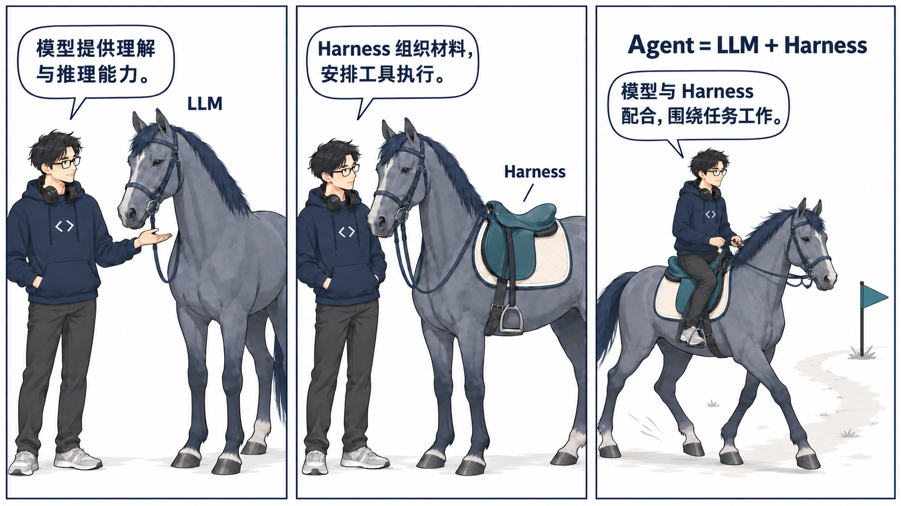

这幅漫画里，**LLM 就像一匹实力强劲的千里马**。理解、推理和生成，就是它的力量。可千里马并不好骑：你希望它沿路线前进，能掌握节奏，需要时停下来。马鞍等骑具帮你坐稳、驾驭它，把力量用在想做的事上。

**Harness 就像配给模型的这套骑具。** 放到运费任务里，它要让模型看到配送规则和代码。它要有工具真正去读文件。你只想查原因时，它还要限制写入。工具执行完，结果再交给模型，作为下一步判断的依据。

看完这张图，你要能：区分模型提供的能力与Harness组织工作的职责，解释两者怎样组成Agent。

### 先看一张整体关系图

**模型和 Harness 在 Agent 里面；文件、命令和外部系统在 Agent 外面，只能通过工具访问。**

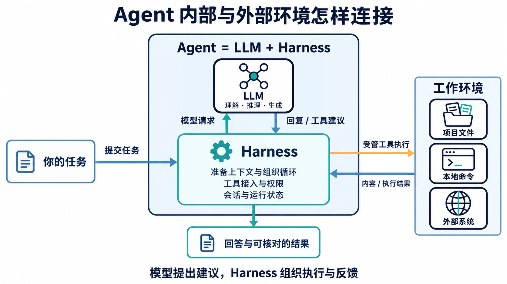

看完这张图，你要能：指出Agent内部的模型与Harness，以及外部文件、程序和系统的访问边界。

看图时，先沿着文件内容走一遍。项目文件在工作环境里，工具负责读取。Harness 把读到的内容放进请求，模型才有材料可以分析。模型想再读一个文件，就返回新的工具请求。模型和外部环境就这样连了起来。具体怎样循环，第 4 课再展开。

### 为什么模型不断变强，仍要建设 Harness？

**模型越强，越需要一套程序把它的能力接到真实项目上。**

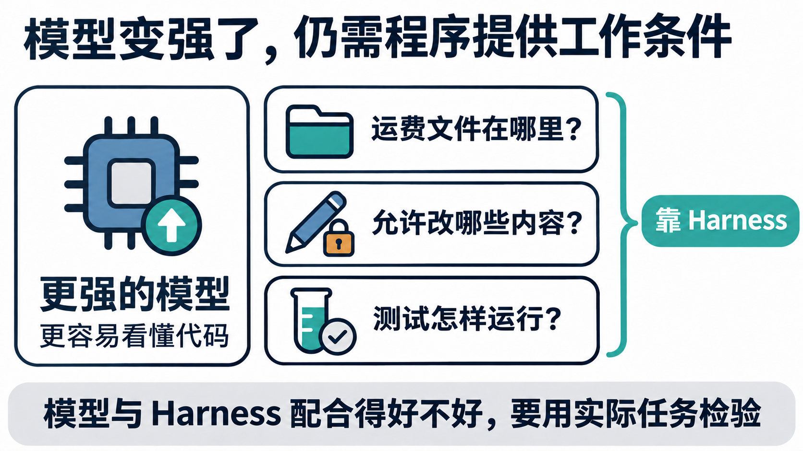

看完这张图，你要能：说明模型变强后，文件位置、修改范围和测试方式仍要靠 Harness 提供。

假设换了一个更强的模型，它更容易看懂复杂代码了。可是，运费文件放在哪里？允许它改哪些内容？测试该怎样运行？这些仍然要靠程序提供。

模型越能理解任务、选择工具，Harness 就越能把它的能力发挥出来。

容易误会的地方：

- 马鞍比喻的是“组织和使用能力”。装上 Harness，任务也不一定成功。
- 别处说的 Harness 有宽有窄，但都不包括模型。本课主要讲 Agent 程序；宽的说法还包括 `AGENTS.md`、测试等**项目约定与检查**，第 3、22 课会讲到。

## 二、使用 Harness 与普通调用大模型有什么区别？

**普通调用要你自己找材料、搬材料；Harness 让程序接手这些工作。**

### 先用一次普通模型调用排查运费

**只调用模型时，模型看不到你的项目，材料全靠你复制给它。**

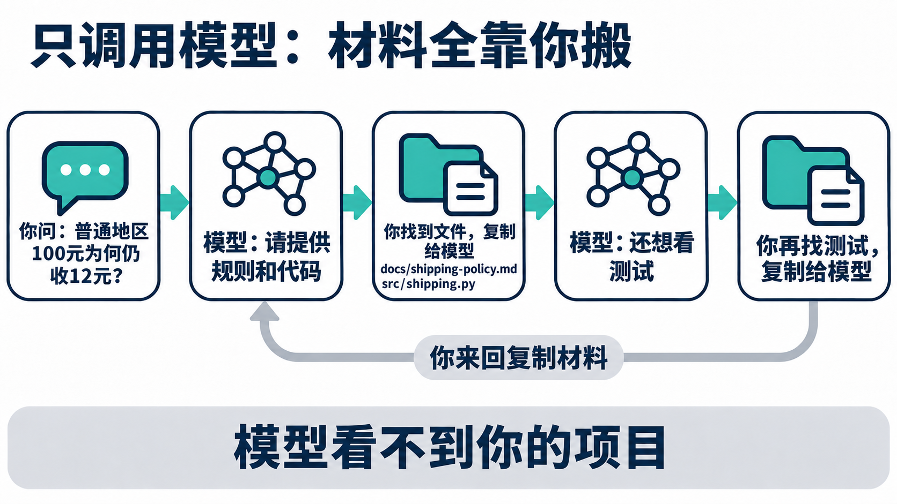

看完这张图，你要能：说出只调用模型时的麻烦：你要来回找文件、复制材料，模型看不到项目。

先准备一个小程序：把你输入的话发给模型，再把回复显示出来。仓库里有一个写好的，`demo-project/plain_chat.py`，只有几十行，可以打开看。你输入：

请查清普通地区恰好满 100 元为什么还收运费，先解释原因，暂时不要修改。

问题发出去了，但模型还没看到你的项目。它不知道配送规则写在哪里，也不知道运费函数怎样计算。它可能列出几种猜测，也可能请你补充材料。比如这样回复：

请提供免邮规则和计算运费的代码。我需要对照两者，才能判断这个项目为什么在 100 元时仍然收费。

于是，你打开项目，找到配送规则和计算函数，复制给它。它读完又想看测试，你就再找、再复制一次。材料齐了，模型才能把规则和实现放在一起比较。

想自己试一遍，可以照下面做。先按《课前-MyBuddy使用导读》装好依赖、在 `config/config.toml` 里填好密钥。

1. 在 MyBuddy 仓库根目录运行 `uv run python demo-project/plain_chat.py`。
2. 输入上面那句话，回车；再单独输入一行 `/send`，把它发给模型。
3. 看模型怎样回答。它多半会列出几种猜测，或者请你提供规则和代码。
4. 用编辑器打开 `demo-project/template/docs/shipping-policy.md` 和 `demo-project/template/src/shipping.py`，把内容复制、粘贴进去，再输入 `/send`。
5. 这次它能对照规则和代码来回答了。输入 `/exit` 退出。

这个小程序不读文件，也不执行命令，所以不会改动你的项目。环境还没配好的话，打开任何一个聊天网页做同样的事，体会是一样的：材料要你自己找、自己贴。

先停在这里，认清一次模型调用。小程序通过 **API**（程序之间交换数据的接口）把信息发给模型服务，再收回结果：

- **输入**：这次交给模型看的内容。比如你的问题、复制来的规则和代码。
- **输出**：模型这次返回的内容。可能是原因说明，也可能是“还需要看测试”。支持工具调用的接口，还能返回工具名称和参数，表示模型希望程序执行什么操作。

模型帮上忙了。但你仍在来回搬材料：找文件、挑内容、发给模型、看回复、决定补什么。要修复的话，你还得自己改文件、跑检查，再把结果交给模型。

### 让程序接手排查，需要做好四件事

**把你手动做的事交给程序，要解决四件事：找材料、选内容、执行操作、决定下一步。**

现在试着把刚才由你安排的工作交给程序。你只说“查清原因”，程序就配合模型一步步查下去。沿刚才的过程看，有四件事要做好。

先用一个出菜窗口看清分工：模型只写单子，程序核对后才去取料，结果再从窗口递回。

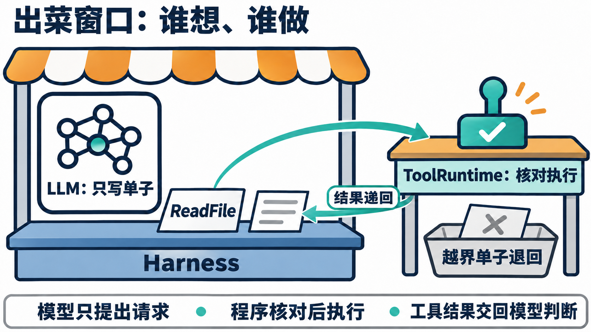

看完这张图，你要能：用“出菜窗口”分清谁提要求、谁动手：模型只写单子，ToolRuntime 检查后才去取料，越界的单子退回，结果再交给模型判断。

#### 1. 找到规则和代码

换成程序找文件，就要准备搜索和读取工具。模型先请求“查找配送规则”，再请求“读取运费代码”；本地工具读完，程序把内容交给模型。

#### 2. 选好这次要发的内容

整个项目发过去，可能放不下，也抓不住重点；只给出错的那一行，又可能漏掉金额门槛和地区规则。程序要把你的要求、相关规则、代码和有用的交互放进这次请求。模型本次能看到的这些信息，合起来叫**上下文**。第 8 课专门讲怎样选材料。

#### 3. 让工具执行允许的操作

模型返回“读取这个文件”的请求时，文件还没打开，真正动手的是本地工具。交给工具之前，程序要检查：路径允许访问吗？参数写对了吗？当前模式允许改文件吗？你写“暂时不要修改”只是告诉模型；MyBuddy 的 `/plan` 只读规划模式，才由程序限制写入。规划时也能运行 `ls`、`git status` 等列在允许执行清单中的只读命令；测试和脚本仍不能运行。工具执行后，读到内容也好，文件不存在也好，都要把实际结果交回来。

#### 4. 根据结果继续查，或结束排查

程序把工具结果放进下一次请求，模型才能根据新材料决定再看配送规则，还是已经找到差异。程序再结合运行限制，安排继续、等待或结束。

查到原因，就可以向你解释。要接着修改，CLI 里先清空输入框，按 Shift+Tab 离开规划模式；Web 里关闭 Plan 开关，再提出修复要求。

回头看，你刚才手动做的事，都能对应到 Harness 的工作：

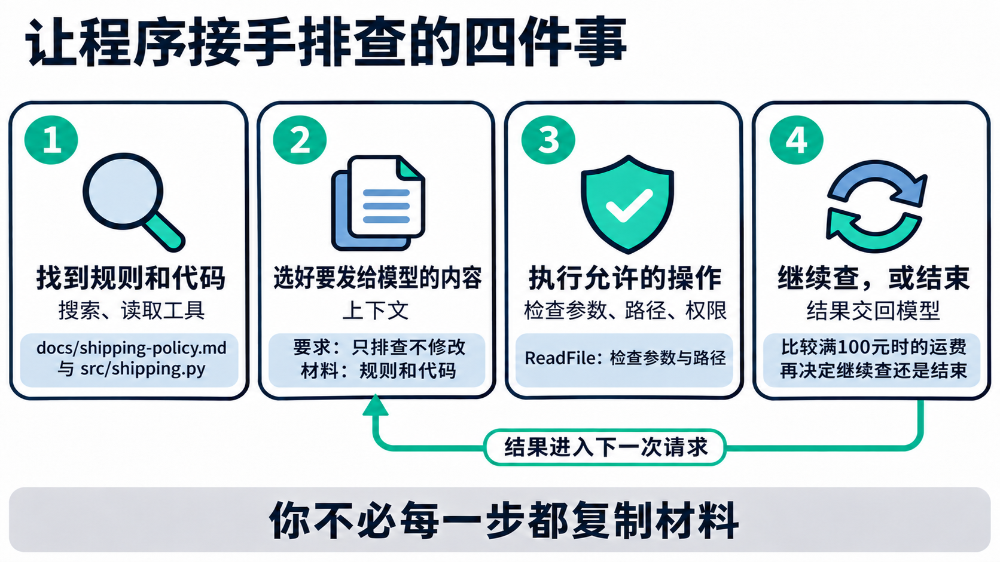

看完这张图，你要能：记住让程序接手排查要做好的四件事：找材料、选内容、执行允许的操作、决定继续或结束。

| 排查时需要做什么 | Harness 怎样支持这件事 |
| --- | --- |
| 找到规则和代码 | 提供搜索、读取工具，把内容或错误交给模型 |
| 选好这次要发的内容 | 把你的要求、相关材料和有效历史放进下一次模型请求 |
| 执行允许的操作 | 检查参数、路径和权限，再让工具执行 |
| 根据结果继续查，或结束排查 | 把真实结果交回模型，并按运行规则处理继续、等待和结束 |

这四件事接起来，就是 Harness 的基本工作过程。你不必每一步都去复制材料、催它继续。程序会把模型和工具接着往下组织。

### 先搭一个最小的 Harness

**一个模型接口、一个读取工具、一个循环，就能搭出最小的 Harness。**

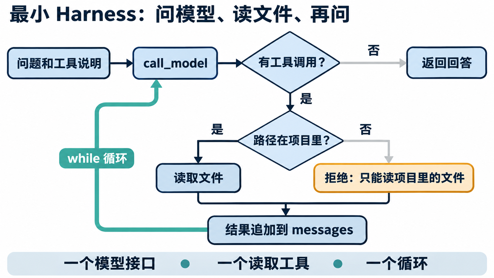

看完这张图，你要能：跟着最小 Harness 的伪代码走一遍：没有工具调用就直接回答，越界路径被拒绝，工具结果加进 messages 后再问模型。

看到这里，你也许想自己写一个了。可以从很小的版本开始。下面是 Python 风格的**教学伪代码**，不能直接运行：

```python
TOOLS = [{"name": "read_file", "description": "读取项目里的一个文本文件",
          "parameters": {"path": "相对项目根目录的路径"}}]

def mini_harness(question, project_dir):
    messages = [{"role": "user", "content": question}]
    while True:
        reply = call_model(messages, TOOLS)       # 1. 把问题和工具说明发给模型
        messages.append(reply)
        if not reply.tool_calls:                  # 2. 不再要工具：这就是回答
            return reply.text
        for call in reply.tool_calls:             # 3. 模型要读文件：程序去读
            path = (project_dir / call.args["path"]).resolve()
            if not path.is_relative_to(project_dir):
                result = "拒绝：只能读项目里的文件"   # 4. 越界的请求不执行
            else:
                result = path.read_text()
            messages.append({"role": "tool", "id": call.id, "content": result})
        # 5. 带着读到的内容，回到开头再问一次模型
```

用运费问题走一遍：第一次问模型，它要求读 `docs/shipping-policy.md` 和 `src/shipping.py`。程序读出两份内容，追加到 `messages`。第二次问模型，它看到了规则和代码，直接给出解释。没有工具调用，循环结束。

这几行已经包含前面的四件事：读取工具负责找材料，`messages` 是这次的上下文，路径检查限制了操作范围，`while` 循环决定继续还是结束。

最小版能跑通运费排查，但遇到读不到文件、要改文件、中途停下、程序崩溃、材料太多时，它就不够用了。后面的课程一次补一个，课次见第五节“从七个问题看 Harness 的工作”表。

MyBuddy 的大部分代码，都在回答这些“出问题时怎么办”。骨架仍然是这几行：问模型、执行工具、带着结果再问。

Harness 调用模型，用的仍是前面说的模型接口。第 2 课“一、你输入的一句话，怎样变成模型请求？”小节就从这里开始，看一次请求到底发了什么、收到了什么。

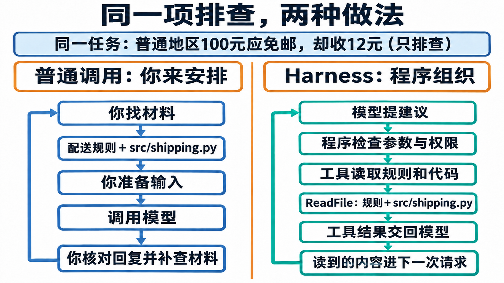

看完这张图，你要能：说出同一次运费排查里，找材料、组织输入、执行动作、检查反馈这几件事，怎样从你亲手安排变成由 Harness 组织。

## 三、MyBuddy 怎样查清 100 元仍收运费的原因？

**MyBuddy 至少要两次模型调用才能查清原因：先要材料，最后比较规则和代码。**

四件事说清楚了，现在把它们连起来，走一遍 MyBuddy 的排查过程。下面是一个简化的顺序。实际运行时，读取顺序和模型调用次数可能不同。

要跟着操作，先按《实践准备》创建运费项目的独立副本，用输出的启动命令打开 MyBuddy。确认 `--workspace` 指向包含 `src`、`docs` 和 `tests` 的业务副本。下面的相对路径都从这个目录算起。正文里的 `demo-project/template/` 路径，用于在课程仓库中查找原始样例。

### 从问题到原因说明，经过了哪些步骤？

**一次用户请求，可能需要多次模型调用才能处理完。**

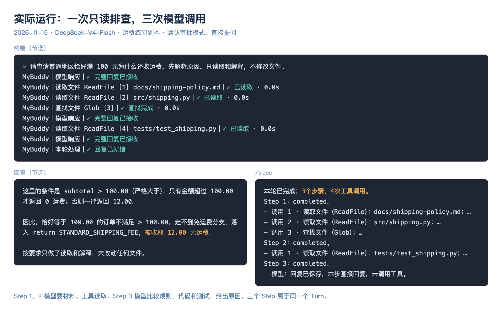

看完这张图，你要能：在一次真实运行里认出同一个 Turn 中的几个 Step：先读规则、代码和测试，再比较它们得出原因。

上图是一次真实运行：在默认审批模式下直接提问，并写明“只读取和解释，不修改文件”。读文件不需要你批准。模型第一次调用后读了规则和代码，第二次调用又补读了测试，第三次调用才给出原因。下表按最少的两次调用，说明每个阶段谁做了什么。

| 阶段 | 模型与本地程序分别做什么 | 得到了什么 |
| --- | --- | --- |
| 第一次模型调用 | 程序发送任务和可用工具说明；模型提出读取规则与运费实现的建议 | 工具名称与读取参数 |
| 本地工具处理 | 程序检查调用，工具读取允许访问的文件，结果经过记录与整理 | 当前规则和代码，或读取失败的结果 |
| 第二次模型调用 | 程序把读取结果加入输入；模型比较规则与实现 | 有依据的原因说明，或继续补查的建议 |
| 本轮收尾 | 程序根据回复与运行状态处理结束；你核对解释及其依据 | 这次排查的回答与执行记录 |

留意表中的两次模型调用。第一次，模型还没有文件内容，所以先提出读取请求。等工具把内容交回来，第二次调用才有材料可比较。这和最小 Harness 的两圈循环是一样的。模型想多核对一份材料，就会多一圈，像上图多读了测试文件。

### 规则与代码为什么能解释收费原因？

**规则写的是“达到或超过”，代码写的是** `>`**，等于 100 元的情况被漏掉了。**

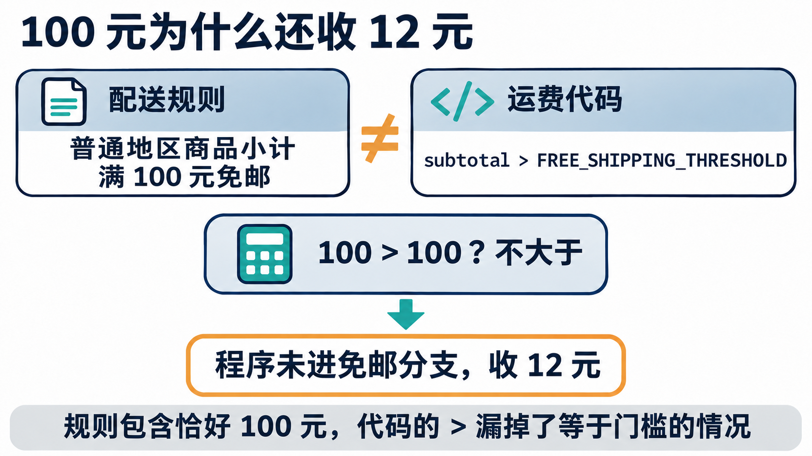

看完这张图，你要能：对照规则“达到或超过 100 元免邮”和代码 subtotal > FREE_SHIPPING_THRESHOLD，说清 100 元为什么收 12 元。

演示项目的配送规则（`demo-project/template/docs/shipping-policy.md`）要求：普通地区商品小计“达到或超过”100 元免邮。实现（`demo-project/template/src/shipping.py`）用的是这个条件：

```python
if subtotal > FREE_SHIPPING_THRESHOLD:
    return Decimal("0.00")
return STANDARD_SHIPPING_FEE
```

这里的门槛是 `Decimal("100.00")`。`Decimal` 用来表示十进制数，我们用它保存金额。把 100 元代进去：100 大于 100 吗？不大于。所以程序没进免邮分支，返回了普通运费。

再看规则，它写的是“达到或超过”。差异找到了：规则包含等于 100 元，代码里的 `>` 把它漏掉了。模型的解释有了具体依据，你也可以自己核对。这次只读排查可以交回答案了。

## 四、模型、工具和 Harness 各负责什么？

**模型做判断，工具做操作，Harness 把两者接起来并管住边界。**

我们已经知道 12 元是怎么来的。现在回头看：哪些事是模型做的，哪些是程序做的？

### 一次任务中的职责划分

**最容易混的是工具和 Harness：工具真正打开文件，Harness 决定这次调用能不能做、结果交给谁。**

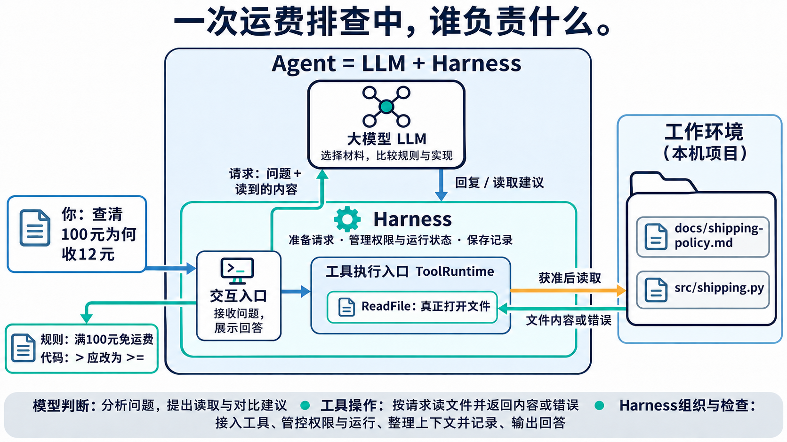

看完这张图，你要能：分清模型、工具、Harness、工作环境和交互入口在运费任务中各做什么。

| 部分 | 在运费任务中做什么 |
| --- | --- |
| 模型 | 理解问题、选择所需信息、比较规则与实现、组织解释 |
| 工具 | 在允许范围内读取文件，返回内容或错误 |
| Harness | 组织模型请求与工具结果，处理权限、会话和运行状态 |
| 工作环境 | 提供工具能够访问的项目文件及运行条件 |
| 交互入口（Harness 的交互前端） | 接收问题，展示活动、需要确认的操作和回答 |

你可以把读取工具理解为“真正打开文件、取回内容的那段程序”。Harness 负责把工具接进任务、检查调用、把结果送回模型。工具也可以由外部系统提供，但照样要经过 Harness 按规则使用。

### 用 Session、Turn 与 Step 标出运行过程

**你问一次是一个 Turn；模型每做一次决策，是 Turn 里的一个 Step。**

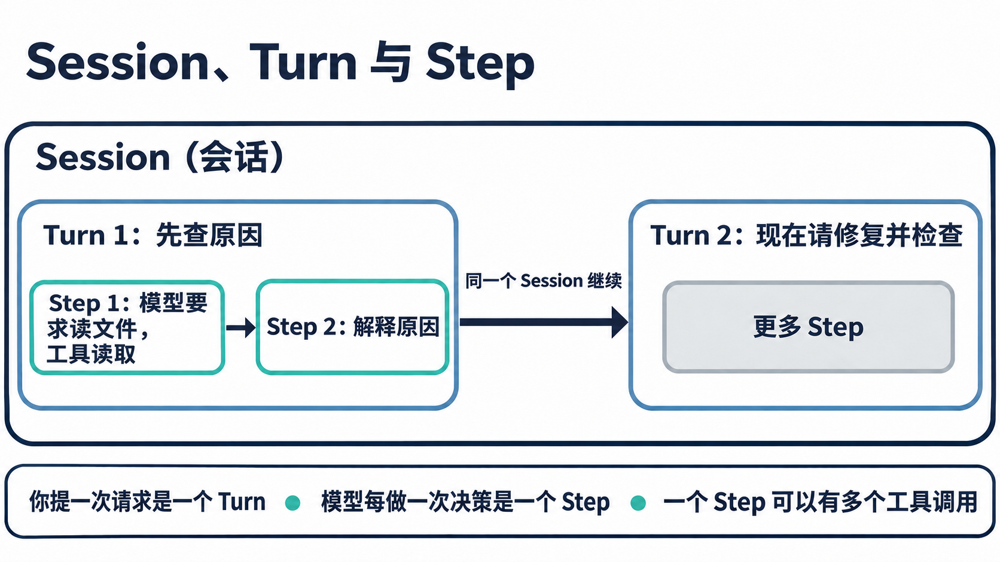

看完这张图，你要能：用套在一起的方框分清 Session、Turn 与 Step：“先查原因”是一个 Turn，里面有两个 Step；修复请求是同一个 Session 里的新 Turn。

刚才有一个反复出现的过程：调用模型，按它的请求执行工具，把结果交回去，再调用模型。这个循环叫 **Agent Loop（智能体循环）**。每取得新信息，模型都能重新判断下一步。负责运行的程序把这些步骤组织起来。

不过，“一轮”这个词有点含糊。你问了一次，模型却调用了两次，算几轮？MyBuddy 用三个名字描述不同范围：

- **Session（会话）**：容纳多次交互，保存它们的历史。你可以在同一个会话里先排查，再提出修复要求。
- **Turn（用户请求轮次）**：从一次用户请求被接受开始，包括为处理它做的后续工作。这次“先查原因”就是一个 Turn。
- **Step（决策周期）**：Turn 中的一次模型决策，以及它触发的工具处理（如果有）。模型先要求读文件，再根据内容解释原因，就经过了两个 Step。

所以，第三节那几次模型调用属于同一个 Turn。Step 1 是第一次决策和相应的读取。Step 2 根据读取结果作出新判断。任务要查更多材料，Turn 里就有更多 Step。一个 Step 也可以包含多个工具调用。

原因解释完，你退出规划模式，再说“现在请修复并检查”，新的 Turn 就开始了。它可以留在同一个 Session 里，参考前面保留的有效信息。第 4 课继续讲每个 Step 怎样推进、循环为什么会停。

### 为什么一句“已解决”还不足以说明结果？

**回答结束只说明这一轮停了；任务做到哪一步，要看实际做了什么。**

假设模型告诉你：“把判断改为 `>=` 即可。”这只说明它提出了改法；这次你只让它排查，文件里可能还是 `>`。要求修复时，还要看修改获准了吗、工具真的改了文件吗、改后的行为通过检查了吗。第 13 课会细讲。

沿下面的图走一遍，看工具结果怎样回到模型。图里只画主要过程，失败和取消留到后续课程。

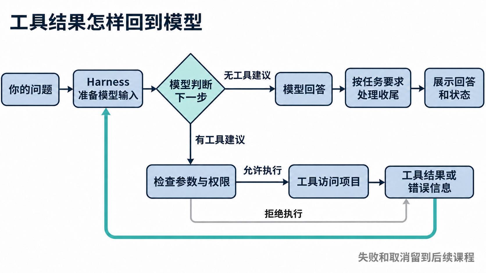

看完这张图，你要能：说出工具结果怎样回到模型：模型提出的调用先检查，允许或拒绝都会产生结果，再交回模型判断。

怎么检查要跟着任务走：查原因就对照规则和代码，改了代码就检查改后的行为。

想知道“它刚才查了哪些文件”，就看 **Trace（执行轨迹）**。MyBuddy 的 `/trace` 会根据会话记录，展示最近一轮用了什么工具、结果状态如何、本轮为什么停止。它是一份工作记录：能核对有没有读到配送规则；原因对不对、修复有没有效，还要对照规则、代码和检查结果。

容易误会的地方：

- 回答快结束时，程序不会自动替每种任务跑测试。要不要检查，取决于任务要求和运行配置。
- Trace 里只有读取请求，或结果显示失败，都不算读到了内容。
- `/trace` 的摘要有数量限制，不是完整记录；里面也没有模型隐藏的思考过程。

## 五、接下来怎样学习和使用 Harness？

**后面的课程会把这次排查拆成七个问题，一课一课看清每部分怎样实现。**

你已经跟完了一次排查：模型提出要什么材料，程序安排工具读取，结果回到模型，最后得到原因说明。后面的课程逐步拆开这个过程。

### 从七个问题看 Harness 的工作

**这张表是后续课程的地图，读到相关课次时再回来对照。**

假设由你来开发 MyBuddy，要让它处理刚才的任务。你会依次遇到下面这些问题：

| 围绕这项任务要弄清什么 | MyBuddy 在运费任务中需要做什么 | 后面在哪里展开 |
| --- | --- | --- |
| MyBuddy 怎样理解你这次要它做什么？ | 接受“查清原因、暂不修改”的要求；必要时向你澄清地区或金额范围 | 05 人机交互、10 Goal |
| MyBuddy 怎样取得模型判断所需的依据？ | 提供搜索和读取工具，把找到的规则、实现与测试送入模型请求 | 03 指令与工具、08 上下文、09 长结果、16 Skill |
| 模型提出一个动作后，谁决定能否执行？ | 运行时校验路径、参数和权限；需要批准时等待你确认，再交给工具执行 | 06 工具治理、07 本地命令、17 MCP |
| 取得工具结果后，MyBuddy 怎样决定继续、等待或结束？ | 把结果交给下一次模型调用；依据回复、取消信号和运行限制处理后续步骤 | 04 Agent Loop、10 Goal、12 取消与重试 |
| 任务中断后，MyBuddy 怎样知道此前做到了哪里？ | 保存已确认的消息、工具结果与执行状态，让恢复过程有据可查 | 11 会话与恢复 |
| MyBuddy 怎样给出你可以核对的结论？ | 解释当前规则与代码如何导致收费；若你后来要求修复，再检查修改后的行为 | 13 任务验证、20 协作验收 |
| 开发者怎样让 MyBuddy 更好地处理下一次同类任务？ | 根据运行记录改进说明、工具或检查方法，并验证改动的效果 | 18 Hook、21 项目回顾 |

### 使用者准备什么，Harness 开发者实现什么？

**用 MyBuddy 时，你负责把任务交代清楚；开发 Harness 时，你负责把这些要求落到程序里。**

使用时，你要说清：做什么、在哪个项目做、允许做到哪一步、怎样检查。

比如，你对 MyBuddy 说“请看配送规则”，这是用法。让它能查找、读取文件，是 Harness 的实现。你说“改完跑测试”，程序就得能执行检查、拿到结果。后面的使用技巧和源码解析，从这两个角度讲同一件事。

### 为什么还准备了一个 ResearchBuddy？

**同一套 Harness 换一套指令和工具，就能服务另一类任务。**

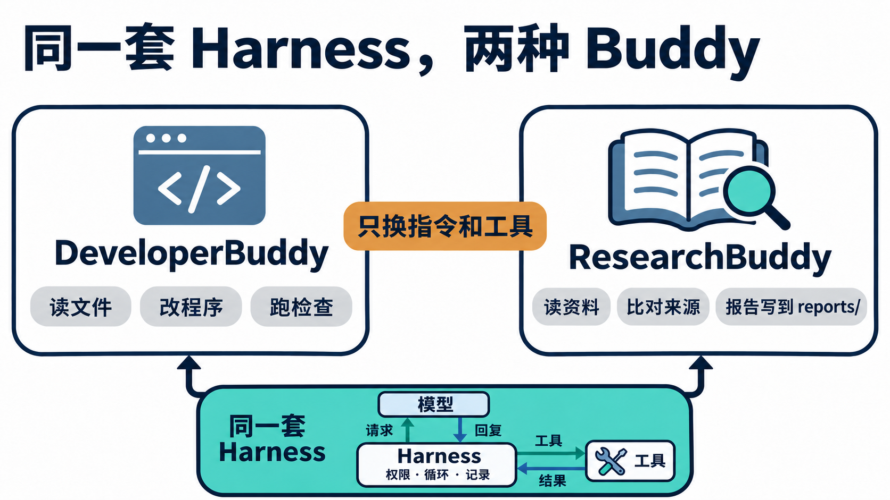

看完这张图，你要能：说出 DeveloperBuddy 与 ResearchBuddy 复用同一套 Harness，只换了指令和工具。

项目里的 **DeveloperBuddy**（开发助手）预设适合运费这类任务：读文件、改程序、跑检查。**ResearchBuddy**（研究助手）预设面向领域研究：读资料、比对来源，把报告写到工作区的 `reports/` 目录；联网版还能搜索网页。两者复用同一套 Harness，只换指令和工具配置。第 14 课会用它做一次小型研究。

### 两个业务项目怎样配合学习？

**运费案例小，用来看清一次往返；收银台大，用来练跨模块修改。**

运费案例的规则、实现和测试很快能看完，适合讲清一次模型与工具的往返。熟悉之后，再用麦当当收银台练跨模块修改。两个项目的介绍见《课前-麦当当收银台介绍》和《实践准备》；随课任务可以先做《综合实践-麦当当收银台》的“4. 随课任务：先只读解释一笔失败支付”小节。

### 把运行职责对应到源码入口

**最小 Harness 里的每一行，在 MyBuddy 源码里都有一个负责的模块。**

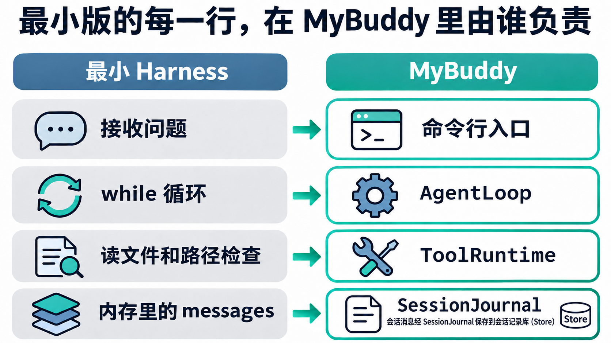

看完这张图，你要能：把最小 Harness 的四个部分，对应到 MyBuddy 的命令行入口、AgentLoop、ToolRuntime 和 SessionJournal。

命令行入口接收你的要求，`AgentLoop` 对应最小版的 `while` 循环，`ToolRuntime` 对应读文件和路径检查，`SessionJournal` 取代内存里的 `messages`。本课源码解析会贴出它们的真实代码。

### 用三个问题检查你的理解

1. 哪份材料说明免邮规则，哪段代码决定了恰好 100 元时的结果？
2. 模型请求读取文件时，谁选择要读什么，谁实际读取，谁约束访问范围？
3. 模型提出把 `>` 改成 `>=`，还需要哪些证据才能判断修复完成？

试着沿刚才的排查过程回答：先指出规则和代码在哪里，再说明谁提出读取、谁实际执行，最后解释你会怎样核对修复结果。

## 使用小妙招

下面这些写法，在 Claude Code、Codex 这类 Agent 里同样适用。轮到你使用时，最先要做好的是把任务说清楚。

### 一条任务先说清四件事

可以把任务想成给协作者的一段交代：**做什么、看哪里、做到什么范围、交回什么结果。** 下面以运费排查为例：

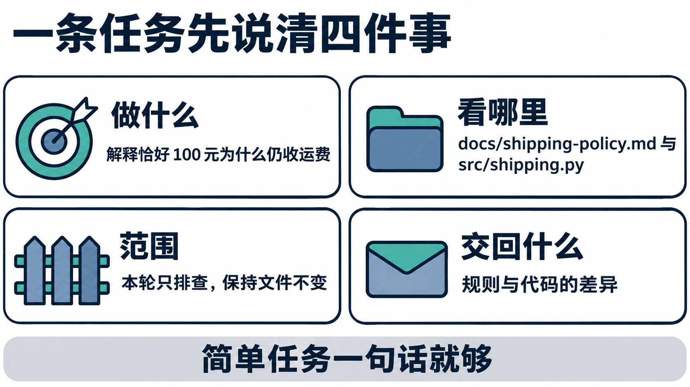

看完这张图，你要能：交代任务时说清四件事：做什么、看哪里、范围多大、交回什么。

| 要交代什么 | 可以怎样写 |
| --- | --- |
| 做什么 | 解释普通地区恰好100元为什么仍收运费 |
| 看哪里 | 对照 `docs/shipping-policy.md` 与 `src/shipping.py` |
| 范围是什么 | 本轮只排查原因，保持文件不变 |
| 交回什么 | 指出规则与代码的差异，给出对应文件和条件 |

简单任务，用一句话把意思说清楚就够了；复杂任务再补充这些信息。知道文件位置，就把路径写出来；不知道，也可以描述现象，请它先找。至于该怎样修复，可以留给模型取得材料后分析。

**为什么这样做：** 模型只能根据收到的内容工作（见“先用一次普通模型调用排查运费”）。只说一句“运费有问题”，它不知道该看哪里、做到哪一步算完，只能先猜或回头问你。四件事说清了，它知道去读哪些文件，你也知道拿什么标准检查它交回的结果。

### 四类常见任务，分别这样写

下面的路径都相对于运费业务项目根目录。解释代码或排查原因时，直接发送问题，并写明“只读取和解释，不修改文件”。想先制定实施方案时，再用 MyBuddy 的 `/plan`；规划提示要求模型调查、澄清，把方案写进指定文件并提交审阅。规划与方案确认的用法见第 5 课。

#### 看懂代码：点名对象，说明想理解什么

请解释 `src/shipping.py` 中的 `shipping_fee` 函数。按普通地区、偏远地区分别说明收费规则，再举一个输入金额和返回运费的例子。

**为什么这样做：** 点名文件和函数，Agent 可以直接去读那一段，不用先四处搜索。说明想理解什么，它就知道要从代码里找出哪些分支来讲。它举出输入和返回值后，你还可以自己代入算一遍，看看它有没有理解对。

#### 排查问题：给出现象与预期，请它找到依据

普通地区商品小计恰好100元时，预期运费为0，当前却收了12元。请对照配送规则、实现和现有测试定位原因，指出对应文件与条件，本轮先不要修改。

遇到报错时也一样：附上报错内容，以及你做了什么操作、输入了什么。想先看方案，就再加一句“列出拟修改的文件和检查方法”。

**为什么这样做：** 写出“应该是 0”和“实际是 12”，Agent 就知道要查清的是哪一个差异。它会在“读材料、看结果、再决定下一步”之间循环几次（见“从问题到原因说明，经过了哪些步骤？”），有了明确的差异，每一步读什么才有方向。要求指出文件和条件，是让结论有依据，方便你回到代码核对。

#### 修改代码：写明结果与需要保持的规则

请在当前练习副本修复免邮边界：普通地区商品小计达到或超过100元时运费为0，低于100元时仍收12元；偏远地区仍固定收20元。保留现有调用方式和测试预期，运行现有运费测试，再额外检查普通地区商品小计120元时是否免运费。最后说明改了哪些文件、检查结果是什么。

如果当前在规划模式，发这一条之前先离开规划模式。规划期间，文件工具只能写指定的方案文件，不能修改业务文件；Bash 也不能运行测试。

**为什么这样做：** 模型决定怎么改，真正改文件的是工具，Harness 管能不能改（见“一次任务中的职责划分”）。你写出要修好什么、其他规则要保持什么样，模型选改法时有依据；界面请你批准操作时，你也能对照这些要求，看它准备做的事对不对。

#### 核对结果：说明检查范围，要求报告实际结果

请运行 `tests/test_shipping.py` 中的现有测试，再单独调用运费函数，检查普通地区商品小计120元时是否返回0。不修改业务代码或测试文件，报告执行命令和实际结果。

现有测试只覆盖普通地区 99.99 元、100 元和偏远地区 120 元，所以要另查普通地区 120 元。

**为什么这样做：** 模型写出“已修复”，只是它说的话，不是检查结果（见“为什么一句‘已解决’还不足以说明结果？”）。要求报告实际执行的命令和输出，你才能看出哪些情况真的检查过、哪些还没覆盖。第 13 课会细讲怎样要求报告。

### 追问时，指出具体对象和缺少的信息

等本轮回答结束后，可以沿同一会话继续问。尽量把“再看看”“讲详细点”换成具体问题，例如：

你已经解释了普通地区的边界。请再说明偏远地区商品小计120元时会经过哪个分支，为什么仍收20元，并指出对应代码。

如果发现它把“商品小计”理解成了“含运费的总价”，直接指出这个差别，再请它重新核对相关判断即可。

**为什么这样做：** 同一会话会带上仍保留的历史；较早的代码和结论被压缩后，可能只剩概要，需要重新读取细节。“讲详细点”没有说清你缺什么，模型只能自行揣测。指出对象和缺的信息，下一次决策就有了方向。

### 收到回答后，自己核对这次工作

| 你想确认什么 | 可以怎样做 |
| --- | --- |
| 刚才读了什么、经过哪些步骤？ | 展开界面里的工具调用记录（Claude Code 按 Ctrl+O；MyBuddy 用 `/trace`） |
| 当前项目有哪些文件变化？ | 在终端运行 `git status` 和 `git diff`（Codex、MyBuddy 也可以用 `/diff`） |
| 修改后是否符合要求？ | 请它运行对应检查，并报告命令、结果和未覆盖的情况 |

《实践准备》创建的运费副本自带 Git 仓库，原始状态已经提交，所以 `git diff` 显示的就是这次练习的修改。自己的项目也一样：开始让 Agent 修改前，先提交或记下当前状态。

**为什么这样做：** Agent 的回答是它对这次工作的总结，可能漏说，也可能说错。工具调用记录告诉你它实际读了什么、做了什么；`git diff` 告诉你文件实际变成了什么样；检查结果告诉你改完后行为对不对。三样对照着看，才知道这次工作到底完成了多少。

容易误会的地方：

- 工作区里可能有别人或别的会话留下的改动，`git diff` 里的差异不一定都来自这次任务。
- 让 Agent 重新读取文件，只能看到当前内容，看不出本轮改了什么。

## 自测：这一课的概念分清了吗

**先自己作答，再看后面的答案。** 每题都能在本课正文里找到依据；带“动手验证”的题，可以照着做一遍，亲眼看到结果。

**1.** 两个 Harness 接同一个模型。一个把配送规则和代码交给模型，另一个只给了报错描述。怎样理解它们的差别？

- A. 模型相同，能依据的材料也相同。
- B. 模型相同，收到的材料仍可能不同，这会影响分析。
- C. 只给报错描述也够了，模型能力强就能直接看到本地项目。

**2.** 按本课的职责划分，读取项目文件时，哪一种分工是对的？

- A. 模型选择文件，也直接打开本地文件；工具只展示内容。
- B. 工具选择该读什么，模型只负责复述结果；Harness 保存回答。
- C. 模型提出读取请求，工具实际读取，Harness 检查调用并把结果交回模型。

**3.** 你只要求排查原因，收到回答：“把判断改为 `>=` 即可。”目前只有这句建议，怎样判断任务结果？

- A. 这说明提出了改法；要认定修复完成，还需要实际修改和检查的证据。
- B. 这说明业务文件已经改好，只差你重新打开文件。
- C. 回答已经结束，就说明修复和检查都完成了。

**4.** 判断：你在 MyBuddy 中输入 `/diff`，看到了文件修改，因此可以认定这些修改都来自当前会话。（对 / 错）

### 答案与依据

**1. 选 B。** 同一个模型收到的材料可以不同，分析所依据的信息也就不同。模型相同不代表输入相同，也不代表它能直接看到你的项目。  
依据：本课“先用一次普通模型调用排查运费”。

**2. 选 C。** 模型提出要读什么，工具真正打开文件，Harness 负责检查并组织结果反馈。模型提出请求，不等于已经直接读取了本地文件。  
依据：本课“一次任务中的职责划分”。

**3. 选 A。** 提出改法和完成修改是两件事。回答结束本身不能证明文件改过，更不能证明改后的行为通过了检查。  
依据：本课“核对结果：说明检查范围，要求报告实际结果”。

**4. 错。** `/diff` 查看工作区的未提交修改，其中也可能有你自己或其他会话留下的改动。它不能单凭文件差异判断是谁改的。  
依据：本课“收到回答后，自己核对这次工作”。  
动手验证：先按课前导读装好依赖、填好 `config/config.toml`。在仓库根目录运行 `uv run python demo-project/prepare_shop_demo.py`。用编辑器在输出目录的 `project/README.md` 末尾添加一行“这是我手动添加的自测记录”并保存。进入输出目录，在终端运行 `sh start-mybuddy.command`。启动后不发送模型任务，直接输入 `/diff` 并回车。“未暂存”列表中会出现你手动修改的 `README.md`，说明这里也会显示会话开始前已有的修改。

## Q&A：常见追问

### Q1：换了更强的模型，Harness 里哪些设置值得重新检查？

可以先拿同一个运费问题试一遍，从相同的项目状态开始，看看新模型怎样找材料、选择工具、解释原因。如果行为变了，再检查原来的提示是否还合适，工具说明是否清楚，步骤限制是否够用。接入新模型时，也要核对接口能否正确处理请求和返回结果。

### Q2：两个 Harness 接同一个模型，为什么使用体验差很多？

比如一个 Harness 会把配送规则和代码都交给模型，另一个只给了报错描述。虽然模型相同，能依据的材料已经不同了。可用工具、循环怎样继续、结果怎样检查，也都会影响体验。你可以用同一项任务和相同的项目起点比较，沿过程看看差异出在哪里；再换几类任务，才能判断这种差异是否普遍。

### Q3：怎样判断 Harness 的模块划分是否合理？

要看职责能不能沿一次真实任务说清楚，出错后能不能找到负责的地方。例如模型提出读文件，AgentLoop 负责推进这一步，ToolRuntime 检查并执行读取，SessionJournal 保存记录；会话能否继续由 AgentSession 管。模块名列得再全，如果权限检查散在多处、失败后不知道由谁处理，划分仍然有问题。

### Q4：Coding Agent 的会话状态与业务项目的运行状态有什么区别？

Coding Agent 保存任务处理记录，业务项目保存自己的业务状态，两者要分别管理。以 MyBuddy 为例，它帮你读文件、改代码、运行检查；运费程序和收银台则有各自的业务逻辑。收银台保存订单状态，MyBuddy 保存 Agent 怎样处理任务的记录。因此，继续 MyBuddy 的会话，也不会自动找回收银台退出前只保存在内存里的订单。

## 本课术语速查

| 本课说法 | 源码或命令中的名字 | 含义 |
| --- | --- | --- |
| LLM | 大语言模型 | 根据输入生成文字的模型，只负责“想”和“说” |
| Harness | — | 模型之外的整套程序：准备材料、执行工具、记录过程、控制权限 |
| Agent | Agent = LLM + Harness | 模型加上 Harness，能多步完成任务的智能体 |
| Agent Loop | `AgentLoop` | 反复“请求模型 → 执行工具 → 带着结果再请求”的循环（第 4 课） |
| 上下文 | — | 这一次交给模型看的全部内容（第 8 课） |
| 会话 | Session | 容纳多次交互、保存它们历史的单位 |
| 用户请求轮次 | Turn | 从你的一次请求被接受开始，到这次处理结束 |
| 决策周期 | Step | Turn 中的一次模型决策，以及它触发的工具处理 |
| 工具执行入口 | `ToolRuntime` | 统一检查、执行和记录工具调用的地方（第 3、6 课） |
| 会话日志 | `SessionJournal` | 按顺序保存会话中每件事的记录（第 11 课） |
| 执行轨迹 | Trace、`/trace` | 回看最近一轮的步骤和工具摘要 |
| DeveloperBuddy / ResearchBuddy | `buddy.developer` / `buddy.research` | 课程中的编码助手和研究助手（第 14 课） |

## 继续阅读源码解析

接着打开本课源码解析，把刚才的读取过程对应到真实的 Python 文件和函数。
