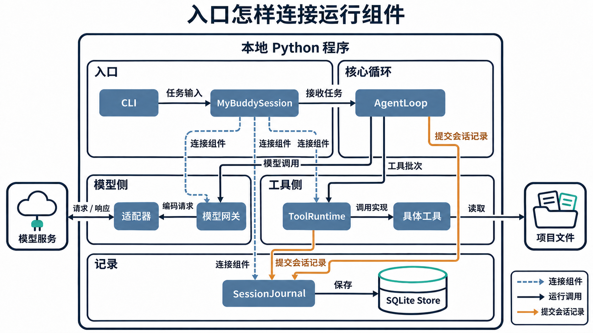
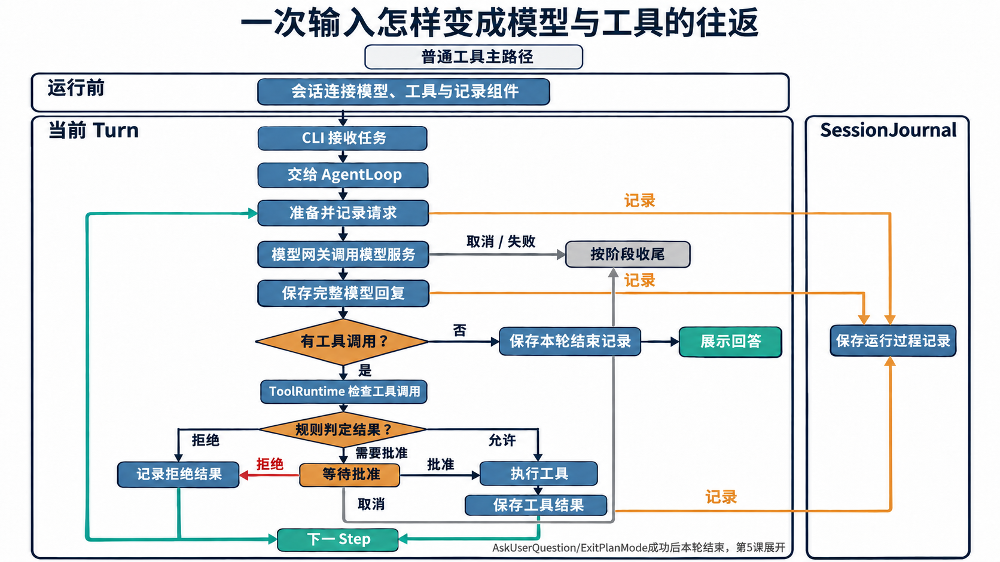
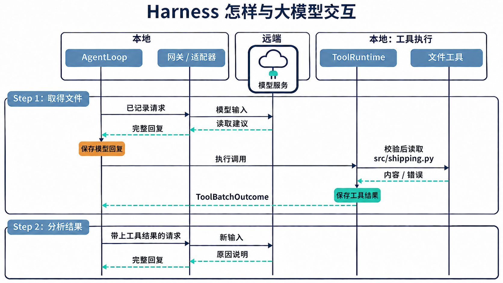

与第 1 课课程正文配套阅读。

正文第二节“先搭一个最小的 Harness”里，用十几行伪代码搭了一个最小 Harness。“最小”的意思是：只有一个模型接口、一个读文件的工具和一个循环，刚好够把运费问题查清。这里把它再贴一遍，方便对照（教学伪代码，不能直接运行）：

```python
def mini_harness(question, project_dir):
    messages = [{"role": "user", "content": question}]
    while True:
        reply = call_model(messages, TOOLS)       # 1. 把问题和工具说明发给模型
        messages.append(reply)
        if not reply.tool_calls:                  # 2. 不再要工具：这就是回答
            return reply.text
        for call in reply.tool_calls:             # 3. 模型要读文件：程序去读
            path = (project_dir / call.args["path"]).resolve()
            if not path.is_relative_to(project_dir):
                result = "拒绝：只能读项目里的文件"   # 4. 越界的请求不执行
            else:
                result = path.read_text()
            messages.append({"role": "tool", "id": call.id, "content": result})
        # 5. 带着读到的内容，回到开头再问一次模型
```

它做四件事：问模型、读文件、把结果放回 `messages`、再问。MyBuddy 的骨架也是这四件事，只是每一件都由专门的代码负责。这一篇就在 MyBuddy 里找到这几行各自的“负责人”，并读它们的真实代码。

**怎么读：** 每一节先贴一段代码，再用几句话解释。代码从当前源码原样复制，上方标了文件和行号。`# ...` 表示省略了与本节无关的行。

先记住两个词。你的一次请求及其处理叫 **Turn**。其中一次模型决策和它触发的工具处理叫 **Step**。下面沿用运费排查：模型先要求读规则和代码，再根据内容解释原因。

先看整条调用链。缩进表示“谁调用谁”：

```latex
run_cli → submit_turn               cli.py                   接收终端输入
└─ MyBuddySession.ask               application_session.py   会话入口
   └─ TurnCoordinator.run           turn.py                  保存输入，准备本轮
      └─ AgentLoop.run_turn         agent_loop.py            Step 循环（最小版的 while）
         ├─ GovernedModelGateway.complete  model_gateway.py  把请求发给模型服务
         └─ ToolRuntime.execute_batch      tool_runtime.py   检查、执行、保存工具结果
```

和最小 Harness 对一下：

| 最小 Harness | MyBuddy 里谁负责 |
| --- | --- |
| `call_model(messages, TOOLS)` | `AgentLoop` 准备请求，`GovernedModelGateway` 发出去 |
| 路径检查与 `path.read_text()` | `ToolRuntime` 检查和执行，具体工具真正读文件 |
| `messages.append(...)` | `SessionJournal` 把每件事保存进会话记录 |
| `while True` 与 `return reply.text` | `AgentLoop.run_turn` |

## 相关模块：从入口找到各项职责

**先认识下表中的源码入口，知道各个文件负责什么。**

先按下表打开文件，找到对应的类或函数即可。内部算法在后续课程展开。

| 模块与源码入口 | 负责什么 | 先找哪个对象 |
| --- | --- | --- |
| `src/mybuddy/cli.py` | 接收终端输入，分发命令或任务，展示结果 | `run_cli` |
| `src/mybuddy/platform/application/session_startup.py` 与 `src/mybuddy/platform/application/session_construction.py` | 创建主会话或受限子会话，分开装配值与外部依赖 | `create_configured_session`、`create_restricted_child`、`SessionDependencies` |
| `src/mybuddy/platform/application/application_session.py` | 作为会话的公开入口和执行所有者 | `MyBuddySession`、`ask`、`_ask_turn` |
| `src/mybuddy/platform/application/session_runtime.py` | 会话初始化时连接模型、MCP、工具与循环 | `activate_resources`、`build_runtime` |
| `src/mybuddy/platform/application/goal.py` 与 `src/mybuddy/platform/application/turn.py` | 前者安排一轮或按目标条件续轮；后者接纳输入、准备一轮并整理结果 | `run_goal_turns`、`TurnCoordinator.run` |
| `src/mybuddy/platform/application/tool_composition.py` 与 `src/mybuddy/platform/tools/tool_registry.py` | 保留外层约束，按工具名精确绑定领域策略和具体实现 | `compose_tools`、`ToolRegistry` |
| `src/mybuddy/core/runtime/ports.py` | 规定循环与模型、工具之间传递的数据和接口 | `PreparedModelRequest`、`ModelCompletion`、`ModelPort`、`ToolRuntimePort` |
| `src/mybuddy/core/runtime/agent_loop.py` | 推进当前用户请求，安排模型调用、工具处理与收尾 | `AgentLoop` |
| `src/mybuddy/platform/models/model_gateway.py` | 检查请求条件，衔接供应商适配器，整理模型回复 | `GovernedModelGateway.complete` |
| `src/mybuddy/spi/model_adapter.py` | 定义供应商接入时统一使用的输入、回复与工具建议 | `ModelInput`、`ModelReply`、`ModelToolProposal` |
| `src/mybuddy/platform/sessions/session_journal.py` | 按提交规则保存会话中已发生的事实 | `SessionJournal` |

代码里的“接口”，描述一个组件要具备哪些能力。例如 `ModelPort` 要求提供模型调用方法，`ToolRuntimePort` 要求提供工具批次执行方法。循环只依赖这些接口。具体用哪个模型接入、哪些工具实现，由初始化代码连起来。这个连接过程叫**装配**。



看完这张图，你要能：分清源码里哪些模块负责装配，哪些在运行时互相调用。

## 从终端到循环：一次输入怎样进来

**终端把输入交给会话；会话先装配好组件，再把每次请求交给循环。**



看完这张图，你要能：按顺序说出一次请求经过的环节：装配、准备请求、模型回复、执行工具、交回结果、收尾。

### 片段 1：终端把你的输入交给会话

`src/mybuddy/cli.py:454-460`

```python
        async def submit_turn() -> ApplicationTurnResult | None:
            if initialize_project:
                return cast(ApplicationTurnResult,
                    (await execute_session_command(self.conversation, ParsedCommand('/init'))).value)
            if pending:
                return await self.conversation.ask_pending()
            return await self.conversation.ask(text)
```

`submit_turn` 是 CLI 提交一次请求的地方。普通输入走最后一行 `self.conversation.ask(text)`。`/init` 和排队中的输入走另外两个分支。

`self.conversation` 是一个 `MyBuddySession`。它在启动时由 `create_configured_session` 创建，之后每次输入都交给这同一个会话处理。

### 片段 2：会话把工具和循环装配起来

`src/mybuddy/platform/application/session_runtime.py:198-203`

```python
    session.provider = composed.provider
    session._tools_runtime = composed.runtime
    session._coding_plans = composed.coding_plans
    # 模型返回的是想调用哪个工具以及参数，真正检查权限、运行工具的是本地的工具运行组件。
    # 把它交给 AgentLoop，模型就不能仅凭一段回复绕过本地检查直接执行操作。
    session.loop = AgentLoop(session.model, session._tools_runtime, session.ids)
```

这几行在 `session_runtime.py` 的 `build_runtime` 里，`session` 就是当前的 `MyBuddySession`。前面的 `compose_tools` 已经把所有工具组装好了。

- `composed.provider` 按工具名把调用交给对应实现。
- `composed.runtime` 是循环使用的工具执行入口，负责检查、权限判断和结果记录。
- `session.model` 是本地的模型接口，不是模型本身。

最后一行创建 `AgentLoop`，把模型接口和工具运行组件都交给它。注释说明了原因：模型只能“说想调什么”，真正执行要经过本地的 `ToolRuntime`。

### 片段 3：一轮请求先保存输入，再进循环

`src/mybuddy/platform/application/turn.py:161-165`

```python
            prepared = await self._prepare(accepted)
            outcome = detach_turn_result(await self._host.loop.run_turn(
                prepared.context, self._host.journal.commits(self._host.scope, "turn"), signal))
            outcome_name = outcome["outcome"]
            return await self._finish(prepared, accepted, outcome)
```

`MyBuddySession.ask` 经过 `run_goal_turns` 和 `_ask_turn`，最后来到 `TurnCoordinator.run`。这段是它的后半部分。

前面几行已经用 `_accept_input` 把你的输入保存好了，并运行了配置的 TurnStart Hook（每轮开始时自动运行的命令，第 18 课）。`_prepare` 为本轮准备上下文。然后调用 `loop.run_turn`，并传入一个保存记录用的 `commits`。循环返回后，`_finish` 整理本轮结果。

所以，循环开始前，你的输入已经在会话记录里了。这是最小版没有的：最小版的 `messages` 只在内存里。

## 循环里的第一次往返：请求、回复、工具

**循环先保存请求再调用模型，先保存回复再执行工具；每一环都有记录。**

### 片段 4：准备请求，保存后再发给模型

`src/mybuddy/core/runtime/agent_loop.py:466-467,481-492`

```python
            request = await context.make_request(
                RequestBuildInput(step_id, progress.step_index, attempt_id, progress.head))
# ...
        # 先把请求写入数据库并确认成功，再交给模型网关。
        # 这样这次模型调用有一份已保存的请求可供关联。
        event = context.session_event(progress.head + 1, "model.request_prepared", 10,
            self._ids.next("event"), context.now(), thaw_json(request), producer="turn", **identities)
        prepared = await commits.save(self._ids.next("batch"), [event])
        progress.head = prepared

        # 模型网关会检查回复格式、检查回复里有没有泄露已知密钥，并按顺序给工具调用编号。
        try:
            model_completion = await self._model.complete(
                PreparedModelRequest(event["event_id"], request, prepared, event["activation_id"], event["lease_generation"]), signal,
            )
```

这段在 `_request_model` 里，对应最小版的 `call_model(messages, TOOLS)`。它分三步：

1. `context.make_request` 根据当前已保存的历史，组织这一步要发的内容。没被读取过的文件，不会因为在项目目录里就自动进入请求。
2. `commits.save` 把请求存成 `model.request_prepared` 事件。保存成功才往下走。
3. `self._model.complete` 把请求交给模型网关。`await` 表示在这里等待回复。

`PreparedModelRequest` 里的 `request` 是请求内容，`prepared` 是保存后返回的序号。这样每次模型调用都能对上一份已保存的请求。

### 片段 5：请求和回复的数据长什么样

`src/mybuddy/core/runtime/ports.py:43-50,60-68`

```python
@dataclass(frozen=True, slots=True)
class PreparedModelRequest:
    # 请求事件的编号和数据库写入成功后的确认信息，让调用模型时能指向已保存的输入。
    request_event_id: str
    snapshot: Mapping[str, Any]
    checkpoint: int
    activation_id: str
    lease_generation: int
# ...
@dataclass(frozen=True, slots=True)
class ModelCompletion:
    # 模型返回的工具调用只是建议，不会因为出现在回复里就自动运行。
    # 后面还要检查调用是否允许，必要时询问用户，再由本地程序执行。
    model_message: Mapping[str, Any]
    tool_calls: tuple[RegisteredToolCall, ...]
    # 模型点名了本次请求没有提供的工具时，这些调用照常登记，但工具运行器不会执行它们，
    # 只给模型回一条“没有提供这个工具”的错误结果。这里记下这些调用的编号。
    unoffered_call_ids: frozenset[str] = frozenset()
```

`PreparedModelRequest` 是交给模型网关的请求。`snapshot` 是请求内容，`checkpoint` 是保存后的历史末尾序号，后两个字段记录运行者身份。

`ModelCompletion` 是网关交回循环的完整回复。`model_message` 是模型消息，`tool_calls` 是工具调用。注释写得很清楚：工具调用只是建议，不会自动运行。

### 片段 6：网关把请求翻译给模型服务

`src/mybuddy/platform/models/model_gateway.py:140-148`

```python
        # 根据已保存的请求重新确定适配器并生成正文，确保它使用的是当前网关的配置。
        expected_route = self._budget.expected_route if self._budget is not None else None
        try:
            descriptor = resolve_model_adapter(snapshot["model_route"],
                inline_value(snapshot["request_parameters"]["provider_options"]))
            if descriptor != self._descriptor:
                raise AgentLoopError("request_snapshot_mismatch")
            model_input = descriptor.codec.business_input(snapshot, expected_route)
            encoded = descriptor.codec.encode(model_input)
```

这段在 `GovernedModelGateway.complete` 的后半部分。前半部分做各种检查，这里只看主线：

- `codec.business_input` 把已保存的请求还原成 `ModelInput`。
- `codec.encode` 把它转成模型服务接受的格式。OpenAI Chat Completions 协议的实现在 `openai_wire_codec.py`。
- `self._adapter.dispatch` 真正发起网络请求，等回复。
- `host_model_completion` 把回复整理成 `ModelCompletion`，并给每个工具调用分配本地编号。

Harness 和模型的边界，就是**发出数据、收到数据**。模型不会穿过这个接口直接运行本地 Python 函数。

### 片段 7：模型的工具建议长什么样

`src/mybuddy/spi/model_adapter.py:67-75,86-91`

```python
@dataclass(frozen=True, slots=True)
class ModelToolProposal:
    """保存模型想调用的工具名称、参数和模型服务返回的调用编号。
    这只是模型的提议，不表示已经得到允许或运行了工具。"""
    # 模型服务给这次工具调用的编号，供后续区分不同调用并对应结果。
    # 这里只接受 1 到 200 个英文字母、数字、下划线、点或连字符。
    provider_call_id: str
    name: str
    arguments: Mapping[str, Any]
# ...
@dataclass(frozen=True, slots=True)
class ModelReply:
    """保存模型的完整回复，包括文字、工具调用提议、结束原因和 token 用量。"""
    text: str | None
    tools: tuple[ModelToolProposal, ...]
    stop_reason: Literal["end_turn", "tool_use"]
```

`ModelReply` 是供应商接入层收到的回复。`text` 是文字，`tools` 是工具建议，`stop_reason` 是结束原因。

`tools` 里的每一项是 `ModelToolProposal`：调用编号、工具名、参数。文档字符串说得很直白：这只是提议，没有得到允许，也没有运行。

网关再把提议整理成 `RegisteredToolCall`，分配本地编号。所以，“模型建议读 `shipping.py`”“本地登记了这个建议”“文件读取成功”，是流程中三个不同的位置。

### 片段 8：先保存模型消息，再处理工具

`src/mybuddy/core/runtime/agent_loop.py:294-307`

```python
            # 注意：先保存模型回复和其中的工具调用，保存成功后才运行工具。
            # 否则工具可能已经改了文件或执行外部操作，历史里却找不到对应的调用。
            identities = {"turn_id": context.turn_id, "step_id": step_id, "attempt_id": attempt_id}
            occurred_at = context.now()
            events = [context.session_event(progress.head + 1, "model.message_committed", 1,
                self._ids.next("event"), occurred_at, thaw_json(model_completion.model_message),
                producer="turn", **identities)]
            for call in model_completion.tool_calls:
                events.append(context.session_event(progress.head + len(events) + 1,
                    "tool.call_registered", 1, self._ids.next("event"), occurred_at, thaw_json(call.call),
                    producer="turn", **identities, tool_call_id=call.tool_call_id))
            message = await commits.save(self._ids.next("batch"), events)
            progress.head = message
            message_event_id = events[0]["event_id"]
```

回到 `run_turn`。模型回复回来后，循环先做一件事：把模型消息和其中每个工具调用，一起保存进会话记录。

- `model.message_committed` 是模型消息。
- `tool.call_registered` 是每个工具调用，带着各自的 `tool_call_id`。

`commits.save` 成功后才往下走。这对应最小版的 `messages.append(reply)`，但多了一个保证：工具还没执行，历史里已经有了它的来源。

### 片段 9：把工具调用交给 ToolRuntime

`src/mybuddy/core/runtime/agent_loop.py:320-326`

```python
            # 模型给出的工具调用只是请求，并不会让模型自己运行本地程序。
            # 这里把请求交给 ToolRuntime，由它检查规则、处理审批、运行工具并保存结果。
            tool_outcome = await self._tools.execute_batch(
                model_completion.tool_calls,
                ToolBatchContext(context.turn_id, step_id, progress.head, model_completion.unoffered_call_ids),
                active_signal,
            )
```

这对应最小版的 `for call in reply.tool_calls: run_tool(call)`。区别是：循环自己不执行任何工具，而是把整批调用交给 `ToolRuntime`。

`ToolRuntime` 校验参数、检查权限，允许时才交给具体工具。读 `shipping.py` 的是文件工具。读取被拒绝，这个结果也会保存下来，交回模型。

### 片段 10：工具批次的结果

`src/mybuddy/core/runtime/ports.py:208-223`

```python
@dataclass(frozen=True, slots=True)
class ToolBatchOutcome:
    """向运行循环返回这批工具调用的结果、历史记录末尾的序号以及停止原因。"""

    head_seq: int
    result_event_ids: tuple[str, ...]
    calls: tuple[ClosedToolCall, ...]
    # Python 任务被取消和通过取消信号提出请求是两回事，调用方需要区分处理。
    task_cancelled: bool = False
    business_cancelled: bool = False
    # 注意：有时不知道工具是否运行完，重复运行可能再次产生副作用，比如重复转账。
    # continuation_blocked 表示这一批后续工具不能运行；
    # unknown_turn_open 表示这一轮要保持未结束，等待处理这个无法确定的结果。
    continuation_blocked: bool = False
    unknown_turn_open: bool = False
```

`ToolBatchOutcome` 是 `ToolRuntime` 交回循环的结果：

- `head_seq`：保存结果后的历史末尾序号。下一次请求会从这里读历史。
- `result_event_ids`：每个工具结果的记录编号。
- 几个布尔值：有没有取消、能不能继续、有没有结果无法确认。

循环拿到它，决定进入下一个 Step 还是停下。下一个 Step 准备请求时，刚保存的工具结果就在历史里。模型这时才有材料比较规则里的“达到或超过”和代码里的 `>`。

把片段 4 到片段 10 连起来，就是下面这两个 Step：



看完这张图，你要能：分清一次模型调用的输入输出、本地工具动作，以及工具结果进入下一次调用的位置。

## 实现关键点：哪些边界需要保留

**最小版的每一行都还在；多出来的代码，保证每一步都有记录、有检查。**

- **装配与执行分开。** 创建对象、向模型展示工具说明、某次操作获准、实际执行成功，各有各的条件。读初始化代码时，要继续追到运行调用。
- **模型和工具都经过接口。** 循环负责顺序，网关和适配器负责接模型，`ToolRuntime` 负责治理，具体工具负责操作。新增模型或工具时，按对应职责扩展。
- **先确认，再推进。** 请求保存好才发送；模型消息保存好才执行工具；工具结果保存好才进入下一步。第 2 课会讲流式预览为什么还不能进入这条链。
- **回答和完成分开判断。** 这次只要解释原因，给出可核对的规则与代码即可。后来要修复，就还需要修改和检查。

容易误会的地方：

- 只加了一个工具名，却没有对应的实现和策略，这条链路没有闭合，不能说具备了这个工具能力。
- 模型写出“已解决”，本身不是检查结果。

## 附：使用小妙招里的知识点

正文的“使用小妙招”教了七种向 Agent 提要求的方法。读完上面的源码，可以回头看每种方法为什么管用。下面每条开头是方法，括号里是它对应的知识点，后面是原因：

- **一条任务先说清四件事（模型输入、上下文与任务完成条件）。** 模型只收到一句运费问题时，会请你补材料。任务交代得具体，它更容易知道该看哪里、最后要回答什么。
- **看懂代码（上下文与读取工具）。** 指出文件、函数和关注点，模型更容易选出要读的材料，再根据工具返回的内容解释代码。
- **排查问题（Agent Loop 中的取证与反馈）。** 现象与预期确定了要查清的差异；模型请求读取材料，Harness 把工具结果交回模型（片段 8–10），排查才有依据。想先看方案时，记住使用 `/plan` 时运行时按只读规划模式限制写入，提出改法不等于文件已经改变。
- **修改代码（模型、工具与 Harness 的职责分工）。** 模型选择改法，`ToolRuntime` 处理校验与权限，工具完成实际操作；任务里写明的规则用来核对修改是否符合要求。
- **核对结果（任务完成条件与结果验证）。** 模型说“已修复”之后，还要看实际执行的检查和结果，才能判断哪些要求得到了验证。
- **追问（Session、Turn 与有效历史）。** 在同一个 Session 里继续提问，会开始新的 Turn，并能使用前面保留的有效信息；具体的追问说明了这一轮还要查清什么。
- **收到回答后核对（Trace、文件差异与结果验证）。** `/trace`、`/diff` 和检查结果，分别帮你核对执行过程、当前改动和实际行为，要结合任务要求一起判断。

## 读码练习

1. 对照正文的最小 Harness，在本篇片段里找出 `call_model`、读文件的 `path.read_text()`、`messages.append(reply)` 各对应哪一行。
2. 哪个组件连接模型服务？哪个组件真正读文件？哪个组件保存结果？
3. 模型回复里有一个读取 `shipping.py` 的工具调用。从模型返回到文件真正被读，中间经过了哪几步？
4. 假设片段 8 的 `commits.save` 失败了，片段 9 的工具还会执行吗？
5. 画出“第一次模型输入 → 读取建议 → 本地读取结果 → 第二次模型输入 → 原因说明”，标出哪两处是模型输出，哪一处是本地工具产生的。

参考答案

**第 1 题** - `call_model`：片段 4 的 `self._model.complete(...)`。非流式请求随后由 `GovernedModelGateway.complete` 调用 `self._adapter.dispatch(...)` 发送，当前位于 `model_gateway.py:163`；片段 6 没有贴出这行。 - `path.read_text()`：片段 9 的 `self._tools.execute_batch(...)` 只是工具执行入口；真正读取文件的是 `coding_tools.py` 中 `CodingToolProvider.prepare_read` 调用的 `CodingWorkspace.prepare_read_file`，本篇没有贴出这段实现。 - `messages.append(reply)`：片段 8 的 `commits.save(...)` 把模型回复保存到会话历史。下一次请求会从历史重新组装内存中的消息列表，历史不会只保存在这个临时列表里。 **第 2 题** - 连接模型服务：`GovernedModelGateway`，经由 Codec 和适配器（片段 6）。 - 真正读文件：具体的文件工具，由 `ToolRuntime` 调用。 - 保存结果：`SessionJournal`。循环通过 `commits.save` 保存，`ToolRuntime` 保存工具结果。 **第 3 题** 1. 适配器收到回复，里面是一个 `ModelToolProposal`（片段 7）。 2. 网关把它整理成 `RegisteredToolCall`，放进 `ModelCompletion.tool_calls`（片段 5、6）。 3. 循环把模型消息和 `tool.call_registered` 一起保存（片段 8）。 4. 循环调用 `execute_batch`，`ToolRuntime` 检查参数和权限（片段 9）。 5. 允许后，文件工具读取文件，结果被保存，`ToolBatchOutcome` 交回循环（片段 10）。 **第 4 题** 不会。`commits.save` 成功才返回新序号；失败时直接抛出错误，后面的 `execute_batch` 走不到。这就是“先保存，再执行”。 **第 5 题** 模型输出两处：第一次的读取建议，第二次的原因说明。本地工具产生一处：读取结果（文件内容或错误）。第二次模型输入里包含这份读取结果，所以模型才能比较规则和代码。
